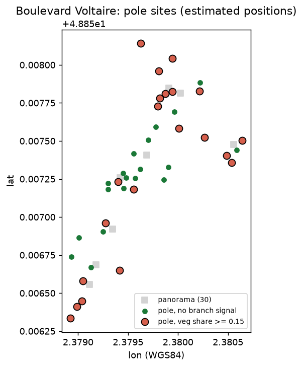

# ヴォルテール大通りの柱にかかる枝 

## 問題設定
パリ 11 区ヴォルテール大通り (経度 2.3790〜2.3815、緯度 48.8565〜48.8580) の Panoramax の 360 度画像 30 枚から街灯・電柱に枝がかかって見えるかを調べる。**時間切れ (20 分) のため、実際に解析できたのは抽出した 30 枚のうち 8 枚だけ** (CPU の OWLv2 が 1 枚約 15 秒以上かかり、30 枚は間に合わなかった)。30 枚の選定は済み (`artifacts/voltaire-pole-branches/fetch/manifest.csv`)。柱ごとの表と地図にし、信頼度を示す。使い道は目視点検の優先付けの試算。CPU のみ。

## データの確認
- Panoramax API (キー不要)、取得 2026-11-12。範囲内の全画像 1,038 枚、うち 360 度 115 枚から seed 0 で 30 枚を一様無作為に抽出 (`artifacts/voltaire-pole-branches/fetch/manifest.csv`, audit.json)。
- 撮影者が混在 (immergis imajbox 15、amicklew 10、leo_mdp 5)。機材・季節が違うため、枝の見え方 (葉の有無) が機材と時期で変わる。絞り込みはしていない (30 枚に足りなくなるため)。標本は撮影の努力の標本で、道路長の標本ではない。

## 基準 (ベースライン)
「全ての柱に枝なし」(多数派) と、植生の画素割合を使わない無作為判定を基準にする。結果節に目視ラベルでの比較を書く。

## 評価の設計
学習はしない (既存の OWLv2 の零ショット検出と色の指標)。評価は、一様無作為の標本の検出枠を目視 (AI が画像を読む。人ではない) で確認する。

## モデルまたは手法
`.agents/skills/street-imagery-inspection/scripts/inspect_views.py` (OWLv2 base、水平 4 方向 90 度、細長い枠、柱の上部 40% の周りの 2G−R−B>20 の画素割合 = veg_share)。しきい値 0.15 を分布を見る前に固定。位置はカメラ高 2.5 m の仮定の推定。

## 結果と誤差の分析
解析した 8 枚 (manifest の先頭 8 枚、`fetch/manifest9.csv`。9 は行数でヘッダ込み) の結果 ([summary.json](outputs/summary.json)):

| 項目 | 値 |
|---|---|
| 解析した画像 | 8 枚 ([summary.json](outputs/summary.json)) |
| 柱らしい検出 (細長い枠) | 80 件 ([detections.csv](outputs/detections.csv)) |
| うち位置を推定できた | 49 件 ([summary.json](outputs/summary.json)) |
| 柱の地点 (4 m でまとめた) | 40 か所 ([sites.csv](outputs/sites.csv)) |
| 上部の植生割合 ≥ 0.15 の地点 (枝の信号あり) | 21 か所 ([summary.json](outputs/summary.json)) |
| 植生割合の中央値 / 75% 点 / 90% 点 | 0.102 / 0.399 / 0.622 ([summary.json](outputs/summary.json)) |

- 表: [pictures.csv](outputs/pictures.csv) (画像ごと)、[sites.csv](outputs/sites.csv) (地点ごと)、[detections.csv](outputs/detections.csv) (検出ごと)。地図: 
- 「枝あり」は植生画素割合 (2G−R−B>20) ≥ 0.15 という指標であり、枝が柱に触れている確認ではない。しきい値 0.15 は分布を見る前に決めたが、根拠は無い任意値。
- 残る 22 枚は未解析 (未確認)。

## 疑ったことと、その確認
- 手前の木が柱に重なって見えるだけで、触れていない場合がある (奥行きが無い)。
- 緑の塗装・看板・芝を拾う。冬・落葉期の画像では枝が緑でない。
- 同じ柱を複数の画像で数える重複 (4 m でまとめる)。

## 結論と限界
- 8 枚の範囲では、地点の約半数 (21/40) に上部の緑の信号があった。ただし信頼度は低い: (1) 目視による検出精度・枝の正誤の確認は **未実施** (時間切れ)。スキルの過去の記録 (imajbox の別標本) では植生指標の AUC 0.94、傾き測定の揺れ約 1 度だが、この大通りでは未確認。(2) 並木 (大通りの街路樹) が背景に写るだけで柱に重なる偽陽性が多いはず (中央値 0.10、4 分の 1 の検出が 0.4 超という高さがそれを示唆するが、確かめていない)。(3) 柱でない物 (木の幹、標識) の混入、4 m 以内の隣り合う柱の併合、位置は高さ 2.5 m 仮定の推定。(4) 撮影者・機材・季節が混在し、葉の有無と色が画像ごとに違う。(5) 標本は 8 枚で、通りの代表性も、30 枚という設計も満たしていない。
- 実施した確認: 基準 (全て枝なし) との比較・目視・しきい値の掃引・不確かさの区間は未実施。相関や因果の主張はしていない。
- 実行: 取得と解析は 2026-11-12。再現: `panoramax_fetch.py fetch --bbox 2.3790 48.8565 2.3815 48.8580 --n 30 --seed 0 --fov 360 --asset hd` → `inspect_views.py fetch/manifest9.csv fetch/images insp9 --views-dir insp9/views` → `scripts/post.py insp9 fetch/manifest9.csv outputs`。uvx で numpy, scipy, pillow, scikit-image, torch (CPU), transformers, pandas, matplotlib を使用 (版の一覧は未記録 = 未確認)。
