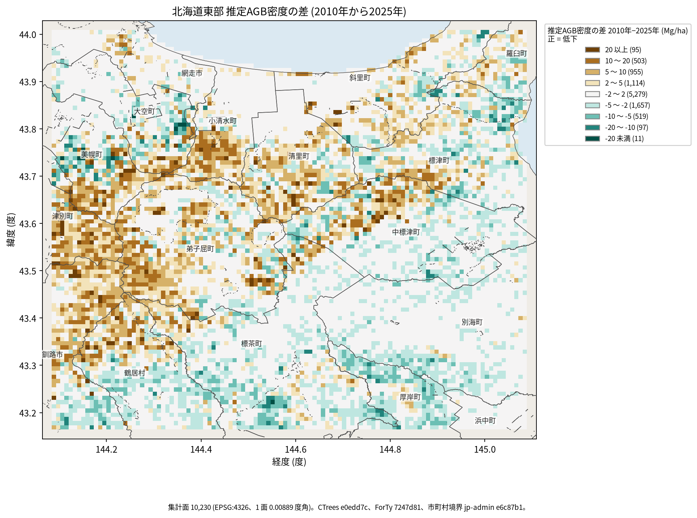
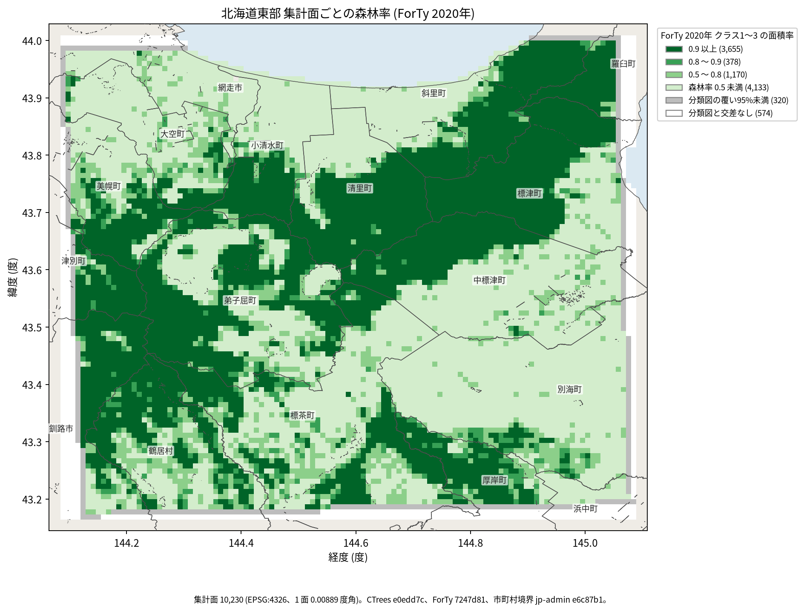
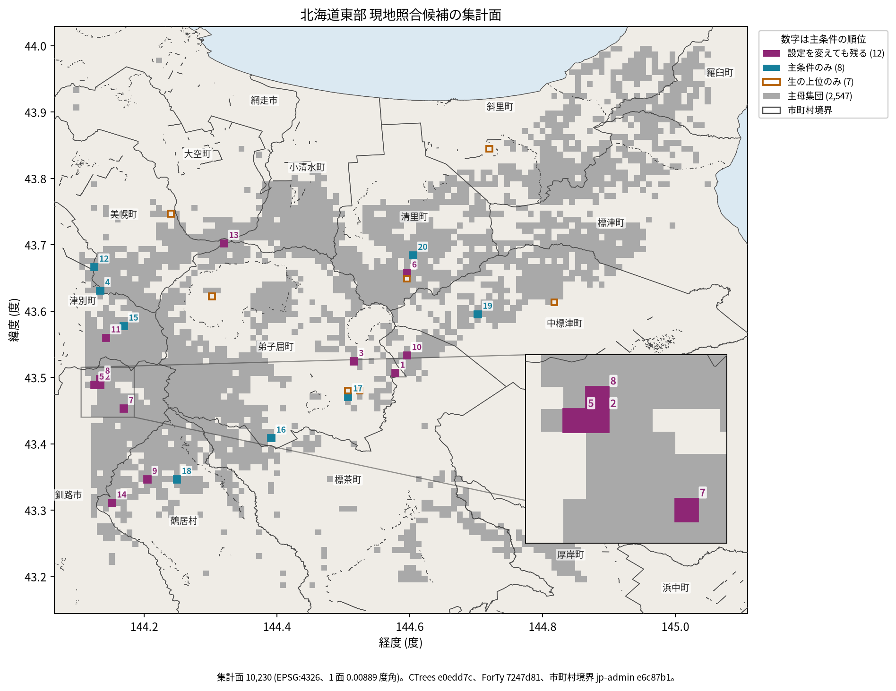

# 東北海道の森林AGB推定低下を現地で確かめる候補

## 問い

2010年と2025年のCTrees推定AGB密度の差から、2020年の森林分類と品質条件を変えても現地照合候補に残る集計面はどこか。

## 結論

### 要点

| # | 要点 | 数字 | 図 |
|---:|---|---|---|
| 1 | 森林分類を条件に入れると、上位の候補が入れ替わる | 生の差の上位20面と、森林率80%以上を条件にした上位20面の共通は13面。7面が入れ替わる | [図 3](#図-3-現地照合候補の集計面) |
| 2 | 分類と品質の設定を変えても残る候補は12面で、西の山地に寄る | 釧路市4、弟子屈町2、鶴居村2、清里町・標茶町・津別町・美幌町が各1。最大は弟子屈町の61.65 Mg/ha | [図 3](#図-3-現地照合候補の集計面)、[表 1](#表-1-主条件の上位5面) |
| 3 | 画素の欠けと不確実性は、上位を動かさない | 両年の有効画素の位置が食い違う面は10,230面で0。不確実性の上位四分位の除外、100画素の条件でも上位20面は20/20一致 | [共通画素監査](outputs/common_pixel_summary.json) |
| 4 | 推定差は場所で固まる。隣の面は独立な調査地点ではない | 2 Mg/ha以上の低下が2,667面、2 Mg/haを超える増加が2,284面、その間が5,279面 | [図 1](#図-1-推定agb密度の差) |
| 5 | 主条件の母集団は、分類図が覆い森林率が高い山地の帯に限られる | 分類図が95%以上を覆う9,336面のうち、森林率80%以上は4,033面。主条件を満たし低下した面は2,547 | [図 2](#図-2-森林率) |

差はどれもCTreesのモデル推定平均の差で、現地で確認した森林減少ではない。

### 読み手ごとに知るべきこと

| 読み手 | 結論 | 検討する材料 | 詳しく |
|---|---|---|---|
| 森林管理者 (現地照合の担当) | 先に見る候補は、設定を変えても残る12面。順位2、5、8は釧路市北部で隣り合い、1つの調査区で回れる | 12面と、森林率の条件で外れた7面 (森林率0.23〜0.79) を、事前に決めた標本として一緒に照合する | [候補の市町村表](outputs/candidate-municipalities.csv) |
| 自治体の森林担当 | 候補は弟子屈町と釧路市北部、鶴居村に多い。中標津町・別海町の平地は分類上の森林が少なく、ほぼ候補にならない | 自分の町の中で、低下 (茶) が固まる場所と候補の位置 | [図 1](#図-1-推定agb密度の差)、[図 3](#図-3-現地照合候補の集計面) |
| データを使う研究者 | 分類図の時点 (2020年) と推定の年 (2010年、2025年) が違う。不確実性の平均は年差の標準誤差ではない | 分類誤差と各年の推定誤差の相関、100m画素や林班の単位での順位 | [論文](paper.md) |

### 図 1: 推定AGB密度の差

茶が推定値の低下、緑が増加。区切りは0を中心に対称な固定値 (±2、5、10、20 Mg/ha)。低下は西の津別町・美幌町・釧路市北部・弟子屈町西部の山地と、小清水町南部、清里町から標津町の帯に固まり、増加は南の標茶町・厚岸町に多い。海と湖の上にも集計面がある。

### 図 2: 森林率

ForTy 2020年のクラス1〜3が面に占める割合。区切りは解析で比べた閾値 (0.5、0.8、0.9)。分類図と交わらない574面 (白) と、覆いが95%未満の320面 (灰) は、森林率0と分けて描いた。森林率0.8以上は、西の山地から清里町・標津町・羅臼町への帯と、南の厚岸町に集まる。

### 図 3: 現地照合候補の集計面

紫は設定を変えても残る12面、青は主条件の上位20面の残り8面、橙の枠は生の上位20面にだけ入る7面。数字は主条件の順位。灰は主条件を満たし低下した2,547面。右下は順位2、5、7、8の付近の拡大。四角は配布集計面 (約0.7〜1.0 km) そのもの。

### 表 1: 主条件の上位5面

| 順位 | 市町村 | 面中心 (東経, 北緯) | 推定AGB差 (Mg/ha) | 森林率 | 設定を変えても残るか |
|---:|---|---|---:|---:|---|
| 1 | 弟子屈町 | 144.5778, 43.5067 | 61.65 | 0.940 | 残る |
| 2 | 釧路市 | 144.1333, 43.4889 | 58.75 | 1.000 | 残る |
| 3 | 弟子屈町 | 144.5156, 43.5244 | 35.14 | 0.987 | 残る |
| 4 | 津別町 | 144.1333, 43.6311 | 34.91 | 0.875 | 主条件のみ |
| 5 | 釧路市 | 144.1244, 43.4889 | 34.89 | 1.000 | 残る |

6〜20位と生の上位のみの7面は [candidate-municipalities.csv](outputs/candidate-municipalities.csv)。

### 読み方で変わる答え

| 読み方 | 主 | 別の読み方 (主の上位20面との共通) |
|---|---|---|
| 森林の条件 | 森林率80%以上 | 条件なし13面、50%以上16面、90%以上16面 |
| 森林の測り方 | 面積率 | 面中心の分類14面 |
| 品質の条件 | 有効画素各80以上 | 各100以上で20面。2025年の不確実性の上位四分位 (50.37 Mg/ha超) を除いても20面 |
| 平均の取り方 | 集計版の平均 | 両年に共通の元画素だけの平均で20面 (差の違いは最大0.00000235 Mg/ha未満) |

## データ

- CTrees AGB 100m の東北海道集計版 `yuiseki/ctrees-agb-hokkaido-east-100m` 版 `e0edd7c`。2010年と2025年、43,550面 (100m画素を10×10で集計)。分類図の外接範囲と交わる10,230面を使った。AGB は乾燥重量の推定 (Mg/ha) で、炭素量ではない。
- ForTy 2020年の東北海道分類版 `yuiseki/forty-hokkaido-east-2020` 版 `7247d81`、63,630面。
- 市町村の境界: `yuiseki/jp-admin-2026-09` 版 `e6c87b1` (地図と市町村表のみ)。
- 両派生物の表示ライセンスは CC BY 4.0。元データの著作者 (CTrees、ForTy の著者) と加工版を区別して表示する。

## 方法

- 両データを等積の EPSG:6933 に変換し、ForTy のクラス1〜3との交差面積率を測った。主条件は、分類図の覆い95%以上、森林率80%以上、両年の有効画素各80以上。推定AGB密度の差 (2010年−2025年) の降順で上位20面を並べた。20面は仮の調査枠。
- 主条件は全件の交差の前に [計画](EXPERIMENT_PLAN.md) で固定した。ただし pilot で一部を見た後なので、全区画を探索として報告する。失敗した実行 (DuckDB の交差がメモリ約15GBで停止、元ラスタの nodata の誤認) も [記録](EXPERIMENT_TRACKER.md) に残した。
- 元の GeoTIFF を SHA256 で照合し、両年に共通の有効画素だけで平均を計算し直した。
- 有意性の検定はしない。不確実性は画素の推定残差の集計で、年差の標準誤差ではないため。隣の面の独立性を仮定する検定と、100m画素や別の格子での順位の掃引 (MAUP) もしていない。
- 地図は解析の出力だけから描き、集計面を四角に戻して市町村の境界を重ねた ([maps.py](scripts/maps.py))。JGD2000 の境界は変換せずに重ねた (WGS84 との差は線の幅より小さい)。
- 再実行は [README.md](README.md)。論文の形は [paper.md](paper.md)。

## 確かめていないこと

- 現地の AGB、伐採や火災などの低下の原因、炭素排出量。
- ForTy の地域での正解率。2020年の分類は、2010年と2025年の森林の状態を保証しない。
- 調査の費用、立入の許可、道からの距離。
- 配布集計面 (約0.7〜1.0 km) より細かい単位での順位。隣の面は独立な調査地点とも限らない。
