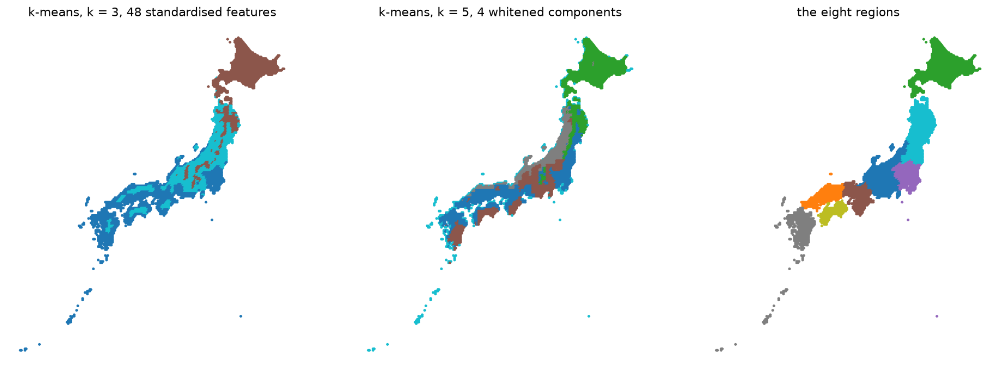
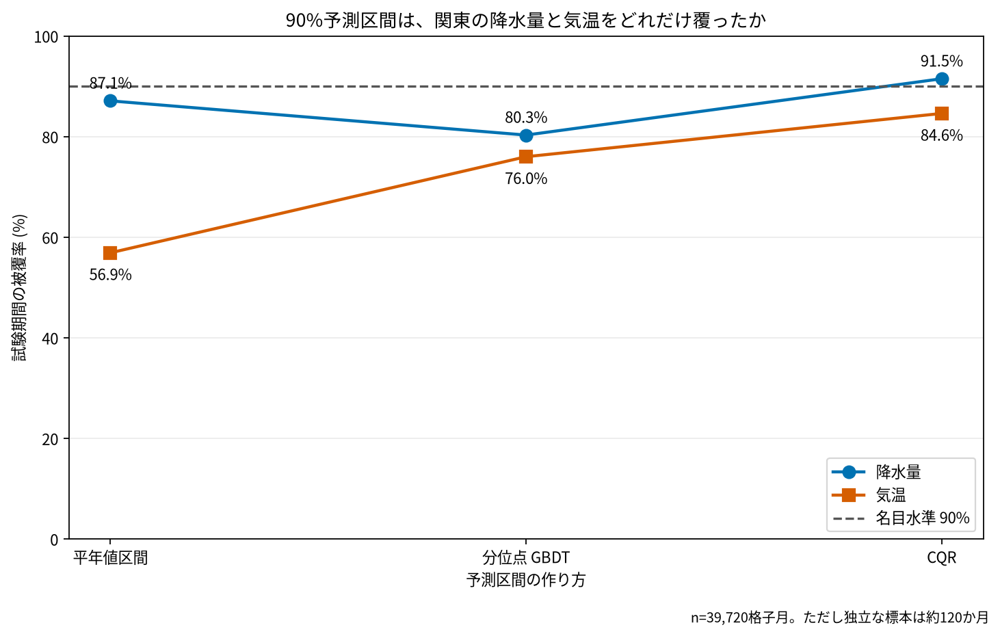

# 日本の月別気候と予測の不確かさ

## 問い

農業や防災の計画に向けて、日本の月別気候の地域差と異常を読み、東京・関東の気温と降水量をどの程度予測し、その不確かさを示せるか。

## 結論

### 要点

| # | 要点 | 数字 | 図 |
|---:|---|---|---|
| 1 | 日本の月別気候は、暖かさ、年間の雨の多さ、冬と夏の雨の差の3つの軸でほぼ読める | 48の月別平年値の分散のうち、第1主成分72.6%、第2 12.4%、第3 5.9%。3つで90.8% | [図 1](#図-1-主成分の地図) |
| 2 | 気候の型は、北の寒い型と南西の暖かい型にまず分かれる。8地方の区分とはあまり合わない | k = 2 のシルエット0.442が最大。8地方との一致 (ARI) は0.300 | [図 2](#図-2-気候の型) |
| 3 | 軸は時代では保たれ、東西では変わる | 1981〜2000年と2006〜2025年で軸の向きの一致0.997、0.991、0.987。東日本と西日本では0.903、0.712、0.811 | [主成分ログ](outputs/national-pca.log) |
| 4 | 東京の月の最高気温は、傾向を扱う手法で平年値より当たる。月の降水量は平年値を上回る手法がほぼ無い | ETS の平均絶対誤差0.96℃、平年値1.46℃ | 移植元の事例 |
| 5 | 関東の90%予測区間は、降水量では名目どおり覆い、気温では足りない | CQR の被覆率は降水量91.5%、気温84.6%。気温の平年値区間は56.9% | [図 3](#図-3-関東の90予測区間の被覆率) |

### 読み手ごとに知るべきこと

| 読み手 | 結論 | 検討する材料 | 詳しく |
|---|---|---|---|
| 農業の計画の担当 | 気温の月の見込みは、平年値でなく傾向を入れた予測と、その区間で見る。平年値の区間は気温の6割足らずしか覆わない | 基準期間と傾向、月ごとの外れ方 | [図 3](#図-3-関東の90予測区間の被覆率) |
| 防災の担当 | 月の降水量は平年値より良い予測がほぼ無い。区間 (CQR) は全期間で91.5%を覆うが、月ごと、地域ごとの保証ではない | 日単位の豪雨は、この分析の外 | [図 3](#図-3-関東の90予測区間の被覆率) |
| 地域の気候を比べる担当 | 地方の区分でなく、気候の型と主成分の得点で比べる。東西で軸が変わるので、地域を分けたら軸を作り直す | 型の境 (東北と中部の山地、日本海側) | [図 1](#図-1-主成分の地図)、[図 2](#図-2-気候の型) |

### 図 1: 主成分の地図

第1主成分 (73%) は暖かさで、北海道が負、九州・沖縄が正。第2主成分 (12%) は年中の雨の多さで、北陸から中部の日本海側と紀伊半島が正。第3主成分 (6%) は冬の雨と夏の雨の差で、日本海側の沿岸が正 (冬に雨と雪が多い)。色の向き (正と負) は主成分の符号の取り方で決まり、意味は上の読み方による。

### 図 2: 気候の型

左は48の特徴で分けた3つの型、中は4つの主成分で分けた5つの型、右は8地方。3つの型は、北海道を中心とする寒い型 (1,183格子、1月の最高気温−3.9℃)、南西の暖かい型 (1,418格子)、東北と中部の雨の多い型 (1,244格子、年1,978 mm)。図には型の名前の凡例が無い。型の中身は [気候型ログ](outputs/national-types.log) で読む。2つの時代で同じ数の型を作ると、型が変わる格子は4.6%。

### 図 3: 関東の90%予測区間の被覆率

試験期間 (2016〜2025年) に、実測が区間に入った割合。90%に届くのは降水量の CQR (91.5%) だけ。気温では較正しても84.6%で、較正期間 (2011〜2015年) の外れ方を後の年にそのまま移せない。39,720の格子月は独立ではなく、移植元は有効な時間の単位を120か月ほどとしている。

### 読み方で変わる答え

| 読み方 | 主 | 別の読み方 |
|---|---|---|
| 型の数 | k = 3 (k = 2 も記述) | シルエットは k = 2 で最大 (0.442)。4つの主成分で分けると k = 5 が最大で、48の特徴の k = 5 との一致は0.451 |
| 比べる時代 | 1991〜2020年の平年値 | 後の時代の平年値を前の時代の型に当てると、12.1%の格子が別の型に入る |
| 地域 | 日本全体の軸 | 東日本だけでは全体とほぼ同じ軸 (0.996、0.991、0.964)、西日本とは第2の軸が変わる (0.712) |
| 予測区間 | CQR | 平年値区間は降水量87.1%、気温56.9%。分位点 GBDT は80.3%、76.0% |

## データ

- FAO FERSPAS の AgERA5 月別データ。約10 km、1979年1月〜2025年12月。配布データの版は未確認。
- 降水量、基準蒸発散量、日最高気温、日最低気温。日本3,845格子、関東331格子、東京23区にかかる9格子。4変数564か月に欠測は無い。海として扱われる5格子を除いた。
- 移植元: [`study-geoai-algo-py` 事例006 (commit 6880b32)](https://github.com/yuiseki/study-geoai-algo-py/blob/6880b32c097a7c65a6bd72a38682ce1dce1c9a2b/case-studies/006-japan-climate/README.md)。

## 方法

- 48の月別平年値 (4変数 × 12か月、1991〜2020年) を標準化して主成分分析し、平行分析で4つの成分を残した。k-means (k = 2〜10、5つの seed) で型を作り、シルエットと8地方との一致で比べた。異常月は Isolation Forest と LOF で比べた。
- 東京の予測は、平年値、季節ナイーブ、ETS、SARIMA、GBDT、TimesFM を時系列の分け方で評価した。関東の予測区間は、学習1980〜2010年、較正2011〜2015年、試験2016〜2025年に分け、平年値区間、分位点 GBDT、CQR を比べた。
- 全国の主成分と気候の型は、固定した元のコードで実行し直した ([主成分ログ](outputs/national-pca.log)、[気候型ログ](outputs/national-types.log))。東京と関東の予測は実行し直していない。被覆率は元の事例の値を [source-values.csv](outputs/source-values.csv) に写し、[plot.py](scripts/plot.py) で描いた。

## 確かめていないこと

- 東京と関東の予測の数字 (ETS の誤差、被覆率) は、元の事例の値を写したもので、ここでは計算し直していない。
- 月ごと、地域ごとの被覆。90%は全期間の割合で、各月や各地域への保証ではない。
- 日単位の豪雨、ENSO などの外部の気候指標、最近の期間だけで較正したときの改善。
- 図 1 と図 2 は元のコードの図で、型の名前の凡例と地名が無い。
