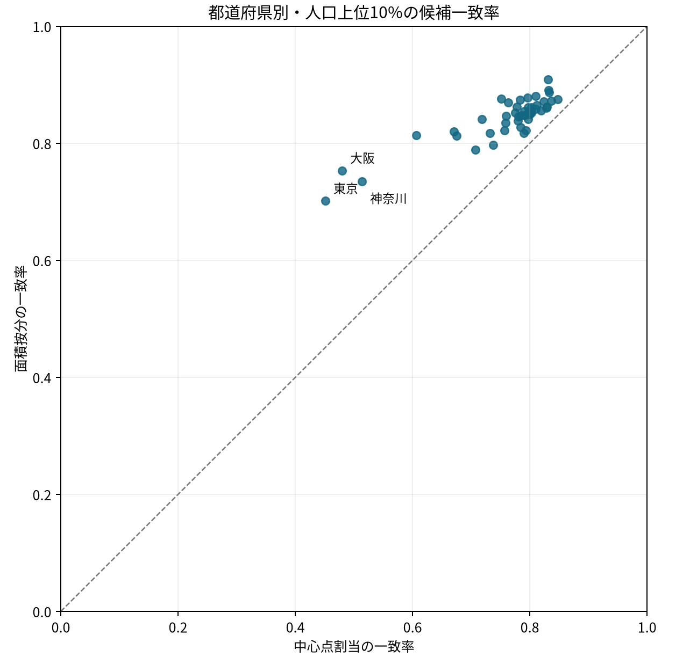

# 全球格子人口を日本の国勢調査メッシュの代用にしたときの候補地区選定の整合性

## 要旨

詳細な人口統計が使えない地域で全球格子人口を現地調査候補の一次選定に用いる場合、地域全体の人口が近くても候補地区が一致するとは限らない。本研究は、日本の2020年国勢調査の第3次地域メッシュ人口を比較対象に、GHSL R2023A E2020 の30秒角人口を面積按分または画素中心点で割り当てたときの人口上位候補の一致を調べた。探索済みの都心100メッシュを除く174,900メッシュで、上位10%の一致率は面積按分0.8748、中心点割当0.8254だった。面積按分の優位は候補割合と人口下限を変えても保たれたが、東京周辺の土地被覆との対応は空間依存と集計単位に敏感だった。この結果は固定版・有人メッシュでの代用時の整合性であり、独立した人口推定精度や業務上の採否を判定するものではない。

## 1. はじめに

現地調査の候補地区を人口で絞る際、国ごとに粒度や公開条件の異なる統計を集める代わりに、全球で同じ形式の人口格子を使いたくなる。ただし、候補集合の一致は人口総量の一致からは導けない。さらに、日本の第3次地域メッシュは緯度30秒・経度45秒である一方、今回の GHSL は緯度・経度とも約30秒角であり、格子をどう重ねるかも選定結果に入る。[総務省統計局の地域メッシュの説明](https://www.stat.go.jp/data/mesh/m_tuite.htm)、[GHSL の製品案内](https://human-settlement.emergency.copernicus.eu/datasets.php)。

研究の問いは、国勢調査2020のメッシュ人口を GHSL E2020 で代用したとき、人口上位の現地調査候補がどの程度一致し、その答えが格子変換法・候補数・対象人口の下限で変わるか、である。事前の[実験計画](EXPERIMENT_PLAN.md)では、面積按分と中心点割当を同じ候補集合で比較し、東京の既知の100メッシュを主評価から除くことを定めた。補助的に、東京周辺で市街地分類の割合と人口差の対応を見る。関連研究は十分に調査していない。本稿の貢献は、新規の人口推定手法ではなく、固定版の格子を代用するときの候補集合のずれと、その読み方の限界を追跡可能にしたことである。

## 2. データ

表1. 実際に使用した固定版。列と件数の監査は[全国出力](outputs/full-summary.json)と[土地被覆出力](outputs/landcover-summary.json)に記録した。

| 資料 | 時点・粒度 | 使用した版と量の意味 |
|---|---|---|
| 総務省統計局「令和2年国勢調査に関する地域メッシュ統計」 | 2020年10月1日、JGD2011の第3次地域メッシュ | [HF変換版 `T001140`、`6c486c8…`](https://huggingface.co/datasets/yuiseki/estat-census-mesh-2020/tree/6c486c8649484e09e549c0c99b5fa89b4f416edb)。`T001140001` は常住人口総数 |
| 欧州委員会 JRC、GHS-POP R2023A | E2020、EPSG:4326の30秒角セル | [HF変換版の人口5タイル、`4ee7674…`](https://huggingface.co/datasets/yuiseki/ghsl-japan-core-2020-30arcsec/tree/4ee767429ee03ea47a9003c547f92c320474e350)。`population_estimate` はセルの推計居住人数 |
| ESA WorldCover 2021 v200 | 2021年の10 m分類を100 mセルへ集計 | [HF東京周辺変換版、`6f006f6…`](https://huggingface.co/datasets/yuiseki/esa-worldcover-tokyo-2021-100m/tree/6f006f64483b65b20f06c775b87db7a8d57a6fda)。クラス50の画素数は市街地分類で、住民数ではない |

国勢調査入力は177,861行で、都道府県境にかかる897コードの人口を合算すると176,964メッシュコード、総数126,146,099人となった。[統計局の結果概要](https://www.stat.go.jp/data/mesh/r2_w.html)にある統計を元にしたが、この比較では公開されたメッシュ値そのものを完全な個人単位の真値とは置かない。[全国監査](outputs/full-summary.json)のとおり、GHSLの固定5タイルに全域が入り人口が正のものは175,000メッシュ、範囲外は1,964メッシュである。既知の都心pilot100メッシュを除いた174,900メッシュを主評価対象とした。範囲外の国勢調査人口は1,574,690人で、範囲外を推計人口0としていない。人口0の未収録セルも候補集合に含めない。

GHSL の公式説明では、GHS-POP は国勢調査・行政区別人口を建物分布等の情報で格子に細分した推計である。したがって今回の国勢調査との比較は、完全に独立した外部検証ではない。[JRC の製品説明](https://human-settlement.emergency.copernicus.eu/ghs_pop2023.php)。東京周辺の補助分析は東京都の行政境界ではなく、WorldCover 変換版の東経139.5〜140.0度、北緯35.5〜36.0度の矩形に完全に入る1,899メッシュで行った。土地被覆は2021年、人口は2020年という時点差がある。[土地被覆の結合監査](outputs/landcover-summary.json)。

## 3. 方法

### 3.1 格子の対応づけ

国勢調査の8桁メッシュコードを経緯度の矩形に復元し、経度・緯度順を固定した。GHSLの各セルは人口という加算可能な量を持つため、主法では各セルの人数を重なる面積に比例してメッシュへ配分した。面積は経緯度の度数や Web メルカトルではなく、等積投影 EPSG:6933 で計算した。比較法では GHSL セルの中心点が国勢調査メッシュ内にあるとき、そのセルの人数を全量割り当てた。これは「国勢調査メッシュの中心にあるGHSL値を読む」方法ではない。[実装](scripts/analyze.py)、[入力・面の監査](outputs/full-summary.json)。

```math
\widehat{P}^{\mathrm{area}}_m=\sum_c P_c\frac{A(c\cap m)}{A(c)},\qquad
\widehat{P}^{\mathrm{center}}_m=\sum_{c:\,x_c\in m}P_c.
```

ここで $P_c$ は GHSL セル $c$ の推計人数、$x_c$ は同セルの中心点、$A$ は EPSG:6933 上の面積、$m$ は国勢調査メッシュである。面積按分は各セル内の人口が一様に分布する仮定を置き、実際の住居位置を復元しない。合成格子で面積の保存・重複の検出をテストし、実データでは格子原点・セル数・入力人口合計を確認した。[合成テスト](scripts/test_analyze.py)、[全国監査](outputs/full-summary.json)。

### 3.2 候補の評価

同じ評価対象集合で、国勢調査人口と各 GHSL 割当人口を別々に並べ、上位 $k=\lceil qN\rceil$ 件の重なりを $|T_{\mathrm{census}}\cap T_{\mathrm{GHSL}}|/k$ とした。同点はメッシュコードの昇順で決めた。主設定は $q=0.10$、比較する候補割合は0.05と0.20。追加の診断では国勢調査人口が100人以上、1,000人以上の集合だけで順位を付け直す。人口下限は比較対象の国勢調査値で決めているため、GHSLだけで実施できる運用方法ではない。[計画](EXPERIMENT_PLAN.md)、[実装](scripts/run_analysis.py)、[下限診断](outputs/population-sensitivity.json)。

東京周辺では、WorldCover のクラス50（市街地）の有効10 m画素数に占める割合を面積交差でメッシュへ移し、$|\log(1+\widehat{P}^{\mathrm{area}}_m)-\log(1+P^{\mathrm{census}}_m)|$ との対応を記述した。`1+` の値は人数単位であり、差の指標をゼロ人口付近でも定義するためのもの。層別は実行時に0〜25%、25〜50%、50〜75%、75〜100%の固定幅とした。これは計画に記した四分位ではなく、[実験記録](EXPERIMENT_TRACKER.md)に逸脱として残した。補助診断として、球面上の4・8・12近傍、行標準化重み、999回の並べ替えで両変数の Moran's I を測った。さらに完全な2×2、4×4、8×8メッシュ集合を作り、原点の半区画移動でも同じ相関を比べた。具体的な近傍数・格子幅は主結果の後に決めた探索的設定である。[空間診断](outputs/spatial-diagnostics.json)。

## 4. 結果

### 4.1 全国の候補集合

表2. 同じ174,900メッシュで選ぶ上位集合と国勢調査上位集合の重なり。各行の候補数は[全国出力](outputs/full-summary.json)に保存した。

| 候補割合 | 候補数 | 面積按分の一致数・率 | 中心点割当の一致数・率 |
|---:|---:|---:|---:|
| 5% | 8,745 | 7,330、0.8382 | 6,641、0.7594 |
| 10% | 17,490 | 15,300、0.8748 | 14,437、0.8254 |
| 20% | 34,980 | 30,964、0.8852 | 29,766、0.8509 |

人口の合計は評価対象で国勢調査122,726,894人、GHSLの面積按分119,584,495人で、比は0.9744だった。面積按分のメッシュごとの平均絶対差は206.0人、中心点割当は293.2人。合計の近さと候補集合の一致率は別の性質である。[全国の `metrics` と `rankings`](outputs/full-summary.json)。

都道府県内でそれぞれ上位10%を選ぶと、集計対象の46都道府県すべてで面積按分の一致率が中心点割当を上回った。これは全国上位10%の集合を県別に分解した値ではない。東京都は0.7014対0.4514、神奈川県は0.7348対0.5138、大阪府は0.7533対0.4800で、都市部でも格子対応づけの選択が大きい。[都道府県別の保存結果](outputs/full-summary.json)。



図1. 横軸は中心点割当、縦軸は面積按分。46都道府県の同一県内での上位10%を比較した。破線は一致率が等しい場合。入力と表示条件は[図の来歴](outputs/prefecture-recall.json)。

### 4.2 対象人口と東京周辺の補助結果

人口100人以上に限ると上位10%一致率は面積按分0.8368、中心点0.7574、1,000人以上では0.8124対0.6645だった。向きは維持されたが、条件付きの値は主設定より低い。探索済み都心100メッシュの上位20件は面積按分8件、中心点6件の一致で、これを主結果の独立な確認とは扱わない。[人口下限](outputs/population-sensitivity.json)、[pilot](outputs/pilot-summary.json)。

東京周辺の1,899メッシュでは、市街地割合が25%未満の115メッシュで絶対対数差の中央値は0.731、75%以上の1,084メッシュでは0.182だった。ただし絶対人数差の中央値は同じ順に298人、2,190人で、差の尺度だけで印象が逆になる。100人以上に限定しても対数差の層別方向は残った。[土地被覆の層別結果](outputs/landcover-summary.json)。

## 5. 頑健性と限界

主結果では候補割合5%・10%・20%と人口下限100人・1,000人のいずれでも面積按分が中心点割当を上回った。一方、都道府県内の一致率には地域差があり、特に東京などの値を全国平均で代表させられない。固定5タイルの範囲外、人口0の未収録セル、別の GHSL 版、別の人口推計法、異なる選定費用や許容閾値は評価していない。評価集合を作るために国勢調査人口を使っているので、この手順をそのまま国勢調査のない地域に移せない。[全国出力](outputs/full-summary.json)、[実験計画](EXPERIMENT_PLAN.md)。

東京周辺では市街地割合の Moran's I は近傍数4・8・12で0.666・0.615・0.571、絶対対数差は0.430・0.329・0.282だった。いずれも近隣の値が似るため、各メッシュを独立標本とみなす通常の相関検定や区間は用いなかった。1km格子の相関は −0.341、完全な2×2格子は原点を変えて −0.427 と −0.423、4×4格子では −0.410 と −0.289 だった。8×8格子では15・17区画に減り、+0.226と −0.274 に分かれた。粗い尺度への一般化は支持されない。完全区画のみを残すため尺度ごとに範囲も変わり、単位の効果と対象集合の変化を分離できていない。[空間診断](outputs/spatial-diagnostics.json)。

GHSL は国勢調査・行政統計と建物情報を用いるため、両資料の差を独立な推定誤差と呼べない。セル内一様という面積按分の仮定も検証できていない。WorldCover の市街地分類には分類誤差があり、2021年の値を2020年の人口差の原因と読めない。[JRC の製品説明](https://human-settlement.emergency.copernicus.eu/ghs_pop2023.php)、[ESA WorldCover 2021 v200 の製品資料](https://esa-worldcover.org/en/data-access)。

## 6. 考察

この比較で面積按分は候補選定の整合性を改善したが、人口分布をより正確に復元したとまでは言えない。方法間の差には、GHSLと国勢調査の格子原点、画素内一様という配分、地域ごとの人口集中の違いが重なり得る。さらに、土地被覆の市街地率は都市性や人口規模の代理でもある。東京周辺の層別傾向に対して、分類誤差・人口分母の差・地域構成という別の説明を排除していない。関連研究は十分に調査していない。

現地調査で使うなら、候補割合と見逃しの費用を利用者が別途決め、対象地域のメッシュ統計または現地情報で候補を再確認する必要がある。本研究はその運用判断の基準値を与えず、固定版に対する「どれほど候補が入れ替わるか」の記述を与える。

## 7. 結論

GHSL E2020 を国勢調査2020の有人3次メッシュ人口の代わりに使うと、固定タイル内の主評価集合では上位10%候補の一致率が面積按分0.8748、中心点割当0.8254となった。格子の合わせ方は候補集合を左右する。土地被覆との対応は探索的で尺度依存があり、誤差の原因や政策効果を示さない。独立な推定精度、無人メッシュ、実際の業務上の採否は今後の確認課題として残る。

## 参考文献・データ出典

- 総務省統計局（2022）「[令和2年国勢調査に関する地域メッシュ統計](https://www.stat.go.jp/data/mesh/r2_w.html)」。本稿では上記HF固定版の `T001140` を使用。
- Schiavina, M., Freire, S., Carioli, A., MacManus, K.（2023）[GHS-POP R2023A - GHS population grid multitemporal (1975–2030)](https://human-settlement.emergency.copernicus.eu/ghs_pop2023.php)、European Commission JRC、doi:10.2905/2FF68A52-5B5B-4A22-8F40-C41DA8332CFE。本稿では E2020 のHF固定版を使用。
- Pesaresi, M. ほか（2024）[Advances on the Global Human Settlement Layer by joint assessment of Earth Observation and population survey data](https://doi.org/10.1080/17538947.2024.2390454)、*International Journal of Digital Earth*。JRC が GHSL の利用時に求める[参照論文](https://human-settlement.emergency.copernicus.eu/GHSLhowToCite.php)。本文では未確認の細部をこの論文に帰していない。
- Zanaga, D. ほか（2022）[ESA WorldCover 10 m 2021 v200](https://doi.org/10.5281/zenodo.7254221)、[ESA のデータと引用案内](https://esa-worldcover.org/en/data-access)。本稿ではHF東京周辺の集計版を使用。

本稿の Parquet は元資料を変換した派生版である。GHSL と ESA WorldCover は CC BY 4.0 に基づき出典・改変の表示を要する。[GHSL の利用条件](https://human-settlement.emergency.copernicus.eu/GHSLhowToCite.php)、[ESA の利用条件](https://esa-worldcover.org/en/data-access)。本稿の結果は元の製品提供者による承認を意味しない。
