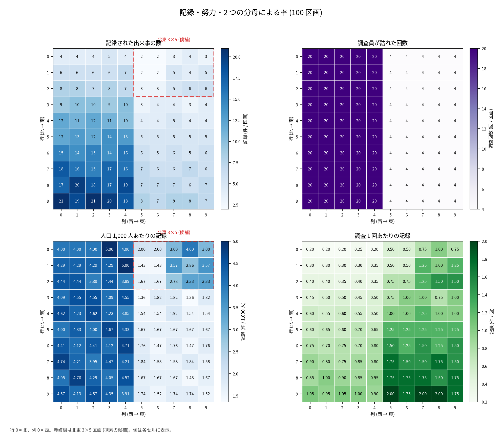
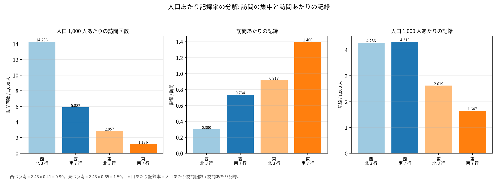
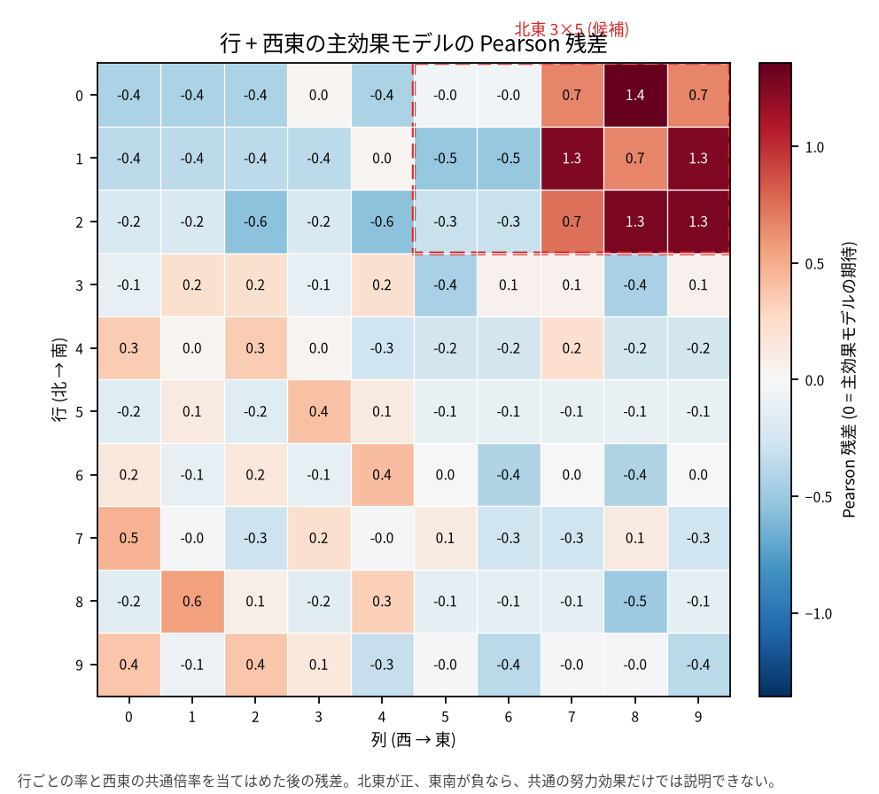

# 記録の多さと発生の多さ: 100 区画の分析

## 問い

この 100 区画 (提供された `units.csv`、1 行 = 1 区画) の記録から、人口あたりの発生が多い地域はどこか。対象はこの 100 区画だけ。

## 結論

この記録だけでは、発生が多い地域を一意に決められない。生の記録が多い南西は、人口と調査回数の多さで説明できる。東の中で北東の記録率が高いが、それも人口あたりの訪問回数の多さで説明できる。優先順位を生の記録数で決めない。

### 要点

| # | 要点 | 数字 | 図 | 区分 |
|---:|---|---|---|---|
| 1 | 西の記録の多さは、調査の多さと揃う | 記録 西604件、東251件 (2.41倍)。訪問 西1,000回、東200回 (5.0倍)。記録/回は東1.255、西0.604 ([summary.json](outputs/summary.json)、[evidence.txt](outputs/evidence.txt)) | [図 1](#図-1-記録調査率の地図) | 確認 |
| 2 | 南西の記録の多さは、人口の多さで説明できる | 西の行ごとの人口あたり記録率は4.200〜4.429 (最大/最小1.05)。人口は行で1,000〜4,600人 ([evidence.txt](outputs/evidence.txt)、[row_rates.csv](outputs/row_rates.csv)) | [図 2](#図-2-行ごとの人口あたり記録率) | 確認 |
| 3 | 東の中では、北東3行の人口あたり記録率が南7行の1.59倍 | 北東2.619、東南1.647 (1,000人あたり)。並べ替え p = 0.0083、95%区間1.16〜2.15。西の同じ比は0.99 ([summary.json](outputs/summary.json)) | [図 2](#図-2-行ごとの人口あたり記録率)、[図 4](#図-4-主効果モデルの残差) | 探索 |
| 4 | 北東の1.59倍は、人口あたりの訪問の多さ (2.43倍) と訪問あたりの記録の少なさ (0.65倍) の積 | 北東は1,000人あたり2.857回、東南は1.176回訪問 ([summary.json](outputs/summary.json)) | [図 3](#図-3-記録率の分解) | 探索 |
| 5 | 西と東のどちらで発生が多いかは、検出の仮定で逆になる | 真の西東比は、線形検出0.48、共通の飽和検出1.00、完全検出2.41 ([summary.json](outputs/summary.json)、[detection_models.csv](outputs/detection_models.csv)) | [表 1](#読み方で変わる答え) | 確認 |

確認は流す前に比べ方を決めた比較、探索は表を見てから足した比較 ([計画](EXPERIMENT_PLAN.md)、[記録](EXPERIMENT_TRACKER.md))。

### 読み手ごとに知るべきこと

| 読み手 | 結論 | 検討する材料 | 詳しく |
|---|---|---|---|
| 対策の優先順位を決める担当 | 人口あたりのリスクで選ぶなら北東 (東の row 0〜2) が確認待ちの候補。ただし弱い候補。件数で選ぶなら南西と南東だが、人口と調査回数の効果を含む | 人口あたりと件数で、優先する地域が逆になる (北東/東南は面積あたり0.65倍) | [図 2](#図-2-行ごとの人口あたり記録率) |
| 調査を設計する担当 | このデータでは発生と検出を分けられない。確かめるには、訪問回数を人口に比例させる、同じ区画を繰り返し調べる、検出率を別に測る、のどれかが要る | 東西で訪問回数だけを揃えても、人口が違えば人口あたりの努力は揃わない | [図 3](#図-3-記録率の分解) |

### 図 1: 記録、調査、率の地図

左上が観測記録、右上が調査回数、左下が人口1,000人あたり記録率、右下が記録/回。赤枠は北東の3×5区画。row は北から南、col は西から東で、座標系は与えられていないので格子の番号で描いた。生の記録は南西で多いが、調査は西で多い。記録/回は東で高い。

### 図 2: 行ごとの人口あたり記録率

誤差棒は Poisson の正確な95%区間。西は4.200〜4.429でほぼ一定。東は北3行が2.556〜2.800、南7行が1.615〜1.684で、北東の3行だけが高い。行を1つずつ抜いても比は1.556〜1.619、行のブートストラップの95%区間は1.54〜1.70。差は北の端に寄り、row 0〜1 だけなら2.67。

### 図 3: 記録率の分解

人口あたり記録率 = 人口あたりの訪問回数 × 訪問あたりの記録。東の北/南は2.43倍 × 0.65倍 = 1.59倍、西の北/南は2.43倍 × 0.41倍 = 0.99倍。同じ回数の訪問でも、人口の少ない北では人口あたりの訪問が多い。この分解は記録の恒等式で、発生や検出の因果の分解ではない。

### 図 4: 主効果モデルの残差

行と西東の主効果の Poisson モデル (M6) の残差。北東が正、南東が負で、主効果では説明できない高さと低さが残る。北東の項を足すと1.60 (95%区間1.10〜2.33)。残差の Moran's I は rook 0.473、queen 0.509 (p = 0.0001) で、空間の構造は残る。行ごとの西/東の比は [row_ratio_plot.png](outputs/row_ratio_plot.png)。

### 読み方で変わる答え

| 読み方 | 主 | 別の読み方 |
|---|---|---|
| 分母 | 人口あたり: 北東/東南1.59倍 | 面積あたり: 北東3.667、東南5.600件/km² で0.65倍 (東南の記録196件、北東55件)。訪問あたり: 0.65倍 |
| 検出の仮定 (西東比) | 決めない | 線形検出0.48 (東が多い)、共通の飽和検出1.00 (同じ)、完全検出2.41 (西が多い)。20回と4回の2水準では分けられない |
| 北東の範囲 | row 0〜2 | row 0〜1 で2.67、row 2〜3 で2.05、南の組は1.64〜1.67 |
| モデル | Poisson (過小分散、区間は広め) | 負の二項は収束しなかった |

## データ

- 提供された `data/units.csv` (2026-10-25 受領、版は未確認)。100行、1行は1 km² の区画。列は `unit_id, row, col, area_km2, population, survey_visits, observed`。欠損0、除いた行は無い。
- col 0〜4 が西 (訪問20回)、col 5〜9 が東 (訪問4回)。人口は行ごとに1,000〜4,600人で、東西とも合計14万人。
- 座標系、出来事の定義、調査期間、重複の扱い、訪問の割り当ての理由はデータに無い。

## 方法

- 主の読み方は人口あたりの記録率 (記録 / 人口 × 1,000)。人口を発生の機会、調査回数を観測の努力として分けた。調査回数と記録率の Spearman は0.861、調査回数と人口は0.000。
- 人口を offset にした Poisson GLM (M1〜M6b)。率の比は条件付き二項の正確な区間。北東の比は、10行から3行を選ぶ全120通りの並べ替えで検定した。行と区画を抜く感度、行のブートストラップ (10,000回)、2行の集約も見た。
- 検出の模型は、線形、完全検出、共通の飽和検出の3つ。どれも西東の集計に合う。
- 空間は rook と queen の Moran's I (9,999回の置換)。局所の Moran、GWR、空間の交差検証はしていない。予測と一般化が問いではないため。
- 北東の比較 (C2) は表を見てから示唆されたので探索。計画から変えたこと (並べ替えの p の計算、行の率の分母、ブートストラップの追加) は [記録](EXPERIMENT_TRACKER.md) に残した。
- Python 3.12、statsmodels 0.15.0 ほか。[analysis.py](scripts/analysis.py)。数字は [evidence.txt](outputs/evidence.txt)、主な結果は [summary.json](outputs/summary.json)。

## 確かめていないこと

- 記録の数が発生の数か。出来事の定義、調査期間、重複、観測されなかった発生がデータに無い。
- 行や人口で変わる検出率。繰り返しや独立の観測が無いので、北東の差が発生の差か検出の差かを分けられない。
- 訪問の割り当ての理由。発生の多い所に多く訪問したなら、調査回数は努力であり発生の結果でもある。
- 区画ごとの順位。1区画の記録は少なく、行や3×5のまとまりより細かい順位は支持できない。
- この100区画の外への一般化と、対策の効果。
