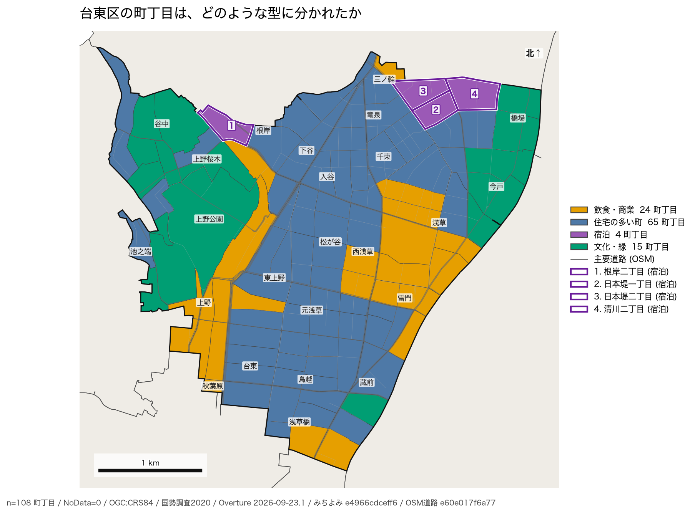
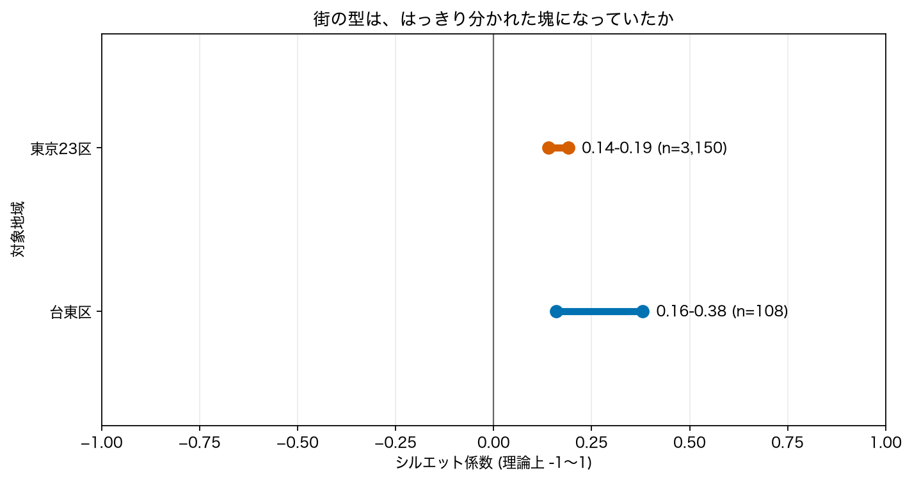

# 東京の街の「型」は単位と特徴量でどう変わるか：町丁目・1km格子・街路画像による探索的比較

## 要旨

地域施策の対象を選ぶ前に、正解ラベルのない地域データから街の違いを把握できるかを検討した。台東区の国勢調査町丁目108地区、東京23区の約1km格子631個、台東区の街路画像を集約した約250m格子173個を対象に、固定版の元事例を用いてk-meansと主成分分析（PCA）の地図を再生成した。台東区の町丁目は4群に分かれ、宿泊に特徴のある群は4地区だった。一方、23区全体で分類した格子のうち台東区に接する18格子中15格子は同じ「都心寄りの混在地」に入った。街路の第一主成分は標準化した12特徴量の分散の約41%を説明した。これらは異なる単位・特徴量で得た記述であり、単位だけの効果を分離した比較ではない。類型は調査候補の下見には使えても、地区の本質的な属性や施策効果を示すものではない。

## 1. はじめに

商業、住宅、宿泊、緑などが混在する都市で、施設配置や現地調査の対象を選ぶには、地区ごとの違いを把握する必要がある。ただし、教師なし分類が出す群には外部の「正解」がない。本稿の問いは、東京の街の違いを表す分類が、町丁目・約1km格子・街路画像という観測単位と特徴量の取り方の下でどう見えるか、またその結果を地域施策の下見にどこまで使えるかである。推定対象は個人の属性でも政策介入の効果でもなく、指定したデータ版と分類条件における地区・格子の記述である。

本稿は[移植元の事例004（固定コミット）](https://github.com/yuiseki/study-geoai-algo-py/blob/6880b32c097a7c65a6bd72a38682ce1dce1c9a2b/case-studies/004-town-types/README.md)を、[このprojectの再現手順](README.md)と保存済みの図・数値から論文化した。町丁目・約1km格子・街路PCAの3枚の地図は2026年10月23日に元コードの固定コミットから再生成した。他手法との比較値は移植元の2026年9月29日の実験記録に依拠し、今回独立に再計算した値ではない。事前登録された仮説検証ではなく、結果を見た後に整理した探索的分析である。関連研究は十分に調査していないため、方法論上の新規性は主張しない。

## 2. データ

表1. 観測単位と、今回保存した再生成物。件数と版は[再生成スクリプト](scripts/reproduce_maps.py)・各図の来歴JSONに対応する。

| 対象 | 主な入力と版 | 採用単位 | 保存した出力 |
|---|---|---:|---|
| 台東区の町丁目 | 国勢調査2020、Overture Places/Buildings 2026-09-23.1、みちよみ `e4966cdceff6` | 108町丁目 | [分類地図と来歴](outputs/taito-town-types.json) |
| 東京23区の格子 | WorldPop R2025A、Overture 2026-09-23.1、みちよみ `e4966cdceff6`、OpenCelliD 2024-06-14 | 中心が23区内の631格子 | [分類地図と来歴](outputs/tokyo23-grid-types.json) |
| 台東区の街路 | みちよみ `e4966cdceff6` の画像由来特徴。撮影年は1970～2026年が混在 | 撮影30枚以上の173格子 | [PCA地図と来歴](outputs/taito-street-pc1.json) |

町丁目の国勢調査値は観測の集計値だが、POIのカテゴリ、建物被覆、街路画像から推定した設備・景観指標、WorldPopの人口、OpenCelliDの基地局記録は測定・推計・投稿の過程が異なる。特に画像特徴は設備台帳による実測ではない。格子は日本の第3次地域メッシュを約1km格子と呼び、街路の格子はみちよみのIDから復元した約250mの区画である。両者も町丁目も同一の観測単位ではない。使用した地図の表示座標系はOGC:CRS84（経度、緯度）。元コードでは面積に楕円体上の計算を使い、経緯度の度を面積にしていない。

元事例の[町丁目の記録](https://github.com/yuiseki/study-geoai-algo-py/blob/6880b32c097a7c65a6bd72a38682ce1dce1c9a2b/src/005-A-k-means/README.md)によれば、人口とPOIがともにない地区は除外され、23区の町丁目では無電柱化割合97地区、緑89地区などの欠損を中央値で補った。[格子の記録](https://github.com/yuiseki/study-geoai-algo-py/blob/6880b32c097a7c65a6bd72a38682ce1dce1c9a2b/src/005-C-grid-types/README.md)では、POI割合8格子、無電柱化割合10格子、緑7格子を中央値で補った。これは観測がないことを値0と置く操作ではない。元データの粒度別ファイルはGitに複製しておらず、個々の入力行と除外行の一覧は本稿の保存成果物からは監査できない。再現には固定コミットの読込処理と公開データへのアクセスが要る。

街路特徴は、みちよみ（finalvent/michiyomi-tokyo-streetscape、CC BY-SA 4.0）による© Mapillary contributors（CC BY-SA 4.0）のデータを加工したものと[元事例](https://github.com/yuiseki/study-geoai-algo-py/blob/6880b32c097a7c65a6bd72a38682ce1dce1c9a2b/src/006-A-pca/README.md)に記載される。元データには国土数値情報と東京都建設局の資料も含まれる。本稿は元画像や粒度別データを再配布せず、図と来歴のみを参照する。

## 3. 方法

### 3.1 地区と格子の分類

町丁目では、人口密度、建物被覆、POI密度、POIに占める飲食・物販・宿泊・文化の割合、街路画像からの無電柱化割合と緑の割合の9特徴量を用いた。人口密度とPOI密度には `log(1+x)` を適用し、欠損を列の中央値で補い、列ごとに標準化してk-meansに投入した。台東区では `k=4`、初期化20回、乱数種0とした。[元の実装](https://github.com/yuiseki/study-geoai-algo-py/blob/6880b32c097a7c65a6bd72a38682ce1dce1c9a2b/src/005-A-k-means/run.py)の分類を[地図再生成コード](scripts/reproduce_maps.py)で再実行し、群の件数を固定記録と照合した。群名は各群の特徴量の中央値を読んで付けた解釈名であり、入力にあった正解ラベルではない。

約1km格子では、町丁目と同種の指標に基地局密度を加えた10特徴量を使い、23区内に中心を持つ631格子を一括して `k=6` に分類した。WorldPopの人口は100m画素の中心、建物は重心、POI・画像・基地局は位置により格子へ割り当てられる。欠損の中央値補完、列の標準化、初期化20回、乱数種0は町丁目と同じである。台東区の18格子は23区全体の分類から抜き出したもので、台東区だけで学習し直していない。町丁目との違いには、単位だけでなく対象範囲、人口資料、基地局特徴量、群数も同時に変わる。この設計からMAUPの純粋な効果量や町丁目と格子の群の一致率は推定できない。

### 3.2 街路特徴のPCAと記録の区別

台東区の約250m格子ごとに、車道・歩道、電柱、街灯、緑、色、無電柱化、電線、舗装、見通し、撮影枚数の12指標を平均・集計した。撮影30枚未満の格子は除き、欠損を中央値で補って標準化した後、PCAの第一主成分の得点を地図化した。主成分の符号そのものに絶対的意味はないため、同じ再生成における負荷量と凡例で方向を読む。ここでも撮影枚数は道路の性質ではなく観測努力の指標であり、入力したことで主成分の解釈に混入しうる。

移植元のDBSCAN・HDBSCAN・ディリクレ過程混合モデル（DPMM）、23区全体のPCA、シルエット係数やブートストラップの一部は今回再実行していない。必要な数値は[元事例](https://github.com/yuiseki/study-geoai-algo-py/blob/6880b32c097a7c65a6bd72a38682ce1dce1c9a2b/case-studies/004-town-types/README.md)とその実験別記録から引用し、「移植元の記録」と明示する。シルエット係数の範囲だけは元事例の要約値を[CSV](outputs/source-values.csv)へ転記して図にした。実測の再計算と転記を混同しない。教師なしの記述研究なので、未知地区への予測精度や因果効果の交差検証は行っていない。

## 4. 結果

### 4.1 町丁目と約1km格子で見える違い

台東区の町丁目108地区は、飲食・商業24、住宅の多い町65、宿泊4、文化・緑15に分かれた。[元の群別中央値](https://github.com/yuiseki/study-geoai-algo-py/blob/6880b32c097a7c65a6bd72a38682ce1dce1c9a2b/src/005-A-k-means/README.md)では宿泊群のPOIに占める宿泊割合の中央値は0.13で、その他の群は0.03以下だった。4地区の宿泊群は日本堤・清川などに見える。ただし、地図だけから居住者の属性は分からない。

図1. 台東区の108町丁目を9特徴量・`k=4`で分類した結果。色は群名であり序列ではない。[図の来歴](outputs/taito-town-types.json)。

23区の約1km格子631個は、都心寄りの混在地225、人口・建物が少ない37、住宅地225、単独の外れ値1、無電柱化が多い103、緑・文化40に分かれた。[元の格子別記録](https://github.com/yuiseki/study-geoai-algo-py/blob/6880b32c097a7c65a6bd72a38682ce1dce1c9a2b/src/005-C-grid-types/README.md)では、台東区に接する18格子のうち15格子が混在地の群に属した。町丁目で見えた局所的な「宿泊」「文化・緑」が、この別設定の粗い格子地図では独立した群として現れにくい。ただし、この差を空間単位だけの因果的効果とは読めない。格子側の1格子だけの群は、POIが少数の中で宿泊1件が大きな割合になった例であり、割合の分母が小さい場合の不安定さを示す。

図2. 23区全体で10特徴量・`k=6`により分類した約1km格子。図1とは学習対象と特徴量が異なり、同じ色や群名でも対応付けて比較できない。[図の来歴](outputs/tokyo23-grid-types.json)。

### 4.2 街路の軸と分類の不確かさ

再生成した台東区の街路PCAでは第一主成分が分散の約41%を説明した。[元の負荷量表](https://github.com/yuiseki/study-geoai-algo-py/blob/6880b32c097a7c65a6bd72a38682ce1dce1c9a2b/src/006-A-pca/README.md)では、正側に電柱・電線、負側に無電柱化・ブロック舗装・緑がある。図3は画像から推定された街路の相対的な違いで、インフラ台帳の現地確認結果ではない。

図3. 撮影30枚以上の約250m格子173個。第一主成分の得点を示し、赤側は電柱・電線、青側は無電柱化・ブロック舗装・緑と対応する。[図の来歴](outputs/taito-street-pc1.json)。

移植元の[町丁目k-means記録](https://github.com/yuiseki/study-geoai-algo-py/blob/6880b32c097a7c65a6bd72a38682ce1dce1c9a2b/src/005-A-k-means/README.md)では、試した群数にわたるシルエット係数は台東区0.16～0.38、23区0.14～0.19であった。これは群が明瞭に分かれていることを示す強い証拠ではない。図4はこの範囲を転記して可視化したもので、信頼区間ではない。

図4. 移植元の要約値を[転記したCSV](outputs/source-values.csv)から描画した。横線は試した群数における最小・最大で、今回の再実行による新しい推定ではない。[図の来歴](outputs/silhouette-ranges.json)。

## 5. 頑健性と限界

再実行できたのは図1～3の分類・得点と件数の照合であり、元の全実験の再現ではない。移植元の[DBSCAN記録](https://github.com/yuiseki/study-geoai-algo-py/blob/6880b32c097a7c65a6bd72a38682ce1dce1c9a2b/src/005-B-dbscan/README.md)は距離閾値に、[DPMM記録](https://github.com/yuiseki/study-geoai-algo-py/blob/6880b32c097a7c65a6bd72a38682ce1dce1c9a2b/src/005-D-dpmm/README.md)は型数の上限と共分散の事前分布に結果が敏感だったと報告する。DPMMと格子k-meansの調整Rand指数0.39も移植元の値である。この値は設定の異なる二つの割当ての不一致を表し、どちらか一方が「正しい」とは示さない。今回の保存出力からは各設定の割当てを直接照合できない。

移植元の[街路PCA記録](https://github.com/yuiseki/study-geoai-algo-py/blob/6880b32c097a7c65a6bd72a38682ce1dce1c9a2b/src/006-A-pca/README.md)によると、第一・第二主成分の説明割合は約41%・21%で、並行分析と格子のブートストラップでは主に最初の2軸が残った。ただし今回保存したのは第一主成分の地図だけで、その診断は再計算していない。[23区PCA記録](https://github.com/yuiseki/study-geoai-algo-py/blob/6880b32c097a7c65a6bd72a38682ce1dce1c9a2b/src/006-B-pca-wards/README.md)の「台東区の軸が23区の最初の2軸の張る平面に95%入る」という比較も、ここでは出典記録に限る。特に台東区の地図は撮影枚数を含む12指標、23区の比較は撮影枚数を除く11指標であり、単純に同一モデルの転用と扱えない。

町丁目と格子は境界、大きさ、特徴量、対象範囲が同時に異なるため、空間単位の選択に対する問題提起はできても、同一特徴量・同一範囲で境界だけを変えたMAUP感度実験にはなっていない。撮影時期の混在、撮影場所の偏り、POI登録の偏り、基地局記録の網羅性、POI割合の小さい分母が群の意味を歪めうる。近接地区の空間依存は地図上で示唆されるが、局所検定やMoran's Iは今回実施していない。地区を独立な標本とみなす検定も行わず、位置からのリークを含む予測性能を主張しない。住民の評価、政策の便益・公平性、現地の設備との一致は未確認である。

## 6. 考察

この事例が示すのは、同じ東京でも単位と入力・モデルの選び方によって施策対象の見え方が異なりうる、という記述上の問題である。町丁目の小さな宿泊群をそのまま「優先地区」とするのも、約1km格子の混在地というラベルで局所差を消すのも、使い道を決めない限り適切とは言えない。割合の外れ値だけで1群が成立する場合は、先に分母と元のPOIを点検する必要がある。また、道路の画像から得た主成分は観測努力や撮影年の違いを含みうるため、地図上の極端な値ほど独立の現地確認が要る。

下見に使うなら、候補地区の実際のPOI・街路写真・人口を点検し、対象施策に合う単位と特徴量を先に決めてから再分類するのが次の段階である。その際、同一の特徴量と対象範囲で境界・解像度だけを変える比較、群の割当ての再現性、撮影時点と網羅性の監査が必要になる。本稿はそれらを行った論文ではない。関連研究は十分に調査していないため、既存の都市類型研究との比較も未完了である。

## 7. 結論

固定版のデータと元コードから、台東区の町丁目108地区、23区の約1km格子631個、台東区の街路173格子の地図を再生成した。町丁目の宿泊・文化などの小群は、23区全体で作った粗い格子分類では同じ形で見えず、街路画像は別の連続的な違いを示した。分類を地域調査の入口として読むことはできるが、群数・群名の唯一の正しさ、単位だけの効果、個人の性質、政策効果はこの分析からは分からない。

## 参考資料・データ

- yuiseki, [「004 街の型を、正解の無いデータから見つける」](https://github.com/yuiseki/study-geoai-algo-py/blob/6880b32c097a7c65a6bd72a38682ce1dce1c9a2b/case-studies/004-town-types/README.md), `study-geoai-algo-py`, 固定コミット `6880b32c`。元実験は2026年9月29日。
- 同リポジトリの[町丁目分類](https://github.com/yuiseki/study-geoai-algo-py/blob/6880b32c097a7c65a6bd72a38682ce1dce1c9a2b/src/005-A-k-means/README.md)、[格子分類](https://github.com/yuiseki/study-geoai-algo-py/blob/6880b32c097a7c65a6bd72a38682ce1dce1c9a2b/src/005-C-grid-types/README.md)、[DPMM](https://github.com/yuiseki/study-geoai-algo-py/blob/6880b32c097a7c65a6bd72a38682ce1dce1c9a2b/src/005-D-dpmm/README.md)、[台東区PCA](https://github.com/yuiseki/study-geoai-algo-py/blob/6880b32c097a7c65a6bd72a38682ce1dce1c9a2b/src/006-A-pca/README.md)、[23区PCA](https://github.com/yuiseki/study-geoai-algo-py/blob/6880b32c097a7c65a6bd72a38682ce1dce1c9a2b/src/006-B-pca-wards/README.md)の実験記録。データ版と帰属の詳細は各記録を参照。
