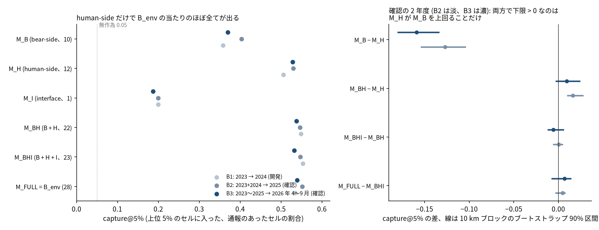
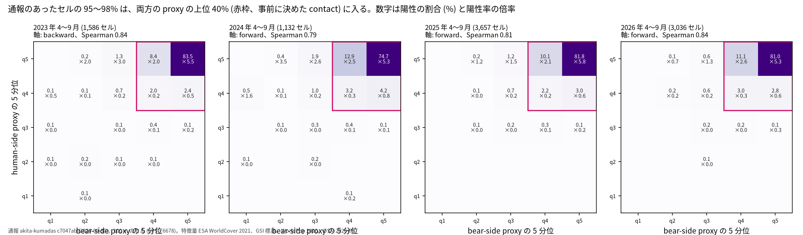
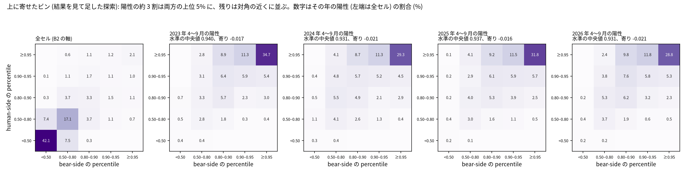
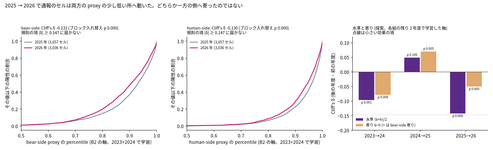
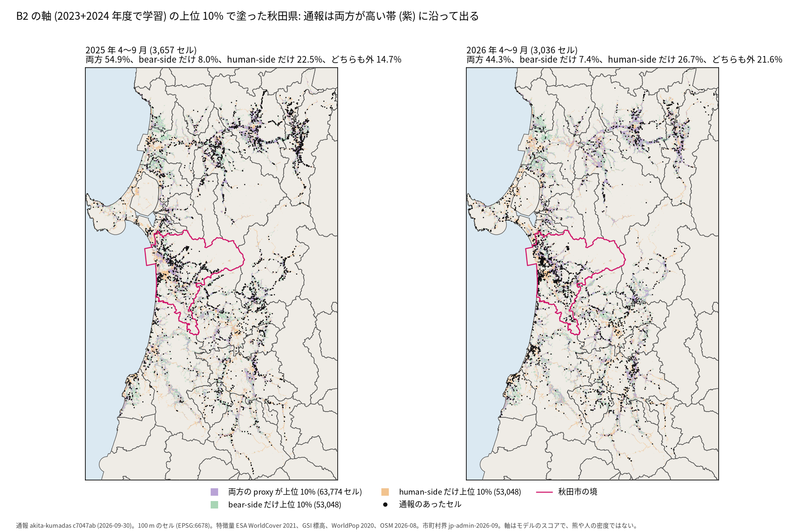
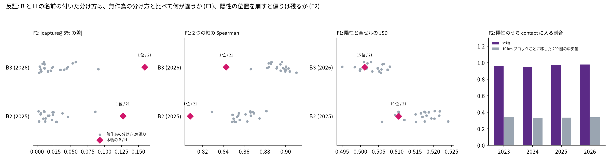
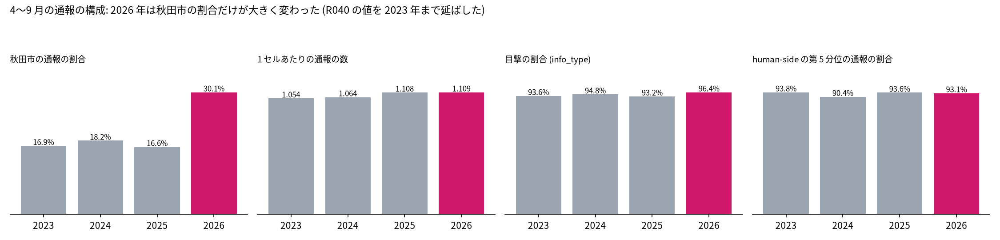

# B_env の予測力は熊側、人側、境目のどこから来ているか: 秋田県の 100 m セルの分解

## 問い

秋田県の 100 m セルの翌年度のクマ出没通報の順位を当てる B_env の予測力は、bear-side、human-side、interface の proxy のどこから来ていて、通報のあったセルは 2023〜2026 年度にその平面のどちらへ動いたか。

## 結論

B_env の予測力のほぼ全ては human-side の特徴量 (人口、建物、道路、農地、市街地) から来ている。human-side だけのモデル M_H が、学習に使っていない 2 つの年度で B_env の当たりの 95.7% と 97.8% を出した。bear-side だけのモデル M_B は M_H より capture@5% で 0.127 と 0.159 低い。両方を合わせた改善は 2025 年度だけで確かめられ、明示的な interface (森林の縁までの距離) と B × H の積は何も足さなかった。事前の規則では Pattern B (M_H ≫ M_B) に当たる。2 つの軸は強く相関し (Spearman 0.79〜0.84)、通報のあったセルは毎年、両方の proxy が高い組合せに集まっている。2025 → 2026 年で通報のセルはどちらか一方の側へではなく、両方の proxy が少し低いセルへ動いた。ただし動きは事前に決めた効果の境に届かない。静的な proxy と通報だけでは、熊の分布の変化、人の側の変化、通報の過程の変化を区別できない。環境省の別の観測系の分布メッシュとは、M_B も M_H も逆向きに関係し、bear-side という名前の外的妥当性は得られなかった。

### 7 つの問いへの答え

| # | 問い | 答え |
|---:|---|---|
| 1 | B_env の予測力はどこから主に来ているか | human-side。M_H だけで B_env の当たりの 95.7% (2025 年度)、97.8% (2026 年度 4〜9 月)。3 群の Shapley 分解で H 0.290 と 0.296、B 0.157 と 0.142、I 0.050 と 0.045 |
| 2 | bear-side だけ、人側だけでどこまで当たるか | capture@5% は M_B 0.403 と 0.370、M_H 0.530 と 0.529 (B_env 0.552 と 0.539) |
| 3 | 両者を合わせると単独より改善するか | 確かではない。M_BH − M_H は 2025 年度 +0.016 (90% 区間 +0.010〜+0.027) で、2026 年度 +0.009 (−0.002〜+0.024) は下限が 0 を下回る |
| 4 | 明示的な interface は追加価値を持つか | 持たない。M_BHI − M_BH は +0.001 と −0.006、B × H の積の項は +0.0001 と −0.004 で、どちらも下限が 0 を下回る |
| 5 | 2023〜2026 年で陽性のセルは平面のどちらへ動いたか | 事前の規則で「動いた」と言える軸は、どの年度の組にも無い。2025 → 2026 年は両軸が同じだけ下がった (Cliff's δ bear-side −0.131、human-side −0.130)。探索の分解では、両方の proxy の水準が下がり (−0.142)、human-side への寄りは小さい (−0.050) |
| 6 | 熊側の拡大、人側の変化、通報の過程の変化をどこまで区別できるか | 区別できない。言えるのは「通報のセルが、両方の proxy が少し低いセルへ移った」まで。2026 年は秋田市の通報の割合が 16.6% から 30.1% に増えたが、熊の出方の変化か通報の過程の変化かはこのデータでは分けられない |
| 7 | 時間変化する bear-side、human-side の外部データを集める価値があるか | ある。予測力が human-side に偏り、2 つの軸が強く相関するため、通報と独立の熊の観測と、人の分布と通報の窓口の時系列が無いと仮説 A〜D は分けられない。依頼書は [DATA_REQUEST_BEAR.md](DATA_REQUEST_BEAR.md)、[DATA_REQUEST_HUMAN.md](DATA_REQUEST_HUMAN.md) |

### 要点

| # | 要点 | 数字 | 図 |
|---:|---|---|---|
| 1 | human-side だけで B_env の当たりのほぼ全てが出る (確認、Pattern B) | M_H 0.530 と 0.529、M_B 0.403 と 0.370、M_B − M_H −0.127 と −0.159、B_env の当たりのうち M_H の割合 0.957 と 0.978 ([B2](outputs/b2_confirm_2023-2024_to_2025.json)、[B3](outputs/b3_confirm_2023-2025_to_2026.json)) | [図 1](#図-1-役割ごとのモデルの当たり) |
| 2 | 両者の組合せ、interface、積の項はどれも両年度では足さない | M_BH − M_H +0.016 と +0.009、M_BHI − M_BH +0.001 と −0.006、M_FULL − M_BHI +0.005 と +0.007 ([B2](outputs/b2_confirm_2023-2024_to_2025.json)、[B3](outputs/b3_confirm_2023-2025_to_2026.json))。積の項 +0.0001 と −0.004 ([B2](outputs/interaction_b2.json)、[B3](outputs/interaction_b3.json)) | [図 1](#図-1-役割ごとのモデルの当たり) |
| 3 | 2 つの軸は強く相関し、通報のセルは毎年、両方の proxy が高い組合せに集まる | 全セルの Spearman 0.791〜0.843、陽性のうち contact に入る割合 0.950〜0.978 ([phase_space.json](outputs/phase_space.json)) | [図 2](#図-2-phase-space) |
| 4 | 2025 → 2026 年、通報のセルは両方の proxy が少し低いセルへ動いたが、規則の効果の境に届かない | Cliff's δ bear-side −0.131、human-side −0.130 ([year_shift.json](outputs/year_shift.json))。水準 −0.142、寄り −0.050 ([year_shift_posthoc.json](outputs/year_shift_posthoc.json)) | [図 3](#図-3-年度の移動) |
| 5 | 地図で見ると、両方が上位 10% のセルの陽性が減り、どちらも外のセルと human-side だけのセルの陽性が増えた | 両方 54.9% → 44.3%、どちらも外 14.7% → 21.6%、human-side だけ 22.5% → 26.7%、bear-side だけ 8.0% → 7.4% ([map_phase_classes.json](outputs/map_phase_classes.json)) | [図 4](#図-4-地図で見る-phase-space) |
| 6 | B と H の分け方は、予測力の差と軸の独立さでは無作為の分け方と区別できるが、平面の上の偏りでは区別できない | capture の差は 21 中 1 位 (0.127、0.159)、Spearman は最も低い (0.808、0.843)、陽性と全セルの JSD は 19 位と 15 位 ([F1 B2](outputs/f1_role_perm_b2.json)、[F1 B3](outputs/f1_role_perm_b3.json)) | [図 5](#図-5-反証) |
| 7 | 平面の上の偏りは、通報がまとまって出ることでは作れない | 10 km ブロックごとに陽性を移すと contact の割合が 0.950〜0.978 から 0.332〜0.341 へ ([f2_block_shuffle.json](outputs/f2_block_shuffle.json)) | [図 5](#図-5-反証) |
| 8 | 通報の構成で 2026 年に大きく変わったのは秋田市の割合で、通報の 9 割強は毎年 human-side の第 5 分位にある | 秋田市の割合 16.6% → 30.1%、第 5 分位の割合 0.938、0.904、0.936、0.931 ([reporting_process.json](outputs/reporting_process.json)) | [図 6](#図-6-通報の過程の構成) |
| 9 | 環境省の別の観測系 (分布メッシュ、2010〜2017 年度) とは、M_B も M_H も逆向きに関係し、M_B は逆向きの程度が小さいだけ。bear-side という名前の外的妥当性の根拠にはならない (探索、1 回だけ) | ρ(M_B) −0.244、ρ(M_H) −0.272、差 +0.028 (+0.003〜+0.054) ([biodic_consistency.json](outputs/biodic_consistency.json)) | [環境省の記録との整合](#環境省の別の観測系との整合) |

### 読み手ごとに知るべきこと

| 読み手 | 結論 | 検討する材料 | 詳しく |
|---|---|---|---|
| 県の担当 (重点地区を絞る) | B_env の当たりはほぼ人側の特徴量で出ている。上位 5% の地図は「人がいて、通報が出やすい場所」の地図として読む | 地図の上位のセルが熊の多い所とは限らない。通報と独立の熊の観測と並べること | [図 1](#図-1-役割ごとのモデルの当たり)、[図 4](#図-4-地図で見る-phase-space) |
| 研究者 (熊の分布の変化を問う) | 静的な proxy では熊の分布の拡大は言えない。2025 → 2026 年の通報の位置の移動は、両方の proxy の水準が少し下がる方向で、熊側へ寄る形ではなかった | 時間で変わる独立の熊の観測 (捕獲の位置、固定の自動撮影の地点) | [DATA_REQUEST_BEAR.md](DATA_REQUEST_BEAR.md) |
| データを集める担当 | 次に要るのは、熊の観測の時系列と、人の分布と通報の窓口の時系列 | 依頼書の優先順 | [DATA_REQUEST_HUMAN.md](DATA_REQUEST_HUMAN.md) |

### 図 1: 役割ごとのモデルの当たり

左は各モデルの capture@5%、右は主な差と 10 km ブロックのブートストラップの 90% 区間 (淡が 2025 年度、濃が 2026 年度 4〜9 月)。両年度で下限が 0 を超えたのは、M_H が M_B を上回る差だけ。M_I (森林の縁までの距離 1 つ) も無作為の 0.05 よりは当たるが、M_H に足すと消える。B1 (開発、2024 年度) では M_FULL より M_BH と M_BHI の方が高かったが、確認の 2 年度では差は区間の中にある。

### 図 2: phase space

各年度の陽性を、その年度を学習していないモデルの軸に置いた (2023 年度だけは 2024 + 2025 年度で学習した後ろ向きの軸)。数字は陽性の割合 (%) と陽性率の倍率。事前に決めた 6 領域のうち contact が毎年ほぼ全てを占め、等分のビンでは年度の違いが読めない。2 つの軸がどちらも通報で学習されているので、bear-side の軸も通報の出る所で高くなる。

結果を見て足した探索のビン (各軸を 0.50、0.80、0.90、0.95 で切る)。陽性の約 3 割は両軸の上位 5% どうしに、残りは対角の近くに並ぶ。bear-side だけ高く human-side の低いビン (右下) にも、その逆 (左上) にも陽性はほとんど無い。

### 図 3: 年度の移動

左 2 つは、2025 年と 2026 年の 4〜9 月の陽性を同じ B2 の軸 (2023 + 2024 年度で学習、どちらの年も見ていない) に置いた累積分布。2026 年は両方の軸で少し左 (低い方) にある。右は、水準 (b + h) / 2 と寄り b − h の Cliff's δ (探索)。2025 → 2026 年は水準が下がり、寄りの変化は小さい。p は 10 km ブロックの年度ラベルの入れ替え (F3) による。

### 図 4: 地図で見る phase space

B2 の軸で、両方が上位 10% のセル (紫)、bear-side だけ (緑)、human-side だけ (橙) を塗り、2025 年と 2026 年の 4〜9 月の陽性を重ねた。紫は谷沿いの集落と森の境に細く伸びる。2026 年は秋田市の市街地とその周りに陽性が集まり、紫の帯の外の陽性が増えた。上位 10% の切り方は図のための選択で、事前に決めたものではない。

### 図 5: 反証

F1: B と H の 22 特徴量を同じ大きさで無作為に 20 通りに分けた。本物の分け方は、2 つの半分の当たりの差が最も大きく、2 つの軸の相関が最も低い。名前の付いた分け方には意味がある。ただし陽性が平面のどこに偏るか (JSD) は、どの分け方でも同じくらいで、本物は普通の位置にある。平面の上の偏りは、2 つの半分がどちらも通報で学習されていることから来ていて、bear-side と human-side という名前の効果ではない。F2: 陽性を 10 km ブロックごとに別のブロックへ移すと偏りは消える。

### 図 6: 通報の過程の構成

4〜9 月の通報の構成。秋田市の割合は 2026 年に大きく増えたが、1 セルあたりの通報の数、目撃の割合、human-side の第 5 分位の割合は大きく変わらない。2024〜2026 年の市町村と info_type は [R040](../akita-bear-risk-grid-100m/outputs/apr_sep_report_composition.json) と一致を確かめて読み直し、2023 年を足した。

### 環境省の別の観測系との整合

熊の生息域の正解のデータは無い。環境省の分布メッシュ ([env-biodic-bear-distribution-mesh-jp](https://huggingface.co/datasets/yuiseki/env-biodic-bear-distribution-mesh-jp)、rev 7f635cb、要注意鳥獣生息分布調査の平成 22〜29 年度の情報と第 6 回の確認) も、人が観測できた熊の記録 (目撃、痕跡、捕獲、聞き取り、市町村へのアンケート) で、熊の分布の検証には使えない。ここでは、観測の過程の違う 2 つの記録がどこまで合うかを 1 回だけ見た (規則は流す前に計画に固定)。

| 5 km メッシュ (県内のセルが 1,200 以上の 480) | 記録の水準 0 (27) | 1 = 2010〜2017 年だけ (89) | 2 = 第 6 回と 2010〜2017 年の両方 (364) | 水準との Spearman の ρ |
|---|---|---|---|---|
| M_B の平均 percentile (B3 の軸) | 0.514 | 0.624 | 0.467 | −0.244 |
| M_H の平均 percentile (B3 の軸) | 0.552 | 0.621 | 0.465 | −0.272 |
| 2023〜2026 年度の通報のあったセルの割合 | 0.007 | 0.021 | 0.014 | −0.120 |

数字は [biodic_consistency.json](outputs/biodic_consistency.json)。ρ(M_B) − ρ(M_H) は +0.028 (90% 区間 +0.003〜+0.054、2 次メッシュのブロックのブートストラップ)、B2 の軸でも +0.031 (+0.002〜+0.062) で、事前の規則の条件 (下限 > 0) は形式上満たす。ただし両方の ρ は負で、規則は ρ が正の場合しか想定していなかった。M_B は環境省の記録と合っているのではなく、M_H より逆向きの程度が小さいだけなので、bear-side という名前の外的妥当性の根拠にはしない。どちらの proxy も、2010〜2017 年に初めて記録の付いたメッシュで最も高く、2000 年代から記録の続くメッシュで低い。2 つの観測系が重なるのは、記録が新しく増えた所 (通報や聞き取りの機会の多い所と考えられるが、このデータでは確かめていない) で、長く記録の続く所ではない。M_B も通報の過程をかなり引きずっていると読む。

### 仮説 A〜D の区別できる範囲

| 仮説 | このデータで言えること | 言えないこと |
|---|---|---|
| A bear-side の分布が変わった | 2025 → 2026 年に通報のセルが bear-side proxy の高い所へ移った形跡は無い (bear-side の δ は負) | 熊の分布の変化そのもの。特徴量は年で変わらない |
| B human-side の分布・活動が変わった | 通報のセルが human-side proxy の高い所へ移った形跡も無い (human-side の δ も負)。秋田市の通報の割合は増えた | 人の分布や行動の変化。人口と建物は 1 時点の値 |
| C interface が変わった | 両方が上位 10% の帯の陽性の割合が減った (図 4) | 境目そのもの (耕作放棄、藪) が変わったか |
| D 通報の過程が変わった | 市町村の構成の JSD は 2025 → 2026 年が最大。info_type の構成の変化は小さい | 通報されやすさが変わったのか、熊の出方が変わったのか |

代替の説明として、human-side proxy の高い所で通報が多いのは、人が多いから通報されやすいだけかもしれない。熊の出没が人の多い所に多いことと、人の多い所で見つかりやすいことは、通報だけでは分けられない。

### 読み方で変わる答え

| 読み方 | 主 | 別の読み方 |
|---|---|---|
| 陽性の季節 | 4〜9 月 (4 年度で揃う) | 熊の年度全体 (2023〜2025): 2023 → 2024、2024 → 2025 で規則の「動いた」は無し ([year_shift.json](outputs/year_shift.json)) |
| 年度の比較の軸 | 比べる 2 年度を見ていない共通の軸 | 年度ごとの軸 (前向き): 両方の上位 5% どうしのビンの陽性の割合 31.8% → 28.8% ([year_shift_posthoc.json](outputs/year_shift_posthoc.json)) |
| F3 の入れ替えの単位 | 10 km ブロック | セルごと (空間の依存を無視): 2025 → 2026 年の両軸で p < 0.05 は同じ |

## データ

- 通報: 秋田県クマダス `yuiseki/akita-kumadas-wildlife-sighting` (rev c7047ab、2026-09-30 まで)、ツキノワグマの全種別。熊の年度 (4 月〜翌 3 月) のセルの数は `reports_by_year.npz` (sha256 b7f5d77e…)、4〜9 月のラベルはこのプロジェクトで作り直し、R036 の陽性セルの数 (1,586、1,132、3,657、3,036) と一致した ([labels_check.json](outputs/labels_check.json))。
- 特徴量: akita-bear-risk-grid-100m の静的な 28 個 (ESA WorldCover 2021 v200、GSI 標高タイル z12、WorldPop R2025A 2020、OSM Japan 2026-08 rev 9a9b4a7)。役割は [feature_roles.csv](feature_roles.csv) (B 10、H 12、I 1、X 5)。
- 格子: EPSG:6678 の 100 m セル 1,168,211 (sha256 は各結果の JSON)。
- 保存済みの B_env のスコア (M_FULL): akita-bear-risk-grid-100m の B1〜B3 (sha256 743c73ac…、aa33ceeb…、9895dbd7…)。
- 外部データは足していない。測った日は 2026-10-31。

## 方法

- モデル: B_env と同じ HistGradientBoostingClassifier (max_iter 300、learning_rate 0.05、max_leaf_nodes 63、min_samples_leaf 500、l2_regularization 1.0)、random_state 0、重みなし、ラベルは熊の年度に 1 件以上。列だけを役割で替えた。28 列で学習し直すと保存済みの B1 の B_env と完全に一致した (最大の差 0)。
- 分割: B1 (2023 → 2024、開発)、B2 (2023 + 2024 → 2025、確認)、B3 (2023〜2025 → 2026 年 4〜9 月、確認)。主指標 capture@5%、差の 90% 区間は 10 km ブロックのブートストラップ (B1 500 回、B2 と B3 1,000 回)。判定は B2 と B3 の両方で下限 > 0。良い方の単独モデル (M_H) は B1 で決めた。
- B × H: 10 km ブロックの 5 分割の cross-fit のスコアで、加法と積ありのロジスティック回帰を 1 回だけ比べた。
- Phase space: M_B と M_H のスコアの県内 percentile の 5 × 5 ビンと、事前に決めた 6 領域。年度の比較は、比べる 2 年度を見ていない共通の軸で、Cliff's δ、KS、JSD。「動いた」の規則は |δ| ≥ 0.147 かつ F3 のブロック入れ替えの p < 0.05。
- 探索 (結果を見て足した、計画の変更に記録): 上に寄せたビン、水準と寄りの分解、地図の上位 10% の塗り分け。
- 環境省の別の観測系との整合 (探索、規則を流す前に固定、1 回だけ): 5 km メッシュのコードはセルの経緯度から計算し、yo4 のポリゴンの中心から計算したコードと全て一致した。記録の水準とメッシュの平均 percentile の Spearman の ρ を比べた。
- 反証: F1 は役割の無作為の入れ替え 20 通り、F2 は 10 km ブロックごとの陽性の移動 200 回、F3 は 10 km ブロックごとの年度ラベルの入れ替え 1,000 回。
- コマンドは [README.md](README.md)、各段の記録は [EXPERIMENT_TRACKER.md](EXPERIMENT_TRACKER.md)。

## 確かめていないこと

- 熊の真の分布と人の真の活動。2 つの軸はどちらも通報で学習したモデルのスコアで、潜在量の観測ではない。bear-side の軸が通報の出る所で高いのは、そのためでもある。
- 熊の観測と人の分布の時間変化。静的な特徴量しか無いので、仮説 A〜D は分けられない。
- 特徴量の役割の分け方の別案。草地 (X) を B に、農地 (H) を B に入れる案は流していない。F1 は無作為の分け方との比較だけ。
- 4〜9 月以外の季節の 2026 年度。データが 2026-09-30 で終わる。
- 通報の座標の誤差。100 m のセルの割り当ての誤りは評価していない。
- 環境省の分布メッシュの観測の機会。記録が新しく増えたメッシュが人の出入りの多い所かは、確かめていない。分布メッシュの期間 (2017 年度まで) は通報 (2023〜2026 年) と重ならない。
- 2026 年の秋田市の通報の割合の増加の原因。周知、窓口、熊の出方のどれかは、このデータでは分からない。
