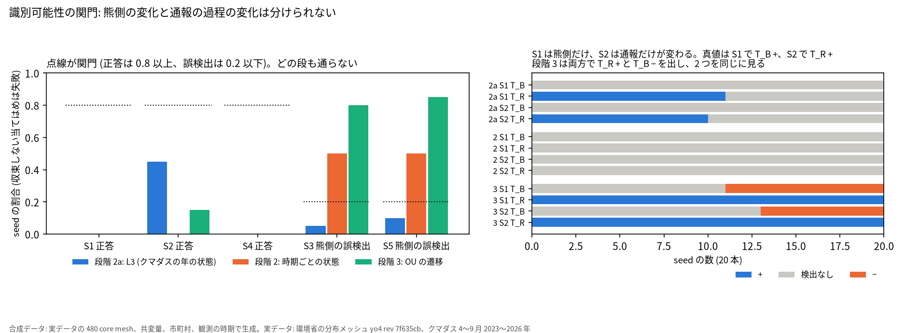
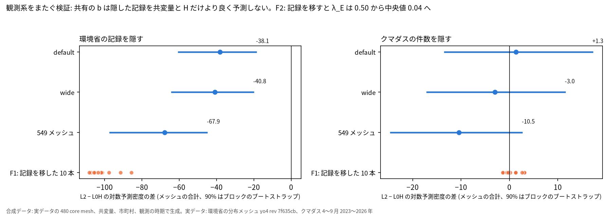
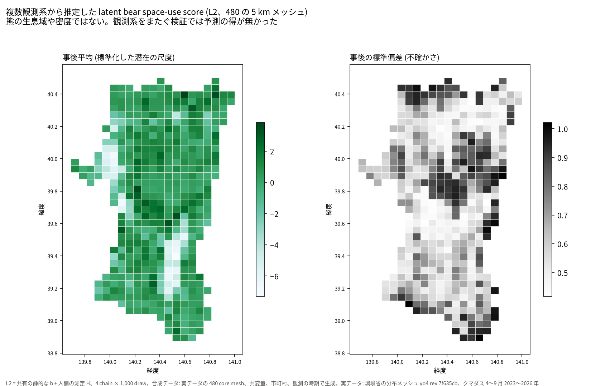
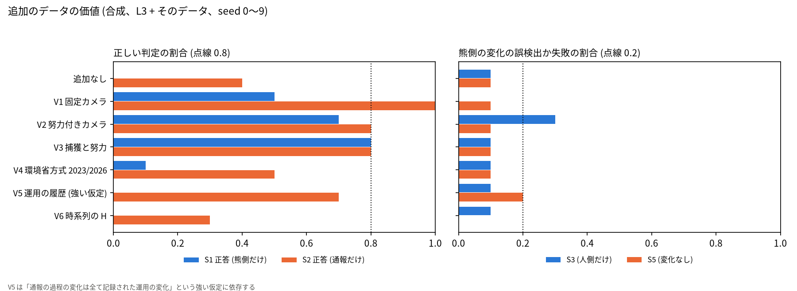

# 熊の潜在の空間利用と観測の過程は、いまのデータで識別できるか: 秋田県の 5 km メッシュ

## 問い

秋田県の 480 の 5 km メッシュで、環境省の分布メッシュとクマダスの通報に共通する潜在の空間構造を置けるか、2023〜2026 年の通報の変化を熊側の変化と通報の過程の変化に分けられるか、分けられないなら何を観測すれば分けられるか。

## 結論

静的な空間の構造は、合成データでは回収でき、実データでも 2 つの観測系の空間の対応として当てはめに現れる。ただし、その共有の潜在のスコアは、隠した環境省の記録を、共変量と人側の測定 H だけのモデルより良くは予測しない。事前に決めた規則では「共通する空間の潜在の構造は無い」。時間の側はもっとはっきりしていて、熊側の変化と通報の過程の変化は、いまの観測の構造では分けられない。3 つの段 (クマダスの年の状態、時期ごとの状態、OU の連続時間の遷移) の合成データの関門は全て通らず、遷移の構造を入れた段は、熊側だけが変わった合成データで 20 本全てを通報の過程の変化と判定した。計画どおり、実データでの時間の推定 (dynamic bear inference) はここで止め、2023〜2026 年に熊が増えた、減ったとは言わない。「熊の真の分布を推定した」とも言わない。合成データの上で識別を最も良くしたのは、通報と独立で努力の分かる熊の観測 (市町村 × 年の捕獲と努力、努力付きのカメラ) だった。地図に描いたのは、複数の観測系から推定した latent bear space-use score とその不確かさで、熊の生息域や密度ではない。

### 7 つの問いへの答え

| # | 問い | 答え |
|---:|---|---|
| 1 | 環境省の分布調査とクマダスに、共通する空間の潜在の構造はあるか | 当てはめの中にはある。予測の規則では無い。L2 の環境省の負荷 λ_E は 0.499 (90% 区間 0.359〜0.652) で、環境省の記録を 2 次メッシュのブロックごとに移すと 10 本とも 0.213 以下に落ちる (F2)。一方、観測系をまたぐ検証では、事前の規則で「無い」 |
| 2 | shared latent model は、観測系ごとの独立のモデルより cross-source prediction を改善したか | 改善しない。環境省の記録を隠すと L2 − L0H は −38.1 (−60.3〜−18.8) で、悪くなる。クマダスを隠すと +1.3 (−13.4〜+17.2) で区別できない。広い事前分布でも、全 549 メッシュでも同じ判定 |
| 3 | human latent state を分けることで説明は改善したか | クマダスの側では改善した。隠したクマダスの件数の予測で L0H − L0 +121.0 (+86.4〜+152.3)。H を入れない共有のモデル L1 は実データで収束せず (R-hat 16.5)、H を分けないと共有の b は識別されない。環境省の側では L0H − L0 −0.1 で、改善しない |
| 4 | いまのデータで bear process と reporting process は識別できるか | 静的な空間の水準は識別できる (合成で、事後平均と真の b の相関の中央値 0.886)。時間の変化は識別できない。関門の S1 (熊側だけが変わる) の正答は、どの段でも 0.00 |
| 5 | 2023〜2026 年の bear-side の時間変化をデータから推定してよいか | してはいけない。関門を通った段が 1 つも無いので、実データに時間の状態を当てなかった。遷移の構造を入れた段は、熊側だけの変化も通報の過程だけの変化も、同じく「通報の過程の増加と熊側の減少」と判定する |
| 6 | 推定結果は事前分布にどの程度依存するか | 静的なモデルのパラメータは依存しない。L0H と L2 の全てのパラメータの符号、観測系をまたぐ検証の判定は、尺度を 3 倍にした事前分布でも同じ。時間の判定は依存する。遷移の段では seed ごとの T_B の判定の一致が 0.62 で、関門の 0.8 に届かない |
| 7 | 何の追加観測があれば識別が最も改善するか | 合成データの上では、通報と独立で、努力の分かる熊の観測。最も効いたのは市町村 × 年の捕獲数と既知の努力 (V3) で、S1 正答が 0.0 から 0.8、S2 正答が 0.4 から 0.8 になり、S3、S5 の熊側の誤検出は 0.1 のまま。次は努力の記録付きのカメラ (V2) と固定のカメラ (V1) で、S1 と S2 の平均がどちらも +0.55。環境省方式の再調査 (V4)、クマダスの運用の履歴 (V5)、人の活動の時系列 (V6) は、S1 正答を 0.1 以下にとどめる |

### 要点

| # | 要点 | 数字 | 図 |
|---:|---|---|---|
| 1 | 熊側の変化と通報の過程の変化は、3 つの段のどれでも分けられない (確認、関門) | S1 正答 0.00 (段階 2a、2、3)、S2 正答 0.45、0.00、0.15 ([段階 2a](outputs/identifiability_gate_L3.json)、[段階 2](outputs/identifiability_gate_stage2.json)、[段階 3](outputs/identifiability_gate_stage3.json)) | [図 1](#図-1-識別可能性の関門) |
| 2 | 遷移の構造を入れると、熊側の変化を通報の過程の変化と取り違える | 段階 3 の S1 で T_R の誤検出 20 本中 20、T_B の負の検出 9。段階 2 からの変化は S1 正答 0.0、S3、S5 の誤検出 +0.3、+0.35 ([summary](outputs/summary_gates_falsification.json)) | [図 1](#図-1-識別可能性の関門) |
| 3 | 静的な共有の b は合成データで回収できる (確認、段階 1) | 相関 ≥ 0.5 の seed 1.0、中央値 0.886、負荷の被覆 0.875 ([stage1](outputs/identifiability_gate_stage1.json)) | [図 3](#図-3-latent-bear-space-use-score) |
| 4 | 実データの共有の b は、隠した環境省の記録を共変量と H だけより悪く予測する (確認、規則で「無い」) | 環境省を隠す L2 − L0H −38.1 (−60.3〜−18.8)、クマダスを隠す +1.3 (−13.4〜+17.2) ([cv default](outputs/real_cv_default.json))。wide −40.8、−3.0 ([cv wide](outputs/real_cv_wide.json))、549 メッシュ −67.9、−10.5 ([cv allmesh](outputs/real_cv_allmesh.json)) | [図 2](#図-2-観測系をまたぐ検証と反証) |
| 5 | 2 つの観測系の空間の対応は負荷に現れ、記録を移すと消える (反証 F1、F2) | λ_E 0.499 (0.359〜0.652)、移した 10 本の λ_E の最大 0.213、中央値 0.044。移した 10 本の環境省を隠す得は −108.2〜−85.6 ([summary](outputs/summary_gates_falsification.json)) | [図 2](#図-2-観測系をまたぐ検証と反証) |
| 6 | 人側の測定 H はクマダスの説明を大きく良くし、環境省の説明は変えない | クマダスを隠す L0H − L0 +121.0 (+86.4〜+152.3)、環境省を隠す −0.1 (−3.9〜+3.0) ([cv default](outputs/real_cv_default.json))。c_K 2.243、c_E 0.039 ([L2](outputs/real_full_default.json)) | [図 2](#図-2-観測系をまたぐ検証と反証) |
| 7 | 熊側だけの変化を検出できるようになるのは、通報と独立で努力の分かる熊の観測を足したときだけ (合成、seed 10 本) | S1、S2 の正答は追加なし 0.0、0.4 に対して、V3 0.8、0.8、V2 0.7、0.8、V1 0.5、1.0、V4 0.1、0.5、V5 0.0、0.7、V6 0.0、0.3。V2 は S3 の熊側の誤検出が 0.3 ([voi](outputs/voi_summary.json)) | [図 4](#図-4-追加のデータの価値) |

### 読み手ごとに知るべきこと

| 読み手 | 結論 | 検討する材料 | 詳しく |
|---|---|---|---|
| 熊の出没の傾向を知りたい人 | 2023〜2026 年の通報の増減は、熊側の変化とも通報の過程の変化とも、このデータでは言えない | 通報と独立で、毎年同じ努力で取る熊の観測 | [図 1](#図-1-識別可能性の関門)、[図 4](#図-4-追加のデータの価値) |
| 地図を使いたい人 | latent bear space-use score の地図は、2 つの観測系の当てはめの要約で、熊の生息域ではない。不確かさの地図と一緒に読む。環境省の記録の予測では共変量だけのモデルより悪い | 標準偏差が 1 に近い北部と東部の山地 | [図 3](#図-3-latent-bear-space-use-score) |
| データを集める人 | 次に集めるなら、市町村 × 年の捕獲の数と努力の記録か、努力の記録付きの自動撮影カメラ。環境省方式の再調査、運用の履歴、人の活動の時系列は、熊側の変化の識別をほとんど良くしない | 捕獲の努力が年ごとに実際に記録されているか、カメラの稼働日数と検出の過程。どれも合成の上の数字で、実物の質は確かめていない | [図 4](#図-4-追加のデータの価値)、[依頼書 (熊側)](../akita-bear-human-interface/DATA_REQUEST_BEAR.md) |

### 図 1: 識別可能性の関門

左は、段階ごとの正答と熊側の誤検出の割合。収束しない当てはめは失敗に数えている。段階 2 の S3、S5 の誤検出 0.50 は全て収束しない当てはめで、検出した当てはめは 0 本 ([段階 2](outputs/identifiability_gate_stage2.json))。段階 2 は区間が広すぎて何も検出しない。右は S1 と S2 の判定の内訳。段階 2a と 3 で、S1 と S2 の棒の形が同じになる。クマダスの尤度の中では、熊側の年の平均の変化と通報の年の効果が同じ定数として現れ、環境省の調査は 2023〜2026 年に重ならないので、2 つを分ける情報が尤度に無い。これは計画に流す前に書いた見込みで、その見込みどおりになった。

### 図 2: 観測系をまたぐ検証と反証

青は 3 つの設定の L2 − L0H (メッシュの合計と、2 次メッシュのブロックのブートストラップの 90% 区間)、橙は環境省の記録をブロックごとに移した 10 本。環境省を隠す方向で、本物 −38.1 は移した 10 本 (−108.2〜−85.6) より良いが、0 より悪い ([summary](outputs/summary_gates_falsification.json))。空間の対応はあるが、共有の b で予測すると、共変量と H で直接予測するより悪くなる、と読む。クマダスを隠す方向は、本物も移した 10 本も 0 の近くで区別できない。

### 図 3: latent bear space-use score

L2 (共有の静的な b と H) の事後平均と事後の標準偏差。熊の生息域、密度、真の分布ではない。事後平均の b は森林の割合と 0.822、H と −0.659 で相関する ([L2](outputs/real_full_default.json))。ほぼ熊側の事前の共変量 (森林など) の地図で、2 つの観測系から新しく分かった空間の情報は、図 2 のとおり予測では確かめられない。

### 図 4: 追加のデータの価値

段階 2a の L3 に候補のデータの尤度を足し、同じ seed 0〜9 で追加なしと比べた ([voi](outputs/voi_summary.json))。左の青 (S1 正答) が伸びるのは V1〜V3 だけで、どれも通報と独立に熊を数え、努力が分かるか一定の観測。捕獲 (V3) は S1、S2 とも 0.8 に届き、熊側の誤検出も 0.1 にとどまる。努力付きのカメラ (V2) は S1 0.7 だが、人側だけが変わる S3 で熊側の変化を 0.3 誤って検出する。環境省方式の再調査 (V4) は 2 時点の有無で、年の熊側の変化を S1 0.1 しか拾わない。運用の履歴 (V5) は S2 を 0.7 に上げるが S1 は 0.0 のままで、しかも「通報の過程の変化は全て記録された運用の変化」という強い仮定に依存する。seed は 10 本なので割合の刻みは 0.1 で、V1〜V3 の順位の差は誤差の内にある。カメラの設計 (地点数を増やす、など) は候補として残し、流していない。

### 読み方で変わる答え

| 読み方 | 主 | 別の読み方 |
|---|---|---|
| 「共通する空間の構造」を何で判定するか | 観測系をまたぐ予測 (計画の規則): 無い | 当てはめの負荷 λ_E: ある (0.499、記録を移すと消える) |
| メッシュの範囲 | 480 の core mesh: 環境省を隠す −38.1 | 環境省の枠の 549 メッシュ: −67.9 (−97.1〜−45.2) |
| 事前分布 | default: 環境省を隠す −38.1、クマダスを隠す +1.3 | 尺度 3 倍: −40.8、−3.0 (符号は変わるが、どちらも区間が 0 を含み判定は同じ) |
| 収束しない当てはめの扱い | 失敗に数える: 段階 3 の S2 正答 0.15 | 収束した当てはめだけ: 段階 3 の S2 正答 0.6 (35 本)、S1 正答は 0.0 のまま ([段階 3](outputs/identifiability_gate_stage3.json)) |

## データ

- 環境省の分布メッシュ: `yuiseki/env-biodic-bear-distribution-mesh-jp` の yo4 (rev 7f635cbfb92be5093fa707dbe6afec0e37d240f4)、第 6 回相当 (約 2000〜2004 年度、`第6回で確`) と 2010〜2017 年度の情報 (`H22_29`) の記録の有無。秋田県に交差する 550 メッシュのうち枠にある 549、主は県内の 100 m セルが 1,200 以上入る 480 (core mesh)。core の記録の割合は 0.758 と 0.944 ([inputs_summary.json](outputs/inputs_summary.json))。
- クマダスの通報: `artifacts/_bear/akita-bear-human-interface/labels/reports.parquet` (元は akita-kumadas c7047ab、sha256 61df4092…)、2023〜2026 年の各 4〜9 月。core の件数 1,641、1,189、3,962、3,275 (県全体 1,671、1,205、4,052、3,366)。
- 共変量: akita-bear-risk-grid-100m の ESA WorldCover 2021、GSI 標高、WorldPop 2020、OSM 2026-08 (sha256 は [inputs_summary.json](outputs/inputs_summary.json))。熊側の事前の共変量 5 列、人側の測定 H は 5 列の第 1 主成分 (分散の 0.736)。H と森林の割合の相関は −0.843。
- 通報で学習した予測器 (B_env、M_B、M_H) は使っていない。外部のデータは足していない。

## 方法

- モデル (NumPyro 0.22.0、JAX 0.12.0.1、CPU の NUTS): 独立 (L0、L0H)、共有の静的な b (L1、L2)、B × H を 1 回 (L2x)。動的な状態は 3 段 (L3 のクマダスの年の状態、時期ごとの状態、OU の遷移 φ(Δt) = exp(−κΔt))。式と事前分布は [EXPERIMENT_PLAN.md](EXPERIMENT_PLAN.md)、概念は [CONCEPT.md](CONCEPT.md)。
- 識別可能性: 実データと同じメッシュ、共変量、市町村、観測の時期で合成データを作り、S1 (熊側だけ)、S2 (通報だけ)、S3 (人側だけ)、S4 (両方)、S5 (変化なし) × seed 0〜19 × 2 つの事前分布で当てはめた。90% 区間が 0 を含まなければ検出。収束しない当てはめ (R-hat > 1.05 か divergence > 1%) は失敗に数える。関門の値は流す前に固定した。段階 1〜3 は、最初の関門 (段階 2a) の当てはめの一部の途中の値を見た後に足した (計画の変更に記録)。
- 実データの当てはめ: 4 chain × 1,000 + 1,000、R-hat ≤ 1.01、ESS ≥ 400、divergence ≤ 0.5% を満たさないものは解釈しない。L0 (R-hat 1.012)、L1 (16.5)、L2x (8.7) は満たさない。L1 が収束しないので、反証 F1、F2 は L2 と L0H で流した (計画の変更に記録)。
- 観測系をまたぐ検証: 2 次メッシュのブロックを 5 fold に分け、片方の観測系の記録を隠して対数予測密度を比べた。区間はブロックのブートストラップ 1,000 回。
- 追加のデータの価値: 段階 2a の L3 に候補の尤度を足し、S1、S2、S3、S5 × seed 0〜9 で、追加なし (同じ seed) と比べた。
- 記録は [EXPERIMENT_TRACKER.md](EXPERIMENT_TRACKER.md) の R001〜R013。

## 確かめていないこと

- 熊の真の分布と人の真の活動。環境省の記録もクマダスの通報も観測で、どちらも ground truth ではない。b は 2 つの観測系の当てはめの要約。
- 合成データの生成の仮定。変化の大きさ (2023 → 2026 年で潜在の尺度 0.4) と形は 1 通りで、もっと大きな熊側の変化なら分けられる可能性は確かめていない。
- 事後予測の外れ。L2 はゼロのメッシュ × 年の割合を 2025、2026 年で少なく出す (p 0.056、0.015、[L2](outputs/real_full_default.json))。過分散の形が合っていない可能性がある。
- 追加のデータの価値は合成の上の数字で、実際のカメラの検出の過程、捕獲の努力の記録の質、運用の履歴の網羅性は確かめていない。V5 は「通報の過程の変化は全て記録された運用の変化」という強い仮定に依存する。
- 5 km の単位と 4〜9 月の窓。100 m への downscaling と、10 月以降の季節は扱っていない。
- 関連する研究のうち Gantchoff 2022、森林総研 2025 は原典を確かめていない ([RELATED_WORK.md](RELATED_WORK.md))。
