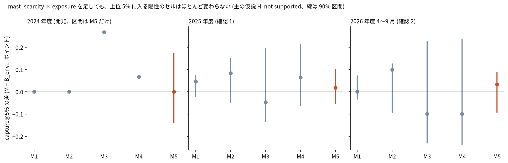
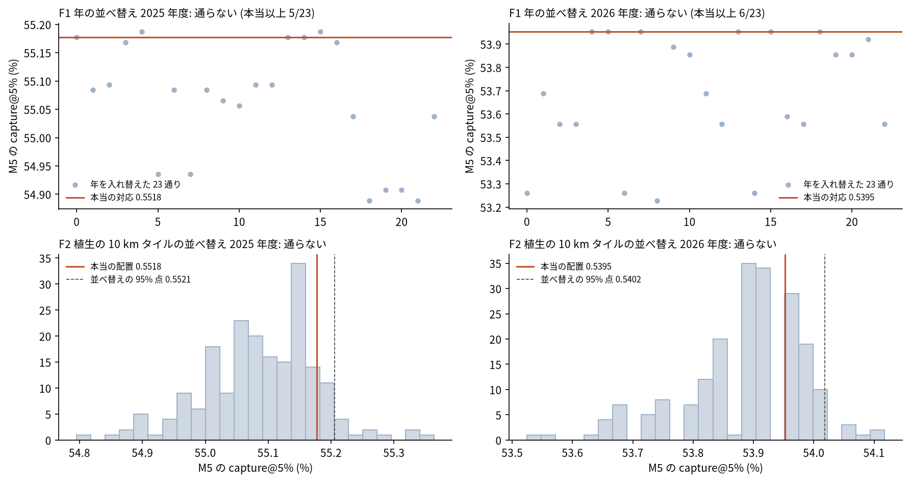
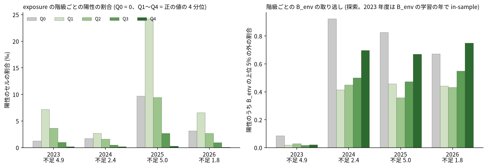
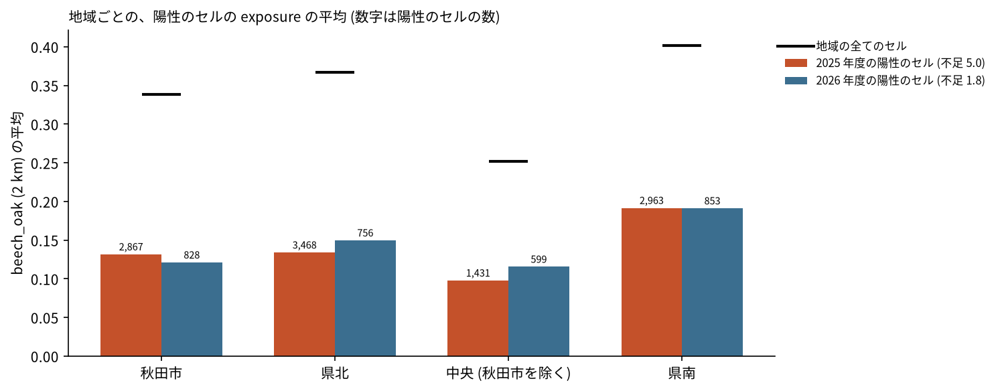

# 年のブナの豊凶 × 場所のブナ・ナラ類の exposure は、秋田県のクマ出没の 100 m セルの順位を B_env より良くするか

## 問い

秋田県の 100 m セル (1,168,211) で、既存の B_env (静的な環境だけのモデル、保存済みのスコア) に「mast_scarcity (年に 1 つ、5 − 秋田の豊凶指数) × 周り 2 km のブナ・ナラ類の群落の面積の割合」を 1 つの係数で足すと、2025 年度と 2026 年度 (4〜9 月) のクマの通報のあったセルを、上位 5% に多く入れられるか。

## 結論

入れられなかった。主の仮説 (M5 が B_env より capture@5% を良くする) は、2025 年度も 2026 年度も支持されない (not supported)。係数はほぼ 0 で、足した項は上位 5% のセルをほとんど入れ替えない。年の対応を壊す並べ替え (F1) でも、植生の場所を 10 km のタイルで入れ替える並べ替え (F2) でも、本当の対応は特別でなかった。計画の撤退の条件に当たるので、「year-level mast × static beech/oak exposure で 100 m のクマ出没の順位を良くする」仮説は支持されないとして、この枝を閉じる。運用の予測値への置き換え、森の縁や集落までの距離との交互作用、2027 年度の前向きの検証には進まない。

### 6 つの問いへの答え

| # | 問い | 答え | 数字 (capture@5% の差 M − B_env、90% 区間は 10 km ブロックの復元抽出) | 図 |
|---:|---|---|---|---|
| 1 | mast × beech/oak exposure は B_env を改善したか | しなかった。差は両年度とも 0 に近く、区間が 0 をまたぐ | M5: 2025 年度 +0.0002 (−0.0005〜+0.0010)、2026 年度 +0.0003 (−0.0009〜+0.0008)。B_env は 0.552、0.539 | [図 2](#図-2-モデルごとの-capture5-の差) |
| 2 | どの植生 category が寄与したか | どれも寄与しなかった。4 つの分解の差は全て区間が 0 をまたぎ、年度で向きもそろわない | beech +0.0005 / 0.0000、beech_mizunara +0.0008 / +0.0010、mizunara −0.0005 / −0.0010、konara +0.0007 / −0.0010 (2025 / 2026) | [図 2](#図-2-モデルごとの-capture5-の差) |
| 3 | 500 m と 2 km のどちらが残ったか | どちらも残らなかった。開発期間 (2024 年度) で M5 は両方の半径で B_env と同じ値になり、同点の規則で 2 km にした | 2024 年度の M5 − B_env: 500 m 0.000、2 km 0.000 | [図 2](#図-2-モデルごとの-capture5-の差) |
| 4 | 年対応と空間対応を壊すと性能は落ちたか | 落ちなかった。F1 も F2 も通らない | F1: 年を入れ替えた 23 通りのうち本当以上が 5 (2025)、6 (2026)。F2: 並べ替えの 95% 点 0.5521、0.5402 に対して本当 0.5518、0.5395 | [図 3](#図-3-並べ替えの反証) |
| 5 | 2025 と 2026 で再現したか | 「改善しない」ことが両年度で再現した。どちらの年度も規則を満たさない | 両年度の平均 (補助) +0.0003 (−0.0005〜+0.0007) | [図 2](#図-2-モデルごとの-capture5-の差) |
| 6 | retrospective な mast 値を operational predictor へ置き換える価値があるか | 今は無い。秋に分かる同じ年の結実時の指数を使っても改善しないので、7 月の開花時の指数に置き換えても得るものが無い。実際に開花時の指数でも同じく改善しなかった | operational M5: 2025 年度 +0.0002 (−0.0005〜+0.0009)、2026 年度 +0.0003 (−0.0006〜+0.0006) | [図 2](#図-2-モデルごとの-capture5-の差) |

### 要点

| # | 要点 | 数字 | 根拠 |
|---:|---|---|---|
| 1 | ブナ・ナラ類の群落は秋田の 3 分の 1 を覆い、B_env の高いセルとは逆の所に多い | beech_oak 4,138.0 km²。2 km の beech_oak と B_env の Spearman −0.67 (2025 年度の面)。森林簿の範囲のセルに 96.0% が入る ([exposure_qa.json](outputs/exposure_qa.json)、[exposure_build.json](outputs/exposure_build.json)) | [図 1](#図-1-ブナナラ類の-exposure) |
| 2 | 学習の年度で当てた係数はほぼ 0 で、目的の年の順位を動かさない | M5 の β: 2025 年度 −0.007 (SE 0.025)、2026 年度 −0.007 (SE 0.013) ([b3_confirm.json](outputs/b3_confirm.json)) | [図 2](#図-2-モデルごとの-capture5-の差) |
| 3 | 主の指標以外の指標でも同じ | capture@10% の差 +0.0003、−0.0003。件数で重みを付けた capture@5% の差 +0.0004、+0.0003 (2025、2026) ([b3_confirm.json](outputs/b3_confirm.json)) | [読み方で変わる答え](#読み方で変わる答え) |
| 4 | 不作の年に、陽性がブナ・ナラ類の多い所へ寄る形は見えない (探索) | 陽性のセルの exposure の平均: 2024 年度 (不足 2.4) 0.183、2025 年度 (不足 5.0) 0.145、2026 年度 (不足 1.8) 0.147 ([b5_diagnostics.json](outputs/b5_diagnostics.json)) | [図 4](#図-4-exposure-の階級ごとの陽性と-b_env-の取り逃し)、[図 5](#図-5-地域ごとの陽性のセルの-exposure) |

### 読み手ごとに知るべきこと

| 読み手 | 結論 | 検討する材料 | 詳しく |
|---|---|---|---|
| クマの出没の地図を作る人 | 100 m の順位は B_env のままでよい。年の豊凶とブナ・ナラ類の植生の積は、上位 5% のセルを良くしなかった | 年の豊凶は、県全体の通報の量 (年の水準) の材料で、どのセルかの順位の材料ではない | [答え 1](#6-つの問いへの答え) |
| ブナとクマの関係を調べる人 | 通報のセルは、どの年もブナ・ナラ類が少しだけある所 (里に近い所) に多く、ブナ・ナラ類の多い所ほど少ない。不作の年でもこの形は変わらなかった | 植生の割合でなく、森の縁や集落との境目からの距離での見方は、この計画では試していない (撤退の条件により進まない) | [図 4](#図-4-exposure-の階級ごとの陽性と-b_env-の取り逃し) |

### 図 1: ブナ・ナラ類の exposure

色は、セルの中心から 2 km の円の中の植生図の範囲に占める、各 category の群落の面積の割合。beech_oak は 4 つの和集合で、重なりを二重に数えない (4 つの和との差は 0.0 km²)。ブナ (beech) は県境の山地と森吉山の周り、コナラ (konara) は県南の丘陵に多い。群落の面積で、ブナやナラの木の割合ではない ([exposure_qa.json](outputs/exposure_qa.json))。

### 図 2: モデルごとの capture@5% の差

縦軸はポイント (0.1 ポイント = 0.001)。M5 (赤) の差は 2025 年度で陽性 10,729 セルのうち約 2 セル分、2026 年度で 3,036 セルのうち約 1 セル分にすぎない。M1〜M4 は分解で、判定に使わない。開発期間 (2024 年度) は学習の年が 1 つなので、mast_scarcity は係数と区別できず、選べたのは半径だけだった。

### 図 3: 並べ替えの反証

上は F1 (2023〜2026 年の 4 つの mast_scarcity を年の間で入れ替えた 24 通り)。本当の対応 (赤の線) と同じかより高い並びが 2025 年度に 5、2026 年度に 6 ある。2023 年 (4.9) と 2025 年 (5.0) の値がほぼ同じなので、F1 の検出力はもともと低い (計画に書いた)。下は F2 (10 km タイルの並べ替え 200 回)。本当の配置は分布の上寄りだが 95% 点 (破線) に届かず、並べ替えが本当以上になった割合は 0.15 と 0.32。

### 図 4: exposure の階級ごとの陽性と B_env の取り逃し

探索の診断で、判定に使わない。階級は 2 km の beech_oak が 0 (Q0) と、正の値の 4 分位 (境界 0.184、0.340、0.532)。どの年度も Q1 の陽性の割合が最も高く (2025 年度 24.2‰)、Q4 が最も低い (0.3‰)。B_env の上位 5% の外の陽性の割合は Q4 で高い (2025 年度 0.67、2026 年度 0.75) が、Q4 の陽性は全体の 1% 前後しかない。2023 年度は B_env の学習の年で、取り逃しは in-sample の値。

### 図 5: 地域ごとの陽性のセルの exposure

黒い線は地域の全てのセルの平均で、陽性のセルはどの地域でもそれよりずっと低い。大量出没の 2025 年度 (不足 5.0) と並作の 2026 年度 (不足 1.8) で、陽性の exposure の平均は秋田市 0.132 対 0.121、県北 0.134 対 0.150、中央 0.098 対 0.116、県南 0.192 対 0.191 で、不作の年に高い方へ寄る向きはそろわない ([b5_diagnostics.json](outputs/b5_diagnostics.json))。

### 読み方で変わる答え

| 読み方 | 主 | 別の読み方 |
|---|---|---|
| 指標 | capture@5%: M5 − B_env +0.0002、+0.0003 (2025、2026) | capture@10%: +0.0003、−0.0003。件数の重み付き capture@5%: +0.0004、+0.0003。どれも区間が 0 をまたぐ |
| mast の値 | retrospective (同じ年の結実時) | operational (同じ年の開花時): +0.0002、+0.0003、not supported |
| 年度 | 2025 年度と 2026 年度を別々に | 2 年度の平均 (補助): +0.0003 (−0.0005〜+0.0007) |
| 半径 | 2 km (開発で同点) | 500 m (開発のみ): 2024 年度の差 0.000 |
| category | beech_oak (union) | 4 つの category の分解: 最大 +0.0010 (beech_mizunara、2026)、最小 −0.0010 (mizunara と konara、2026) |

## データ

- 植生: `yuiseki/akita-vegetation-2024` 版 b3b36a0 (環境省生物多様性センター「現存植生図2024」の秋田県の切り出し、PDL1.0)。174,576 面、使った凡例 10 (面 35,570)。面は県境で切ってあり (1,462)、作成年度は 2001〜2022 年で混ざる。出典: 「現存植生図2024」(環境省生物多様性センター) を yuiseki が秋田県境で切り出し、GeoParquet に変換したものを、さらに加工して作成。
- 森林資源メッシュ (QA だけ): `yuiseki/akita-forest-resource-mesh-2026` 版 1cad01a (林野庁「全国森林資源メッシュ」の秋田県の切り出し、PDL1.0)。29,088,595 セル。モデルには入れていない。
- クマ: `projects/_bear/akita-bear-risk-grid-100m` の 100 m 格子、熊の年度ごとの通報のセル (秋田県クマダス 2026-09-30 時点、CC BY 4.0、出典: 秋田県「ツキノワグマ等情報マップシステム『クマダス』データ」を加工して作成)、保存済みの B_env の 3 つの面。sha256 は [b0_alignment.json](outputs/b0_alignment.json)。陽性のセル 2023 年度 3,439、2024 年度 1,492、2025 年度 10,729、2026 年度 (4〜9 月) 3,036。
- 豊凶: `projects/_bear/beech-masting-triggers/outputs/tohoku_beech_index.csv` の秋田県 (東北森林管理局「ブナ開花・結実調査」、PDL1.0、出典: 東北森林管理局ウェブサイトを加工して作成)。結実時 2023〜2026 年 0.1、2.6、0.0、3.2、開花時 0.3、2.6、0.4、3.6。

## 方法

- exposure: 10 の凡例コードを 4 つの category に分け ([vegetation_mapping.csv](outputs/vegetation_mapping.csv)、名前の部分一致は使わず、ミヤマナラの群落は入れない)、面を EPSG:6678 の 10 m の画素に焼いた。100 m セルの中心から 500 m と 2 km の円の中で、植生図の範囲に占める category の面積の割合をとった。円の中に植生図が無いセル (水面、2 km で 603) は 0 とした。
- モデル: logit P = α(年) + logit(B_env) (係数 1 の offset) + β × mast_scarcity(年) × exposure(セル) を、学習の年度の全セルで当てた。exposure の主効果は置いていない。目的の年は logit(B_env) + β × mast_scarcity(目的の年) × exposure で並べた。B_env の再学習はしていない。
- 区画: 開発 2023 → 2024 年度 (半径を選ぶ)、確認 2023〜2024 → 2025 年度、2023〜2025 → 2026 年度 4〜9 月。B_env の面は、既存のプロジェクトでその目的の年に使った面。
- 判定: capture@5% の差 (M5 − B_env) が、2025 年度と 2026 年度の両方で正かつ 90% 区間の下限が正のとき支持。区間は既存のプロジェクトと同じ 10 km ブロックの復元抽出 (1,000 回、種 0、上位 5% の閾値を引き直すたびに決め直す)。
- 順序: 計画をコミットしてから植生を読み ([計画](EXPERIMENT_PLAN.md))、exposure の確かめを通報より先に済ませ、開発で仕様を凍結 (sha256 655c8590…) してから確認を 1 回だけ流した。反証は確認の結果によらず流した ([記録](EXPERIMENT_TRACKER.md))。
- 空間の扱い: 距離と面積は EPSG:6678 (m)。空間の依存は 10 km ブロックの復元抽出と、10 km タイルの並べ替え (F2) で扱った。地図は図 1 の 100 m のラスタだけで、面積は同じ大きさのセルで比べている。
- 再実行は [README.md](README.md)。

## 確かめていないこと

- B_env は学習の年度の通報で学習したモデルなので、学習の年度では in-sample のスコアになる。その上で当てた β は 0 に寄りやすい。B_env を年度ごとに外の年度で作り直す確かめは、B_env を作り直さない方針なのでしていない。
- 2026 年度の目的は 4〜9 月で、2026 年秋の実りより前の通報が大半。前の年 (2025 年) の秋の不作を 2026 年度の春夏に当てる対応は試していない。
- 学習に使える年度は最大 3 で、mast_scarcity は 4.9、2.4、5.0 の 3 つの値しかない。年の効果の違いを推定する材料は少ない。
- exposure の主効果を置かない形 (依頼どおり) なので、年によらない植生の効果と年の効果を分けていない。
- 植生図の群落の面積は、ブナやナラの木の量や、その年の実りの場所の違いを表さない。作成年度が古い面 (2001 年) もある。
- 通報の点は住所や目印で、クマのいた場所ではない。人の少ないブナ林の中の出没は通報されにくい。
