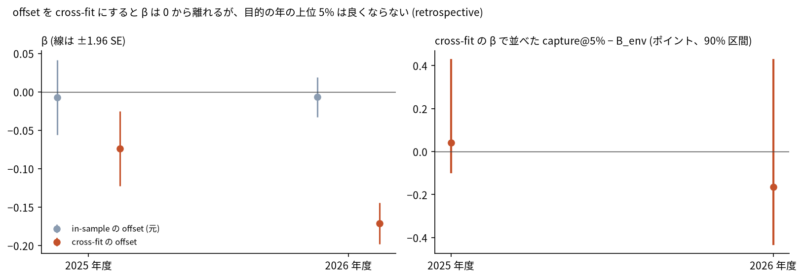

# 追加の診断: in-sample の B_env を offset にしたことが β を 0 へ押したか

## 問い

元の確認 ([report.md](report.md)) で β の学習に使った学習の年度の B_env は、その年度の通報で学習したスコア (in-sample) だった。同じ mast_scarcity × 2 km の beech_oak exposure を、学習の年度の通報を見ていない cross-fit の B_env を offset にして当て直しても、2025 年度と 2026 年度 (4〜9 月) の追加の価値は 0 のままか。post-hoc methodological diagnostic で、元の確認の結論 (preregistered experiment では not supported) は書き換えない。

## 結論

in-sample の offset は β を 0 へ押していた。cross-fit にすると β は 0 から離れた (2025 年度の目的で −0.007 から −0.074、2026 年度で −0.007 から −0.171)。しかし既存の B2、B3 の面で目的の年を並べると、capture@5% は良くならなかった (+0.0004、−0.0016、どちらも 90% 区間が 0 をまたぐ)。計画で先に決めた型 B (学習の年度の残差には信号らしきものが出るが、未来の年度へは一般化しない) に当たる。元の null は stacking の副作用だけでは説明できず、`mast × static beech/oak exposure` の枝は閉じたままにする。並べ替え (F1、F2) は型 C のときだけ流し直す計画なので、流し直していない。

### 5 つの問いへの答え

| # | 問い | 答え | 数字 (retrospective) | 根拠 |
|---:|---|---|---|---|
| 1 | in-sample の B_env の offset は β を 0 へ押していたか | 押していた。in-sample のスコアは学習の年度の通報にかなり当てはまっており、残差に残る信号が小さくなっていた | 学習の年度の capture@5%、in-sample 対 cross-fit: 2023 年度 0.944 対 0.541 (b2 の面)、2025 年度 0.757 対 0.552 (b3 の面) | [表 1](#表-1-offset-の当てはまり) |
| 2 | cross-fit 後の β はどれくらい変わったか | 大きさで約 10 倍と約 25 倍になり、0 から SE の 3〜12 倍離れた。符号は負 | 2025 年度の目的: −0.007 (SE 0.025) から −0.074 (SE 0.025)。2026 年度: −0.007 (SE 0.013) から −0.171 (SE 0.014) | [図 1](#図-1-β-と目的の年の-capture5-の差) |
| 3 | 2025 と 2026 の capture@5% は改善したか | しなかった | 2025 年度 +0.0004 (90% −0.0010〜+0.0043)、2026 年度 −0.0016 (−0.0043〜+0.0043) | [図 1](#図-1-β-と目的の年の-capture5-の差) |
| 4 | 元の negative result は methodological artifact だった可能性があるか | β の大きさについては artifact だった。目的の年の順位について null だったことは artifact ではない。β を正しく当て直しても順位は良くならない | 型 B | [表 2](#表-2-β-と目的の年の差) |
| 5 | mast × beech/oak exposure の枝を閉じきってよいか | よい。cross-fit でも目的の年の改善は出ず、型 C (立て直しの候補) に当たらない | 2 年度とも区間が 0 をまたぐ | [表 2](#表-2-β-と目的の年の差) |

### 図 1: β と目的の年の capture@5% の差

左は β (線は ±1.96 SE)。灰色が元の in-sample の offset で、赤が cross-fit の offset。右は cross-fit の β で並べたときの capture@5% − B_env (ポイント)。β が負なのは、学習の年度で、ブナ・ナラ類の多い所の通報が B_env の予測より少なく、不足の大きい年ほどその差が大きかったことを表す。ブナ・ナラ類の多いセルは、もともと B_env の上位 5% の外に多い (Spearman 約 −0.67)。そのため、そこを下げても上位 5% の中はほとんど入れ替わらない。この符号を生態の因果として読まない。

### 表 1: offset の当てはまり

学習の年度ごとに、元の確認で使った in-sample の面と cross-fit の面を、その年度の通報で採点した ([x1_crossfit_benv.json](outputs/x1_crossfit_benv.json))。

| 目的 | 学習の年度 | in-sample の面 | capture@5% (in / cross) | AUC (in / cross) | AP (in / cross) | 2 つのスコアの Spearman |
|---|---|---|---|---|---|---|
| 2025 年度 | 2023 | b2 | 0.944 / 0.541 | 0.989 / 0.931 | 0.333 / 0.036 | 0.955 |
| 2025 年度 | 2024 | b2 | 0.930 / 0.534 | 0.986 / 0.925 | 0.155 / 0.016 | 0.962 |
| 2026 年度 | 2023 | b3 | 0.774 / 0.621 | 0.967 / 0.944 | 0.113 / 0.054 | 0.986 |
| 2026 年度 | 2024 | b3 | 0.754 / 0.559 | 0.964 / 0.931 | 0.042 / 0.018 | 0.985 |
| 2026 年度 | 2025 | b3 | 0.757 / 0.552 | 0.969 / 0.938 | 0.280 / 0.121 | 0.971 |

cross-fit の 5 つの組のうち {2023} と {2023, 2024} は、既存の b1、b2 の保存済みスコアと float32 で完全に一致した。同じ手順で学習の年度だけを変えたことの確認になる。

### 表 2: β と目的の年の差

[x2_crossfit_beta.json](outputs/x2_crossfit_beta.json) から。差は M5 − B_env で、括弧は 10 km ブロックの復元抽出の 90% 区間。

| 目的 | mast | β (元 / cross-fit) | SE (cross-fit) | β × 不足 (元 / cross-fit) | capture@5% の差 | capture@10% の差 | 件数の重み付き capture@5% の差 |
|---|---|---|---|---|---|---|---|
| 2025 年度 | retrospective | −0.007 / −0.074 | 0.025 | −0.036 / −0.369 | +0.0004 (−0.0010〜+0.0043) | +0.0040 (−0.0002〜+0.0047) | +0.0011 (−0.0008〜+0.0047) |
| 2025 年度 | operational | −0.006 / −0.075 | 0.026 | −0.029 / −0.345 | 0.0000 (−0.0009〜+0.0041) | +0.0038 (−0.0002〜+0.0043) | +0.0010 (−0.0008〜+0.0044) |
| 2026 年度 | retrospective | −0.007 / −0.171 | 0.014 | −0.012 / −0.308 | −0.0016 (−0.0043〜+0.0043) | −0.0003 (−0.0040〜+0.0037) | −0.0009 (−0.0044〜+0.0050) |
| 2026 年度 | operational | −0.003 / −0.176 | 0.015 | −0.004 / −0.247 | −0.0007 (−0.0039〜+0.0040) | 0.0000 (−0.0034〜+0.0034) | −0.0003 (−0.0039〜+0.0045) |

元の確認での capture@5% の差は +0.0002 と +0.0003 だった ([b3_confirm.json](outputs/b3_confirm.json))。cross-fit にすると点推定は 2026 年度でむしろ下がり、区間は広がった。

## データ

元の確認と同じ入力 ([report.md](report.md) のデータの節)。植生 `yuiseki/akita-vegetation-2024` 版 b3b36a0、クマの格子と通報と保存済みの B_env の面 (`artifacts/_bear/akita-bear-risk-grid-100m/`)、秋田の豊凶指数 (`projects/_bear/beech-masting-triggers/outputs/tohoku_beech_index.csv`)。cross-fit の B_env のスコアは `artifacts/_bear/akita-bear-mast-exposure/crossfit_benv_scores.npz` (sha256 は x1 の JSON)。

## 方法

- 計画: [EXPERIMENT_PLAN_CROSSFIT.md](EXPERIMENT_PLAN_CROSSFIT.md) を、cross-fit のスコアを作る前にコミットした。3 つの型の読み方もそこで決めた。
- cross-fit の B_env: 既存の `model_eval.run_models(..., ["B_env"])` (静的な特徴量 28、HistGradientBoostingClassifier、同じハイパーパラメータ、県内の全セル、種 0) を、学習の年度だけ変えて 5 回呼んだ。2025 年度の目的では 2023 年度の offset を {2024}、2024 年度の offset を {2023} で学習した。2026 年度の目的では 2023 を {2024, 2025}、2024 を {2023, 2025}、2025 を {2023, 2024} で学習した。
- β: 元と同じ logit P = α(年) + logit(B_env の cross-fit) + β × mast_scarcity(年) × exposure。目的の年は logit(既存の B2、B3 の面) + β × mast_scarcity(目的) × exposure で並べた。exposure、半径、mast、指標、ブロックの復元抽出は元の凍結した仕様 (sha256 655c8590…) のまま。
- 記録は [EXPERIMENT_TRACKER.md](EXPERIMENT_TRACKER.md) の R012〜R015。

## 確かめていないこと

- cross-fit の offset は学習の年度が 1〜2 少ないモデルなので、元の in-sample の面より弱い。β の大きさは、この弱さの分を拾っている可能性もある。
- 目的の年の面は、計画どおり既存の B2、B3 (cross-fit でない学習の組) のままで、β を当てた offset とは別のモデル。
- 型 B の判断で、β の符号 (負) を生態の向きとしては調べていない。森の縁や集落までの距離との交互作用は、この診断の範囲の外で、ここでは試していない。
