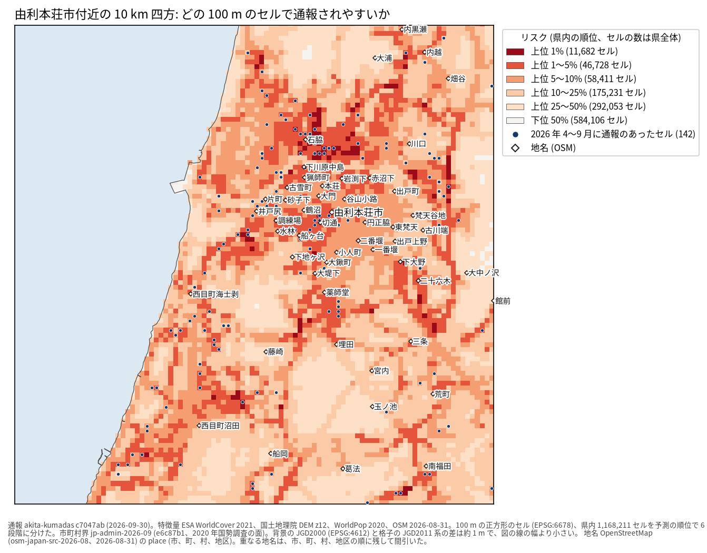
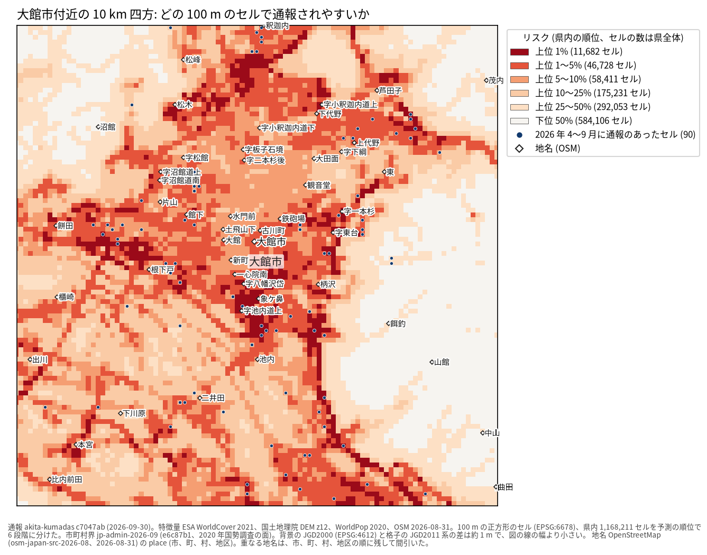
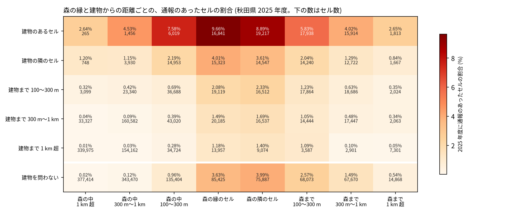

# 秋田県の 100 m セルごとのクマ出没通報のリスク: 図で読む要点

## 問い

秋田県の 100 m セルごとに、次の熊の年度 (4 月〜翌 3 月) にクマの出没通報が 1 件以上ある起こりやすさを、環境と過去の通報から予測し、重点地区の候補を絞る地図にできるか。

## 結論

### 要点

| # | 要点 | 数字 | 図 |
|---:|---|---|---|
| 1 | 環境から学習した地図は、過去の通報の密度や人口の順位より、次の年度の通報をよく捉える (確認、2 つの年度とも支持) | 上位 5% のセル (58,411) に、通報のあったセルの 0.552 (2025 年度)、0.539 (2026 年度の 4〜9 月)。過去の通報の密度は 0.360、0.326、人口は 0.373、0.365。でたらめは 0.05 | [図 1](#図-1-モデルと基準の当たり) |
| 2 | 過去の通報を特徴量に足しても上乗せは無く、地図は環境だけのモデルで描いた (確認) | 環境と過去の通報 − 環境だけ: 2025 年度 −0.011 (90% 区間 −0.025〜+0.003)、2026 年度 −0.024 (−0.041〜−0.008) | [図 1](#図-1-モデルと基準の当たり) |
| 3 | 高く塗られるのは、森と人里の境目 | 建物のある森の縁のセルは 9.66% に通報があり、森の奥 (1 km 超) は 0.02% | [図 4](#図-4-森の縁と建物) |
| 4 | 色は確率ではなく県内の順位。確率の水準は年度で合わない | 2025 年度、環境と過去の通報のモデルの予測の平均 0.0015 に対し、実際の割合 0.0092 | [図 2](#図-2-県全体の地図) |
| 5 | 強みは 100 m の単位で場所を絞ること。1 km に粗くすると基準との差はほぼ消える | 1 km、2025 年度で、上限 0.202 に対し環境のモデル 0.192、過去の通報の密度 0.179 | [表 1](#表-1-単位を粗くしたとき) |

### 読み手ごとに知るべきこと

| 読み手 | 結論 | 検討する材料 | 詳しく |
|---|---|---|---|
| 県の担当 (重点地区の候補を県全体から絞る) | 上位 5% のセル (58,411) に、2026 年度 4〜9 月の通報のあったセルの 0.539 が入った。上位 10% まで広げると 0.764 | 上位 1% (11,682 セル) の分布する市町村、色を確率として読まないこと | [図 2](#図-2-県全体の地図) |
| 市町村の担当 (見回り、注意喚起、誘引物の除去) | 通報の多かった秋田市、由利本荘市、大館市の 10 km 四方では、通報は濃い赤の帯 (森と住宅地の境目) に並ぶ | 拡大図で濃い赤なのに通報の点の無い町、点が多いのに色の薄い町 | [図 3](#図-3-通報の多かった-3-か所) |
| ほかの地域で同じ地図を作る人 | 秋田のモデルをそのまま移すと当たりは下がる (岐阜 0.175、京都 0.160、石川 0.381) | 気候の平年値を足し、複数の地域で学ぶ設定 | [bear-risk-transfer](../bear-risk-transfer/report.md)、[bear-risk-sources](../bear-risk-sources/report.md) |

### 図 1: モデルと基準の当たり

capture@5% は、リスク上位 5% のセルに、その年度に通報のあったセルの何割が入ったか。予測より後の年度で採点した。計画で固定した比較 (環境と過去の通報のモデル − 過去の通報の密度) は、2025 年度 +0.181 (+0.138〜+0.230)、2026 年度 +0.189 (+0.160〜+0.225)。通報の件数で数えると、上位 5% に 0.591 (2025 年度)、0.562 (2026 年度) が入る。

### 図 2: 県全体の地図

2023〜2025 年度で学習した環境のモデルの、2026 年度の予測の県内の順位を 6 段階に分けた。上位 1% は 11,682 セル、上位 1〜5% は 46,728 セル。色の差は順位の差で、2025 年度のような大量出没の年の多さは表さない。

### 図 3: 通報の多かった 3 か所

2026 年度 4〜9 月の通報のセルが最も多い 10 km 四方を、市町村ごとに 1 つずつ選んだ (通報のセルは 312、142、90)。1 つの四角が 100 m のセル。地名は重ならないように間引き、描いたのは 80、51、49。通報の点は通報された住所や目印で、クマのいた場所とは限らない。

### 図 4: 森の縁と建物

2025 年度に通報のあったセルの割合。森の縁のセル (3.63%) と森の隣のセル (3.99%) が最も高く、建物があると 9.66%、8.89% に上がる。森の奥 (1 km 超、0.02%) と、森から 1 km 超の平地 (0.54%) は低い。記述で、森の縁が通報を起こすとは読まない。

### 表 1: 単位を粗くしたとき

| 単位 | 年度 | 環境のモデル | 過去の通報の密度 | 人口 | 上位 5% に入れられる上限 |
|---|---|---:|---:|---:|---:|
| 100 m | 2025 | 0.552 | 0.360 | 0.373 | 1.0 |
| 500 m | 2025 | 0.316 | 0.251 | 0.252 | 0.436 |
| 1 km | 2025 | 0.192 | 0.179 | 0.175 | 0.202 |
| 1 km | 2026 | 0.237 | 0.216 | 0.218 | 0.369 |

粗い単位では、通報のあるセルが上位 5% に収まりきらず、上限が下がる。どの地域かはどの方法でも当たり、差が残るのは 100 m の単位で地域の中の場所を絞るところ。全ての値は `outputs/b2_confirm_2023-2024_to_2025_maup.json` と `outputs/b3_confirm_2023-2025_to_2026_maup.json`。

### 読み方で変わる答え

| 読み方 | 主 | 別の読み方 |
|---|---|---|
| 当たりの数え方 | 通報のあったセル: 0.552 (2025 年度) | 通報の件数: 0.591 |
| 上位の範囲 | 5%: 0.539 (2026 年度) | 1%: 0.167、10%: 0.764 |
| 地図のモデル | 環境だけ: 0.539 | 環境と過去の通報: 0.515 |
| 目的変数 | 全ての通報 (目撃、痕跡、食害、人身被害) | 目撃だけでも、環境と過去の通報 − 過去の通報の密度は +0.183 (2025 年度) |
| 単位 | 100 m | 500 m と 1 km で差は縮む ([表 1](#表-1-単位を粗くしたとき)) |

## データ

- 通報: `yuiseki/akita-kumadas-wildlife-sighting` 版 c7047ab (配布元の 2026-09-30 時点、2026-10-26 取得)。クマの通報 23,306 件 (目撃、痕跡、食害、人身被害)。熊の年度ごとに 864 (2022)、3,895 (2023)、1,586 (2024)、13,592 (2025)、3,369 (2026 の 4〜9 月)。県のセルの外に落ちたのは 8 件。
- 格子: `yuiseki/jp-admin-2026-09` 版 e6c87b1 の市町村の面から、平面直角座標系 X 系 (EPSG:6678) の 100 m の正方形。中心が県内にある 1,168,211 セル (11,682.1 km²)。市町村の面に入る港の海面 (約 64 km²) を含む。
- 土地被覆: ESA WorldCover 2021 v200 (10 m)。標高: 国土地理院の標高タイル z12 (2026-10-26 取得)。値の無い県内セル 6,431 は、WorldCover で 99.8% が水域。
- 人口: WorldPop R2025A の 2020 年 100 m (constrained)。県内の合計 976,508 人で、2020 年国勢調査の 1.018 倍。
- 道路、川、建物、地名: `yuiseki/osm-japan-src-2026-08` 版 9a9b4a7 (2026-08-31)。線 288,085 本、建物の重心 677,156。© OpenStreetMap contributors。

## 方法

- 目的変数は、セル × 熊の年度で通報が 1 件以上あるか。環境のモデルの特徴量は、土地被覆の割合 (セル、500 m、1.5 km)、森の縁からの距離、標高、傾斜、周りとの標高の差、人口 (500 m、2 km)、道路、川、建物までの距離、周りの建物の数。座標と市町村は入れていない。環境と過去の通報のモデルは、予測する年度より前の通報の密度と距離を足した。
- モデルは勾配ブースティングの分類 (scikit-learn 1.9.1、300 木、学習率 0.05、葉 63、葉の最小 500、L2 1.0、種 0)。開発は 2023 → 2024 年度 (探索)。確認は 2023〜2024 → 2025 年度と 2023〜2025 → 2026 年度 4〜9 月で、規則と指標は確認の数字を見る前に [計画](EXPERIMENT_PLAN.md) に固定し、実行は [記録](EXPERIMENT_TRACKER.md) に残した。区間は 10 km 四方のブロック (156 個) を 1,000 回引き直した 90% 区間。
- 地図のモデルを環境と過去の通報から環境だけに変えたのは、確認の結果を見た後 (計画の変更に記録)。環境のモデルの点数は、選んだ分だけ楽観的に読む。
- 地図は `analysis-visualize` の map-context に合わせ、市町村界と地名を重ね、セルを正方形のまま描き、凡例を地図の外に置いた。描いたセル 1,168,211 を格子のセル数と照らし、文字の重なりは 4 枚の地図で 0 件 (`outputs/risk-maps-v2.json`)。背景の JGD2000 と格子の差 (約 1 m) は線の幅より小さいとして変換せずに重ねた。
- 関門: 距離と面積は EPSG:6678 で測った。過去の通報の特徴量は予測する年度より前だけから作り (テストで確認)、並べ替えると下がる (2026 年度で −0.065)。乱数の種 (0、1、2 で 0.540〜0.543) で向きは同じ。残差の空間自己相関は測っていない。同じセルが学習と試験の両方の年度に出るので、これは既知の場所の未来の評価。
- 再実行は [README.md](README.md)。

## 確かめていないこと

- リスクは「クマがいる確率」ではなく「人に見られて通報される起こりやすさ」。通報の点の位置の誤差は測っていない。
- 年度の水準を当てる説明変数 (ブナの結実、気象) は入っていない。2026 年度は 4〜9 月だけで確かめ、秋の通報が出たら同じ地図をもう一度確かめられる。
- 静的な特徴量の時点 (土地被覆 2021、人口 2020、OSM 2026-08) は 2023〜2026 年度で変わらないとみなした。
- 県境の近くでは、周りの人口と土地被覆の集計が少なめに出る (距離は 5 km 広げて測った)。
- 特徴量ごとの効き方は測っていない。
