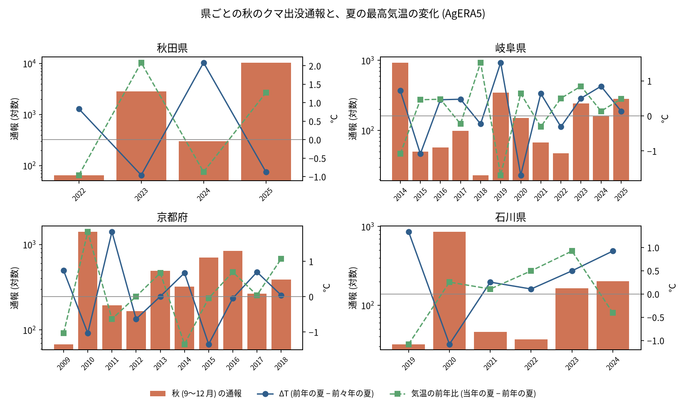
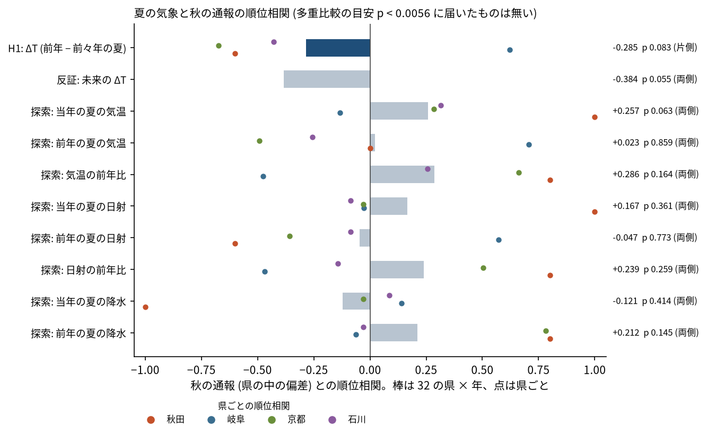

# クマの大量出没の年を、前の年の気温で説明できるか: 図で読む要点

## 問い

秋田県、岐阜県、京都府、石川県の県 × 年の秋 (9〜12 月) のクマの出没通報の多さは、夏の気温、日射量、降水量で説明できるか。

## 結論

### 要点

| # | 要点 | 数字 | 図 |
|---:|---|---|---|
| 1 | 流す前に固定した H1 (前年の夏 − 前々年の夏の気温差 ΔT が小さい年ほど秋の通報が多い) は、規則では判断できない | 32 の県 × 年で順位相関 −0.285 (片側 p 0.083)。県ごとには秋田 −0.60、京都 −0.67、石川 −0.43 で、岐阜は +0.62 と逆 ([h1.json](outputs/h1.json)) | [図 1](#図-1-県ごとの秋の通報と気温の変化)、[図 2](#図-2-指標ごとの順位相関) |
| 2 | 関係するはずのない「未来の ΔT」も同じくらい関係して見え、ΔT が効いているとは区別できない | 未来の ΔT −0.384 (両側 p 0.055) ([h1.json](outputs/h1.json)) | [図 2](#図-2-指標ごとの順位相関) |
| 3 | 結果を見た後に並べた気温、日射、降水の 8 つは、どれも多重比較の目安に届かず、県で向きがそろわない | 目安 p < 0.0056。最も強いのは当年の夏の気温 +0.257 (p 0.063) ([explore_weather.json](outputs/explore_weather.json)) | [図 2](#図-2-指標ごとの順位相関) |
| 4 | 大量出没の秋の多くは、ΔT が −1 °C 前後で、当年の夏が前年より暑い年だった。岐阜は当てはまらない | 秋田 2023 年 (ΔT −0.96、前年比 +2.08)、2025 年 (−0.87、+1.27)、京都 2010 年 (−1.03、+1.84)。岐阜の多い年は ΔT が正 (2014 年 0.72、2019 年 1.52) ([h1_table.csv](outputs/h1_table.csv)) | [図 1](#図-1-県ごとの秋の通報と気温の変化) |

### 読み手ごとに知るべきこと

| 読み手 | 結論 | 検討する材料 | 詳しく |
|---|---|---|---|
| 秋の出没に備える県や市町村の担当 | 夏の気温から秋の大量出没を当てる根拠は、この 32 の県 × 年からは得られない | 実り (ブナなどの豊凶の調査) の公表と、夏の通報の件数 | [japan-bear-sighting-forecast](../japan-bear-sighting-forecast/report.md) |
| 気象と出没の関係を調べる人 | 県 × 年が少なく (県ごとに 4〜12 年)、関係はあるともないとも言えない | 都道府県ごとの月別の出没件数、実りの調査 | [確かめていないこと](#確かめていないこと) |

### 図 1: 県ごとの秋の通報と気温の変化

棒は秋の通報 (対数)、青の線は ΔT、緑の破線は気温の前年比。秋田、京都、石川では、棒の高い年に青の線が下がる年が多い。岐阜では、多い年 (2014 年 929 件、2019 年 345 件) に青の線が上がっている。秋田は 4 年しかなく、県の中の順位相関は ±1 に振れやすい。

### 図 2: 指標ごとの順位相関

棒は 32 の県 × 年での順位相関、点は県ごと。目的変数は秋の通報の log(数 + 1) から県の平均を引いた値で、県の中の年の上下だけを見る。p は年を県の中で並べ替える置換 (10,000 回)。点が棒の両側に散らばる指標は、県で向きがそろっていない。

### 読み方で変わる答え

| 読み方 | 主 | 別の読み方 |
|---|---|---|
| 目的変数の期間 | 秋 (9〜12 月): −0.285 (p 0.083) | 年度の全期間: −0.299 (p 0.073) |
| 県の中の年の傾向 | そのまま | 傾向を除く: −0.250 (p 0.099) |
| 県の組 | 4 県 | 1 県ずつ外すと −0.06〜−0.73 (岐阜を外すと −0.73) |

## データ

- 通報: `akita-kumadas-wildlife-sighting` 版 c7047ab (2022〜2025 年)、`gifu-bear-sighting` 版 b7f5947 (FY2014〜FY2025。月の読めない 32 行は秋に入れない)、`kyoto-bear-sighting` 版 a2a50c4 (FY2009〜FY2018、2018 年は 12 月 10 日まで)、`ishikawa-bear-incident` 版 d2b77a2 (2019〜2024 年。要因別の 5 表の重なりを除く)。県 × 年は 32 ([outcomes.csv](outputs/outcomes.csv))。
- 気温: `agera5-japan-monthly-temperature-1979-2026` 版 348e459 (AgERA5 v2.0 の月別平均最高気温)。県の市町村の面 (`jp-admin-2026-09` 版 e6c87b1) に入る 0.1 度格子の中心の平均 (秋田 125、岐阜 106、京都 49、石川 44 点)。
- 日射量と降水量: AgERA5 の日別の solar radiation flux と月別の precipitation flux (FAO の COG、2026-10-26 取得)。日射は 2006〜2025 年の夏で 1,763 日 (目録に 77 日分が無く、夏ごとに 74〜92 日)。降水の単位は確かめていない (県の中の偏差だけを使う)。

## 方法

- 検定は 32 の県 × 年での順位相関と、年を県の中で並べ替える置換 (10,000 回、種 0)。H1 は片側 (負)、探索は両側。多重比較は Bonferroni の目安 (9 個で p < 0.0056) だけ。
- H1 と判定の規則、頑健性、反証は、気象の値を 1 つも読む前に [計画](EXPERIMENT_PLAN.md) に固定した。探索は H1 の判定を見た後に計画の変更に書いてから流した。実行は [記録](EXPERIMENT_TRACKER.md)。
- 関門: 0.1 度格子の中心を県の面に入れて平均し、面積の重みは付けていない。通報は量、気温と日射は水準、降水は 3 か月の和。気象は全て通報の年以前 (未来の ΔT は反証のためだけ)。年は県の間で同時に動く (全国的な大量出没の年) ので、置換の p は楽観的になりうる。地図は描いていない。
- 図は `scripts/plot.py` と `scripts/plot_rho.py` で、数値は [h1.json](outputs/h1.json) と [explore_weather.json](outputs/explore_weather.json)。

## 確かめていないこと

- 32 の県 × 年は少ない。数百の県 × 年で同じ規則を試すには、都道府県ごとの月別の出没件数 (環境省が公表していると理解しているが、形式と期間は確かめていない) が要る。
- ブナなどの実りの調査は使っていない。気温 → 実り → 出没の筋は確かめていない。
- AgERA5 は再解析の格子値で、観測所の値ではない。日照時間は無く、日射量で代えた。
- 岐阜の逆向きの理由 (集め方の変化、実りの樹種、FY2014 の多さ) は確かめていない。
- Kelly らの ΔT のモデルの引用は記憶によるもので、原典を確かめていない。
