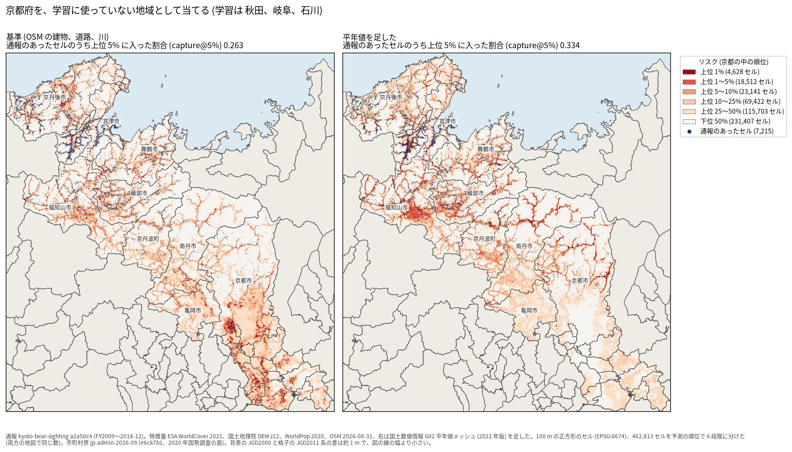

# データの出どころ、気候、学習の地域の数で、クマ出没リスクの地図はどれだけ移せるか: 図で読む要点

## 問い

100 m セルのクマ出没通報のリスクのモデルを学習に使っていない県へ当てはめたときの当たりは、建物、道路、川のデータの出どころ、気候の平年値、学習に使う地域の数 (1〜3) で、どう変わるか。

## 結論

全て探索 (4 地域の結果を見ながら比べた)。指標は capture@5% (学習に使っていない地域のセルの上位 5% に、通報のあったセルの何割が入るか。でたらめは 0.05) の、学習の組と伏せた地域の組の平均。

### 要点

| # | 要点 | 数字 | 図 |
|---:|---|---|---|
| 1 | 気候の平年値を足すのが、群を抜いて効いた | 3 地域で学習して 0.264 から 0.433。基準より良かったのは 28 組中 25 組 ([mean_by_k.csv](outputs/mean_by_k.csv)、[pairs_better_than_base.csv](outputs/pairs_better_than_base.csv)) | [図 1](#図-1-設定と学習の地域の数) |
| 2 | 学習の地域を増やす効果は、気候を入れたときに大きい | 平年値ありは 1 地域 0.341 から 2 地域 0.428。基準は 0.252 から 0.264 ([mean_by_k.csv](outputs/mean_by_k.csv)) | [図 1](#図-1-設定と学習の地域の数) |
| 3 | 気候は、クマのいない暖かい平地を下げる | 岐阜を他の 3 地域で学習して当てると、基準 0.285 が平年値ありで 0.490。京都は 0.263 から 0.334 で、上がり方は小さい ([map-gifu-base-vs-clim.json](outputs/map-gifu-base-vs-clim.json)、[map-kyoto-base-vs-clim.json](outputs/map-kyoto-base-vs-clim.json)) | [図 2](#図-2-岐阜を当てる)、[図 3](#図-3-京都を当てる) |
| 4 | OSM の建物は外すか Overture に替えると少し良く、道路は外すと全ての組で悪くなる。川はほぼ効かない | 3 地域で建物なし 0.303、建物 Overture 0.301。道路なし 0.221 (28 組中 0 組が基準より良い)。川なし 0.271 ([matrix_a.csv](outputs/matrix_a.csv)、[pairs_better_than_base.csv](outputs/pairs_better_than_base.csv)、[mean_by_k.csv](outputs/mean_by_k.csv)) | [図 1](#図-1-設定と学習の地域の数) |
| 5 | 3 地域で学習し平年値と Overture の建物を使うと、その地域で学習したモデルとの差は縮まるが、まだ届かない | 岐阜 0.512 対 0.648、石川 0.494 対 0.622、京都 0.306 対 0.472 ([k3_per_target_vs_local.csv](outputs/k3_per_target_vs_local.csv)) | [表 1](#表-1-3-地域で学習したときの地域ごとの当たり) |

### 読み手ごとに知るべきこと

| 読み手 | 結論 | 検討する材料 | 詳しく |
|---|---|---|---|
| 記録の無い地域でリスクの地図を作る人 | 1 つの県から移すより、気候の平年値を足し、2 つ以上の地域で学ぶ。3 地域で平均 0.439 | 学習に入れる地域の気候の幅、建物のデータの描き込みの濃さ | [図 1](#図-1-設定と学習の地域の数) |
| 特徴量のデータを選ぶ人 | 道路は必須だが出どころ (OSM、Overture、国土数値情報) の差は小さい。建物は Overture の方が地域の差が小さい | 地域ごとの建物の描き込み ([bear-risk-transfer](../bear-risk-transfer/report.md)) | [図 1](#図-1-設定と学習の地域の数) |

### 図 1: 設定と学習の地域の数

青の 3 本が平年値を足した設定で、ほかの設定から離れて上にある。平年値ありの 3 地域で学習した組の、基準との差は +0.071〜+0.269 (4 組)。全ての値は [mean_by_k.csv](outputs/mean_by_k.csv)、基準との差の最小と最大は [diff_from_base.csv](outputs/diff_from_base.csv)。

### 図 2: 岐阜を当てる

左の基準は、濃尾平野 (岐阜市、大垣市の周り) の森の縁を高く塗るが、通報の点は少ない。右の平年値ありは、平野を下げ、通報の集まる飛騨 (高山市、飛騨市) と郡上市を上げた。濃い色は県内の順位で、確率ではない。

### 図 3: 京都を当てる

平年値ありは、京都盆地の南を下げた。ただし通報の集まる北部 (京丹後市、宮津市、福知山市) より、中部の山地を高く塗り、上がり方は小さかった。

### 表 1: 3 地域で学習したときの地域ごとの当たり

| 伏せた地域 | 基準 | 平年値を足す | 平年値 + 建物 Overture | その地域で学習 (参考) |
|---|---:|---:|---:|---:|
| 岐阜 | 0.285 | 0.490 | 0.512 | 0.648 |
| 石川 | 0.201 | 0.470 | 0.494 | 0.622 |
| 京都 | 0.263 | 0.334 | 0.306 | 0.472 |
| 秋田 | 0.306 | 0.438 | 0.445 | |

秋田の「その地域で学習」は、時間で分けた評価で数え方が違うので並べない。全ての値は [k3_per_target_vs_local.csv](outputs/k3_per_target_vs_local.csv)。

### 読み方で変わる答え

| 読み方 | 主 | 別の読み方 |
|---|---|---|
| 建物の扱い (平年値あり、3 地域) | Overture: 0.439 | 建物なし 0.432、OSM 0.433 |
| 学習の地域の数 | 3 地域: 平年値あり 0.433 | 2 地域 0.428、1 地域 0.341 |
| 学習の点の数 | 学習の組の全てのセル | 陰性を 1 割に間引くと 0.01〜0.05 動き、設定の差と区別できなかった |

## データ

- 地域と目的変数: 秋田県 (2022-04〜2026-09、`akita-kumadas-wildlife-sighting` 版 c7047ab)、岐阜県 (FY2014〜FY2025、`gifu-bear-sighting` 版 b7f5947)、京都府 (FY2009〜2018-12、`kyoto-bear-sighting` 版 a2a50c4)、石川県 (2019-01〜2025-06、`ishikawa-bear-incident` 版 d2b77a2)。期間の中に通報が 1 件以上ある 100 m セル。
- 共通の特徴量: ESA WorldCover 2021、国土地理院の標高タイル z12、WorldPop 2020 100 m。市町村界と地図の背景は `jp-admin-2026-09` 版 e6c87b1。
- OSM: `osm-japan-src-2026-08` 版 9a9b4a7 (2026-08-31)。© OpenStreetMap contributors。
- Overture: リリース 2026-09-23.1。transportation/segment (道路)、base/water の線 (川)、buildings/building (重心)。岐阜の建物の出どころは OSM 4,242,970、Microsoft ML 3,127,032、ほか 287,914。
- 国土数値情報 (2026-10-26 取得): N13 道路 (2024 年)、W05 河川 (2007〜2009 年)、G02 平年値メッシュ (2022 年版、1991〜2020 年の平年値)。W05 と G02 は再配布が不可で、原本は手元に置き、集計した結果だけを示す。
- N13 と W05 の区分 (主な道路、林道や小道、川と沢) は、製品仕様のコード表で確かめ、結果を見る前に決めた (対応は [計画](EXPERIMENT_PLAN.md))。

## 方法

- 4 地域から学習の組 (1 地域 4、2 地域 6、3 地域 4 の 14 通り) を作り、組の外の地域を当てた。設定ごとに 28 の (学習の組、伏せた地域)。設定どうしは同じ組で差を取った。
- モデルは勾配ブースティングの分類 (scikit-learn、300 木、学習率 0.05、葉 63、葉の最小 500、L2 1.0、種 0)。特徴量の作り方は出どころによらず同じ (`grid-risk-mapping` スキルの `grid_distance.py`)。平年値はセルの中心の 3 次メッシュの値で、7 つ (年平均気温、1 月と 8 月の平均気温、年最深積雪、年降水量、年間の日照時間、全天日射量)。
- 比べる設定と差し替えの対応は結果を見る前に [計画](EXPERIMENT_PLAN.md) に決めた。組み合わせの 2 設定は、1 つずつの結果を見た後に足した。実行は [記録](EXPERIMENT_TRACKER.md)。
- 区間は付けていない (28 組は互いに独立でない)。代わりに、良かった組の数と差の最小と最大を並べた。
- 地図は `analysis-visualize` の map-context に合わせ、市町村界と名前を重ね、凡例を外に置いた。描いたセル (岐阜 1,061,834、京都 462,813) を格子のセル数と照らし、文字の重なりは 0 件 ([map-gifu-base-vs-clim.json](outputs/map-gifu-base-vs-clim.json))。国勢調査の面の小さな穴は、輪郭が通報の点と紛らわしいので埋めて描いた。
- 再実行は [README.md](README.md)。

## 確かめていないこと

- 4 地域の結果を見ながら比べた探索で、確認ではない。良かった設定は、まだ使っていない地域で確かめる必要がある。
- 平年値は 7 つをまとめて足し、どれが効いたかは分けていない。
- 気候が「クマのいない地域」を下げるのは分布の情報の代わりと読めるが、分布の調査と照らし合わせていない。
- 地域ごとの期間 (京都は 2009〜2018 年) と特徴量の時点 (2020〜2026 年) がずれる。
- 地域の数が 4 で、さらに増やすと上がるかは分からない。
