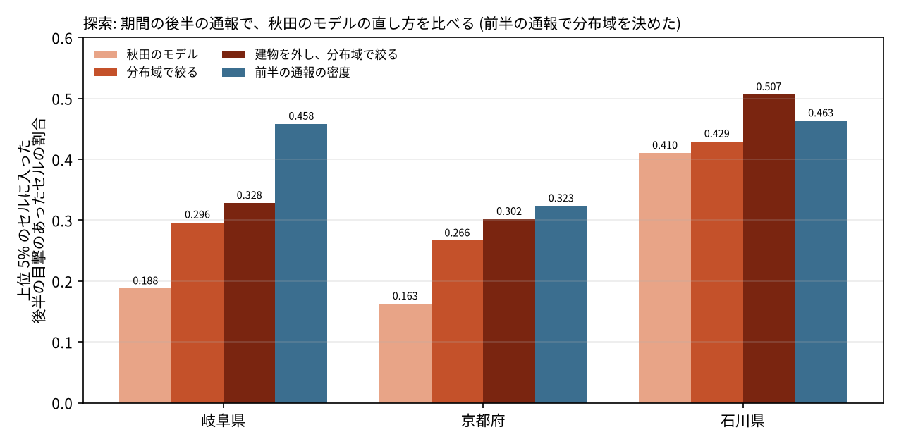
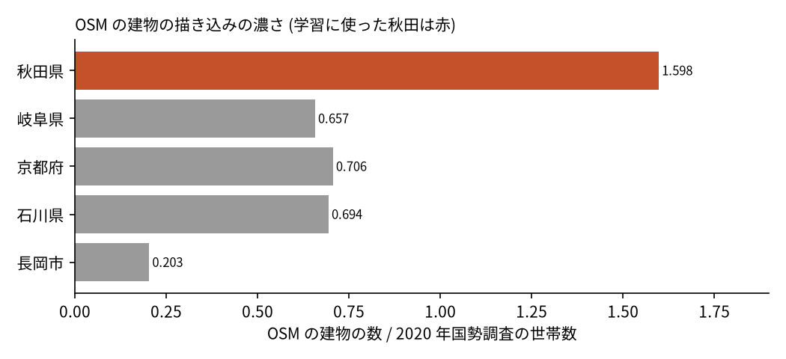

# 秋田で学習したクマ出没リスクのモデルを、ほかの地域へ移す: 図で読む要点

## 問い

秋田県の 100 m セルで学習したクマ出没通報のリスクのモデル (環境だけのモデル) は、学習に使っていない岐阜県、京都府、石川県、長岡市で、目撃のあるセルを絞れるか。

## 結論

### 要点

| # | 要点 | 数字 | 図 |
|---:|---|---|---|
| 1 | 秋田のモデルは、そのままでも人口の順位とでたらめより目撃のある場所を絞れた (確認、3 県とも支持) | capture@5% は岐阜 0.175、京都 0.160、石川 0.381 (人口の順位 0.047、0.002、0.130。でたらめ 0.05) ([transfer-capture.json](outputs/transfer-capture.json)) | [図 1](#図-1-地域ごとの当たり) |
| 2 | ただし秋田の中 (0.539) よりずっと低く、その地域で学習したモデルに大きく及ばない | その地域で学習したモデルとの差は、岐阜 −0.472、京都 −0.313、石川 −0.241 ([matrix_b.csv](../bear-risk-sources/outputs/matrix_b.csv)、[akita_e2_cost.json](outputs/akita_e2_cost.json)、[gifu_scores.json](outputs/gifu_scores.json)) | [図 1](#図-1-地域ごとの当たり) |
| 3 | 下がる理由の 1 つは、クマのいない地域の森の縁まで高く出すこと (探索) | 前半の通報のある 10 km ブロックの外を最下位にすると、後半の通報で岐阜 +0.109、京都 +0.104 ([gifu_e1_whole.json](outputs/gifu_e1_whole.json)、[nagaoka_scores.json](outputs/nagaoka_scores.json)) | [図 2](#図-2-直し方の比較) |
| 4 | もう 1 つは、OSM の建物の描き込みの濃さの違い (探索) | 世帯あたりの OSM の建物は秋田 1.598、ほか 0.203〜0.706。建物を外すと岐阜 +0.046、京都 +0.049、石川 +0.088 ([osm_buildings_per_household.csv](outputs/osm_buildings_per_household.csv)、[gifu_e1_whole.json](outputs/gifu_e1_whole.json)、[ishikawa_e2.json](outputs/ishikawa_e2.json)、[gifu_scores.json](outputs/gifu_scores.json)) | [図 3](#図-3-osm-の建物の濃さ) |
| 5 | 両方を直しても、記録のある地域ではその地域の前半の通報の密度に届かないか、差が見えない | 後半の通報で、直した地図は岐阜 0.328、京都 0.302、石川 0.507。前半の密度は 0.458、0.323、0.463 ([ishikawa_e3.json](outputs/ishikawa_e3.json)、[gifu_e3.json](outputs/gifu_e3.json)、[kyoto_e3.json](outputs/kyoto_e3.json)) | [図 2](#図-2-直し方の比較) |

### 読み手ごとに知るべきこと

| 読み手 | 結論 | 検討する材料 | 詳しく |
|---|---|---|---|
| 目撃の記録がある地域の担当 | まず、その地域の記録の密度か、その地域で学習したモデルを使う。秋田のモデルより当たる (岐阜 0.648 対 0.175) | その地域の記録の期間と集め方 | [図 1](#図-1-地域ごとの当たり) |
| 記録が無い地域の担当 | 建物を外した秋田のモデルを、クマのいる範囲と組み合わせれば、0.302〜0.507 ほどは絞れそう (探索で、確認していない) | 独立した分布の情報 (環境省の分布の調査など) | [図 2](#図-2-直し方の比較) |
| 地図を作る分析者 | 1 つの県から移すより、気候の平年値を足して複数の地域で学ぶ方が当たる | 特徴量の出どころと学習の地域の数 | [bear-risk-sources](../bear-risk-sources/report.md) |

### 図 1: 地域ごとの当たり

capture@5% は、その地域のセルの上位 5% に、目撃のあったセルの何割が入ったか。秋田のモデルと人口の順位の差は、岐阜 +0.128 (90% 区間 +0.099〜+0.167)、京都 +0.157 (+0.119〜+0.190)、石川 +0.251 (+0.185〜+0.309)。長岡市は 160 セルと小さく、+0.056 (−0.009〜+0.104) で記述だけにした。岐阜と京都では人口の順位がでたらめ並みで、越えやすい相手だった。

### 図 2: 直し方の比較

結果を見た後の探索。期間の前半の通報で分布域 (通報のあった 10 km ブロック) を決め、後半の通報で採点した。分布域で絞る効果は岐阜 +0.109 (+0.052〜+0.210)、京都 +0.104 (+0.033〜+0.210)、石川 +0.019 (+0.003〜+0.041)。前半の密度と直した地図の差は、岐阜 +0.130 (+0.036〜+0.199) で密度が上、京都 +0.022 (−0.066〜+0.096) と石川 −0.043 (−0.140〜+0.085) では差が見えない。

### 図 3: OSM の建物の濃さ

学習に使った秋田は、世帯あたりの OSM の建物が他の 2 倍以上ある。建物の特徴量を外して学習し直すと、移す先ではどこも上がり (区間はどれも 0 より上)、秋田の中ではほぼ変わらない (−0.005、−0.016〜+0.008)。どの建物が欠けているかは確かめていない。

### 読み方で変わる答え

| 読み方 | 主 | 別の読み方 |
|---|---|---|
| 当たりの数え方 | 目撃のあったセル: 岐阜 0.175 | 目撃の件数: 岐阜 0.182 |
| 上位の範囲 | 5% | 1% と 10% でも向きは同じ (岐阜で秋田のモデル 0.049 と 0.349、人口 0.002 と 0.112) |
| 採点の期間 | 全期間: 石川 0.381 | 後半だけ: 石川 0.410 ([図 2](#図-2-直し方の比較)) |
| 単位 | 100 m | 1 km にまとめても秋田のモデルが人口の順位を上回る。上限は岐阜 0.270、京都 0.138、石川 0.309 |

## データ

- 学習: 秋田県の 100 m セル 1,168,211、熊の年度 2023〜2025 の通報 (`akita-kumadas-wildlife-sighting` 版 c7047ab)。秋田の地図と同じモデルで、学習し直した予測は保存した予測と全てのセルで一致した。
- 岐阜県: `gifu-bear-sighting` 版 b7f5947、FY2014〜FY2025、6,946 件 (県外 41)、陽性セル 5,755 / 1,061,834。
- 京都府: `kyoto-bear-sighting` 版 a2a50c4、FY2009〜2018-12、10,225 件 (府外 43)、陽性セル 7,215 / 462,813。
- 石川県: `ishikawa-bear-incident` 版 d2b77a2、2019-01〜2025-06。要因別の 5 表 3,798 行を日付、場所、座標の重なりで 2,589 にし、R7 の 103 と合わせて 2,692 件。陽性セル 2,254 / 422,577。
- 長岡市: `nagaoka-bear-sighting` 版 724bde2、FY2014〜FY2015、166 件、陽性セル 160 / 89,071。上砂川町 (北海道) はヒグマで種が違うので外した。
- 特徴量: 秋田と同じ (ESA WorldCover 2021 v200、国土地理院の標高タイル z12 (2026-10-26 取得)、WorldPop 2020 100 m、`osm-japan-src-2026-08` 版 9a9b4a7 © OpenStreetMap contributors、`jp-admin-2026-09` 版 e6c87b1)。人口の合計 / 2020 年国勢調査: 岐阜 1.0072、京都 0.9941、石川 1.0084。

## 方法

- 格子は各地域の平面直角座標系 (岐阜と石川は EPSG:6675、京都は EPSG:6674、長岡市は EPSG:6676) の 100 m の正方形。秋田の格子と特徴量を同じスクリプトで作り直し、元と一致することを確かめた。
- 比べたのは、秋田のモデル (移す先のラベルを見ない)、人口の順位 (周り 500 m)、その地域で学習した同じ設定のモデル (10 km ブロックを 5 組に分けた交差検証、参考)。採点は `grid-risk-mapping` スキルの `score_risk_map.py` で、区間は 10 km ブロックを 1,000 回 (探索は 300 回) 引き直した 90% 区間。
- 主張 T1 と規則は、移す先の指標を 1 つも計算する前に [計画](EXPERIMENT_PLAN.md) に固定した。探索 (分布域、建物を外す) は、結果を見た後に計画の変更に書いてから流した。実行は [記録](EXPERIMENT_TRACKER.md)。
- 関門: 距離は地域ごとの平面直角座標系で測った。人口は合計を国勢調査と照合した。参考のモデルは伏せたブロックを予測し、分布域の探索は前半で決めて後半で採点した。残差の空間自己相関は測っていない。地図は描いていない (移す先の地図は [bear-risk-sources](../bear-risk-sources/report.md))。
- 再実行は [README.md](README.md)。

## 確かめていないこと

- 探索の改善 (分布域、建物を外す) は結果を見た後に選び、別の地域か後の期間で確かめていない。
- 分布域は通報のあった 10 km ブロックで代用し、独立した分布の情報は使っていない。
- 京都 (2009〜2018) と岐阜の前半は、特徴量の時点 (土地被覆 2021、人口 2020、OSM 2026) が目的変数より後。
- 通報の集め方は地域で違い (京都は環境区分の記録あり、岐阜は市町村の担当の入力)、その違いも結果に入る。京都には同じ座標に最大 48 件が重なる場所がある。
- リスクは通報の起こりやすさで、クマがいる確率ではない。
