# クマの出没とブナの豊凶の最終総括: 公開データからの出没予測の限界

## 問い

秋田県を中心としたクマの出没通報について、`_bear/` の 11 のプロジェクトで「どこに」「いつ」「どれだけ」が予測でき、何が予測できなかったか。予測できなかったのは、手法の選び方のためか、公開データの性質のためか。

## 結論

公開されているデータ (クマダスの通報、環境と人の分布、植生、ブナの豊凶、気象、衛星) から熊の出没を予測するモデルを作ることには、限界がある。作れたのは、翌年度に通報の出る 100 m セルの順位までだった。その順位の予測力のほぼ全ては、人側の特徴量 (人口、建物、道路、農地、市街地) から来ている。当てているのは主に「人がいて、熊を見たら通報する、森の縁の場所」で、熊の動きそのものではない。この地図に過去の通報、年の豊凶 × ブナ・ナラ類の植生、季節内の直前の通報を足しても、学習に使っていない年度で当たりは上がらなかった。量と時期 (市町村 × 週、秋の大量出没の年) は、前週の値や前年の結実を超えなかった。

限界の理由は、公開データの側にある。手元の熊の記録は全て、人が見て届けた通報か、聞き取りの分布調査で、熊の正解のデータ (golden data) は無い。通報と独立で、調べた量 (努力) の分かる熊の観測が無いので、通報の増減を熊側の変化と通報の過程の変化に分けられない。これは実データだけでなく、同じ構造の合成データの上でも分けられなかった。合成データで分けるのに効いたのは、捕獲と努力、努力付きのカメラだった。秋田県の公開資料を確かめると、そうしたデータは白神山地周辺の林野庁のカメラの報告書を除いて公開されておらず、捕獲の数と出猟の記録の元の値は県が持っている。

このため、予測変数の探索とモデルの複雑化はここで止める。止めた枝を、特徴量や半径を足して救済しない。次の一手はモデルではなく、県と研究機関へのデータの提供の依頼と、先に凍結した予測の採点にする。

### 一つの式で見る限界

11 のプロジェクトは、どれも次の 1 つの式のどこかを推定しようとしていた。セル $i$、年 $t$ の通報の件数 $Y_{i,t}$ を、熊がそこを使う強さ $\rho_{i,t}$ を、人が熊を見て届ける確率 $\pi_{i,t}$ で間引いた (thinning) ポアソン過程として書く。

```math
Y_{i,t} \sim \mathrm{Poisson}\left(\rho_{i,t}\,\pi_{i,t}\right),\qquad
\log \mathrm{E}\left[Y_{i,t}\right] = \underbrace{\log \rho_{i,t}}_{\text{熊側}} + \underbrace{\log \pi_{i,t}}_{\text{人側と通報の過程}}
```

通報 $Y$ の尤度は積 $\rho\pi$ だけを通して決まるので、どんな $c > 0$ についても $(c\rho,\ \pi/c)$ は同じ尤度を与える。熊側と人側を分けられるのは、$\log\rho$ と $\log\pi$ に別々の説明変数が入り、それらが互いに独立に動くときだけで、秋田ではどちらも成り立たなかった。

- 場所: 熊側の特徴量で作ったスコアと人側の特徴量で作ったスコアは、県内の全セルで Spearman の順位相関 0.791〜0.843 と強く相関し、通報のセルは両方が高い森の縁に集まる ([phase_space.json](../akita-bear-human-interface/outputs/phase_space.json))。2 つの項が同じ場所を指すので、予測には使えても、どちらの項で当てたかは決まらない。当たりは人側の特徴量だけでほぼ出た (要点 8)。
- 年: 年の変化を、熊側の県全体の変化 $g_t$ と通報の過程の年の効果 $a_t$ に分けても、通報が決めるのは和 $a_t + \lambda g_t$ だけ (方法の式 8)。豊凶のように県で 1 つの年の値は、全セルに同じ倍率 $c_t$ を掛けるだけなので、順位を見る capture@k の上では消える (方法の式 1)。
- 打開: $\pi$ を含まず $\rho$ だけを含み、調べた量 $e$ が既知の観測を足すこと。$N \sim \mathrm{Poisson}(e \cdot \exp(\kappa + \lambda' \log\rho))$ で $\kappa$ が年で変わらなければ、$N/e$ の年の変化が熊側の変化を直接決める。捕獲と努力、努力付きのカメラがこれに当たり、合成データでも識別を最も良くした (要点 10)。

### 要点

| # | 要点 | 数字 | 図 |
|---:|---|---|---|
| 1 | 場所は環境だけの地図で絞れる (確認、2 つの年度とも支持) | 上位 5% のセルに、通報のあったセルの 0.552 (2025 年度)、0.539 (2026 年度 4〜9 月)。過去の通報の密度は 0.360、0.326 ([b2_confirm_2023-2024_to_2025.json](../akita-bear-risk-grid-100m/outputs/b2_confirm_2023-2024_to_2025.json)、[b3_confirm_2023-2025_to_2026.json](../akita-bear-risk-grid-100m/outputs/b3_confirm_2023-2025_to_2026.json)) | [図 1](#図-1-環境だけの地図と基準) |
| 2 | B_env に何を足しても、学習に使っていない年度で上がらない (確認) | 過去の通報 −0.011、−0.024。豊凶 × 植生 +0.0002、+0.0003。季節内の活性化 +0.0043 (2026 年)。秋田市の陽性 +0.0308 (90% 区間 0.000〜+0.060) で、下限が 0 を超えず支持されない ([added_predictors.csv](outputs/added_predictors.csv)) | [図 2](#図-2-b_env-に足したものの差) |
| 3 | 秋田市で上がって見えた分は、県の上位 5% が秋田市へ寄っただけだった | 秋田市の中だけで上位 5% を選ぶと −0.0154 (−0.0779〜+0.0538) ([added_predictors.csv](outputs/added_predictors.csv)) | [図 2](#図-2-b_env-に足したものの差) |
| 4 | 市町村 × 週の件数は、前週の値を超えない。秋の大量出没の始まりは見えない | 1 週先の MAE はモデル 2.838、前週値 2.622 (件 / 市町村 / 週)。夏が同じ 794 件と 799 件の 2023 年と 2024 年で、秋は 2,800 件と 338 件 ([dev_b2_paired.csv](../japan-bear-sighting-forecast/outputs/dev_b2_paired.csv)、[data_profile.txt](../japan-bear-sighting-forecast/outputs/data_profile.txt)) | [図 3](#図-3-週の通報件数と凍結した予測) |
| 5 | 年の豊凶は前年の結実が最も確かで、年の中の場所の違いは何でも当てられなかった | 確認期間の RMSE は前年の結実だけ 1.173、気象を足した M7 1.326。年の中の地点の順位は、Landsat の偏差を足すと 0.138 (足さない 0.243) ([b2_b3_confirm.json](../beech-masting-triggers/outputs/b2_b3_confirm.json)、[b3_confirm.json](../beech-masting-satellite-proxy/outputs/b3_confirm.json)) | [図 4](#図-4-ブナの豊凶の確認期間) |
| 6 | 秋田の地図はほかの県へそのまま移すと大きく下がる。気候の平年値と複数の地域で学ぶと戻る (探索) | 岐阜 0.175、京都 0.160、石川 0.381。3 地域で学習して平均 0.264 から、平年値ありで 0.433 ([transfer-capture.json](../bear-risk-transfer/outputs/transfer-capture.json)、[mean_by_k.csv](../bear-risk-sources/outputs/mean_by_k.csv)) | [図 5](#図-5-ほかの地域へ移す) |
| 7 | 地図で見ると、失敗の形は共通している。足した手がかりは、通報の出る里の境目ではない所 (森の奥) を指すか、枠を通報の続く市町村へ寄せるだけだった | 2026 年の秋田市は陽性の 16.4% から 27.3% に増え、当たりは 68.9% から 54.8%。活性化で上位 5% のうち秋田市は 14.9% から 17.8% ([trial_maps.json](outputs/trial_maps.json)) | [図 6〜12](#試行錯誤の順に地図で見る) |
| 8 | B_env の予測力のほぼ全ては人側の特徴量から来ている (確認) | 人側だけのモデルで B_env の当たりの 0.957 (2025 年度) と 0.978 (2026 年度)。熊側だけのモデルは人側だけより 0.127 と 0.159 低い ([b2_confirm_2023-2024_to_2025.json](../akita-bear-human-interface/outputs/b2_confirm_2023-2024_to_2025.json)、[b3_confirm_2023-2025_to_2026.json](../akita-bear-human-interface/outputs/b3_confirm_2023-2025_to_2026.json)) | [図 13](#図-13-予測力は人側から来る) |
| 9 | 熊側の変化と通報の過程の変化は、合成データの上でも分けられない。2 つの観測系に共通の潜在の空間スコアも、観測系をまたぐ予測を良くしない (確認、関門) | 熊側だけが変わる合成データの正答は 3 つの段の全てで 0.0 ([段階 2a](../akita-bear-latent-observation-model/outputs/identifiability_gate_L3.json)、[段階 2](../akita-bear-latent-observation-model/outputs/identifiability_gate_stage2.json)、[段階 3](../akita-bear-latent-observation-model/outputs/identifiability_gate_stage3.json))。環境省の記録を隠すと、共有のモデルは共変量と人側の測定だけより −38.1 ([real_cv_default.json](../akita-bear-latent-observation-model/outputs/real_cv_default.json)) | [図 14](#図-14-熊側と通報の過程は分けられない) |
| 10 | 分けるのに効くのは、通報と独立で努力の分かる熊の観測。それは秋田県ではほぼ公開されていない (合成と公開資料の確認) | 熊側だけ、通報だけの変化の正答は、追加なし 0.0 と 0.4 に対して、捕獲と努力 0.8 と 0.8、努力付きのカメラ 0.7 と 0.8 ([voi_summary.json](../akita-bear-latent-observation-model/outputs/voi_summary.json))。公開されている努力付きの観測は白神山地周辺の林野庁のカメラだけで、捕獲は市町村 × 月の頭数で罠の数も稼働日数も無い ([確認の記録](../akita-bear-latent-observation-model/BEAR_DATA_AVAILABILITY_AUDIT.md)) | [図 15](#図-15-どのデータがあれば分けられるか) |

### 読み手ごとに知るべきこと

| 読み手 | 結論 | 検討する材料 | 詳しく |
|---|---|---|---|
| 県の担当 (重点地区を県全体から絞る) | B_env の上位 5% に、通報のあったセルの 5 割強が入る。年の豊凶や直前の通報で地図を描き替えても、絞り方は良くならない | 上位 5% の地図と、年の水準 (量) は別に見ること | [akita-bear-risk-grid-100m](../akita-bear-risk-grid-100m/report.md) |
| 市町村の担当 (来週どこを見回るか) | 来週の市町村ごとの件数は前週の件数と変わらない。直前 28 日の通報で地図を重み付けても、秋田市の中の順位は良くならない | 森と住宅地の境目、前週の件数 | [japan-bear-sighting-forecast](../japan-bear-sighting-forecast/report.md) |
| 秋の大量出没に備える人 | 夏の気温からも、モデルの週の予測からも、秋の量は当てられない。最も確かなのは前年の結実 (豊作の翌年は凶作) | 東北森林管理局の 7 月の開花の公表、前年の結実 | [beech-masting-triggers](../beech-masting-triggers/report.md)、[bear-outbreak-weather](../bear-outbreak-weather/report.md) |
| 分析を続ける人 | 公開データのまま手法を変えても、熊側の変化は取り出せない。年の豊凶は県全体の量の材料で、100 m の順位の材料ではない。ここで止めた枝を、特徴量や半径を足して救済しない | 凍結した予測の採点 (2026 年 10 月以降の通報、2027 年度の豊凶)、白神山地周辺のカメラの報告書の表 | [確かめていないこと](#確かめていないこと)、[データの所在の確認](../akita-bear-latent-observation-model/BEAR_DATA_AVAILABILITY_AUDIT.md) |
| 熊の記録を持つ県や研究機関 | 予測を先へ進めるのに要るのは、モデルではなく、通報と独立で努力の分かる熊の記録 | 出猟カレンダーの 3 km メッシュの値、捕獲調書のメッシュ × 月の集計、生息数推定のカメラの地点と稼働日数と検出の記録、有害捕獲の罠の数と設置期間 | [akita-bear-latent-observation-model](../akita-bear-latent-observation-model/report.md)、[棚卸し](../akita-bear-latent-observation-model/BEAR_OBSERVATION_INVENTORY.md) |

### 図 1: 環境だけの地図と基準

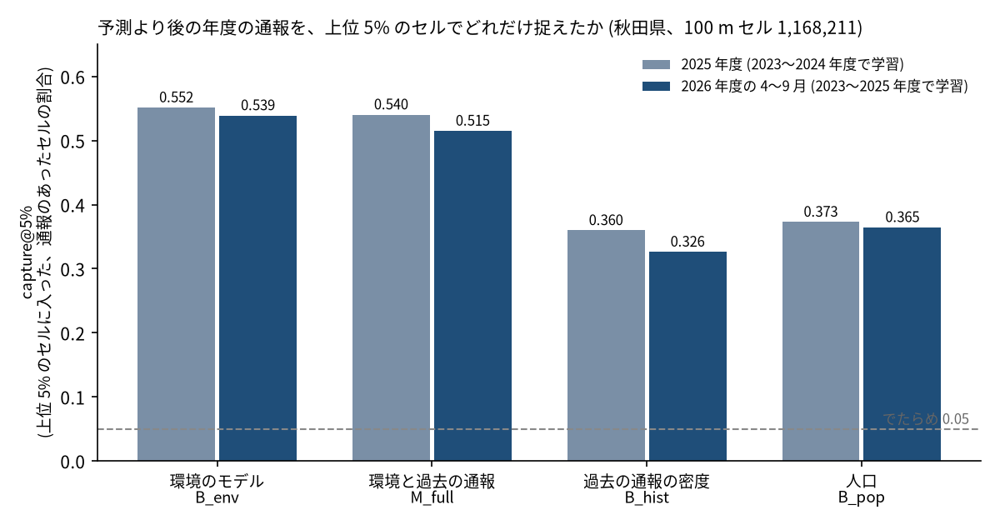

capture@5% は、県内の 1,168,211 セルの上位 5% (58,411 セル) に、その年度に通報のあったセルの何割が入ったか。でたらめなら 0.05。高く塗られるのは森と人里の境目で、建物のある森の縁のセルは 9.66% に通報があり、森の奥 (1 km 超) は 0.02%。1 km に粗くすると基準との差はほぼ消える (0.192 対 0.179)。capture@k は順位だけを見る指標で、式は方法の式 1 にある。

### 図 2: B_env に足したものの差

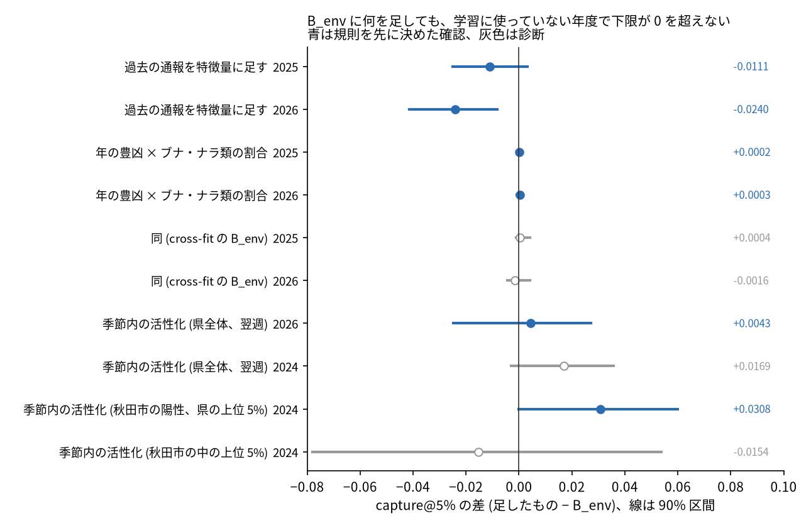

青は規則を先に決めた確認、灰色は診断。過去の通報は 2026 年度に下限まで負 (−0.041〜−0.008) で、足すと悪くなる。豊凶 × 植生は区間が 0 のまわりに細く、効果が無いことがはっきりしている。季節内の活性化は、選んだ 2025 年 (+0.0279) より後の年で小さく、区間は 0 をまたぐ。秋田市の +0.0308 は 3 つの年で同じ向き (2025 年 0.707 → 0.753、2026 年 0.775 → 0.852 は区間なし) だが、秋田市の中だけで選ぶ予算では上がらないので、市の中の順位を良くしたのではない。値は [added_predictors.csv](outputs/added_predictors.csv) に、読んだ JSON の場所と一緒にある。豊凶 × 植生の項は、県で 1 つの不作の度合い $s_t$ と植生の割合 $x_i$ の積なので、その年の順位を動かせるのは $x_i$ の大小だけになる (方法の式 2)。

### 図 3: 週の通報件数と凍結した予測

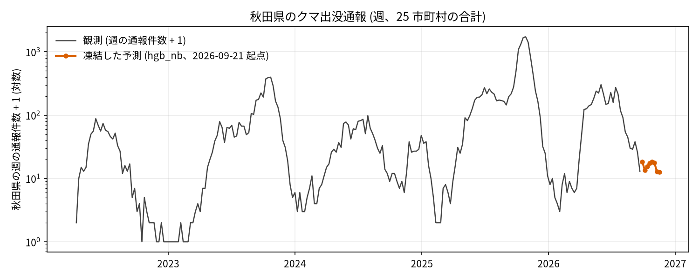

凍結した予測 (起点 2026-09-21) は週 11.7〜17.4 件で、直近の静かな水準の延長。2025 年 10 月には週 1,720 件あった。大量出没の秋は 2023 年と 2025 年の 2 回だけで、隔年に見えるが仮説にとどまる。重点の 5 市町村を選ぶ用途でも、モデル 0.579、前週値 0.572 で差はほとんど無い。

### 図 4: ブナの豊凶の確認期間

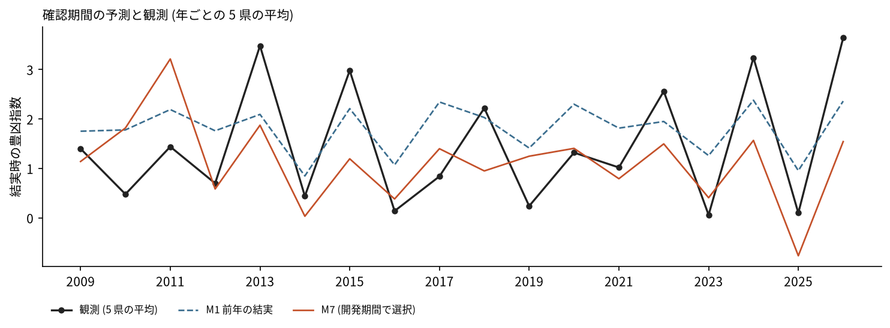

東北 5 県は揃って豊作になり、翌年は揃って凶作になる。前年の結実との順位相関は −0.689 (−0.808〜−0.446)。2 つの夏の気温の差 ΔT も開花時と +0.508 で並ぶが、選んだのは結果を見た後なので主張には数えない。前年の値に負の係数を掛ける 1 次の自己回帰 $I_{p,t} = \alpha_p + \beta I_{p,t-1}$ (県 $p$ の切片つき、凍結した $\beta$ は負) が、手がかりを足したモデルより確認期間で当たった (方法の式 6)。年の中でどの地点が多く実るかは、地形と地点の気象 (順位相関の 9 年の平均 0.169) でも Landsat の偏差でも当たらず、豊凶の面を場所ごとに作る枝は閉じた。

### 図 5: ほかの地域へ移す

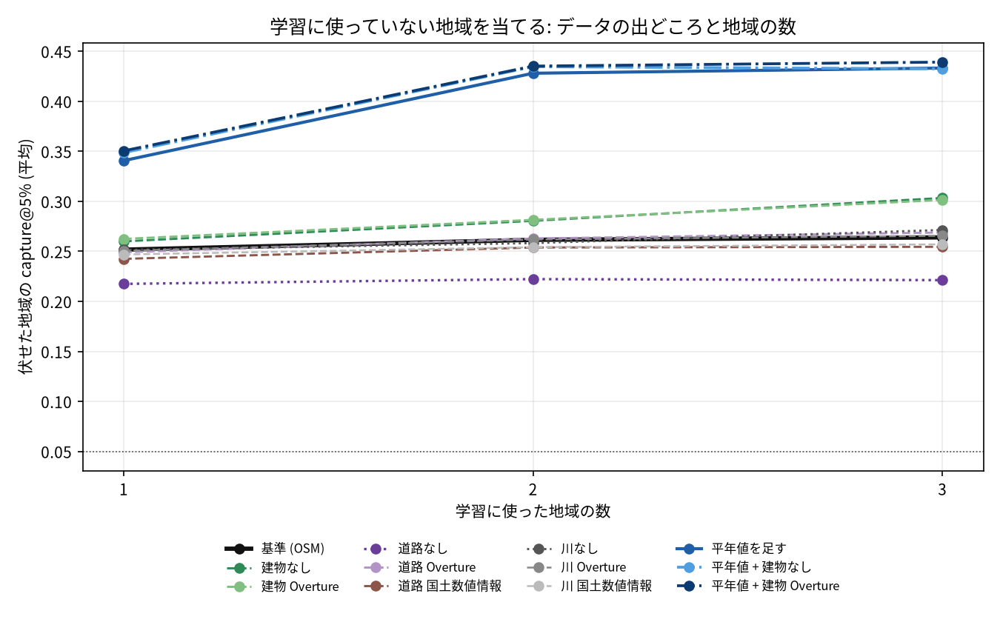

全て探索。秋田の地図をそのまま移すと、人口の順位よりは当たるが、その地域で学習したモデルとの差は岐阜 −0.472、京都 −0.313、石川 −0.241。気候の平年値を足すと、クマのいない暖かい平地が下がる。3 地域で学習し平年値と Overture の建物を使っても、岐阜 0.512 対 0.648 で、その地域のモデルには届かない。

### 試行錯誤の順に地図で見る

ここからは、何を見て次の手を選び、その手が地図の上で何をしたかを、試した順に地図で追う。図 6、7、9、11〜15 は各プロジェクトの図をそのまま使い、図 8 と図 10 はこの総括のために [scripts/trial_maps.py](scripts/trial_maps.py) で描いた (数は [trial_maps.json](outputs/trial_maps.json))。図 13〜15 は、足しても上がらない理由を、予測の手がかりではなく観測の側に探した後半の 2 プロジェクト。

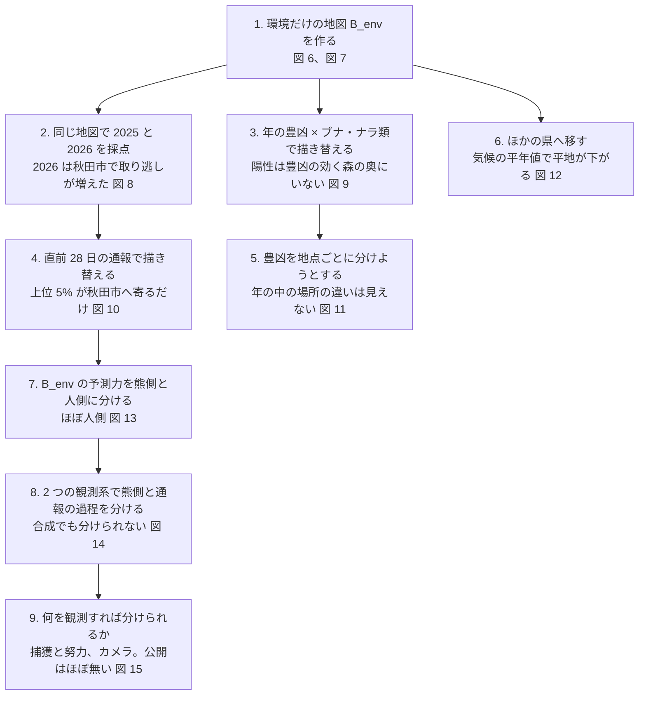

#### 図 6: 1. 環境だけの地図

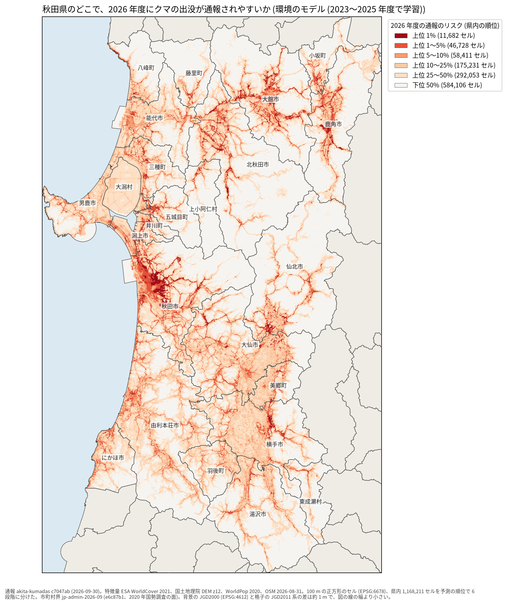

出発点の B_env。2023〜2025 年度で学習し、2026 年度の県内の順位を 6 段階に塗った。濃い色は川沿いの谷と、秋田市、大館市、鹿角市、横手市の市街の周りに帯で並び、山の奥と平野の真ん中は薄い。これが過去の通報の密度 (0.326) より当たり (0.539)、以後の全ての手はこの地図を良くできるかを試した。

#### 図 7: 1. 秋田市付近で何が塗られているか

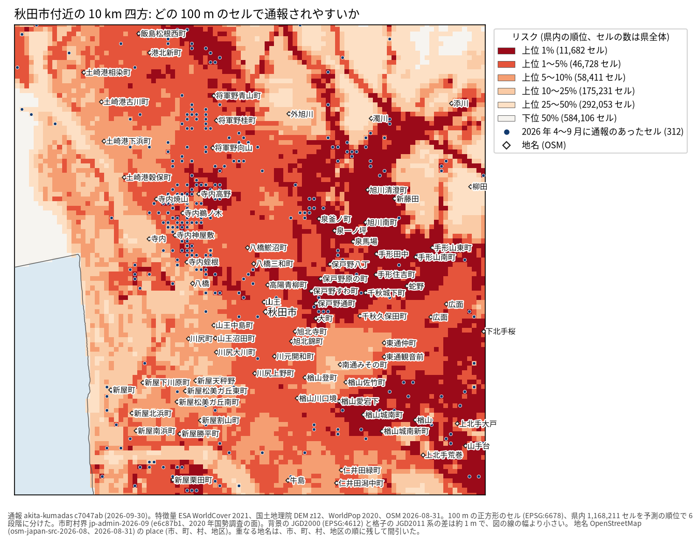

10 km 四方を 100 m のセルで見ると、濃い赤は住宅地の内側ではなく、森と住宅地の境目に並ぶ。2026 年 4〜9 月の通報のセル (312) の多くもその帯に落ちる。地図の強みはこの 100 m の絞り込みで、1 km に粗くすると基準との差はほぼ消える。

#### 図 8: 2. 同じ地図で 2 つの年を採点する

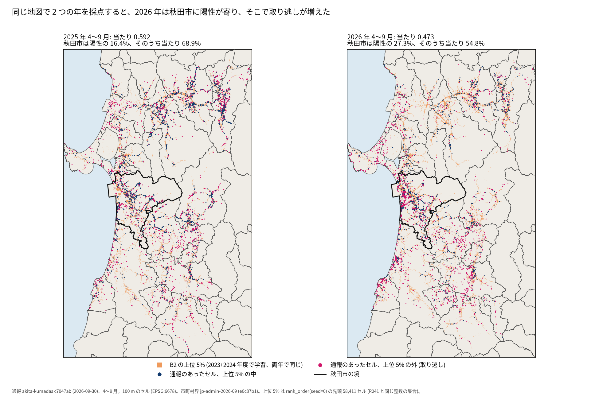

2023+2024 年度で学習した B2 の地図を 1 枚に固定し、2025 年と 2026 年の 4〜9 月に通報のあったセルを、上位 5% の中 (紺) と外 (赤紫) に分けた。当たりは 0.592 から 0.473 に下がり、2026 年は秋田市の境 (黒い線) の西側の市街の周りに赤紫が密集する。秋田市は陽性の 16.4% から 27.3% に増え、その中の当たりは 68.9% から 54.8% に下がった。この 2026 年の当たりは 2026 年度の評価に使った B3 (0.539) ではなく、2 つの年を同じ地図で比べるための B2 の値。これを見て、「その年に通報の出る場所の動き」を直前の通報で捉えられないかと考え、図 10 の活性化を試した。

#### 図 9: 3. 年の豊凶 × ブナ・ナラ類の植生

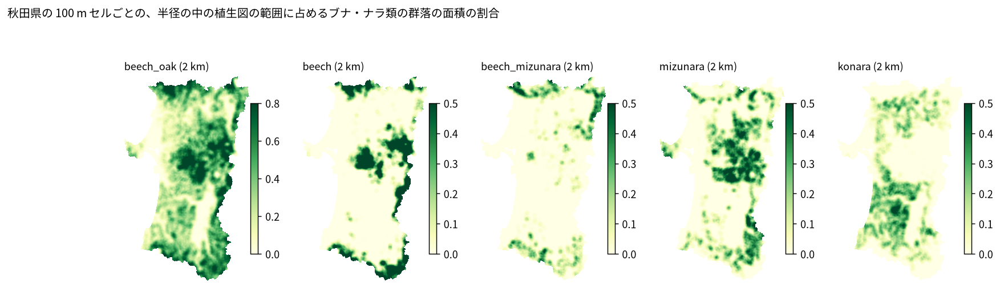

不作の年にはブナ・ナラ類の多い所でクマが動き、通報もそこへ寄る、と考えて足した植生の割合。濃い緑は県境の山地と森吉山の周りで、図 6 の濃い赤 (里の境目) とは逆の所に多い (B_env との Spearman −0.67)。通報のセルはどの年もブナ・ナラ類が少しだけある里の近くに多く (Q1 の陽性の割合 2025 年度 24.2‰、Q4 0.3‰)、不作の年に濃い緑の方へ寄る形は見えなかった。足した項は上位 5% のセルをほとんど入れ替えない (+0.0002、+0.0003)。

#### 図 10: 4. 直前 28 日の通報で地図を重み付ける

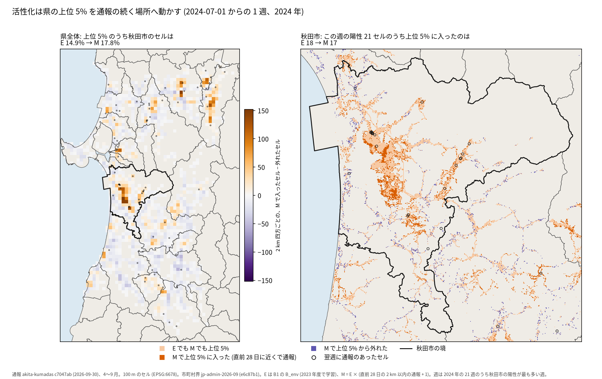

M = B_env × (直前 28 日の 2 km 以内の通報 + 1) で、2024 年の 21 週のうち秋田市の陽性が最も多い週 (2024-07-01 から、陽性 77 セル、うち秋田市 21) を描いた。左は 2 km 四方ごとの、M で上位 5% に入ったセルから外れたセルを引いた数で、橙が直前に通報の続いた所 (秋田市の市街の周りと県北) に固まり、紫が県全体に薄く散る。上位 5% のうち秋田市のセルは 14.9% から 17.8% に増え、21 週の平均でも 16.6%。右の秋田市では、この週の陽性 21 セルのうち上位 5% に入ったのは E 18、M 17 で、増えていない。21 週をまとめた秋田市の当たりは +0.0308 (0.000〜+0.060) で規則の基準に届かず、秋田市の中だけで上位 5% を選ぶと −0.0154 だった。活性化がしたのは、通報の続く市町村へ枠を寄せることで、その中の順位を良くすることではなかった。式で書くと、県の当たりは市町村ごとの当たりの加重和 $\sum_c (P_c/P)\,\mathrm{cap}_c(K_c)$ で、活性化は秋田市の枠 $K_c$ を増やしただけだった (方法の式 3)。

#### 図 11: 5. 豊凶を地点ごとに分けようとする

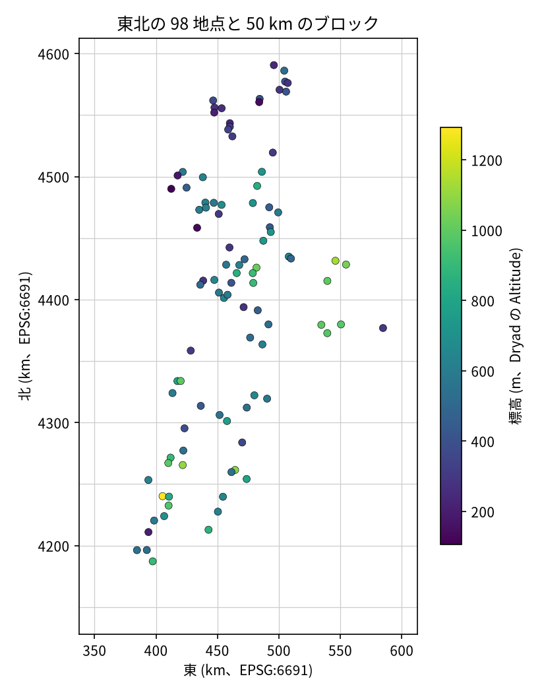

図 9 の植生は場所ごとに違うが、掛けた豊凶は県で 1 つの値だった。豊凶そのものを地点ごとに作れないかを、東北 98 地点のブナの結実の評価で試した。地点を 50 km のブロックに分け、学習に使っていない地点と年で当てた。地形と地点の気象では、同じ年の中でどの地点が多く実るかの順位相関が 9 年の平均 0.169 にとどまり、Landsat 5 の偏差を足すと 0.138 (足さない 0.243) に下がった。場所ごとの豊凶の面は作れず、図 9 の枝に場所の信号を足す道も閉じた。

#### 図 12: 6. ほかの県へ移す

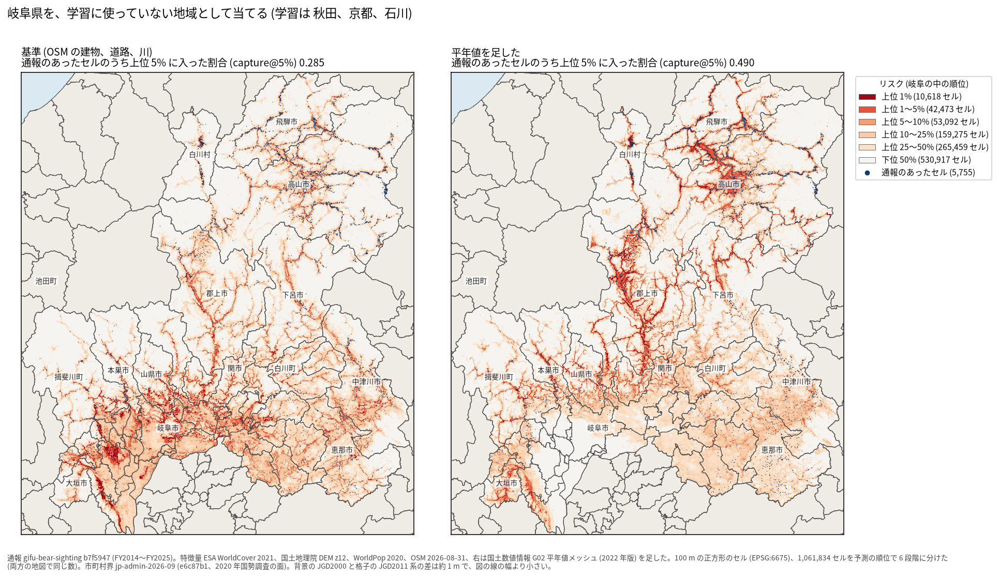

秋田、京都、石川で学習して岐阜を当てた地図 (探索)。左の基準は濃尾平野 (岐阜市、大垣市の周り) の森の縁を濃く塗るが、通報の点 (紺) は少ない。右は気候の平年値を足した地図で、暖かい平地を下げ、通報の集まる飛騨と郡上市を上げた。当たりは 0.285 から 0.490。秋田の中では効く「森と人里の境目」という手がかりが、クマのいない地域では誤って高く出ることを、気候が抑えている。

#### 図 13: 7. 予測力は人側から来る

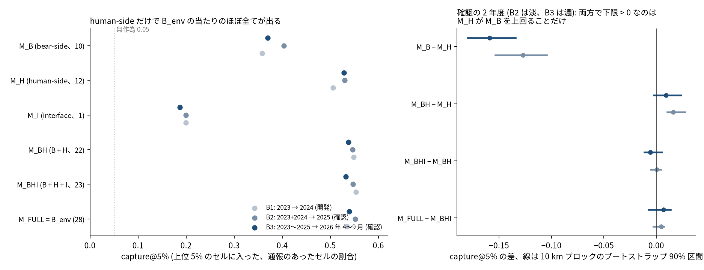

図 6 から図 12 まで、何を足しても上がらなかった。そこで手がかりを足すのをやめ、B_env がすでに何を当てているかを分けた。B_env の特徴量を熊側 (森、水辺、標高と地形、沢)、人側 (人口、建物、道路、農地、市街地)、両者の境目に分けて学習し直すと、人側だけのモデルが B_env の当たりの 95.7% と 97.8% を出した。熊側と人側の 2 つの軸は強く相関し、通報のセルは毎年、両方が高い所に集まる。寄与は、群を足す全ての順で増分を平均する Shapley 値で測った (方法の式 4)。B_env が当てているのは「人がいて熊を見る所」で、静的な特徴量と通報だけでは、熊の分布の変化と、人や通報の過程の変化を区別できなかった。

#### 図 14: 8. 熊側と通報の過程は分けられない

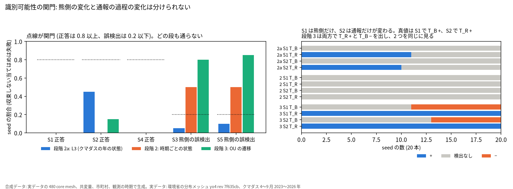

通報だけでは足りないので、偏りの違う 2 つ目の観測系 (環境省の分布メッシュ) と合わせ、熊側の潜在の空間利用と観測系ごとの偏りを同時に置くモデルを組んだ。実データに当てる前に、同じ構造の合成データで「熊側だけが変わった」「通報だけが変わった」を見分けられるかを関門にした。3 つの段 (年の状態、時期ごとの状態、連続時間の遷移) のどれも関門を通らず、熊側だけが変わった合成データを正しく言い当てた割合は全ての段で 0 だった。遷移を入れた段は、熊側だけの変化を「通報の増加と熊側の減少」と読む。原因は式の形にある。クマダスの件数が決めるのは通報の過程の年の効果と熊側の年の変化の和 $a_y + \lambda_K g_y$ だけで、尤度はこの和を保つ方向に平らになる (方法の式 8)。計画どおり、実データで 2023〜2026 年の熊の増減を推定するのは止めた。

#### 図 15: 9. どのデータがあれば分けられるか

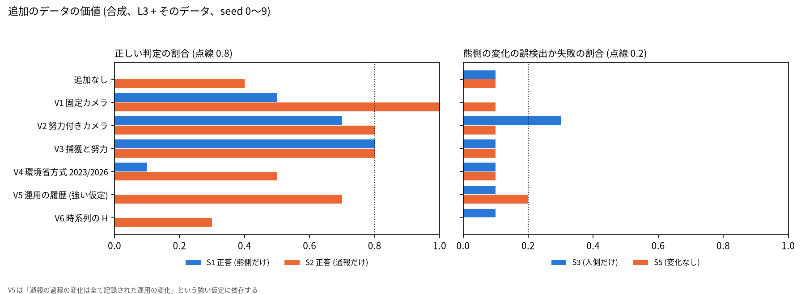

同じ合成データに、候補のデータを 1 つずつ足して関門を流し直した。熊側だけ、通報だけの変化をどちらも見分けられるようになったのは、通報と独立で努力の分かる熊の観測 (捕獲と努力、努力付きのカメラ、固定のカメラ) を足したときだけで、環境省方式の再調査、クマダスの運用の履歴、人の活動の時系列はほとんど効かない。効いた候補は、努力 $e$ が既知で年で変わらない切片を持ち、通報の過程の項 $a_y$ を含まない観測の式 $N \sim \mathrm{Poisson}(e \cdot \exp(a_{\mathrm{cap}} + \lambda_{\mathrm{cap}} \bar B))$ を足すもので、これが和から熊側の変化を切り離す。続けて秋田県と林野庁の公開資料で、そうしたデータが実在するかを確かめた ([確認の記録](../akita-bear-latent-observation-model/BEAR_DATA_AVAILABILITY_AUDIT.md))。努力付きで複数年の観測として公開されていたのは、白神山地周辺 (八峰町、藤里町) の林野庁の固定カメラの報告書だけで、県全体の変化は識別できない。有害捕獲は市町村 × 月の頭数が公開され、罠の数と稼働日数は様式にも無い。出猟カレンダー (出猟した日ごとの 3 km メッシュと目撃数) と生息数推定のカメラの元の記録は、県が持っていて公開されていない。ここが、公開データからの予測の限界の具体的な場所になる。

### 読み方で変わる答え

| 読み方 | 主 | 別の読み方 |
|---|---|---|
| 当たりの数え方 | 通報のあったセル: 0.552 (2025 年度)、0.539 (2026 年度) | 通報の件数: 0.591、0.562 |
| 秋田市の活性化の予算 | 県の上位 5% のうち秋田市の陽性: +0.0308 (0.000〜+0.060) | 秋田市の中の上位 5%: −0.0154 (−0.0779〜+0.0538) |
| 活性化の年 | 確認の 2026 年: +0.0043 (−0.0247〜+0.0271) | 2024 年: +0.0169 (−0.0030〜+0.0358)。選んだ 2025 年: +0.0279 (+0.0055〜+0.0474) |
| 豊凶 × 植生の B_env | 保存済みの B_env: +0.0002、+0.0003 | cross-fit の B_env: +0.0004、−0.0016 |
| 週の予測の先 | 1 週先: モデル 2.838、前週値 2.622 | 4 週先: 4.039 対 5.129 (区間は 0 をまたぐ、秋の多さを小さめに外した結果) |

## データ

- 通報: `yuiseki/akita-kumadas-wildlife-sighting` 版 c7047ab (秋田県クマダス、配布元の 2026-09-30 時点、CC BY 4.0)。クマ 23,306 件、熊の年度 2022〜2026 (2026 年は 4〜9 月)。ほかの県は `gifu-bear-sighting` 版 b7f5947、`kyoto-bear-sighting` 版 a2a50c4、`ishikawa-bear-incident` 版 d2b77a2、`nagaoka-bear-sighting` 版 724bde2。
- 格子と環境: `yuiseki/jp-admin-2026-09` 版 e6c87b1 から EPSG:6678 の 100 m の 1,168,211 セル。ESA WorldCover 2021 v200、国土地理院の標高タイル z12、WorldPop 2020 100 m、`yuiseki/osm-japan-src-2026-08` 版 9a9b4a7 (© OpenStreetMap contributors)。
- 植生: `yuiseki/akita-vegetation-2024` 版 b3b36a0 (環境省「現存植生図2024」、PDL1.0)。
- 豊凶: 東北森林管理局「ブナ開花・結実調査」(2026-10-28 取得、PDL1.0) の 5 県の指数と、`yuiseki/fagus-crenata-masting-jp-2026-06` 版 db40a09 (Dryad、Masaki ほか、CC0) の東北 98 地点。
- 気象と衛星: `agera5-japan-monthly-temperature-1979-2026` 版 348e459 (AgERA5 v2.0、CC BY 4.0)、`yuiseki/landsat5-fagus-crenata-sites-jp-2026-10` 版 939ee55、MODIS collection 6.1 (2026-10-28 取得)。
- 熊の 2 つ目の観測系: 環境省 自然環境保全基礎調査の分布メッシュ (5 km、yo4 の rev 7f635cb。詳細は `akita-bear-latent-observation-model` の report.md にある)。
- データの所在: 秋田県と林野庁の公開資料 (2026-11-01 取得)。読んだ資料と sha256 は [BEAR_DATA_AVAILABILITY_AUDIT.md](../akita-bear-latent-observation-model/BEAR_DATA_AVAILABILITY_AUDIT.md) にあり、値を数えて使ってはいない。
- 件数、除いた行、出典の表示の詳細は、各プロジェクトの report.md のデータの節にある。この総括は新しくデータを読んでいない。

## 方法

- 総括は、各プロジェクトの出力と report.md の数字を並べ直しただけで、モデルを学習し直していない。最初の版は 9 プロジェクトをまとめ、最終の版で [akita-bear-human-interface](../akita-bear-human-interface/report.md) と [akita-bear-latent-observation-model](../akita-bear-latent-observation-model/report.md) の結果と、データの所在の確認を足した。新しく描いたのは図 2、図 8、図 10 の 3 つ。[scripts/added_predictors.py](scripts/added_predictors.py) は、元の実行が書いた JSON から差と区間を読む (読んだ場所は CSV の source の列)。[scripts/trial_maps.py](scripts/trial_maps.py) は、保存済みの B2 と B1 の B_env と固定版の通報 (c7047ab) から地図を描く。図 8 の陽性と当たりの数は R041 の出力と一致しなければ止まり、図 10 の設定は R044 と同じ (半径 2 km、α 1、直前 28 日)。図 8 と図 10 の上位 5% は、端のセルを端数で数えない整数の 58,411 セル。
- 主な評価の指標は capture@5% (県内全セルの上位 5% に入った陽性セルの割合、端のセルは端数で数える)。区間は 10 km ブロックの復元抽出の 90% 区間。支持の規則は、どの比較も「学習に使っていない年度で、差の下限 > 0」を流す前に固定した。
- 確認と探索の区別は、各プロジェクトの計画と記録から写した。B_env に足したものの確認は、[akita-bear-risk-grid-100m](../akita-bear-risk-grid-100m/EXPERIMENT_PLAN.md) と [akita-bear-mast-exposure](../akita-bear-mast-exposure/EXPERIMENT_PLAN.md) の計画にある。
- 秋田市の 2024 年の検証 (R044) は、秋田市に注目したのが 2025/2026 年の結果を見た後だったため、活性化に一度も使っていない 2024 年の週で、設定を変えずに 1 回だけ流した。どちらの結果でも予測変数の探索をここで止めると先に決めた ([計画](../akita-bear-risk-grid-100m/EXPERIMENT_PLAN.md)、[記録](../akita-bear-risk-grid-100m/EXPERIMENT_TRACKER.md))。

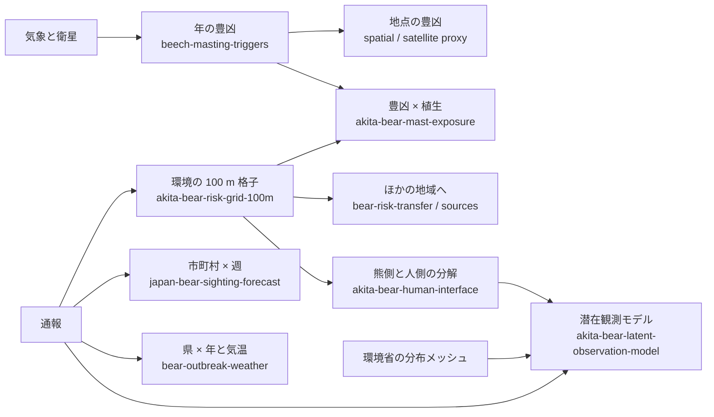

### 方法の式

各プロジェクトのモデルと評価を、結論の式 $Y_{i,t} \sim \mathrm{Poisson}(\rho_{i,t}\pi_{i,t})$ のどこを狙ったかの順に、式で書き直す。記号は節ごとに閉じている。どの数学を何のために使ったかを、それぞれの末尾に 1 行で書いた。

#### 1. 場所の順位: B_env と capture@k

セル $i$ ($N$ = 1,168,211) の熊の年度 $t$ に通報が 1 件以上あれば $Z_{i,t} = 1$。結論の式からは $\Pr(Z_{i,t} = 1) = 1 - \exp(-\rho_{i,t}\pi_{i,t})$ で、有無にしたので、同じセルへの重ねた通報は 1 つに数えられる。B_env は、環境の特徴量 $x_i$ から勾配ブースティングの分類器で $\Pr(Z=1 \mid x)$ を当てたもの。

```math
\hat p(x) = \sigma\!\left(\sum_{m=1}^{300} \eta\, f_m(x)\right),\qquad
\min \; -\sum_{i,t}\Big[Z_{i,t}\log \hat p(x_i) + (1 - Z_{i,t})\log\big(1 - \hat p(x_i)\big)\Big]
```

$f_m$ は回帰木、$\eta$ = 0.05 は学習率、$\sigma$ はロジスティック関数。評価は確率の値ではなく順位で行い、スコア $s$ の上位 $k$ の割合に入った陽性の割合を capture@k とする。

```math
\mathrm{capture@}k(s) = \frac{\sum_i Z_i\, w_i(s)}{\sum_i Z_i},\qquad
w_i(s) = \begin{cases} 1 & \text{順位が } \lfloor kN \rfloor \text{ 以内} \\ kN - \lfloor kN \rfloor & \text{次の 1 セル} \\ 0 & \text{それ以外} \end{cases}
```

$k$ = 0.05 で $kN$ = 58,410.55 なので、端の 1 セルを 0.55 だけ数える。スコアを無作為に並べると期待値は $k$ になり、これが「でたらめなら 0.05」の意味。capture@k は狭義単調増加の変換 $h$ について $\mathrm{capture@}k(h \circ s) = \mathrm{capture@}k(s)$ なので、年の強度が全セルで $\rho_{i,t} = c_t \rho_i$ と同じ倍率で変わっても値は動かない。B_env の色が年度の量を表さず、県で 1 つの豊凶の値が順位を変えられないのはこのため。

2 つのスコアの差 $\Delta = \mathrm{capture@}k(s_1) - \mathrm{capture@}k(s_0)$ の区間は、10 km 四方のブロック $b$ = 1, …, 156 を復元抽出して $\Delta^{*}$ を 1,000 回作り、その 5% 点と 95% 点をとる。通報は近くのセルでまとまって出る (空間の自己相関) ので、セルを独立に引き直すと有効なサンプルの数を過大に見て区間が狭くなる。ブロックごとに引けば、ブロックの中の依存を保ったまま揺らせる。支持の規則「学習に使っていない 2 つの年度の両方で $\Delta^{*}$ の 5% 点 > 0」は、片側の有意水準 5% の検定を 2 回続けて通ることに当たる。

使った数学: 点過程の間引き (有無への変換)、交差エントロピーの最小化、順位の指標の単調変換に対する不変性、空間のブロック・ブートストラップ。

#### 2. 豊凶 × 植生: offset 付きのロジスティック回帰

B_env を学び直さずに、年の豊凶がどれだけ足すかだけを測るため、logit(B_env) を係数 1 に固定した offset にした。

```math
\operatorname{logit} \Pr(Z_{i,t} = 1) = \alpha_t + \operatorname{logit} B_{\mathrm{env},i} + \beta\, s_t\, x_i,\qquad s_t = 5 - (\text{秋田の豊凶指数}_t)
```

$x_i$ はセルの周り 2 km のブナ・ナラ類の群落の面積の割合、$s_t$ は不作の度合い。目的の年 $T$ の順位は $\operatorname{logit} B_{\mathrm{env},i} + \beta s_T x_i$ で決まり、$s_T$ は県で 1 つの数なので、順位を動かせるのは $x_i$ の大小だけ。$x_i$ は B_env と逆に並ぶ (Spearman −0.67) ので、この項は通報の少ない森の奥を押し上げる。学習の年が 1 つしかないと $\alpha_t$ と $\beta s_t$ は区別できない (開発期間では半径しか選べなかった)。

使った数学: offset による係数の固定、交互作用項、年の固定効果と年の説明変数の交絡。

#### 3. 季節内の活性化と、予算の配り直し

直前の通報で地図を重み付けたスコアは、静的な susceptibility と季節の activation の積。

```math
M_{i,t} = B_{\mathrm{env},i}\,\big(A_{i,t} + \alpha\big),\qquad \log M_{i,t} = \log B_{\mathrm{env},i} + \log\big(A_{i,t} + \alpha\big)
```

$A_{i,t}$ はセル $i$ から 2 km 以内の直前 28 日の通報の数、$\alpha$ = 1。対数では結論の式の 2 つの項の和と同じ形で、$\alpha \to \infty$ で B_env の順位に戻る。県の上位 5% という予算 $K$ を固定したまま、市町村 $c$ の陽性を $P_c$、そのうち上位に入った割合を $\mathrm{cap}_c$ と書くと、県の当たりは

```math
\mathrm{capture@}k = \sum_c \frac{P_c}{P}\,\mathrm{cap}_c\big(K_c\big),\qquad \sum_c K_c = K
```

と市町村ごとの当たりの加重和に分かれる。$K_c$ は市町村 $c$ に割り当たった上位のセルの数で、$\mathrm{cap}_c$ は $K_c$ について単調に増える。$M$ は $A > 0$ の市町村 (秋田市) の $K_c$ を増やすので、市の中の順位が変わらなくても $\mathrm{cap}_c$ は上がる。$K_c$ を市の中の 5% に固定して比べたのが −0.0154 で、上がった分が $K_c$ の配り直しだったことを分けた。

使った数学: 乗法モデルの対数での加法分解、固定予算のもとでの加重和への分解。

#### 4. 熊側と人側の分解: Shapley 値

特徴量を熊側 $B$、人側 $H$、境目 $I$ の 3 群に分け、群の部分集合 $S$ だけで学び直したモデルの当たりを $v(S)$ とする ($v(\varnothing)$ = 0.05、無作為の期待値)。群 $j$ の寄与を Shapley 値で測った。

```math
\phi_j = \sum_{S \subseteq \{B,H,I\} \setminus \{j\}} \frac{|S|!\,(3 - |S| - 1)!}{3!}\,\Big[v\big(S \cup \{j\}\big) - v(S)\Big],\qquad \sum_j \phi_j = v(\{B,H,I\}) - v(\varnothing)
```

群を足す順の 3! 通り全てについて、足したときの増分を平均したもの。足す順で増分が変わる (2 群が同じ情報を持つ) ときにも、合計が全体の当たりに一致するように配る。熊側と人側は強く相関するので、2 群が重ねて持つ情報の分は、おおむね 2 群に分けて配られる。それでも人側の $\phi$ が熊側のおよそ 2 倍で、人側だけのモデルが B_env の当たりのほぼ全てを出した。年度の間の移動は Cliff の $\delta = \Pr(X > X') - \Pr(X < X')$ ($X$、$X'$ は 2 つの年度の陽性のセルのスコア) で測り、$|\delta| \ge$ 0.147 (小さい効果の慣例の境) とブロックの入れ替えの検定の両方を「動いた」の条件にした。

使った数学: 協力ゲームの Shapley 値、順位に基づく効果量 (Cliff の δ)、置換検定。

#### 5. 市町村 × 週の件数

市町村 $g$、週 $w$ の件数 $y_{g,w}$ を、起点 $w$ までの情報だけから $h$ 週先まで当てる。

```math
y_{g,w+h} \sim \mathrm{Poisson}(\mu_{g,w+h}),\qquad \log \mu_{g,w+h} = \theta^{\top} z_{g,w},\qquad
\mathrm{MAE}_h = \frac{1}{n}\sum_{g,w}\left|\,y_{g,w+h} - \hat y_{g,w+h}\right|
```

$z_{g,w}$ は起点までの件数から作った特徴量 (候補によっては隣の市町村の直近の件数も)。比べる相手の前週値 $\hat y_{g,w+1} = y_{g,w}$ は、件数が $y_{g,w+1} = y_{g,w} + \varepsilon$ と動き、変化 $\varepsilon$ が過去から予測できず中央値が 0 なら、条件付きの中央値そのものなので、MAE を最小にする予測になる。モデルが前週値を超えるには $\varepsilon$ の向きを $z$ で当てる必要があり、秋の大量出没の始まりは起点までの件数からは先に見えなかった。区間は起点を 13 週のかたまりで引き直す (時間のブロック・ブートストラップ)。

使った数学: ポアソン回帰と、ポアソン損失の勾配ブースティング、MAE と条件付きの中央値、ランダムウォークに近い過程での持続予測の強さ、時系列のブロック・ブートストラップ。

#### 6. 年の豊凶と、年の中の地点の違い

県 $p$、年 $t$ の豊凶指数 $I_{p,t}$ を、県の切片を持つ最小二乗で当てた。最も確かだった M1 は前年の結実だけを使う。

```math
I_{p,t} = \alpha_p + \beta\, I_{p,t-1} + \varepsilon_{p,t}
```

前年との順位相関は負 (−0.689) で、豊作と凶作が交互に来る負の自己相関になっている。よく使われる説明は資源収支 (豊作の年に木が蓄えを使い切り、翌年は実らない) で、このプロジェクトでは確かめていない。候補は年を 1 つずつ伏せた RMSE $\sqrt{\frac{1}{n}\sum (I - \hat I)^2}$ で選んだ。東北 5 県は同じ年に揃って動く (同調) ので、区間は県 × 年でなく年を単位に、5 県を一緒に引き直した。県 × 年を独立に数えると、実際より多くの情報があるように見える。

地点の違いは、年 $t$ ごとの地点の間の Spearman の順位相関 $r_t$ を、年で平均して測った。

```math
\bar r = \frac{1}{|T|}\sum_{t \in T} \operatorname{Spearman}\big(I_{\cdot,t},\ \hat I_{\cdot,t}\big)
```

年ごとに順位をとるので、年の水準 (県全体の豊凶) は消え、残るのは同じ年の中でどの地点が多く実るかだけになる。これが 0.169 にとどまったので、方法 2 の $s_t$ を地点ごとの $s_{i,t}$ に置き換える道は閉じた。

使った数学: 固定効果の線形回帰、負の自己相関、leave-one-out、同調のあるデータでのクラスタ単位のブートストラップ、年で中心化した順位相関。

#### 7. 前年の気温と大量出没

県 × 年 (32) の秋の通報の量と、前年の夏と前々年の夏の気温の差 $\Delta T$ の Spearman の順位相関 $\rho$ を、年を県の中で並べ替える置換 (10,000 回) で検定した。置換の分布は「県の水準を保ったまま、年の対応だけを壊した」帰無仮説を表す。県 × 年が少なく、全国で同時に動く年があるので、検出力は低く、$p$ は楽観的になりうる。

使った数学: 順位相関、層別の置換検定、多重比較の Bonferroni の目安。

#### 8. 潜在観測モデル: 熊側と通報の過程を分ける

結論の式の $\log\rho$ を、2 つの観測系に共通する潜在の $b_m$ (5 km メッシュ $m$) として明示的に置き、観測系ごとの $\pi$ を別の項にした階層ベイズのモデル (NUTS で事後分布を求めた)。主のモデル L2 は次の 3 本。

```math
b_m = X_{B,m}^{\top}\beta + u_m,\quad u_m \sim \mathrm{Normal}(0,1);\qquad
\operatorname{logit}\Pr(E_{m,e}=1) = a_e + \lambda_E b_m + c_E H_m
```

```math
Y_{m,y} \sim \mathrm{NegBin}(\mu_{m,y}, \phi),\qquad \log\mu_{m,y} = o_m + a_y + r_{g(m),y} + \lambda_K b_m + c_K H_m
```

$E_{m,e}$ は環境省の記録の有無、$Y_{m,y}$ はクマダスの件数、$H_m$ は人側の測定、$\lambda_E$、$\lambda_K$ は同じ $b_m$ が各観測系に効く負荷。年の熊側の変化 $g_y$ を入れて県全体の年の項でまとめると、

```math
\log\mu_{m,y} = o_m + \underbrace{\left(a_y + \lambda_K g_y\right)}_{\text{データが決めるのはこの和}} + r_{g(m),y} + \lambda_K\left(b_m + \sigma_v v_{m,y}\right) + c_K H_m
```

となり、通報の過程の年の効果 $a_y$ と熊側の変化 $g_y$ は和でしか現れない。尤度が平らな方向 ($a_y + \delta$、$g_y - \delta/\lambda_K$) があるので、2 つの分け方は事前分布で決まる。これが識別不能 (non-identifiability) の正体で、環境省の調査が 2023〜2026 年と重ならない限り、もう 1 本の式は $g_y$ を拘束しない。

そこで、実データに当てる前に、真の値が分かる合成データで分けられるかを関門にした。熊側だけが変わる (S1)、通報だけが変わる (S2) などの場面を seed ごとに作り、$T_B$ (熊側の平均の変化) と $T_R$ (通報の過程の平均の変化) の 90% 信用区間が 0 を含まなければ検出とした。正答の割合が 0.8 以上、誤検出が 0.2 以下で通過という規則は、流す前に固定した。モデルが正しく書けていても、データの構造が識別を許さなければ合成データでも通らないので、実データの結果を読む前に「読んでよいか」が分かる。

追加の観測の価値 (VOI) は、候補の尤度を 1 本ずつ足して同じ関門を流し直して測った。最も効いた市町村 × 年の捕獲と努力 (V3) の式は

```math
N_{g,y} \sim \mathrm{Poisson}\Big(e_{g,y}\,\exp\big(a_{\mathrm{cap}} + \lambda_{\mathrm{cap}}\,\bar B_{g,y}\big)\Big),\qquad \bar B_{g,y} = \frac{1}{|g|}\sum_{m \in g}\big(b_m + d_{m,y}\big)
```

で、努力 $e_{g,y}$ は既知、切片 $a_{\mathrm{cap}}$ は年で変わらない。この式は $a_y$ も $r_{g,y}$ も含まず $g_y$ だけを含むので、$N/e$ の年の変化が和 $a_y + \lambda_K g_y$ から $g_y$ を切り離す。努力付きのカメラ (V2) も同じ形をメッシュ × 年で持つ。

観測系をまたぐ検証は、片方の記録を隠して当てはめ、隠した記録の対数予測密度を比べた。

```math
\Delta_{L2 - L0H} = \sum_m \left(\ell^{L2}_m - \ell^{L0H}_m\right),\qquad
\ell_m = \log \frac{1}{S}\sum_{s=1}^{S} p\big(\text{hidden}_m \mid \theta^{(s)}\big)
```

$\theta^{(s)}$ は事後分布の $s$ 番目の draw。対数の中で draw を平均するので、事後分布の不確かさを含めた予測の当たりになる。

使った数学: 階層ベイズの潜在変数モデル、負の二項分布、負荷による 2 つの観測系の結合、尤度の平らな方向としての識別不能性、合成データによるパラメータ回収の実験 (parameter recovery)、事後予測の対数密度、情報の価値 (VOI)。

## 確かめていないこと

- 前向きの採点は未了。凍結した市町村 × 週の予測 (2026-09-28〜2026-11-16 の 8 週) は、2026 年 10 月以降の通報が配布されたら `japan-bear-sighting-forecast/scripts/score_frozen.py` で採点する。2027 年度のブナの豊凶の先の予測 (beech-masting-triggers の B6) は、2026 年 8 月の気温が出るまで planned のまま。
- 通報は個体数でも出没の数でもなく、人が見て通報した数。2026 年に秋田市の陽性セルの割合が 16.38% から 27.27% に増えたのが、クマの動きか、通報の行動の変化かは分けられない。これは手元のデータでは確かめようがないことが、潜在観測モデルの関門で分かった (図 14)。
- 「限界がある」は、ここで試した公開データと手法の範囲での結論で、どんなデータでも出没を予測できないという主張ではない。通報と独立で努力の分かる熊の記録 (図 15) が手に入れば、識別の関門から流し直せる。白神山地周辺のカメラは範囲が狭く、それだけで県全体の熊側の変化は分けられない。
- 秋田県立大学の 2015 年のカメラ調査と、環境省東北地方環境事務所の白神山地の調査は、検索結果の要約しか読んでいない。
- 年の水準 (量) の予測は、県 × 年が少なく (4 県で 32、秋田は 4 年) 確かめきれていない。都道府県ごとの月別の出没件数があれば、数百の県 × 年で同じ規則を試せる。
- B_env の色は県内の順位で、確率としての水準は年度で合わない。大量出没の年の多さを地図は表さない。
- 2024 年の秋田市の陽性は 195 (19 ブロック) と少なく、主指標の区間の下限がちょうど 0 になった。効果が無いことを示したのではなく、規則の基準に届かなかった。
