# クマの出没とブナの豊凶の 9 プロジェクトの総括: 図で読む要点

## 問い

秋田県を中心としたクマの出没通報について、9 つのプロジェクトで「どこに」「いつ」「どれだけ」が予測でき、何が予測できなかったか。

## 結論

場所の予測 (100 m セルの順位) は、環境だけで学習した地図 B_env が過去の通報の密度より確かに当たった。その B_env に、過去の通報、年の豊凶 × ブナ・ナラ類の植生、季節内の直前の通報を足しても、学習に使っていない年度で当たりは上がらなかった。量と時期 (市町村 × 週、秋の大量出没の年) は、前週の値や前年の結実を超える予測ができなかった。予測変数の探索はここで止め、残りは先に凍結した予測の採点で答えを待つ。

### 要点

| # | 要点 | 数字 | 図 |
|---:|---|---|---|
| 1 | 場所は環境だけの地図で絞れる (確認、2 つの年度とも支持) | 上位 5% のセルに、通報のあったセルの 0.552 (2025 年度)、0.539 (2026 年度 4〜9 月)。過去の通報の密度は 0.360、0.326 ([b2_confirm_2023-2024_to_2025.json](../akita-bear-risk-grid-100m/outputs/b2_confirm_2023-2024_to_2025.json)、[b3_confirm_2023-2025_to_2026.json](../akita-bear-risk-grid-100m/outputs/b3_confirm_2023-2025_to_2026.json)) | [図 1](#図-1-環境だけの地図と基準) |
| 2 | B_env に何を足しても、学習に使っていない年度で上がらない (確認) | 過去の通報 −0.011、−0.024。豊凶 × 植生 +0.0002、+0.0003。季節内の活性化 +0.0043 (2026 年)。秋田市の陽性 +0.0308 (90% 区間 0.000〜+0.060) で、下限が 0 を超えず支持されない ([added_predictors.csv](outputs/added_predictors.csv)) | [図 2](#図-2-b_env-に足したものの差) |
| 3 | 秋田市で上がって見えた分は、県の上位 5% が秋田市へ寄っただけだった | 秋田市の中だけで上位 5% を選ぶと −0.0154 (−0.0779〜+0.0538) ([added_predictors.csv](outputs/added_predictors.csv)) | [図 2](#図-2-b_env-に足したものの差) |
| 4 | 市町村 × 週の件数は、前週の値を超えない。秋の大量出没の始まりは見えない | 1 週先の MAE はモデル 2.838、前週値 2.622 (件 / 市町村 / 週)。夏が同じ 794 件と 799 件の 2023 年と 2024 年で、秋は 2,800 件と 338 件 ([dev_b2_paired.csv](../japan-bear-sighting-forecast/outputs/dev_b2_paired.csv)、[data_profile.txt](../japan-bear-sighting-forecast/outputs/data_profile.txt)) | [図 3](#図-3-週の通報件数と凍結した予測) |
| 5 | 年の豊凶は前年の結実が最も確かで、年の中の場所の違いは何でも当てられなかった | 確認期間の RMSE は前年の結実だけ 1.173、気象を足した M7 1.326。年の中の地点の順位は、Landsat の偏差を足すと 0.138 (足さない 0.243) ([b2_b3_confirm.json](../beech-masting-triggers/outputs/b2_b3_confirm.json)、[b3_confirm.json](../beech-masting-satellite-proxy/outputs/b3_confirm.json)) | [図 4](#図-4-ブナの豊凶の確認期間) |
| 6 | 秋田の地図はほかの県へそのまま移すと大きく下がる。気候の平年値と複数の地域で学ぶと戻る (探索) | 岐阜 0.175、京都 0.160、石川 0.381。3 地域で学習して平均 0.264 から、平年値ありで 0.433 ([transfer-capture.json](../bear-risk-transfer/outputs/transfer-capture.json)、[mean_by_k.csv](../bear-risk-sources/outputs/mean_by_k.csv)) | [図 5](#図-5-ほかの地域へ移す) |
| 7 | 地図で見ると、失敗の形は共通している。足した手がかりは、通報の出る里の境目ではない所 (森の奥) を指すか、枠を通報の続く市町村へ寄せるだけだった | 2026 年の秋田市は陽性の 16.4% から 27.3% に増え、当たりは 68.9% から 54.8%。活性化で上位 5% のうち秋田市は 14.9% から 17.8% ([trial_maps.json](outputs/trial_maps.json)) | [図 6〜12](#試行錯誤の順に地図で見る) |

### 読み手ごとに知るべきこと

| 読み手 | 結論 | 検討する材料 | 詳しく |
|---|---|---|---|
| 県の担当 (重点地区を県全体から絞る) | B_env の上位 5% に、通報のあったセルの 5 割強が入る。年の豊凶や直前の通報で地図を描き替えても、絞り方は良くならない | 上位 5% の地図と、年の水準 (量) は別に見ること | [akita-bear-risk-grid-100m](../akita-bear-risk-grid-100m/report.md) |
| 市町村の担当 (来週どこを見回るか) | 来週の市町村ごとの件数は前週の件数と変わらない。直前 28 日の通報で地図を重み付けても、秋田市の中の順位は良くならない | 森と住宅地の境目、前週の件数 | [japan-bear-sighting-forecast](../japan-bear-sighting-forecast/report.md) |
| 秋の大量出没に備える人 | 夏の気温からも、モデルの週の予測からも、秋の量は当てられない。最も確かなのは前年の結実 (豊作の翌年は凶作) | 東北森林管理局の 7 月の開花の公表、前年の結実 | [beech-masting-triggers](../beech-masting-triggers/report.md)、[bear-outbreak-weather](../bear-outbreak-weather/report.md) |
| 分析を続ける人 | 年の豊凶は県全体の量の材料で、100 m の順位の材料ではない。ここで止めた枝を、特徴量や半径を足して救済しない | 凍結した予測の採点 (2026 年 10 月以降の通報、2027 年度の豊凶) | [確かめていないこと](#確かめていないこと) |

### 図 1: 環境だけの地図と基準

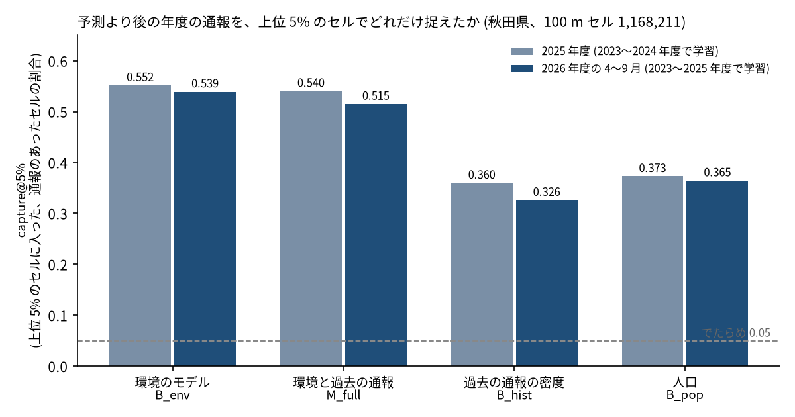

capture@5% は、県内の 1,168,211 セルの上位 5% (58,411 セル) に、その年度に通報のあったセルの何割が入ったか。でたらめなら 0.05。高く塗られるのは森と人里の境目で、建物のある森の縁のセルは 9.66% に通報があり、森の奥 (1 km 超) は 0.02%。1 km に粗くすると基準との差はほぼ消える (0.192 対 0.179)。

### 図 2: B_env に足したものの差

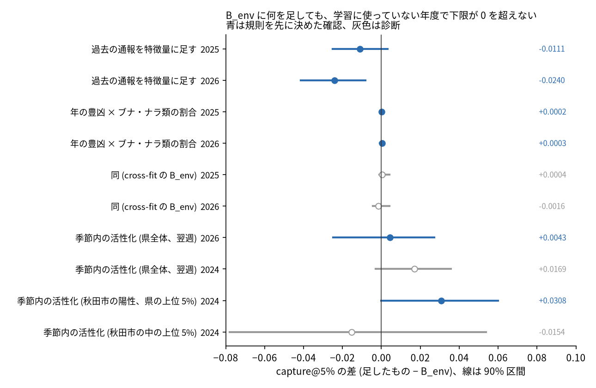

青は規則を先に決めた確認、灰色は診断。過去の通報は 2026 年度に下限まで負 (−0.041〜−0.008) で、足すと悪くなる。豊凶 × 植生は区間が 0 のまわりに細く、効果が無いことがはっきりしている。季節内の活性化は、選んだ 2025 年 (+0.0279) より後の年で小さく、区間は 0 をまたぐ。秋田市の +0.0308 は 3 つの年で同じ向き (2025 年 0.707 → 0.753、2026 年 0.775 → 0.852 は区間なし) だが、秋田市の中だけで選ぶ予算では上がらないので、市の中の順位を良くしたのではない。値は [added_predictors.csv](outputs/added_predictors.csv) に、読んだ JSON の場所と一緒にある。

### 図 3: 週の通報件数と凍結した予測

凍結した予測 (起点 2026-09-21) は週 11.7〜17.4 件で、直近の静かな水準の延長。2025 年 10 月には週 1,720 件あった。大量出没の秋は 2023 年と 2025 年の 2 回だけで、隔年に見えるが仮説にとどまる。重点の 5 市町村を選ぶ用途でも、モデル 0.579、前週値 0.572 で差はほとんど無い。

### 図 4: ブナの豊凶の確認期間

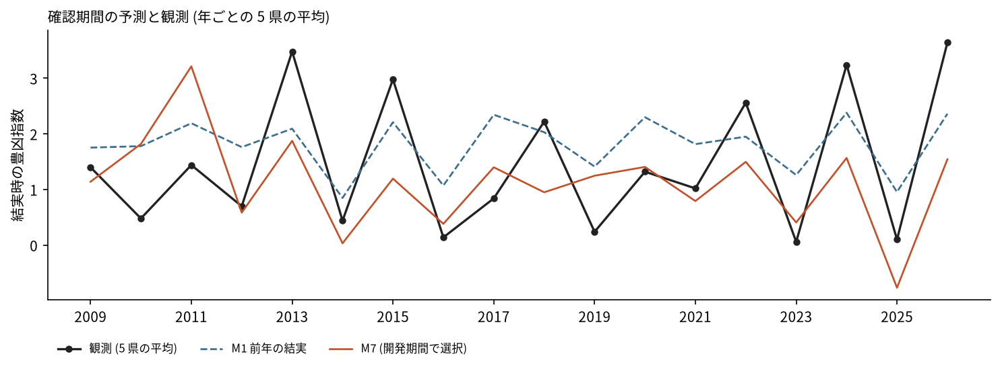

東北 5 県は揃って豊作になり、翌年は揃って凶作になる。前年の結実との順位相関は −0.689 (−0.808〜−0.446)。2 つの夏の気温の差 ΔT も開花時と +0.508 で並ぶが、選んだのは結果を見た後なので主張には数えない。年の中でどの地点が多く実るかは、地形と地点の気象 (順位相関の 9 年の平均 0.169) でも Landsat の偏差でも当たらず、豊凶の面を場所ごとに作る枝は閉じた。

### 図 5: ほかの地域へ移す

全て探索。秋田の地図をそのまま移すと、人口の順位よりは当たるが、その地域で学習したモデルとの差は岐阜 −0.472、京都 −0.313、石川 −0.241。気候の平年値を足すと、クマのいない暖かい平地が下がる。3 地域で学習し平年値と Overture の建物を使っても、岐阜 0.512 対 0.648 で、その地域のモデルには届かない。

### 試行錯誤の順に地図で見る

ここからは、何を見て次の手を選び、その手が地図の上で何をしたかを、試した順に地図で追う。図 6、7、9、11、12 は各プロジェクトの地図をそのまま使い、図 8 と図 10 はこの総括のために [scripts/trial_maps.py](scripts/trial_maps.py) で描いた (数は [trial_maps.json](outputs/trial_maps.json))。

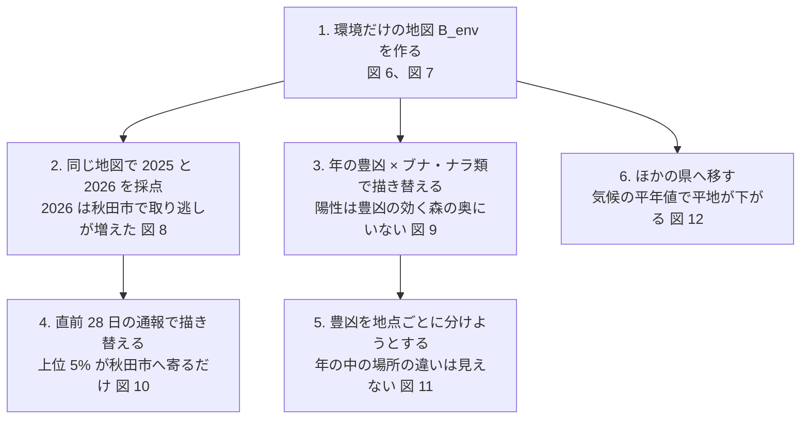

#### 図 6: 1. 環境だけの地図

出発点の B_env。2023〜2025 年度で学習し、2026 年度の県内の順位を 6 段階に塗った。濃い色は川沿いの谷と、秋田市、大館市、鹿角市、横手市の市街の周りに帯で並び、山の奥と平野の真ん中は薄い。これが過去の通報の密度 (0.326) より当たり (0.539)、以後の全ての手はこの地図を良くできるかを試した。

#### 図 7: 1. 秋田市付近で何が塗られているか

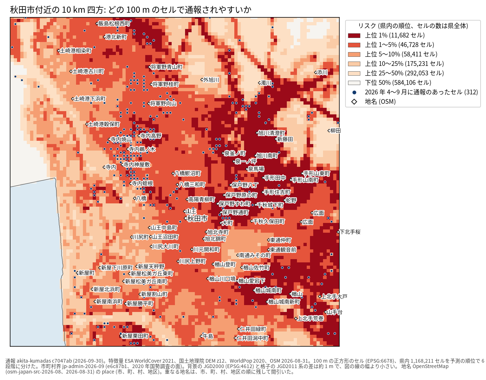

10 km 四方を 100 m のセルで見ると、濃い赤は住宅地の内側ではなく、森と住宅地の境目に並ぶ。2026 年 4〜9 月の通報のセル (312) の多くもその帯に落ちる。地図の強みはこの 100 m の絞り込みで、1 km に粗くすると基準との差はほぼ消える。

#### 図 8: 2. 同じ地図で 2 つの年を採点する

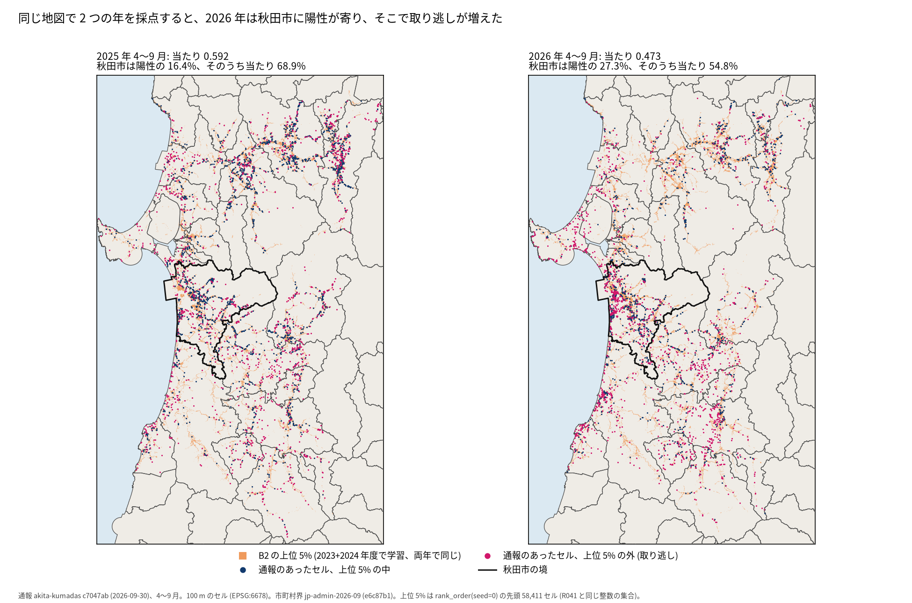

2023+2024 年度で学習した B2 の地図を 1 枚に固定し、2025 年と 2026 年の 4〜9 月に通報のあったセルを、上位 5% の中 (紺) と外 (赤紫) に分けた。当たりは 0.592 から 0.473 に下がり、2026 年は秋田市の境 (黒い線) の西側の市街の周りに赤紫が密集する。秋田市は陽性の 16.4% から 27.3% に増え、その中の当たりは 68.9% から 54.8% に下がった。この 2026 年の当たりは 2026 年度の評価に使った B3 (0.539) ではなく、2 つの年を同じ地図で比べるための B2 の値。これを見て、「その年に通報の出る場所の動き」を直前の通報で捉えられないかと考え、図 10 の活性化を試した。

#### 図 9: 3. 年の豊凶 × ブナ・ナラ類の植生

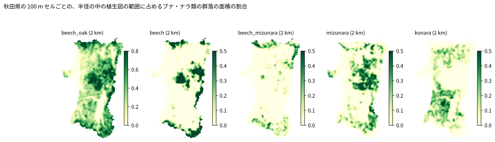

不作の年にはブナ・ナラ類の多い所でクマが動き、通報もそこへ寄る、と考えて足した植生の割合。濃い緑は県境の山地と森吉山の周りで、図 6 の濃い赤 (里の境目) とは逆の所に多い (B_env との Spearman −0.67)。通報のセルはどの年もブナ・ナラ類が少しだけある里の近くに多く (Q1 の陽性の割合 2025 年度 24.2‰、Q4 0.3‰)、不作の年に濃い緑の方へ寄る形は見えなかった。足した項は上位 5% のセルをほとんど入れ替えない (+0.0002、+0.0003)。

#### 図 10: 4. 直前 28 日の通報で地図を重み付ける

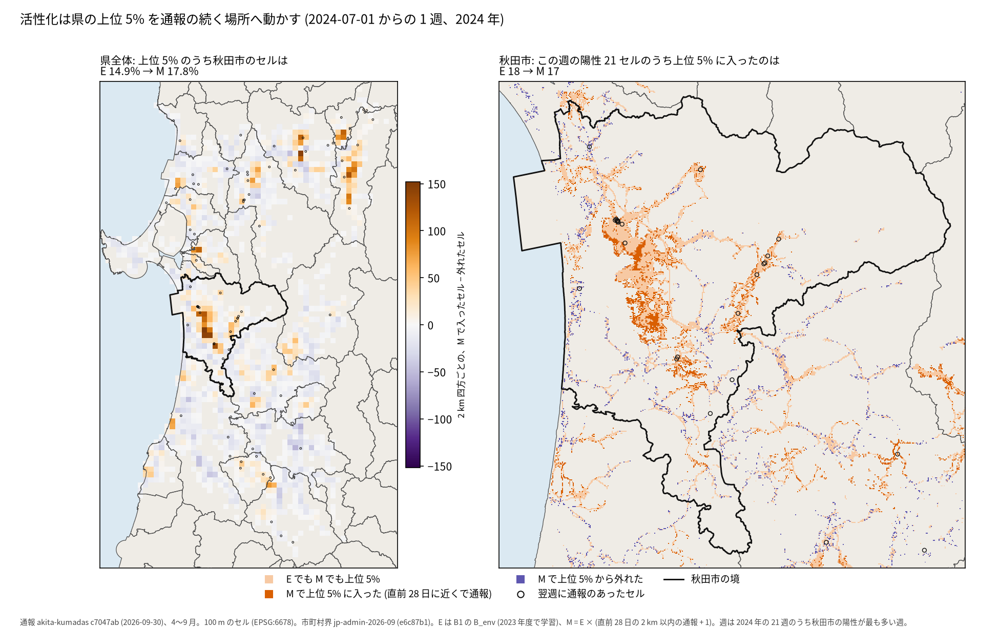

M = B_env × (直前 28 日の 2 km 以内の通報 + 1) で、2024 年の 21 週のうち秋田市の陽性が最も多い週 (2024-07-01 から、陽性 77 セル、うち秋田市 21) を描いた。左は 2 km 四方ごとの、M で上位 5% に入ったセルから外れたセルを引いた数で、橙が直前に通報の続いた所 (秋田市の市街の周りと県北) に固まり、紫が県全体に薄く散る。上位 5% のうち秋田市のセルは 14.9% から 17.8% に増え、21 週の平均でも 16.6%。右の秋田市では、この週の陽性 21 セルのうち上位 5% に入ったのは E 18、M 17 で、増えていない。21 週をまとめた秋田市の当たりは +0.0308 (0.000〜+0.060) で規則の基準に届かず、秋田市の中だけで上位 5% を選ぶと −0.0154 だった。活性化がしたのは、通報の続く市町村へ枠を寄せることで、その中の順位を良くすることではなかった。

#### 図 11: 5. 豊凶を地点ごとに分けようとする

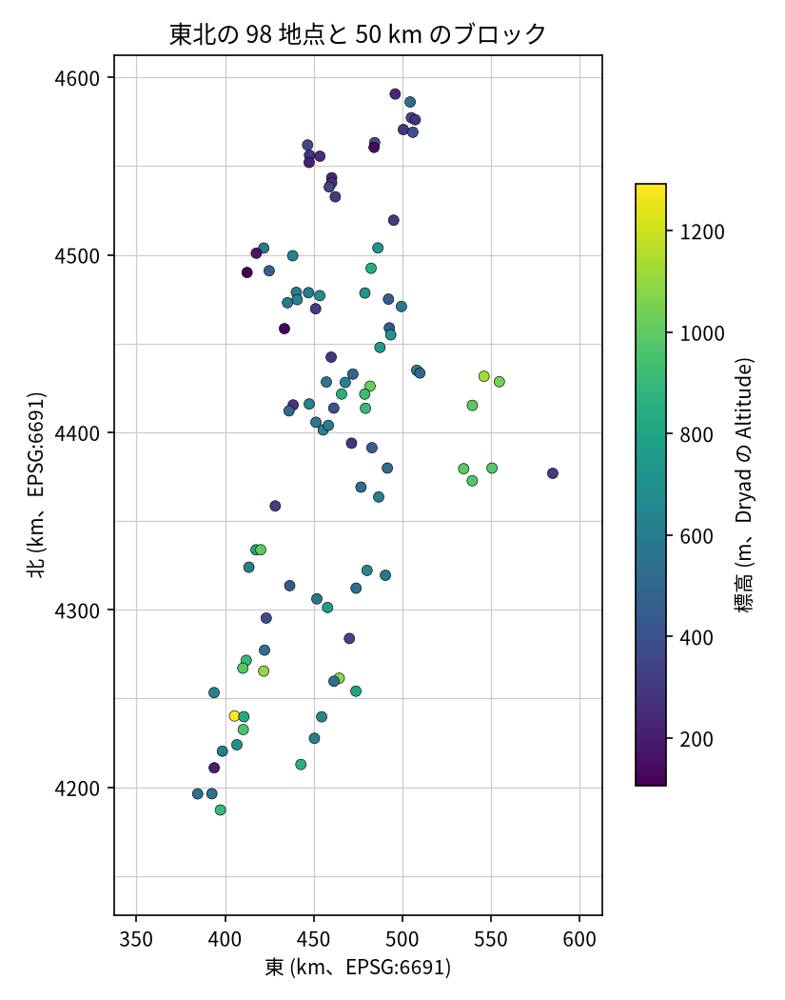

図 9 の植生は場所ごとに違うが、掛けた豊凶は県で 1 つの値だった。豊凶そのものを地点ごとに作れないかを、東北 98 地点のブナの結実の評価で試した。地点を 50 km のブロックに分け、学習に使っていない地点と年で当てた。地形と地点の気象では、同じ年の中でどの地点が多く実るかの順位相関が 9 年の平均 0.169 にとどまり、Landsat 5 の偏差を足すと 0.138 (足さない 0.243) に下がった。場所ごとの豊凶の面は作れず、図 9 の枝に場所の信号を足す道も閉じた。

#### 図 12: 6. ほかの県へ移す

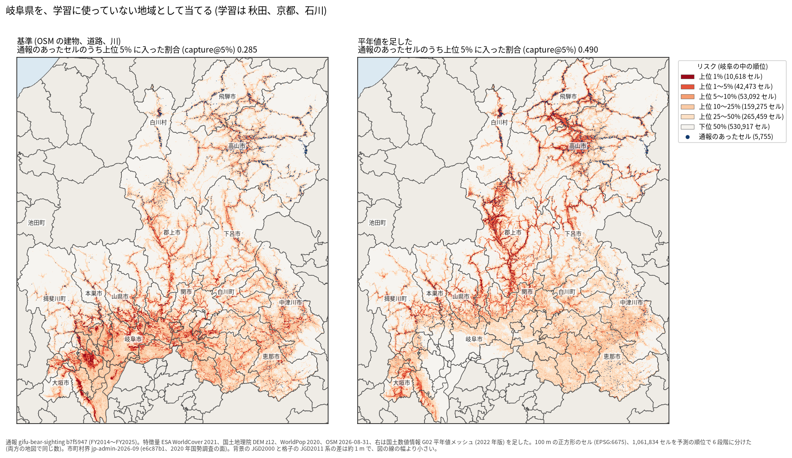

秋田、京都、石川で学習して岐阜を当てた地図 (探索)。左の基準は濃尾平野 (岐阜市、大垣市の周り) の森の縁を濃く塗るが、通報の点 (紺) は少ない。右は気候の平年値を足した地図で、暖かい平地を下げ、通報の集まる飛騨と郡上市を上げた。当たりは 0.285 から 0.490。秋田の中では効く「森と人里の境目」という手がかりが、クマのいない地域では誤って高く出ることを、気候が抑えている。

### 読み方で変わる答え

| 読み方 | 主 | 別の読み方 |
|---|---|---|
| 当たりの数え方 | 通報のあったセル: 0.552 (2025 年度)、0.539 (2026 年度) | 通報の件数: 0.591、0.562 |
| 秋田市の活性化の予算 | 県の上位 5% のうち秋田市の陽性: +0.0308 (0.000〜+0.060) | 秋田市の中の上位 5%: −0.0154 (−0.0779〜+0.0538) |
| 活性化の年 | 確認の 2026 年: +0.0043 (−0.0247〜+0.0271) | 2024 年: +0.0169 (−0.0030〜+0.0358)。選んだ 2025 年: +0.0279 (+0.0055〜+0.0474) |
| 豊凶 × 植生の B_env | 保存済みの B_env: +0.0002、+0.0003 | cross-fit の B_env: +0.0004、−0.0016 |
| 週の予測の先 | 1 週先: モデル 2.838、前週値 2.622 | 4 週先: 4.039 対 5.129 (区間は 0 をまたぐ、秋の多さを小さめに外した結果) |

## データ

- 通報: `yuiseki/akita-kumadas-wildlife-sighting` 版 c7047ab (秋田県クマダス、配布元の 2026-09-30 時点、CC BY 4.0)。クマ 23,306 件、熊の年度 2022〜2026 (2026 年は 4〜9 月)。ほかの県は `gifu-bear-sighting` 版 b7f5947、`kyoto-bear-sighting` 版 a2a50c4、`ishikawa-bear-incident` 版 d2b77a2、`nagaoka-bear-sighting` 版 724bde2。
- 格子と環境: `yuiseki/jp-admin-2026-09` 版 e6c87b1 から EPSG:6678 の 100 m の 1,168,211 セル。ESA WorldCover 2021 v200、国土地理院の標高タイル z12、WorldPop 2020 100 m、`yuiseki/osm-japan-src-2026-08` 版 9a9b4a7 (© OpenStreetMap contributors)。
- 植生: `yuiseki/akita-vegetation-2024` 版 b3b36a0 (環境省「現存植生図2024」、PDL1.0)。
- 豊凶: 東北森林管理局「ブナ開花・結実調査」(2026-10-28 取得、PDL1.0) の 5 県の指数と、`yuiseki/fagus-crenata-masting-jp-2026-06` 版 db40a09 (Dryad、Masaki ほか、CC0) の東北 98 地点。
- 気象と衛星: `agera5-japan-monthly-temperature-1979-2026` 版 348e459 (AgERA5 v2.0、CC BY 4.0)、`yuiseki/landsat5-fagus-crenata-sites-jp-2026-10` 版 939ee55、MODIS collection 6.1 (2026-10-28 取得)。
- 件数、除いた行、出典の表示の詳細は、各プロジェクトの report.md のデータの節にある。この総括は新しくデータを読んでいない。

## 方法

- 総括は、各プロジェクトの出力と report.md の数字を並べ直しただけで、モデルを学習し直していない。新しく描いたのは図 2、図 8、図 10 の 3 つ。[scripts/added_predictors.py](scripts/added_predictors.py) は、元の実行が書いた JSON から差と区間を読む (読んだ場所は CSV の source の列)。[scripts/trial_maps.py](scripts/trial_maps.py) は、保存済みの B2 と B1 の B_env と固定版の通報 (c7047ab) から地図を描く。図 8 の陽性と当たりの数は R041 の出力と一致しなければ止まり、図 10 の設定は R044 と同じ (半径 2 km、α 1、直前 28 日)。図 8 と図 10 の上位 5% は、端のセルを端数で数えない整数の 58,411 セル。
- 主な評価の指標は capture@5% (県内全セルの上位 5% に入った陽性セルの割合、端のセルは端数で数える)。区間は 10 km ブロックの復元抽出の 90% 区間。支持の規則は、どの比較も「学習に使っていない年度で、差の下限 > 0」を流す前に固定した。
- 確認と探索の区別は、各プロジェクトの計画と記録から写した。B_env に足したものの確認は、[akita-bear-risk-grid-100m](../akita-bear-risk-grid-100m/EXPERIMENT_PLAN.md) と [akita-bear-mast-exposure](../akita-bear-mast-exposure/EXPERIMENT_PLAN.md) の計画にある。
- 秋田市の 2024 年の検証 (R044) は、秋田市に注目したのが 2025/2026 年の結果を見た後だったため、活性化に一度も使っていない 2024 年の週で、設定を変えずに 1 回だけ流した。どちらの結果でも予測変数の探索をここで止めると先に決めた ([計画](../akita-bear-risk-grid-100m/EXPERIMENT_PLAN.md)、[記録](../akita-bear-risk-grid-100m/EXPERIMENT_TRACKER.md))。

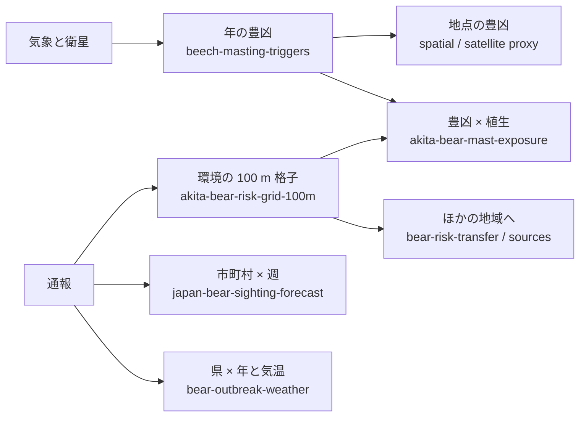

## 確かめていないこと

- 前向きの採点は未了。凍結した市町村 × 週の予測 (2026-09-28〜2026-11-16 の 8 週) は、2026 年 10 月以降の通報が配布されたら `japan-bear-sighting-forecast/scripts/score_frozen.py` で採点する。2027 年度のブナの豊凶の先の予測 (beech-masting-triggers の B6) は、2026 年 8 月の気温が出るまで planned のまま。
- 通報は個体数でも出没の数でもなく、人が見て通報した数。2026 年に秋田市の陽性セルの割合が 16.38% から 27.27% に増えたのが、クマの動きか、通報の行動の変化かは分けられない。
- 年の水準 (量) の予測は、県 × 年が少なく (4 県で 32、秋田は 4 年) 確かめきれていない。都道府県ごとの月別の出没件数があれば、数百の県 × 年で同じ規則を試せる。
- B_env の色は県内の順位で、確率としての水準は年度で合わない。大量出没の年の多さを地図は表さない。
- 2024 年の秋田市の陽性は 195 (19 ブロック) と少なく、主指標の区間の下限がちょうど 0 になった。効果が無いことを示したのではなく、規則の基準に届かなかった。
