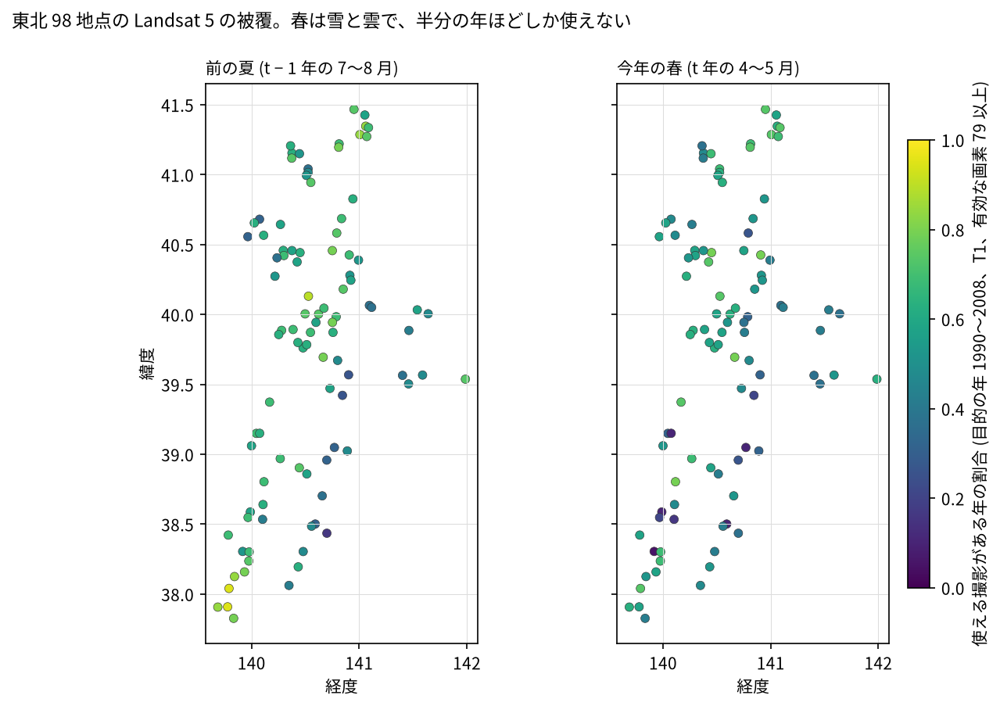
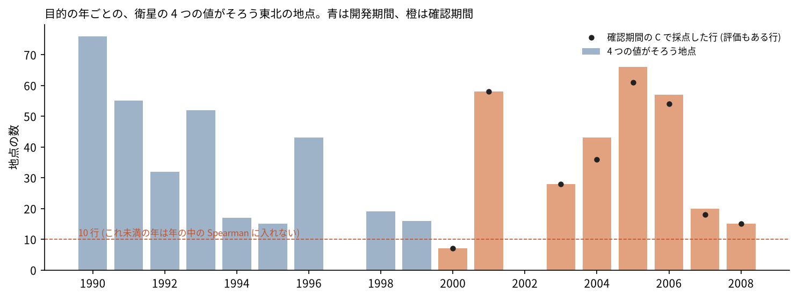
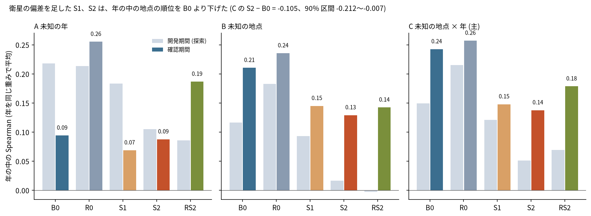
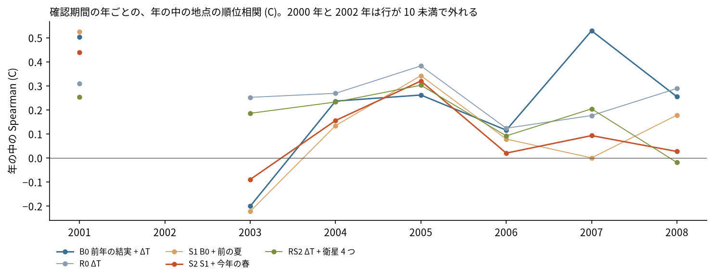
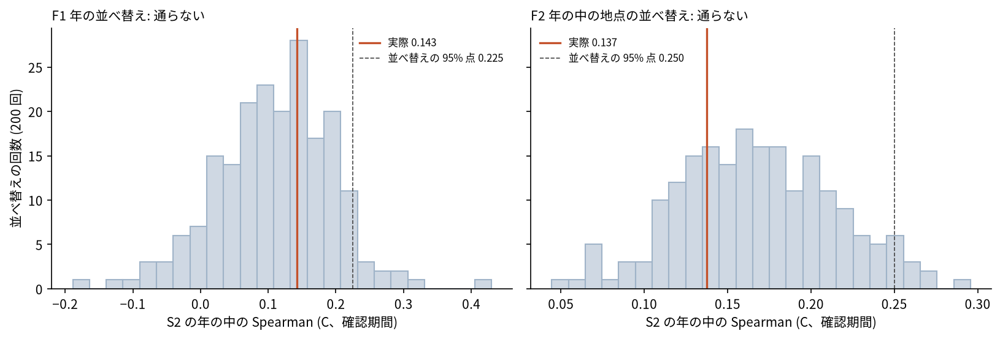

# Landsat 5 の NDVI と NDMI の偏差で、同じ年の中のブナの豊凶の地点の順位を当てられるか

## 問い

東北 98 地点のブナの結実の評価 (0〜3、確認期間 2000〜2008 年) について、地点の周り 300 m の Landsat 5 TM の NDVI と NDMI の、その地点自身の平年からの偏差 (前の夏と今年の春) は、同じ年の中で「どの地点がより実るか」を、学習に使っていない地点 × 年 (C) で当てる情報を足すか。

## 結論

足さなかった。先に決めた関門 (C の年の中の Spearman で、S2 が B0 より良く、90% 区間の下限が 0 より上) は通らず、衛星の偏差を足すと年の中の順位はむしろ下がった。年の中で地点の対応を壊す並べ替え (F2) でも悪くならず、計画の撤退の条件 (H を支持せず、F2 も通らない) に当たる。Landsat NDVI/NDMI の偏差から地点別の mast surface を作る枝は支持されないとして閉じる。北海道 4 地点の目的変数は読んでいない。

### 5 つの問いへの答え

| # | 問い | 答え | 数字 (確認期間、C、年の中の Spearman、90% 区間は年の復元抽出、7 年) | 図 |
|---:|---|---|---|---|
| 1 | Landsat の偏差は、同じ年の中で「どの地点がより実るか」を予測できたか | できなかった。S2 は B0 より悪い | S2 0.138、B0 0.243。S2 − B0 は −0.105 (−0.212〜−0.007)。支持しない | [図 3](#図-3-モデルごとの年の中の-spearman) |
| 2 | previous summer と current spring のどちらが情報を足したか | どちらも足さなかった。前の夏を足すと下がり、春を足しても変わらない | S1 − B0 (前の夏) −0.095 (−0.228〜+0.004)。S2 − S1 (春) −0.010 (−0.068〜+0.046) | [図 4](#図-4-年ごとの年の中の-spearman) |
| 3 | site 対応を shuffle すると性能は落ちたか | 落ちなかった。並べ替えの 72% が実際以上で、F2 は通らない。衛星も地点の信号を持っていない | 実際 0.137、並べ替え 200 回の中央値 0.166、95% 点 0.250 | [図 5](#図-5-並べ替えの反証) |
| 4 | F_lag なしの ΔT + satellite だけでも空間順位を作れたか | 順位は 0 より上だが、それは ΔT から来ている。衛星を足した RS2 は ΔT だけの R0 より悪い | RS2 0.179 (+0.113〜+0.238)、R0 0.257。RS2 − R0 は −0.079 (−0.148〜−0.026)。R は支持しない | [図 3](#図-3-モデルごとの年の中の-spearman) |
| 5 | 秋田県全域に spatially varying mast surface を作る根拠が得られたか | 得られなかった。年の中で場所を分ける信号は、地形と地点の気象 (前のプロジェクト) にも、Landsat の偏差にも見つからない。次の段 (全域の Landsat の proxy、現代の衛星での延長、クマの予測との結合) には進まない | 撤退の条件に当たる (H を支持せず、F2 も通らない) | [図 5](#図-5-並べ替えの反証) |

### 要点

| # | 要点 | 数字 | 根拠 |
|---:|---|---|---|
| 1 | 春の Landsat 5 は、雪と雲で半分ほどの年しか使えない。地点 × 撮影の 4 分の 3 は晴れた画素が無い | 有効な画素 0 の割合 75.4%。被覆の規則 (T1、有効な画素 79 以上、季節に 1 撮影) を満たす年の割合: 前の夏 60.4%、春 51.3%。4 つがそろう東北の地点 × 年は 619 ([coverage_audit.json](outputs/coverage_audit.json)) | [図 1](#図-1-地点ごとの被覆)、[図 2](#図-2-年ごとの使える地点の数) |
| 2 | 確認期間で主の指標に入った年は 7。2000 年 (7 行) と 2002 年 (0 行) は、晴れた春の撮影が無く外れた | C の採点の行 277。年ごとに 15〜61 行 ([b3_confirm.json](outputs/b3_confirm.json)) | [図 2](#図-2-年ごとの使える地点の数) |
| 3 | どの分け方でも、衛星の偏差を足すと年の中の順位は上がらない。開発期間でも同じ向きだった | S2 − B0: A −0.006 (−0.048〜+0.035)、B −0.081 (−0.174〜+0.001)、C −0.105。開発期間の C は B0 0.150、S2 0.051 ([b3_confirm.json](outputs/b3_confirm.json)、[b2_dev_scores.json](outputs/b2_dev_scores.json)) | [図 3](#図-3-モデルごとの年の中の-spearman) |
| 4 | 年の中の順位を一番よく作るのは ΔT だけの R0 で、地点ごとの AgERA5 の ΔT の違いが効いている | C の R0 0.257、B0 0.243。ただし R0 の RMSE は 0.889 で、B0 の 0.750 より大きい (年の水準を外す) ([b3_confirm.json](outputs/b3_confirm.json)、[satellite_seasonal.csv](outputs/satellite_seasonal.csv)) | [図 4](#図-4-年ごとの年の中の-spearman) |
| 5 | 年の対応を壊す並べ替え (F1) でも、地点の対応を壊す並べ替え (F2) でも、S2 は悪くならない | F1: 実際 0.143、95% 点 0.225、並べ替えが実際以上の割合 0.41。F2: 0.137、0.250、0.72 ([b4_falsification.json](outputs/b4_falsification.json)) | [図 5](#図-5-並べ替えの反証) |

### 読み手ごとに知るべきこと

| 読み手 | 結論 | 検討する材料 | 詳しく |
|---|---|---|---|
| クマの出没の予測を作る人 | Landsat 5 の地点の NDVI と NDMI の偏差は、同じ年の中でどこが実るかを当てなかった。豊凶の面を空間に分けて作る根拠は、まだ無い。年の豊凶 (ΔT と前年の結実) は県や地域で一様に扱うのが今の根拠の範囲 | 東北森林管理局の 7 月の開花の公表、前年の結実 | [答え 5](#5-つの問いへの答え) |
| ブナの豊凶を調べる人 | 地点の周り 300 m の偏差は、前の夏の植生の状態としても、春の展葉の状態としても、年の中の順位に効かなかった。春は雪で、確認期間の 2 年が測れない | 林冠の画素だけを選ぶ方法、撮影の日の揃え方は、この計画では試していない (救済として足さない) | [確かめていないこと](#確かめていないこと) |

### 図 1: 地点ごとの被覆

色は、目的の年 1990〜2008 年のうち、被覆の規則を満たす撮影がある年の割合。前の夏は 0.16〜0.95、今年の春は 0.05〜0.79 で、北緯 39 度より南の地点で春が欠けやすい。被覆は目的変数を読む前に監査し、その結果だけで規則を決めた ([coverage_audit.json](outputs/coverage_audit.json))。

### 図 2: 年ごとの使える地点の数

棒は 4 つの季節の値がそろう東北の地点、黒い点は確認期間の C で採点した行 (評価もある行)。1997 年と 2002 年は春に晴れた撮影が無く 0、2000 年は 7 で、10 行未満の年は年の中の Spearman に入れない規則により外れた。確認期間の判定は 2001 年と 2003〜2008 年の 7 年で決まる。

### 図 3: モデルごとの年の中の Spearman

薄い色が開発期間 (探索)、濃い色が確認期間。A、B、C のどれでも、衛星を足した S1、S2 は B0 より低く、ΔT と衛星の RS2 は ΔT だけの R0 より低い。年の中の Spearman は、年ごとに地点の間で予測と観測の順位を比べ、年を同じ重みで平均した値で、年の水準を当てても上がらない。

### 図 4: 年ごとの年の中の Spearman

S2 が B0 を上回ったのは 2003 年 (−0.09 対 −0.20) と 2005 年 (0.32 対 0.26) だけで、2007 年 (0.09 対 0.53) と 2008 年 (0.03 対 0.25) で大きく下回る。R0 は年ごとの揺れが小さく (0.12〜0.38)、ΔT の地点の違いが毎年弱い順位を作っている。

### 図 5: 並べ替えの反証

左は衛星の偏差の年を全ての地点でまとめて入れ替えた F1、右は同じ年の中で地点の間で入れ替えた F2。どちらも実際の値 (赤) は並べ替えの分布の中ほどにあり、95% 点 (破線) に届かない。F2 では並べ替えの中央値 0.166 が実際の 0.137 より高い。F1 は年を入れ替えると春の撮影の有無が変わり、採点する行が 149〜405 で動くので、実際の値も並べ替えごとに同じ行で計算し直して比べた。

### 読み方で変わる答え

| 読み方 | 主 | 別の読み方 |
|---|---|---|
| 指標 | 年の中の Spearman: S2 0.138、B0 0.243 | RMSE: S2 0.768、B0 0.750。年をまとめた Spearman: S2 0.713、B0 0.751。年の中で中心化した RMSE (診断用): S2 0.604、B0 0.595。どれも S2 が B0 より悪い |
| 分け方 | C (未知の地点 × 年): S2 − B0 −0.105 | A (未知の年) −0.006、B (未知の地点) −0.081 |
| 期間 | 確認期間 2000〜2008 年 (7 年) | 開発期間 1990〜1999 年 (8 年、探索): B0 0.150、S2 0.051 |
| 衛星の範囲 | 前の夏と今年の春の両方 (S2) | 前の夏だけ (S1) 0.148、F_lag なし (RS2) 0.179 |

## データ

- 目的変数: `yuiseki/fagus-crenata-masting-jp-2026-06` 版 db40a09 (Dryad doi:10.5061/dryad.7sqv9s54n、Masaki ほか、版 5、CC0)。東北 98 地点の 0〜3 の評価。C の確認期間で採点した行 277。北海道 4 地点の目的変数は読んでいない。
- 衛星: `yuiseki/landsat5-fagus-crenata-sites-jp-2026-10` 版 939ee55 (この研究のために凍結)。USGS Landsat 4-5 TM Collection 2 Level-2 (doi:10.5066/P9IAXOVV) を Planetary Computer から 2026-10-28 に読んだ。item 1,394、地点 × 撮影 23,455 行、画素 7,365,354。Landsat data courtesy of the U.S. Geological Survey (public domain)。
- 気温: 前のプロジェクトの `projects/_bear/beech-masting-spatial-proxy/outputs/site_year_climate.csv` (AgERA5 `agera5-japan-monthly-temperature-1979-2026` 版 348e459、CC BY 4.0) を、同じ ΔT の定義でそのまま読んだ。

## 方法

- 衛星の値: 撮影の UTM の格子で中心が地点から 300 m 以内の画素。USGS の尺度 (DN × 0.0000275 − 0.2) を当て、Collection 2 の QA で fill、雲 (dilated を含む)、雲の影、雪、使う帯の飽和と欠落、有効範囲 (DN 7273〜43636) の外を除いた。画素ごとの NDVI と NDMI の中央値を撮影の値にし、季節 (前の夏 = t − 1 年の 7〜8 月、今年の春 = t 年の 4〜5 月) の中で撮影の値の中央値をとった。半径、指標、季節の窓は計画で 1 つずつに固定した。
- 偏差: 各 fold の学習の年だけで作ったその地点の平年からの差 (A と C は t と t + 1 を除く年、B は各行の年を除く年、3 年以上)。絶対値の版は作っていない。
- モデル: B0 (前年の結実 + ΔT)、R0 (ΔT)、S1 (B0 + 前の夏の 2 つ)、S2 (S1 + 春の 2 つ)、RS2 (ΔT + 4 つ)。全て最小二乗の線形で、4 つの偏差がそろう同じ行で学習し採点した。分け方 (50 km のブロック、5 fold、repeat 10、15 km の緩衝帯、近い 5 地点の前年) は前のプロジェクトと同じで、fold は 50 組とも一致することを確かめた。
- 主の指標と関門: C の年の中の Spearman (repeat で平均した予測、10 行以上の年、年を同じ重み)。S2 − B0 の点推定 > 0 かつ年の復元抽出 (2,000 回) の 90% 区間の下限 > 0 で支持。
- 順序: 計画と追跡表をコミットしてから衛星を読み ([計画](EXPERIMENT_PLAN.md))、抽出表を凍結し、目的変数を読む前に被覆の規則を固定し、開発期間で仕様を凍結 (sha256 3e0b2baf…) してから確認期間を 1 回流した。反証は確認の結果によらず流した ([記録](EXPERIMENT_TRACKER.md))。
- 関門: 距離と緩衝帯は EPSG:6691 (m)、画素の半径は各撮影の UTM (m) で測った。NDVI と NDMI は比の指標で、中央値で集めた。空間の依存は、50 km のブロックと 15 km の緩衝帯の分け方、同じ年の地点を一緒に動かす年の復元抽出で扱った。地図は被覆の図 1 だけで、経緯度の散布図 (面積は比べない)。
- 再実行は [README.md](README.md)。

## 確かめていないこと

- 300 m の円は森林の範囲ではない。道、伐採地、スギの植林などが混ざると、地点の偏差がブナの林冠の状態を表さない。林冠の画素だけを選ぶ方法は、計画にない救済になるので試していない。
- 撮影の日は年と地点で違う。季節の中の展葉や落葉の位置の違いが偏差に入る。
- 確認期間の判定は 7 年と 277 行で決まり、晴れた春の撮影がない 2000 年 (大きな豊作の年) と 2002 年は測れていない。
- QA が拾わない薄雲や霞の可能性: 前の夏の NDVI が 0.5 未満の地点 × 年が 35 あり、1992 年の夏 (t = 1993) に 17 が集まる。規則にない除き方になるので、除かずに使った。
- Landsat 5 だけを使った。Landsat 7 を足す、2025〜2026 年へ延ばすことは、枝を閉じたので行っていない。
- 北海道 4 地点は、関門を通らなかったので開けていない。
