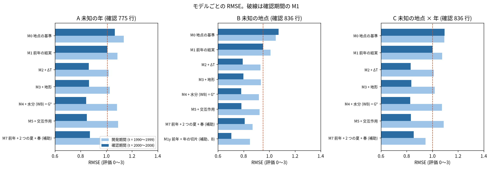
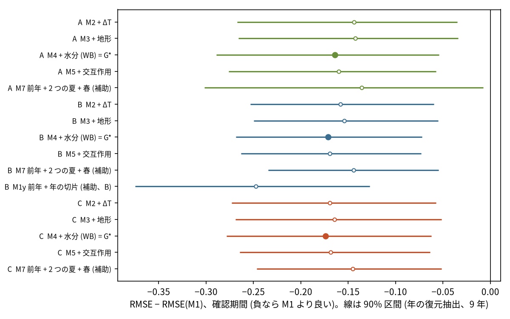
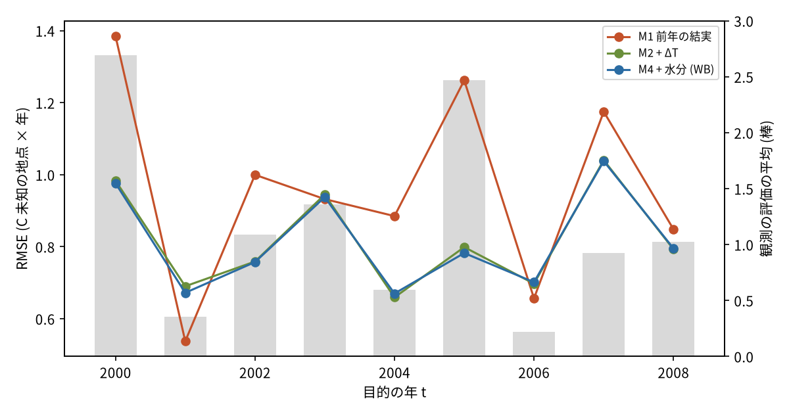
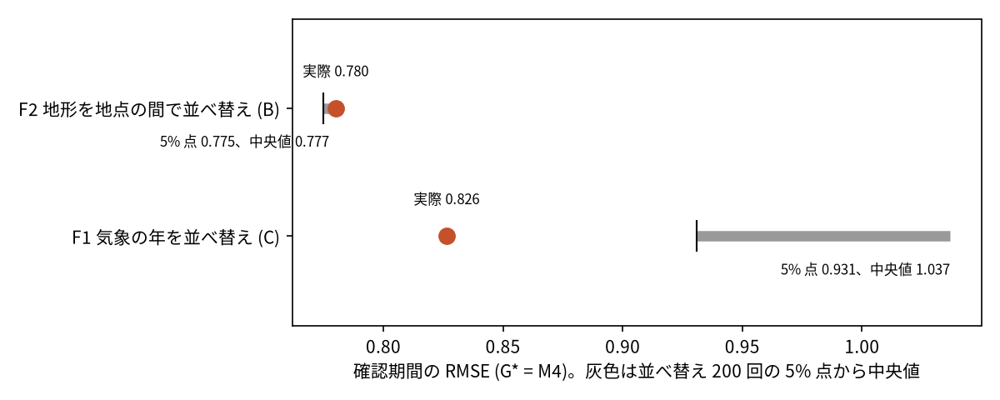

# ブナの豊凶を地点 × 年で地形と気象から当て、観測の無い地点へ広げられるか

## 問い

東北 98 地点のブナの結実の評価 (0〜3、1990〜2008 年) は、前年の結実、地形、年ごとの気象と水分、地形 × 気象で、学習に使っていない年と地点の両方で当たり、環境のラスタから空間に連続な proxy を作る根拠になるか。

## 結論

先に固定した撤退の条件は、規則のうえでは通った。環境のモデル G* (前年の結実 + ΔT + 地形 + 水分、M4) は、確認期間 (2000〜2008 年) の未知の地点 (B) でも、未知の地点 × 未知の年 (C) でも、前年の結実だけのモデル (M1) より RMSE が小さく、空間のブロックの repeat 10 回の全てで良かった。ただし、良くなった分のほとんどは、全ての地点に共通する年の信号 (2 つの夏の気温の差 ΔT) から来ている。地形は効かず (C2 は退ける)、地形 × 気象の交互作用も効かなかった (C3 は退ける)。地形を地点の間で入れ替えても当たりは変わらず (F2 は通らない)、気象を各年の 98 地点の平均に置き換えても C の RMSE はほぼ同じだった (探索)。同じ年の中で、どの地点が多く実るかを当てる力は弱い (地点の順位相関の 9 年の平均 0.169、探索)。

### 5 つの問いへの答え

| # | 問い | 答え | 数字 (確認期間、RMSE、90% 区間は年の復元抽出) | 図 |
|---:|---|---|---|---|
| 1 | 未知の年は予測できたか | できた。ΔT を足すと前年の結実だけより良い。ただし前のプロジェクトで同じ年の県の値を見ていたので、確認ではなく探索として扱う | A: M2 0.864、M1 1.007。差 −0.144 (−0.267〜−0.035) | [図 2](#図-2-モデルごとの-rmse) |
| 2 | 未知の地点は予測できたか | 前年の結実だけよりは良く当たった。しかし地形は効いていない。地形を足すとわずかに悪くなった | B: G* 0.780、M1 0.951、差 −0.171 (−0.269〜−0.072)。M3 − M2 は +0.0044 (+0.0026〜+0.0063) | [図 3](#図-3-前年の結実だけとの差) |
| 3 | 未知の地点 × 未知の年でも改善は残ったか | 残った。repeat 10 回とも M1 より良い | C: G* 0.826、M1 1.000、差 −0.174 (−0.279〜−0.062) | [図 3](#図-3-前年の結実だけとの差) |
| 4 | 地形の交互作用は何を足したか | 何も足さなかった | C: M5 − M4 は +0.0052 (−0.0034〜+0.0153)。B でも +0.0018 | [図 2](#図-2-モデルごとの-rmse) |
| 5 | 空間に連続な mast proxy を作る根拠は得られたか | 年の proxy としては得られた。場所を分ける proxy としては得られていない。規則により枝は閉じず次の段へ進むが、根拠になったのは年の信号と近い地点の前年の結実で、地形と地点ごとの気象の違いではない | F1 (気象の年の並べ替え) 0.826 対 5% 点 0.931 で通る。F2 (地形の並べ替え) 0.780 対 5% 点 0.775 で通らない。気象を年の平均にしても C の G* は 0.8259 (地点の気象 0.8264) | [図 5](#図-5-並べ替えの反証) |

### 次の段について

計画の規則では、未知の地点と未知の年で改善が残ったので、次の段 (北海道 4 地点での別の地域の検証、衛星、秋田県の全域の面、クマの環境の値との結合) に進む根拠になる。ただし、この結果から作れる面は、年ごとにほぼ一様な値に、近い地点の前年の結実と、気温の差の緩やかな勾配が乗るだけのものになる。

- 北海道 4 地点の検証は、年の信号が別の地域でも効くかを確かめるもので、この結果と整合する。最初に進めるならここ。
- 秋田県の全域の面を地形から作ることは、この結果では支えられない。地形は未知の地点の当たりに効かなかった。
- 衛星の植生の値は、年の中で場所を分ける信号を足す候補になる。地形と気象では、その信号が得られなかったため。

## 図

### 図 1: 地点と空間のブロック

98 地点を EPSG:6691 の 50 km 四方で 24 ブロックに分け、ブロックを 5 つの fold に無作為に割った (repeat 10 回)。試験の地点から 15 km 以内の地点は学習から外した。

### 図 2: モデルごとの RMSE

濃い色が確認期間 (2000〜2008 年、凍結した版を 1 回)、薄い色が開発期間 (1990〜1999 年)。どの分け方でも、ΔT を足した M2 で大きく良くなり、地形 (M3)、水分 (M4)、交互作用 (M5) はほとんど動かさない。B の M1y (前年の結実 + その年の他の地点の観測から借りた年の切片、補助) は 0.704 で、環境のモデルより良い。その年の調査の値があるなら、環境のラスタよりそちらが効く。

### 図 3: 前年の結実だけとの差

M2 から M5 は、どの分け方でも M1 より 0.14〜0.17 良く、互いの差は区間の幅に比べて小さい。塗った点が G* (M4)。

### 図 4: 年ごとの RMSE (C)

M1 が大きく外すのは、豊作の 2000 年 (RMSE 1.3849) と 2005 年 (1.262)、それに 2007 年 (1.175)。ΔT を足すと 2000 年は 0.9763、2005 年は 0.7824 (G*) まで下がる。一方、M1 が良く当たる 2001 年 (0.5376) と 2006 年 (0.6567) は、G* のほうが少し悪い。年の信号を当てているので、豊凶の年を当てたかどうかで当たりが決まる。

### 図 5: 並べ替えの反証

気象の年を (全ての地点でまとめて) 並べ替えると、RMSE は 0.826 から 5% 点 0.931 まで悪くなる。年の対応が効いている。地形を地点の間で並べ替えても、5% 点 0.775、中央値 0.777 で、実際の 0.780 より悪くならない (並べ替えのほうが良かった割合 0.955)。

### 判定の表

| claim | 区画 | 比べたもの | 差 (90% 区間) | 規則による判定 |
|---|---|---|---|---|
| C1 | B2 (A) | M2 − M1 | −0.144 (−0.267〜−0.035) | 支持 (報告では探索として扱う) |
| C2 | B2 (B) | M3 − M2 | +0.0044 (+0.0026〜+0.0063) | 退ける |
| C3 | B2 (C) | M5 − M4 | +0.0052 (−0.0034〜+0.0153) | 退ける |
| G | B2 (B) | G* − M1 | −0.171 (−0.269〜−0.072)、repeat 10 回とも負 | 通る |
| G | B2 (C) | G* − M1 | −0.174 (−0.279〜−0.062)、repeat 10 回とも負 | 通る (G は支持) |
| F1 | B3 (C) | 気象の年の並べ替え | 実際 0.826、5% 点 0.931 | 通る |
| F2 | B3 (B) | 地形の地点の並べ替え | 実際 0.780、5% 点 0.775 | 通らない |

### 読み方で変わる答え

| 読み方 | 主 | 別の読み方 |
|---|---|---|
| 指標 | 年をまとめた RMSE: G* は M1 より B で 0.171、C で 0.174 良い | 同じ年の中の地点の順位相関 (探索): C で M1 0.049、M2 0.186、G* 0.169。年の中で場所を分ける力は弱い |
| 気象の空間の違い | 地点のセルの値: C の G* 0.8264 | 各年の 98 地点の平均: 0.8259 (差 +0.0005、−0.0057〜+0.0064)。年の中の順位相関は 0.015 に落ちる |
| 分け方の設定 | 50 km、緩衝帯 15 km、近い地点 5 | 緩衝帯 0 km、30 km のブロック、近い地点 3 と 10: G* − M1 は B で −0.170〜−0.173、C で −0.172〜−0.176。どれも区間の上限 < 0 |
| 期間 | 確認期間 2000〜2008 年 | 開発期間 1990〜1999 年 (探索): C で M1 1.076、M2 1.010、G* 1.074。開発期間では水分を足すと M2 より悪かった |

## データ

- 目的変数: `yuiseki/fagus-crenata-masting-jp-2026-06` 版 db40a09 (Dryad、Masaki ほか、版 5、CC0) の `Obs.seed.rnk.YYYY`。東北の 98 地点、0〜3 だけ (-1 と NULL を除く)。目的の年 1990〜2008 年の行 1,750 (開発期間 914、確認期間 836)。北海道 渡島半島の 4 地点は読んでいない。
- 地形: Mapterhorn の凍結した複製 `z.yuiseki.net/static/mapterhorn/2026-01-06/planet.pmtiles` (2026-01-07 取得) のズーム 12 (画素 14.3〜15.1 m)。標高の特徴量は Dryad の Altitude。Mapterhorn の標高とは相関 0.995、絶対差の平均 19.8 m、100 m を超える食い違い 0 地点 ([terrain_audit.json](outputs/terrain_audit.json))。表示: © Mapterhorn。日本の範囲の配布元は国土地理院の基盤地図情報。
- 気温: `yuiseki/agera5-japan-monthly-temperature-1979-2026` 版 348e459 (AgERA5 v2.0、CC BY 4.0)。夏の気温 Ts(y) は Dryad の T.HSM の同じ年と相関 0.894 ([climate_audit.json](outputs/climate_audit.json))。
- 水分: `yuiseki/agera5-japan-monthly-water-1979-2026` 版 b3d1a83。この研究のために、FAO の公開ストレージの AgERA5 の月別降水 (`AGERA5-PF-M`) と FAO の月別基準蒸発散量 (`AGERA5-ET0-M`) を日本周辺だけ取り出して凍結した。ライセンスは FAO の目録のメタデータで CC-BY-SA-4.0 (2026-10-28 に確認)。出典: Copernicus Climate Change Service (C3S)、ECMWF、AgERA5 version 2.0、FAO。
- 98 地点は AgERA5 の 81 セルに入り、気象の欠けは 0。

## 方法

- 単位は地点 × 目的の年 t。特徴量は全て t 年の 5 月末までに決まる値: 前年の結実、ΔT = Ts(t − 1) − Ts(t − 2) (7〜8 月の月平均最高気温)、t − 1 年の 6〜8 月の降水と基準蒸発散量とその差 WB、地形 6 つ (標高、傾き、北向き度、東向き度、1,000 m の起伏、1,000 m の TPI)。気象は地点のセルの 1981〜2010 年の平均からの偏差。
- モデルは全て最小二乗の線形 (地点と年の切片を持たない)。M0 地点の基準、M1 前年の結実、M2 + ΔT、M3 + 地形、M4 + 水分、M5 + ΔT × 標高、WB × 標高、WB × 北向き度。未知の地点の前年の結実は、学習側の近い 5 地点の前年の平均。
- 分け方: A は年を 1 つずつ伏せる (t と t + 1 を学習から除く)。B は 50 km のブロック × 5 fold、緩衝帯 15 km、repeat 10 回。C は B の fold × 年。主の指標は RMSE。区間は試験の年を単位にした復元抽出 (同じ年の地点を一緒に動かす、2,000 回)。
- 計画 ([EXPERIMENT_PLAN.md](EXPERIMENT_PLAN.md)) は、地形と水分の特徴量を 1 つも計算する前に固定して push した。開発期間 (t = 1990〜1999) で地形の半径と水分の形と G* を選んで凍結し ([b1_frozen_choice.json](outputs/b1_frozen_choice.json)、sha256 2adaa495…)、確認期間 (t = 2000〜2008) を 1 回だけ流した ([b2_confirm.json](outputs/b2_confirm.json)、[b3_checks.json](outputs/b3_checks.json))。年の中の順位相関と、気象を年の平均にした版は、確認の結果を見た後に足した探索 ([e1_within_year.json](outputs/e1_within_year.json))。実行の記録は [EXPERIMENT_TRACKER.md](EXPERIMENT_TRACKER.md)。
- 関門:
  - 座標: 距離とブロックは EPSG:6691 (JGD2011 / UTM 54N) で測った。地形は Web メルカトルの画素を EPSG:6691 に移してから計算した。
  - 量と水準: 評価は順序の水準で、平均で集めた。足していない。
  - 空間の依存とリーク: 空間のブロックと緩衝帯で分けた。緩衝帯を 0 km にしても点数は変わらなかった。モデルが地点ごとの値を持たない (地形が効いていない) ので、近い地点のリークが入り込む余地が無いと読める。
  - 基準: M0 と M1 を同じ分割で比べた。年の切片を借りる M1y を、届かない上限の目安として並べた。
  - 残差: C の G* の残差の Moran's I は、年の平均 0.180 (0.022〜0.541) で、正の空間の偏りが残る。最大は豊作の 2000 年。
  - 報告: 関連であり、気温や地形が豊凶を起こすとは書かない。地点の結果を個々の木の関係として読まない。
- 再実行は [README.md](README.md)。

## 確かめていないこと

- 確認期間は 9 年で、区間の幅の多くは年の数で決まる。G の区間の上限 (B −0.072、C −0.062) は 0 から離れているが、豊作の年 (2000、2005 年) の当たり外れに強く依存する。
- C1 (ΔT が未知の年を良くする) は、前のプロジェクトが同じ年の県の値で ΔT の効きを見ていたため、確認として数えない。
- 年の中で場所を分ける力が弱い理由は分けていない。評価が目視の 4 段階で粗いこと、AgERA5 の 0.1 度のセルが林の中の気象を表さないこと、地点の位置の精度、本当に地形が効かないこと、のどれかは区別できない。
- 残差に正の空間の偏り (Moran's I 0.180) が残るので、近い地点の豊凶の揃いを使う空間のモデル (残差の内挿) なら、年の中の場所の違いを当てられる可能性がある。この計画では試していない。
- 北海道 4 地点、衛星、1,000 m 以外の半径、順序のモデル、日別の気象は使っていない。
- 評価 0〜3 は間隔の尺度として扱った。
