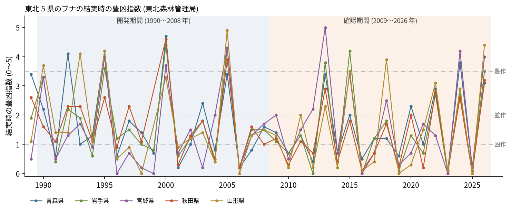
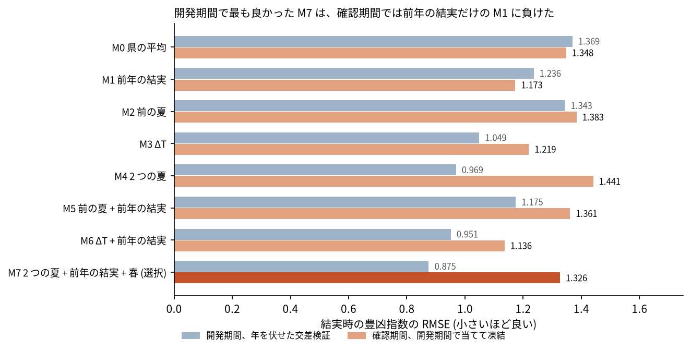
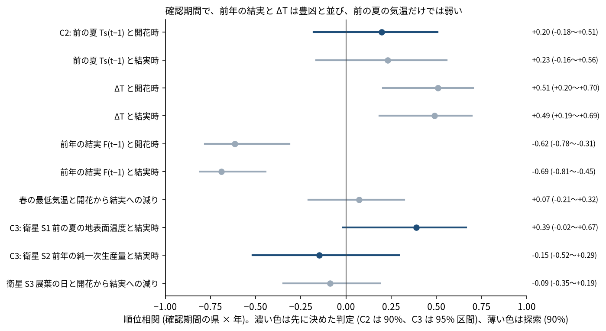

# ブナの豊凶の引き金を、気象と衛星で探す (東北 5 県 × 年): 図で読む要点

## 問い

東北 5 県のブナの結実の豊凶 (東北森林管理局の豊凶指数 0〜5) は、前の年までの夏の気温、春の気温、前の年の結実、衛星で測った地表と植生の値で、学習に使っていない後の年を当てられるか。

## 結論

開発期間 (目的の年 1990〜2008 年) で手がかりを選び、確認期間 (2009〜2026 年) で 1 回だけ確かめた。規則を先に決めた 3 つの主張 (C1〜C3) は、どれも支持されなかった。確認期間でも崩れなかったのは、前の年の結実 (豊作の翌年は凶作) と、2 つの夏の気温の差 ΔT の関係だけで、どちらも探索として見たものである。

### 要点

| # | 要点 | 数字 | 図 |
|---:|---|---|---|
| 1 | 開発期間で最も良かったモデル M7 (2 つの夏、前年の結実、春の最低気温) は、確認期間では前年の結実だけのモデル M1 に負けた。C1 は退ける | 確認期間の RMSE は M7 1.326、M1 1.173、県の平均 M0 1.348。M7 − M1 は +0.153 (90% 区間 −0.062〜+0.351)。開発期間の年を伏せた RMSE は M7 0.875、M1 1.236 | [図 2](#図-2-モデルごとの誤差) |
| 2 | 気象の手がかりの年を入れ替えても、M7 は同じくらい当たる。確認期間では、気象の年の対応が当たりを良くしていない | M7 の RMSE 1.326 に対し、年を入れ替えた手がかりの RMSE の 5% 点 1.178 | [図 3](#図-3-確認期間の予測と観測) |
| 3 | 前の夏の暑さ Ts(t−1) は、花ができる段階 (開花時の指数) とはっきりは関係しない。C2 は支持されない | 順位相関 +0.197 (90% 区間 −0.179〜+0.506) | [図 4](#図-4-手がかりと豊凶の順位相関) |
| 4 | 確認期間でも強いのは、前年の結実 (負) と ΔT = Ts(t−1) − Ts(t−2) (正)。どちらも探索で、主張の証拠には数えない | 結実時と前年の結実 −0.689 (−0.808〜−0.446)、開花時と ΔT +0.508 (+0.204〜+0.704)。ΔT と前年の結実のモデル M6 の確認期間の RMSE は 1.136 | [図 4](#図-4-手がかりと豊凶の順位相関) |
| 5 | 衛星の前の夏の地表面温度 S1 と、前年の純一次生産量 S2 は、決めた向きの規則を満たさなかった。C3 は支持されない | S1 +0.389 (95% 区間 −0.017〜+0.665、17 年)、S2 −0.149 (−0.518〜+0.294) | [図 4](#図-4-手がかりと豊凶の順位相関) |

### 読み手ごとに知るべきこと

| 読み手 | 結論 | 検討する材料 | 詳しく |
|---|---|---|---|
| クマの出没に備える県と市町村の担当 | 秋の実りを夏の前に見積もるなら、前の年の結実 (豊作の翌年は凶作) が最も確か。夏の気温を足しても、確認期間では良くならなかった | 東北森林管理局の 7 月の開花の公表 (開花時と結実時の順位相関は +0.926) | [図 3](#図-3-確認期間の予測と観測) |
| ブナの豊凶を調べる人 | 2 つの夏の差 ΔT は確認期間でも豊凶と並んだが、選んだのは結果を見た後。次の年か別の地域で、先に固定して確かめる必要がある | 2027 年度の公表、北陸などの別の地域の豊凶の調査 | [確かめていないこと](#確かめていないこと) |

### 図 1: 県ごとの豊凶指数

5 県はほぼ同じ年に揃って豊作になり、翌年は揃って凶作になる。確認期間の豊作は 2013、2015、2018 (山形)、2024、2026 年で、豊作の翌年の多くは大凶作。手がかりの効きは、ほぼ年の数 (確認期間で 18) だけの証拠で決まる。

### 図 2: モデルごとの誤差

青は開発期間で年を 1 つずつ伏せた RMSE、橙は開発期間の全ての年で当てて凍結し、確認期間に当てた RMSE。手がかりの多いモデルほど開発期間で良く見え、確認期間で崩れた (M4 は 0.969 から 1.441)。順位で見ると、確認期間の Spearman は M7 0.505、M1 0.655、M6 0.682。

### 図 3: 確認期間の予測と観測

M7 は豊作と凶作の交代の向きを追うが、振れ幅を外し (2011 年を高く予測し、2025 年は 0 未満)、誤差が大きくなった。M1 は前年の逆を言うだけで、平均の水準が高めに出る。未来の夏 Ts(t+1) に替えた偽のモデルは、県の平均より悪い (RMSE 1.897 対 1.276、差 +0.621、90% 区間 +0.167〜+1.038)。年の傾向だけで当たっている形ではない。

### 図 4: 手がかりと豊凶の順位相関

濃い色が先に規則を決めた判定、薄い色が探索。前の夏の気温 Ts(t−1) より ΔT のほうが、開花時とも結実時とも強く並ぶ。衛星の S1 は AgERA5 の Ts(t−1) と +0.586 で並ぶが、結実時とは S1 のほうが強い (+0.389 対 +0.231)。春の最低気温と、開花から結実への減りの関係は見えない (+0.074)。

### 読み方で変わる答え

| 読み方 | 主 | 別の読み方 |
|---|---|---|
| 確認期間の予測の作り方 | 開発期間で 1 回当てて凍結: M7 1.326、M1 1.173 | 年ごとに前の全ての年で当て直す: M7 1.227、M1 1.147。順は変わらない |
| 比べる指標 | RMSE: M1 が M7 より良い | Spearman: M1 0.655、M7 0.505。5 区分の一致は M7 0.389、M1 0.356 |
| 目的の段階 | 結実時 | 開花時: 前の夏との相関 +0.197、ΔT との相関 +0.508 |
| 気温の測り方 | AgERA5 の月平均最高気温 (再解析) | MODIS の昼の地表面温度: 結実時との相関 +0.389 (AgERA5 は +0.231) |

## データ

- 結果: 東北森林管理局「ブナ開花・結実調査」のプレスリリース (令和 8 年度の結実状況 2026-10-06、令和 7 年度の結実状況 2025-11-06、令和 8 年度の開花状況 2026-07-07。2026-10-28 取得) の表「年度別ブナ開花状況並びに結実状況」を読み取った 345 セル ([tohoku_beech_index.csv](outputs/tohoku_beech_index.csv))。2 つのリリースで重なる 335 セルは全て一致した。2026 年度は箇所数から計算し直した値と一致した。欠けは 35 セル (1989 年の開花時、1990〜2003 年の秋田と山形の開花時、1999 年の秋田と山形の結実時)。出典: 東北森林管理局ウェブサイト (https://www.rinya.maff.go.jp/tohoku/sidou/buna.html) を加工して作成 (PDL1.0)。
- 地点: `fagus-crenata-masting-jp-2026-06` 版 db40a09 (Dryad、Masaki ほか、版 5、CC0) の東北 98 地点。地点の評価から作り直した 1989〜2008 年の結実時の指数は、印刷の指数と県ごとに相関 0.952〜0.993 で、同じ調査の一部の地点とみなした ([dryad_vs_printed_index.json](outputs/dryad_vs_printed_index.json))。
- 気象: `agera5-japan-monthly-temperature-1979-2026` 版 348e459 (AgERA5 v2.0 の月平均最高気温と最低気温、0.1 度、CC BY 4.0)。98 地点を含むセル 81 の 571 か月、欠けは 0。
- 衛星: MODIS collection 6.1 の Terra (Planetary Computer、2026-10-28 取得)。MOD11A2 の昼の地表面温度 (2001〜2024 年。2025 年 7〜8 月の合成が Planetary Computer に無い)、MOD17A3HGF の純一次生産量 (2001〜2025 年)、MOD13A1 の EVI (2001〜2025 年)。

## 方法

- 単位は県 × 年。県の気象と衛星の値は、県内の Dryad の地点の値の平均。気温は県の 1981〜2010 年の平均からの差、衛星の S1 と S2 は 2001〜2010 年の平均からの差。手がかりは全て、目的の年の 5 月末までに決まる値だけ。
- 8 つの候補 (全て県の切片を持つ最小二乗) を、開発期間で年を 1 つずつ伏せた RMSE で比べ、最小のもの (M7) を選んで凍結した ([b1_frozen_models.json](outputs/b1_frozen_models.json))。確認期間の行は、凍結の後に 1 回だけ計算した ([b2_b3_confirm.json](outputs/b2_b3_confirm.json))。
- 区間は、確認期間の年を復元抽出する (同じ年の 5 県を一緒に動かす、2,000 回、種 0)。県どうしは同じ年に揃って動くので、県 × 年を独立に扱わない。
- 主張、比べる相手、判断の規則、反証は、気象と衛星の値を 1 つも計算する前に [計画](EXPERIMENT_PLAN.md) に固定した。確認期間の結果の表 (どの年が豊作か) は、計画の前に読んでいた。衛星の品質の扱いは、B2〜B4 の結果を見た後、衛星の値を読む前に計画に足した。実行は [記録](EXPERIMENT_TRACKER.md)。
- 関門: 座標は経緯度の点を格子と画素に入れるだけで、距離と面積は測っていない。気温と指数は水準で、平均で集めた。空間の依存は、県が同じ年に揃うことを年の復元抽出で扱い、県の間の違いは年の中の傾き (探索、+0.304、90% 区間 −0.009〜+0.865) で見ただけ。地図は描いていない (5 県の値で、場所の構造は問いの対象でない)。
- 再実行は [README.md](README.md)。

## 確かめていないこと

- ΔT と前年の結実の関係は、確認期間の結果を見た後に拾ったもので、主張の証拠ではない。2027 年度の結実 (計画の B6、2026 年 8 月の気温が出てから凍結) か、別の地域の豊凶の調査で、先に固定して確かめる必要がある。
- 確認期間は 18 年で、検出力は低い。S1 の区間の下限 (−0.017) のように、規則の境目にある結果は、効かないとまでは言えない。
- 森林管理局の現在の 145 か所の位置は公表されておらず、県の気象は Dryad の 98 地点 (宮城は 3 地点) で代表させた。
- 豊凶指数は目視の 4 段階の平均で、間隔の尺度として扱った。
- 日別の気温 (夏の高温の続いた日数、晩霜の日) は使っていない。月平均では、Masaki ほか (2025) の手がかりと同じものを測れていない。
- 気象と豊凶の関係は関連であり、気温が豊凶を起こすことまでは示していない。
