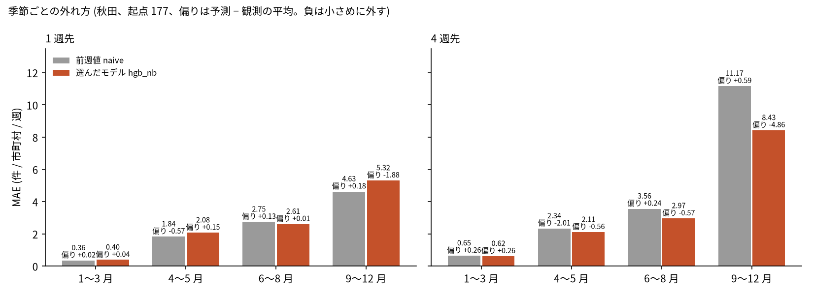

# クマ出没通報の短期予測 (秋田県の市町村 × 週): 図で読む要点

## 問い

秋田県の市町村ごとの、翌週から 4 週先までのツキノワグマの出没通報件数を、前週値より良く当てられるか。

## 結論

### 要点

| # | 要点 | 数字 | 図 |
|---:|---|---|---|
| 1 | 探索で選んだモデル hgb_nb は、1 週先と 2 週先で前週値に勝たない | MAE (件 / 市町村 / 週) は 1 週先 2.838 対 2.622 (差 +0.216、90% 区間 −0.033〜+0.513)、2 週先 3.608 対 3.525 | [図 1](#図-1-モデルごとの-mae) |
| 2 | 4 週先で差が開くのは秋だが、モデルは秋の多さを小さめに外している | 4 週先の 9〜12 月の MAE は 8.429 対 11.172。偏りは −4.856 対 +0.595 | [図 2](#図-2-季節ごとの外れ方) |
| 3 | 重点の 5 市町村を選ぶ用途では、モデルの効果はほとんど見えない | その週の通報のうち予測の上位 5 市町村に入った割合は、1 週先で hgb_nb 0.579、前週値 0.572、過去の平均の順位 0.568。最善の 5 市町村なら 0.762 | [表 1](#表-1-重点の-5-市町村の捕捉率) |
| 4 | 岐阜 (月) の確認では、1 年前の同じ月が前月値より悪いとは言えず、規則では判断できない。岐阜ではモデルが前月値に勝つ | 1 年前の同じ月 − 前月値は +0.019 (−0.076〜+0.113)。hgb の MAE は 1 か月先 0.731、前月値 0.867 | [図 1](#図-1-モデルごとの-mae) |
| 5 | 凍結した予測は直近の静かな水準の延長で、大量出没の始まりは見えない。来秋の量はこのデータでは当てられない | 凍結の県の合計は週 11.7〜17.4 件。2025 年 10 月には週 1,720 件。夏の件数が同じ 2023 年と 2024 年 (794、799) で、秋は 2,800 と 338 | [図 3](#図-3-週の通報件数と凍結した予測) |

### 読み手ごとに知るべきこと

| 読み手 | 結論 | 検討する材料 | 詳しく |
|---|---|---|---|
| 県のパトロールと注意喚起の担当 | 来週の市町村ごとの件数は、前週の件数をそのまま使うのと変わらない。秋の大量出没の始まりは、どの方法でも見えない | 毎週の件数の推移、実りの調査の公表 | [図 3](#図-3-週の通報件数と凍結した予測) |
| 市町村の担当 | 重点の 5 市町村は、どの方法で選んでも通報の約 57% を含む | 自分の市町村が上位 5 に入る週 | [表 1](#表-1-重点の-5-市町村の捕捉率) |
| 場所を絞りたい人 | 市町村 × 週より、細かいセルのリスクの地図の方が場所を絞れる | 秋田のセルごとのリスクの地図 | [秋田のリスクの地図](../akita-bear-risk-grid-100m/report.md) |

### 図 1: モデルごとの MAE

左が秋田 (起点 177、2023-04-10〜2026-08-24)、右が岐阜 (起点 117)。秋田の 1 週先で最も小さいのは前週値 naive と glm_nb (2.622、2.615) で、4 週先では hgb と hgb_nb (4.043、4.039) が前週値 (5.129) より小さい。ただし hgb_nb の 4 週先の差 −1.091 の区間 (−2.700〜+0.073) は 0 をまたぐ。

### 図 2: 季節ごとの外れ方

偏りは予測 − 観測の平均。9〜12 月の 4 週先で hgb_nb の MAE が小さいのは、大量出没の週を小さめに当てて外れの大きさを抑えたためで、多さを当てたわけではない。1 週先では 9〜12 月も前週値 (4.63) の方が小さい。

### 表 1: 重点の 5 市町村の捕捉率

| 選び方 | 1 週先の捕捉率 |
|---|---:|
| 最善の 5 市町村 (オラクル) | 0.762 |
| glm_nb | 0.588 |
| hgb_nb | 0.579 |
| 前週値 naive | 0.572 |
| 過去の平均の順位 muni_mean | 0.568 |

捕捉率は、その週の通報のうち、予測の上位 5 市町村に入った割合。モデルどうしと基準の差は 0.02 ほどで、オラクルとの差 (約 0.18) より小さい。岐阜のオラクルは 0.924。

### 図 3: 週の通報件数と凍結した予測

凍結した予測 (hgb_nb、起点 2026-09-21) は、2026-09-28〜2026-11-16 の 8 週。2026-10 以降の通報が配布されたら、`scripts/score_frozen.py` で採点する (C2、C3 は未採点)。大量出没の秋は 2023 年と 2025 年の 2 回だけで、隔年に見えるが仮説にとどまる。

### 読み方で変わる答え

| 読み方 | 主 | 別の読み方 |
|---|---|---|
| 指標 | MAE: 1 週先の最小は glm_nb 2.615 と前週値 2.622 | ポアソン逸脱度: glm_nb 2.558、前週値 5.122 (0 の予測を強く罰する) |
| 候補の選び方 | 3 つの先の MAE の平均: hgb_nb 3.495 | 前週値は 3.759 で、平均では負けるが 1 週先と 2 週先では勝つ |
| 目的変数 | 全ての通報 | 目撃だけでも候補の順位は同じ |
| 確認の地域 | 岐阜 (月): 1 年前の同じ月と前月値は判断できない | 秋田 (週、探索): 1 年前の同じ週は前週値より明確に悪い (+2.582、+1.311〜+4.270) |

## データ

- 秋田: `yuiseki/akita-kumadas-wildlife-sighting` 版 c7047ab (配布元の 2026-09-30 時点、2026-10-26 取得)。24,757 件のうちクマ 23,306 件。25 市町村 × 233 週 (2022-04-11〜2026-09-21) の 5,825 行に集計し、範囲の外の 6 件を除いた。市町村は点を `yuiseki/jp-admin-2026-09` 版 e6c87b1 の面に入れて決め、面に入らない 10 件は記録の市町村名で付けた。
- 岐阜: `yuiseki/gifu-bear-sighting` 版 b7f5947 (配布元の更新は 2025-11-18)。6,946 件のうち、42 市町村 × 144 か月に 6,877 件を集計。月が空の 32 件と県外の 37 件を除いた。
- 日本全体のモデルは立てなかった。同じ粒度で複数年そろうのは秋田と岐阜だけで、集め方も県ごとに違い、件数を県の間で比べる根拠が無い。
- 件数は個体数でなく通報の数。週の件数は平均 4.0、分散 416.0、0 の割合 0.553。

## 方法

- ローリング起点で、起点までの週だけを渡して 1、2、4 週先 (岐阜は 1〜3 か月先) を当てた。基準は前の期間の値、直近の平均、過去の平均、1 年前の同じ週とその前後、直近 3 年の同じ週の平均、直近 1 年の平均。モデルはポアソン回帰と、ポアソン損失の勾配ブースティング、それぞれに隣の市町村の件数を足したもの、県の合計を予測して配るもの。
- 区間は、起点を 13 週のかたまり (岐阜は暦年) で引き直した 90% 区間 (2,000 回、種 0)。
- C1 (岐阜) と凍結の規則は [計画](EXPERIMENT_PLAN.md) に先に固定した。秋田の比較と候補の選び方は探索で、凍結する候補を 3 つの先の MAE の平均が最小のものとする規則だけを先に置いた。実行は [記録](EXPERIMENT_TRACKER.md)。凍結は 2026-10-26、ファイルの sha256 は `87493827f572d11d65b751b96cdf314ea700cd21e2b80824482a737a9288593c`。
- 関門: 特徴量は起点までの値だけから作り、起点より後を壊しても予測が変わらないことを全モデルのテストで確かめた。週ごとの残差の Moran's I の平均は −0.04〜+0.06 で、空間依存が無いときの期待値 −0.042 に近い。単位 (市町村) の掃引と多重比較の補正はしていない。地図は描いていない。
- スコアの全て (MAE、逸脱度、偏り、捕捉率) は [scores_akita_b2.json](outputs/scores_akita_b2.json) などの `outputs/scores_*.json`。再実行は [README.md](README.md)。

## 確かめていないこと

- 2026-09-21〜27 の週まで通報が出そろっているか。出そろっていなければ、前週値と凍結した予測の両方が低く見える。
- C2 と C3 は採点していない。8 週しかなく、区間は広い。
- 大量出没の駆動因 (ブナなどの結実、気象、人里の誘引物) は説明変数に無い。気象との関係は [bear-outbreak-weather](../bear-outbreak-weather/report.md) で見たが、判断できなかった。
- 岐阜と秋田の違いが、地域の違いか、週と月の粒度の違いかは分けていない。
- 隣の市町村は県内に限った。全国の出没件数がこの問いに使えるかは確かめていない。
