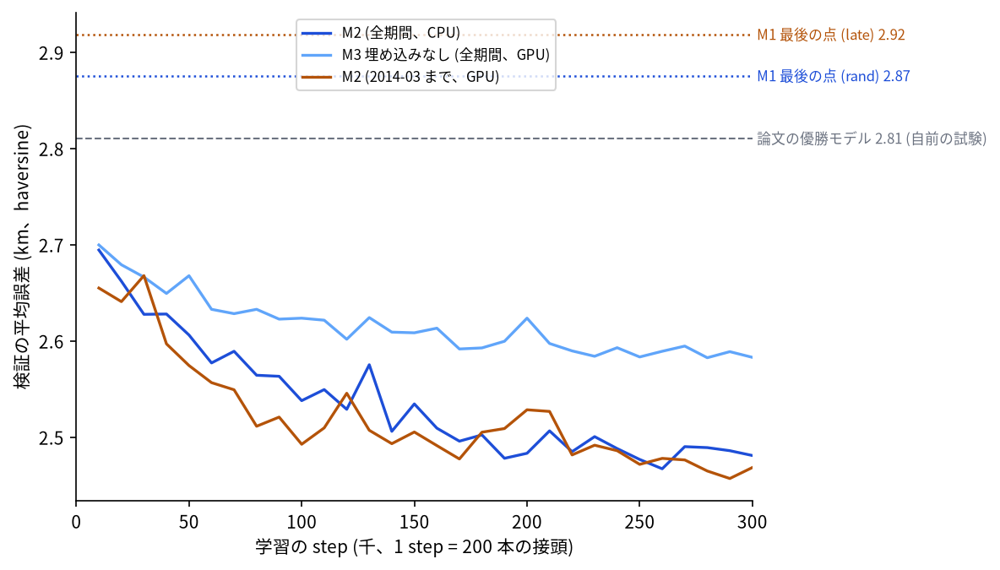

# Porto のタクシーの行き先の予測 (ECML/PKDD 2015) の再現

問い: 走行中のタクシーの軌跡の始まり (接頭) と付随情報から行き先を当てる課題で、論文の優勝モデル (de Brébisson ほか 2015) を、論文と同じ試験の作り方で再現できるか。再現できたとき、単純な基準 (接頭の最後の点) に対する差は、学習より後の時期の試験でも保たれるか。

## 結論

再現できた。優勝モデル (M2) の誤差は、論文と同じ作り方の試験で 2.597 km で、論文の 2.81 km より小さかった。接頭の最後の点をそのまま答える基準 (M1、3.018 km) より 0.420 km 小さく、この差の区間は 0 を含まない。学習を 2014 年 3 月までに限り、その後の 3 か月で試しても、差は 0.491 km で、同じ時期の差 (0.498 km) とほとんど変わらなかった。

一方で、論文は M1 の値を載せていない。M1 との差は約 0.4〜0.5 km で、M2 の誤差の大半は、最後の点からでも届く距離である。論文の表 2 の数字だけからは、この差の大きさは読めない。Kaggle の試験 (320 本) では M2 は 2.539 km で、論文の公開と非公開の平均 2.134 km より大きいが、本数が少なく区間は 2.107〜2.996 と広い。

| # | 要点 | 数字 | 根拠 |
|---|---|---|---|
| 1 | 自前の試験 (S_rand、500 の時刻で切った 19,711 本) の M2 の平均誤差。括弧は時刻ごとのブートストラップの区間 | 2.597 km (2.470〜2.733) | [eval_rand.csv](outputs/eval_rand.csv) |
| 2 | 論文の同じ試験の値と、再現の関門 | 2.81 km、3.1 km 以下 | [paper_values.csv](outputs/paper_values.csv) |
| 3 | 同じ試験の基準。M1 最後の点、M0 ポルトの中心 | 3.018 km、4.262 km | [eval_rand.csv](outputs/eval_rand.csv) |
| 4 | M1 − M2 (同じ接頭で対にした差) | 0.420 km (0.324〜0.525) | [diff.csv](outputs/diff.csv) |
| 5 | 付随情報の埋め込みを外した M3 との差 (M3 − M2)。論文は 2.93 − 2.81 | 0.102 km (0.076〜0.128) | [diff.csv](outputs/diff.csv)、[paper_values.csv](outputs/paper_values.csv) |
| 6 | 2014-03 までで学習し、同じ時期 (S_early) と後の 3 か月 (S_late) で試した M1 − M2 | 0.498 km、0.491 km (0.418〜0.568) | [diff.csv](outputs/diff.csv) |
| 7 | Kaggle の試験 320 本の M2、M1。論文の公開と非公開の平均 | 2.539 km、2.962 km、2.134 km | [eval_rand.csv](outputs/eval_rand.csv)、[paper_values.csv](outputs/paper_values.csv) |
| 8 | Kaggle の試験の M3。M2 より小さく、論文と逆の向き (320 本、区間は重なる) | 2.444 km | [eval_rand.csv](outputs/eval_rand.csv) |

図: 学習中の検証の平均誤差。点線は、それぞれの検証の集まりでの M1 (最後の点)、破線は論文の優勝モデルの自前の試験の値。M2 は 2 本とも 10 万 step ほどで 2.5 km 台に下がり、その後はゆっくり下がった。M3 は 2.6 km 前後で止まった。

## データ

| データ | 版 / 取得日 | 使ったこと |
|---|---|---|
| UCI Machine Learning Repository 339「Taxi Service Trajectory - Prediction Challenge, ECML PKDD 2015」 | CC BY 4.0、doi:10.24432/C55W25。2026-11-07 取得。SHA-256 は [sources.csv](outputs/sources.csv) | 学習の軌跡、Kaggle の試験の接頭と正解 (`solution_fixed.csv`) |
| de Brébisson ほか (2015) "Artificial Neural Networks Applied to Taxi Destination Prediction" (arXiv:1508.00021) と著者のコード (github.com/adbrebs/taxi) | 2026-11-07 に読んだ | 比べる値、試験の作り方、モデルの設定。コードはライセンスの記載が無いので、手順を読んだだけで写していない |

学習の軌跡は 1,710,670 本で、点の無い 5,901 本を除いた ([prepare_counts.csv](outputs/prepare_counts.csv))。期間は 2013-07-01〜2014-06-30。

## 方法

計画 ([EXPERIMENT_PLAN.md](EXPERIMENT_PLAN.md)) は流す前にコミットした。

- 試験の作り方: 学習の期間から一様に選んだ 500 の時刻で、その時刻に走っていた軌跡をその時刻までの点で切る (Kaggle の試験と同じ作り方)。検証は別の 500 の時刻。試験と検証の軌跡は学習から除いた。本数は試験 19,711、検証 19,023 で、論文の 19,770、19,427 とほぼ同じ ([split_rand.csv](outputs/split_rand.csv))。
- 学習の接頭: 全ての軌跡の全ての切り方から一様に選ぶ。長い軌跡ほど選ばれやすく、試験の作り方と同じ分布になる。
- M2: 接頭の最初の 5 点と最後の 5 点 (標準化) と、7 つの付随情報 (電話の客、乗り場、年の週、曜日、15 分刻みの時刻、日の種類、タクシー) の 10 次元の埋め込みを、ReLU 500 の隠れ層に通す。出力は、学習の行き先を mean-shift (帯域 0.001 度) でまとめた 3,399 個の塊の中心を、softmax の重みで平均した点。損失は equirectangular の距離、SGD (momentum 0.9、学習率 0.01、batch 200) で 30 万 step、1 万 step ごとの検証で最良の重みを使う。
- 指標: 半径 6,371 km の haversine の平均。
- 区間: 同じ時刻に切った軌跡は、同じ道の混み方と時間帯を共有するので、時刻ごとにまとめてブートストラップした (2,000 回)。Kaggle の試験は 5 つの時刻しかないので、軌跡ごとに振った参考値である。
- テスト: `scripts/test_porto.py` の 13 件。haversine の手計算、時刻での切り方 (ちょうど最後の点で切る場合、2 つの時刻にかかる軌跡を 1 回だけ取る)、端の点の繰り返し、接頭の抽出が全ての接頭について一様であること、出力が塊の凸包に収まること。

計画からの変更は記録 ([EXPERIMENT_TRACKER.md](EXPERIMENT_TRACKER.md)) にある。M3 と後の時期の M2 は、計算時間のため GPU で学習した (M2 の CPU の学習の途中、試験の点を見る前に決めた)。データ、分け方、step 数、種、学習率は同じ。

関門について:

- 座標と距離: 経緯度 (WGS84、点は経度、緯度の順) から、球の上の haversine で測った。学習の損失の equirectangular は、市の範囲では haversine と 0.1% 以内で一致する (テスト)。
- 量と水準: 誤差の平均だけを扱う。
- 空間と時間の依存とリーク: 試験の区間は時刻ごとにまとめた。学習と試験は同じ軌跡を共有しない。ただし S_rand は学習と同じ期間の中の時刻なので、同じ日の別の軌跡が学習に入っている。後の時期の試験 (S_late) は、その近さを外しても差が保たれるかを確かめたもの。
- 基準: M0 と M1 を同じ試験で並べた。
- 残差と頑健性: 時期を変えた試験 (B2) だけを確かめた。種は 1 つで、場所ごとの誤差の偏りは測っていない。
- 報告: 平均の誤差の比較で、個々のタクシーの行き先の当たり方ではない。

## 確かめていないこと

- 種による揺れ。各モデル 1 本ずつしか学習していない。M2 の検証の誤差は 1 万 step ごとに 0.02〜0.05 km ほど上下しており、M3 − M2 (0.102 km) より小さいが、0 ではない。
- 論文の 2.81 km より小さくなった理由。試験の時刻は論文と別に引いたので、試験の軌跡が違う。学習の長さや塊の数の違いも効きうる。どれが効いたかは分けていない。
- Kaggle の試験の公開と非公開の分け方。`solution_fixed.csv` に分け方の列が無く、論文の 1.878 km (非公開) とは直接比べられない。
- 場所ごとの誤差の偏り (空港、市の外れの行き先など) と、接頭の長さごとの誤差。
- 論文の他のモデル (RNN、双方向 RNN、memory network)。
