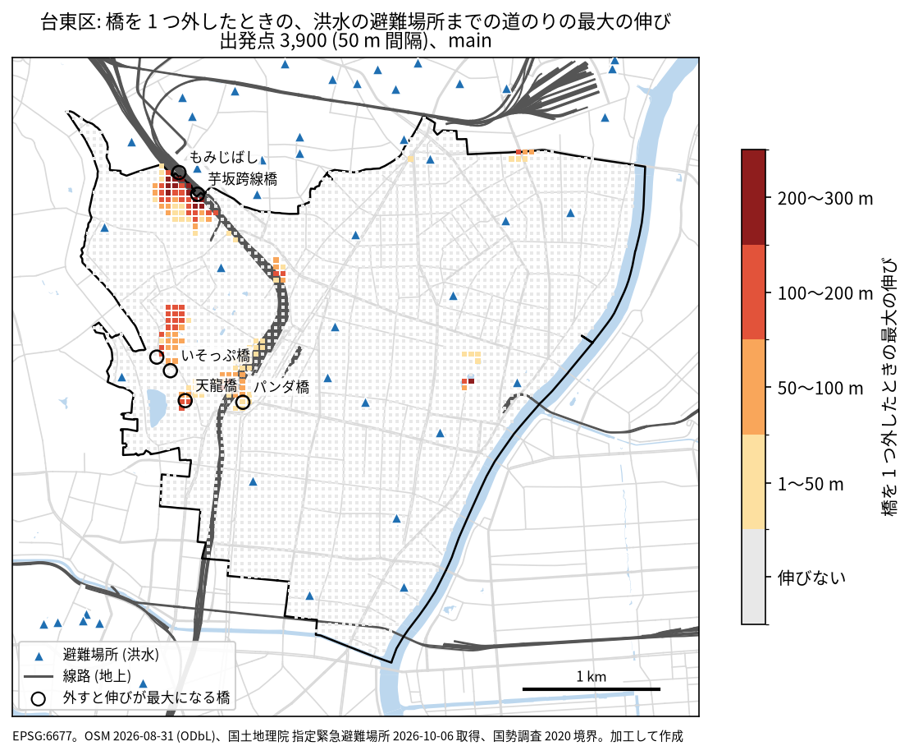
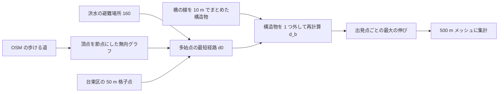

# 台東区: 橋 1 つの切断で避難の道のりが大きく伸びる地区

## 問い

台東区の 500 m メッシュのうち、洪水の指定緊急避難場所までの平常時の最短徒歩距離は短いのに、経路上の橋 1 つが通れなくなると道のりが大きく伸びる (または届かなくなる) のはどこか。その伸びは川と線路のどちらを渡る橋で起きているか。

## 結論

台東区には、橋 1 つの切断で避難の道のりが大きく伸びる地区は無かった。この分析の条件で、届かなくなる点は 0、500 m 以上伸びる点も 0 だった。伸びが最大になるのは、北西の谷中・日暮里の付近で、JR の線路をまたぐ 2 本の跨線橋 (もみじばし、芋坂跨線橋) を外したときの 293 m だった。伸びは線路を渡る橋で起きていて、川を渡る橋ではほとんど起きない。

| 要点 | 値 |
|---|---|
| 出発点 (50 m 間隔、水面を除く) | 3,900 点 ([summary.json](outputs/main/summary.json)) |
| 平常時の道のりの中央値 | 427.7 m ([summary.json](outputs/main/summary.json)) |
| 橋 1 つの切断で道のりが伸びる点の割合 | 3.69% ([summary.json](outputs/main/summary.json)) |
| 届かなくなる点、500 m 以上伸びる点の割合 | 0.0、0.0 ([summary.json](outputs/main/summary.json)) |
| 最大の伸び | 293.1 m、芋坂跨線橋 ([structures.csv](outputs/main/structures.csv)) |
| 伸びの合計が最大の橋 | もみじばし、3,239.9 m (24 点) ([structures.csv](outputs/main/structures.csv)) |
| 伸びの合計: 線路を渡る橋 / 川を渡る橋 | 7,598.8 m / 453.9 m ([crossing_kinds.csv](outputs/crossing_kinds.csv)) |
| 伸びの中央値が 0 より大きい 500 m メッシュ | 57 のうち 1 (533946712、90.5 m) ([cells.csv](outputs/main/cells.csv)、[summary.json](outputs/main/summary.json)) |
| 上の 1 メッシュで、建物の近く、公園と霊園の外の点だけにしたとき | 23 点、伸びる点 47.8%、100 m 以上 43.5%、中央値 0.0 ([cells_near_buildings.csv](outputs/main/cells_near_buildings.csv)) |



地図の色は出発点ごとの最大の伸び (Δ)。伸びる点は 2 か所に集まる。北西の谷中 7 丁目と日暮里の付近では線路の東側へ渡る跨線橋が効く。西の上野公園の付近では、上野動物園の中のいそっぷ橋、不忍池の天龍橋、上野駅のデッキ (パンダ橋) が効く。後者の点の多くは、公園、動物園、霊園の中にある。伸びた 144 点のうち 94 点は、霊園 34、公園 25、動物園 22、線路の敷地 13 の中だった ([origin_context.json](outputs/main/origin_context.json))。

### 主張の判定

主張は流す前に計画 ([EXPERIMENT_PLAN.md](EXPERIMENT_PLAN.md)) に書いた。主の読み方の計算 (B2) は、結果を見た後に出発点の寄せ方を 2 回直したので ([EXPERIMENT_TRACKER.md](EXPERIMENT_TRACKER.md) の D1、D2)、全て探索として扱う。

| 主張 | 規則 | 結果 | 判定 |
|---|---|---|---|
| C1: 伸びの中央値の上位 5 メッシュは設定を変えても大きく入れ替わらない | 6 つの変種の全てで上位 5 のうち 3 つ以上が共通 | 共通は 4〜5 ([compare_summary.json](outputs/compare_summary.json)) | 規則の上では支持。ただし下の注意 |
| C2: 大きな伸びは川より線路を渡る橋で起きる | 線路の伸びの合計が川より 1 割以上大きい | 7,598.8 m と 453.9 m ([compare_summary.json](outputs/compare_summary.json)) | 支持 |

C1 の注意: 主の指標 (メッシュの伸びの中央値) が 0 より大きいのは 1 メッシュだけで、2 位以下は中央値 0 の同点を最大の伸びの順で並べたもの。規則が支持したのは、最大の伸びの順位が安定していることにすぎない。中央値は、台東区では順位の指標として働かなかった。救済のための指標の差し替えは計画で禁じたので、していない。

### 読み方と設定を変えたときの答え

| 変種 | 変えたこと | 伸びる点の割合 | 最大の伸び (m) | 上位 5 の共通 |
|---|---|---|---|---|
| main | | 0.0369 | 293.1 | 5 |
| cluster5、cluster20 | 橋をまとめる距離 5 m、20 m | 0.0369、0.0369 | 293.1、293.1 | 4、5 |
| sites_taito | 避難先を台東区の登録 17 件だけ | 0.0277 | 209.3 | 4 |
| corridor | 駅の中の通路を入れる | 0.0369 | 293.1 | 5 |
| buffer3000、buffer8000 | 緩衝帯 3 km、8 km | 0.0369、0.0369 | 293.1、293.1 | 5、5 |
| tunnels | トンネルと地下の通路も 1 つずつ外す | 0.0585 | 293.1 | 5 |

値は [robustness.csv](outputs/robustness.csv)。緩衝帯を変えても値が同じなので、範囲の端で迂回路が切れた影響は無い。

単一の切断ではない参考 (探索): 線路を渡る橋 88 個を同時に外すと、伸びる点は 2.1%、最大の伸びは 544.8 m (533946712) ([all_rail/summary.json](outputs/all_rail/summary.json)、[all_rail/cells.csv](outputs/all_rail/cells.csv))。川や水面を渡る橋 600 個を同時に外しても、伸びる点は 0.23% ([all_river/summary.json](outputs/all_river/summary.json))。

橋に限らない「ボトルネック区間」は答えられていない。歩ける道を 1 本ずつ外す版は、届かなくなる点が 49.31% と出たが ([allways/summary.json](outputs/allways/summary.json))、これは出発点が乗る袋小路などを外して点が孤立したもので、ボトルネックを測れていない。設計の失敗として記録した ([EXPERIMENT_TRACKER.md](EXPERIMENT_TRACKER.md) の R010)。

## データ

| データセット | 版 | 範囲と件数 |
|---|---|---|
| `yuiseki/gsi-evacuation-sites-jp` | `d8ad2169789b71c951e8808b2e54a953030aae07` (2026-10-06 取得) | 台東区から 5 km の緩衝帯の指定緊急避難場所 233 件のうち、洪水の指定 160 件 ([fetch_summary_b5000.json](outputs/fetch_summary_b5000.json)) |
| `yuiseki/osm-japan-src-2026-08` | `9a9b4a77e89e28a66bf15781644a16b63501f622` (2026-08-31) | 緩衝帯の歩ける道 91,664 本 ([summary.json](outputs/main/summary.json)) |
| `yuiseki/estat-census-mesh-2020` | `6c486c8649484e09e549c0c99b5fa89b4f416edb` | 1 km メッシュの人口 (文脈として添えただけ) |
| `yuiseki/jp-admin-2026-09` | `e6c87b1d7095c17422147962185071a986e13135` | 台東区 (13106) の面、10.09 km² ([fetch_summary_b5000.json](outputs/fetch_summary_b5000.json)) |

避難場所の登録に欠けがある ([site_registration_tokyo23.csv](outputs/site_registration_tokyo23.csv))。台東区の 17 件は洪水と内水氾濫の指定だけで、地震と大火の指定は 0 件。墨田区、江東区、渋谷区、葛飾区は、指定緊急避難場所の登録が全国の表に 1 件も無い。この表で 0 件なのは「登録が無い」ことで、避難場所が無いことではない。

## 方法



出発点 p について、平常時の最寄りの避難場所までの道のり $d_0(p)$ と、構造物 b を外したときの道のり $d_b(p)$ から、

```math
\Delta(p) = \max_b d_b(p) - d_0(p), \qquad r(p) = \frac{\max_b d_b(p)}{d_0(p)}
```

を求めた。外した後は、最寄りでなくなった別の避難場所へ行ってよい。b は、出発点の最短経路の木に乗る構造物だけ (それ以外は外しても最短の道のりを変えない)。メッシュの値は、中の出発点の $\Delta$ の中央値 (主)、最大、割合。

- 歩ける道: motorway とその連絡路、工事中、ホーム、駅の中の通路 (corridor)、エレベーターなどを除き、`foot=no` と、`foot` の許可が無い `access=no/private` を除いた。線は頂点を共有するときだけつながる。グラフは 308,614 節点、最大の連結成分が 99.03% ([summary.json](outputs/main/summary.json))。
- 橋: `bridge` が no 以外の歩ける線を、10 m 以内どうしでまとめた 1,033 個。車道と左右の歩道を別の線で描いた橋を 1 本ずつ外すと、残りの線で渡れてしまう (合成のテストで確かめた)。
- 寄せ方: 出発点と避難場所は、地上の道を持ち、橋とトンネルを全て外した地上の道の成分が 1 km 以上ある節点に寄せた。水面の中の格子点 133 点は除いた。避難場所の寄せた距離は中央値 27.0 m、最大 87.3 m ([summary.json](outputs/main/summary.json))。
- 川と線路の判定: 構造物の線が水路 (river、canal、stream、drain、ditch) と交差するか水面に掛かるなら川、地上の線路と交差するなら線路。両方なら両方に数えた。
- 座標は EPSG:6677 (平面直角座標 IX 系) で、長さはその平面で測った。

## 確かめていないこと

- 人のいる場所: 出発点は面積で重み付けした格子で、人口の重みではない。人口は 1 km メッシュにしか無く、500 m の人口は作っていない。建物の近くの点に限った版 ([cells_near_buildings.csv](outputs/main/cells_near_buildings.csv)) は、OSM の建物の有無で、人数ではない。
- 地震の読み方: 台東区は地震の避難場所を登録していないので、地震で読む計算はしていない。地震時の上野公園などの広域避難場所への道のりは、このデータでは答えられない。
- 対岸: 墨田区の登録が無いので、隅田川の対岸の避難場所は計算に入っていない。川を渡る橋の効きが小さいのは、対岸を避難先に数えていないことにも依る。
- OSM の描き方: 階段、駅の通り抜け、敷地の出入り口、跨線橋の取り付けが実際の通行と合うかは、現地でも画像でも確かめていない。上野動物園の中の道は、開園時間と入場料を無視して歩けるものとして扱った。
- 通行の可否: 橋が実際に落ちる、浸かる確率と、洪水で道そのものが浸かることは扱っていない。踏切が閉じたままになる場面も扱っていない。
- 地理データの関門: 結論は相関や回帰ではないので、Moran's I は流していない。単位の取り方は、500 m と 1 km のメッシュで比べ、どちらでも中央値が 0 より大きいメッシュは 1 つ以下だった ([unit_500m_vs_1km.csv](outputs/unit_500m_vs_1km.csv))。
