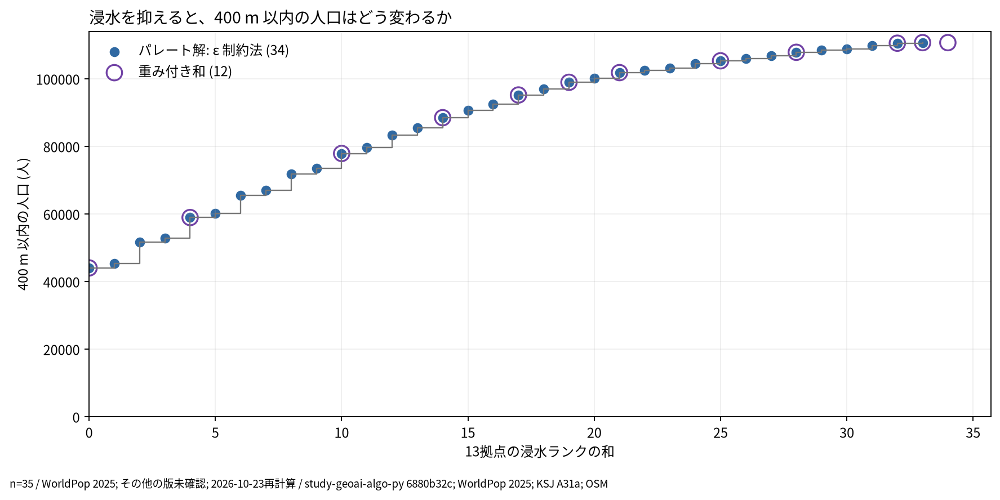
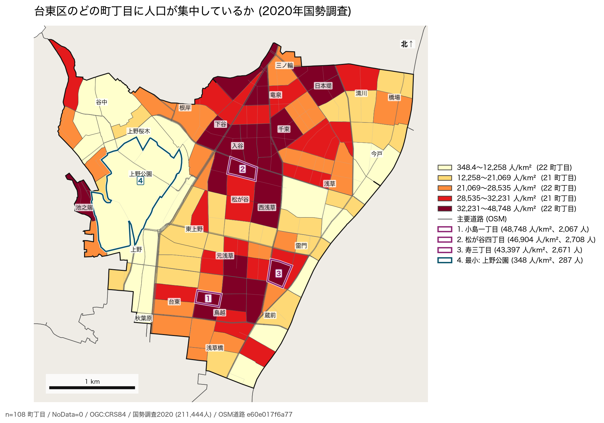
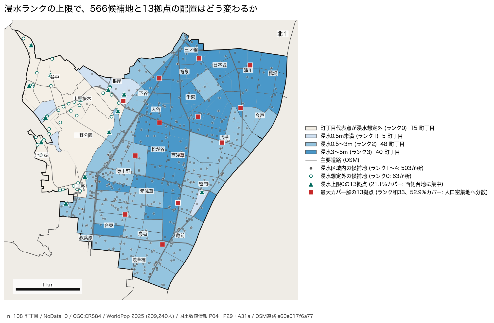
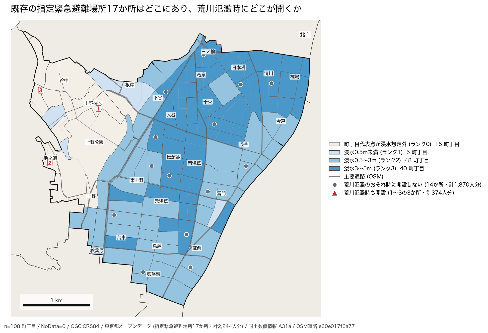

# 台東区の避難・生活拠点配置

## 問い

台東区で、住民が歩いて着きやすく、容量を超えず、洪水のリスクも抑えた拠点の配置を、どう示せば行政の意思決定に使えるか。

## 結論

1つの「最適配置」ではなく、近さ、覆う人口、容量、浸水のリスクのトレードオフを、パレート解の全体として示す。

### 要点

| # | 要点 | 数字 | 図 |
|---:|---|---|---|
| 1 | 浸水を避けるほど、400m以内で覆える人口は減る | 13拠点で、浸水ランクの上限0なら21.1% (44,051人)、最大カバー解 (ランク和33) なら52.9% (110,715人) ([front-data.json](outputs/front-data.json)、[shelter-summary.json](outputs/shelter-summary.json)) | [図 1](#図-1-カバー率と浸水ランクのパレート解)、[表 1](#表-1-浸水ランクの上限とカバー率) |
| 2 | 両立の形は34の解の全体で見る。重み付き和では一部しか見つからない | ε 制約法で34解、重み付き和で12解 ([shelter-front.json](outputs/shelter-front.json)、[shelter-summary.json](outputs/shelter-summary.json)) | [図 1](#図-1-カバー率と浸水ランクのパレート解) |
| 3 | 今の指定緊急避難場所は、指標によって評価が変わる | 17か所の400m以内のカバー率33.7%は、ランダムな配置の中央値と同じほど。平均距離ではランダムより良い ([shelter-summary.json](outputs/shelter-summary.json)) | [図 4](#図-4-既存の指定緊急避難場所17か所と荒川氾濫時の開設可否) |
| 4 | 荒川の氾濫時に開ける既存の拠点では、住民の1%も入れない | 開けるのは西側台地の3か所、374人分。1% (2,111人) を入れる問題は解が無い ([shelter-summary.json](outputs/shelter-summary.json)) | [図 4](#図-4-既存の指定緊急避難場所17か所と荒川氾濫時の開設可否) |
| 5 | 拠点の候補のほとんどが浸水区域にあり、浸水上限0では西側の台地に偏る | 医療機関と学校の566候補の88.9% (503か所) が浸水区域内、想定外は63か所 ([shelter-summary.json](outputs/shelter-summary.json)) | [図 3](#図-3-浸水ランクと566候補地13拠点の配置) |
| 6 | 需要は中央から東側の低地の町丁目で高く、浸水想定外の西側台地とずれる | 人口密度は348〜48,748人/km² (最大は小島一丁目、最小は上野公園) ([shelter-summary.json](outputs/shelter-summary.json)、[taito-population-density.json](outputs/taito-population-density.json)) | [図 2](#図-2-町丁目の人口密度) |

### 読み手ごとに知るべきこと

| 読み手 | 結論 | 検討する材料 | 詳しく |
|---|---|---|---|
| 区の防災担当 | 近さと浸水の安全は両立しない。どこで折り合うかは、34解の中から選ぶ判断で、最適化は決めない | 浸水ランクの上限ごとのカバー率と拠点の位置 (表 1、図 3)、荒川の氾濫時の容量の不足 (図 4) | [図 1](#図-1-カバー率と浸水ランクのパレート解)、[図 3](#図-3-浸水ランクと566候補地13拠点の配置)、[図 4](#図-4-既存の指定緊急避難場所17か所と荒川氾濫時の開設可否) |
| 施設の管理者 (学校、医療機関) | 候補の88.9% (503か所) が浸水区域にあり、洪水時に開けるかは施設ごとに確かめる必要がある | 施設ごとの浸水ランク ([shelter-summary.json](outputs/shelter-summary.json)、[selected-sites.csv](outputs/selected-sites.csv))、運用の容量、上の階の使い方 | [図 3](#図-3-浸水ランクと566候補地13拠点の配置)、[図 4](#図-4-既存の指定緊急避難場所17か所と荒川氾濫時の開設可否) |

### 図 1: カバー率と浸水ランクのパレート解

青い34点が ε 制約法で得た全てのパレート解、紫の輪が重み付き和で得た12解。輪だけの1点 (浸水ランク和34、110,715人) は、同じ人口をより低い浸水ランク (33) で覆える解がある弱い解。階段の線は離散の解をつなぐ目印で、途中の浸水ランクに解があることは示さない。4点だけの旧図は [shelter-tradeoff.png](outputs/shelter-tradeoff.png)。

### 表 1: 浸水ランクの上限とカバー率

| 浸水ランクの上限 | 400m以内の人口 (人) | 400m以内の人口カバー率 | 選ばれた13拠点の主な地域 |
|---:|---:|---:|---|
| 0 | 44,051 | 21.1% | 谷中・上野桜木・池之端・根岸・上野公園・上野・駒形 (12拠点が西側台地) |
| 4 | 58,963 | 28.2% | 西側台地11拠点 + 下谷三丁目・浅草三丁目 (ランク2を2拠点追加) |
| 21 | 101,844 | 48.7% | 谷中・上野桜木・根岸・駒形 + 蔵前・小島・下谷・松が谷・寿・浅草・清川・東浅草・東上野 |
| 33 (最大カバーパレート解) | 110,715 | 52.9% | 三ノ輪・清川・下谷・根岸・浅草・東浅草・松が谷・東上野・西浅草・寿・台東・浅草橋 |

どれも13拠点で、それぞれの制約で別々に解いた配置 ([selected-sites.csv](outputs/selected-sites.csv))。同じ配置の感度ではない。

### 図 2: 町丁目の人口密度

2020年国勢調査の108町丁目の人口密度 (人/km²)。108町丁目の人口の合計211,444人は元の分析と一致した。番号1〜3は人口密度の上位3町丁目 (`1. 小島一丁目 48,748人/km²`、`2. 松が谷四丁目 46,904人/km²`、`3. 寿三丁目 43,397人/km²`)、番号4は最小 (`上野公園 348人/km²`)。分位の5階級で各色に21〜22町丁目が入る。等間隔の5階級にすると30.6%の町丁目の色が変わるので、色の境を政策の閾値として扱わない。

### 図 3: 浸水ランクと566候補地・13拠点の配置

町丁目の代表点における想定最大規模の浸水ランク (国土数値情報 A31a: 0は想定外、1は0.5m未満、2は0.5〜3m、3は3〜5m) と、医療機関・学校の566候補地を重ねた。浸水想定外 (ランク0) の候補地は63か所しかなく、西側の台地 (谷中・上野桜木・上野公園・池之端) に偏る。そのため浸水上限0の13拠点 (緑の三角) は西側に集中し、図 2 で見た中央〜東側の人口密集地を覆えない (カバー率21.1%)。一方、最大カバーパレート解の13拠点 (赤の四角、浸水ランク和33) は中央〜東側の人口密集地へ分散し、52.9%を覆う代わりに浸水ランク1〜3の地域に置かれる。

### 図 4: 既存の指定緊急避難場所17か所と荒川氾濫時の開設可否

台東区の指定緊急避難場所17か所 (想定収容人数の合計2,244人分、[existing-shelters.csv](outputs/existing-shelters.csv)、[existing-shelters-summary.json](outputs/existing-shelters-summary.json)) を浸水ランクの地図に重ねた。中央〜東側の低地にある14か所 (灰の丸、計1,870人分) には「荒川が氾濫するおそれがある場合は、開設しない」との備考があり、荒川氾濫時に開くのは西側の台地 (浸水ランク0) にある3か所 (`1. 上野中学校 129人`、`2. 忍岡小学校 106人`、`3. 谷中小学校 139人`、計374人分) に限られる。そのため住民の1% (2,111人) を入れる容量制約付きの輸送問題は実行不可能となる。

### 読み方で変わる答え

| 読み方 | 主 | 別の読み方 |
|---|---|---|
| 浸水の扱い | ランクの上限を変えた34解 | 最大カバー解 (ランク和33) で52.9%、上限0で21.1% |
| 解き方 | ε 制約法 (34解) | 重み付き和 (12解)。間の解を見落とす |
| 既存の17か所の評価 | 400m以内のカバー率33.7% (ランダムの中央値と同じほど) | 平均距離 (ランダムより良い) |
| 密度の階級 | 分位5階級 | 等間隔で30.6%の町丁目の色が変わる |

## データ

- 需要: 2020年国勢調査の108町丁目 (`yuiseki/estat-boundary-2020` `823195c`・211,444人) と、WorldPop 2025 の1,422格子・209,240人。
- 供給: 台東区の指定緊急避難場所17か所と、国土数値情報の医療機関 (P04)・学校 (P29) の566候補 (浸水ランク0が63か所、ランク1〜4が503か所)。
- 徒歩の道と周辺区界: OpenStreetMap (`e60e017f6a77`)、区界 (`yuiseki/jp-admin` `c86cbe9f2200`)。浸水: 国土数値情報 A31a の想定最大規模。
- 移植元: [`study-geoai-algo-py` 事例002 (commit 6880b32)](https://github.com/yuiseki/study-geoai-algo-py/blob/6880b32c097a7c65a6bd72a38682ce1dce1c9a2b/case-studies/002-shelter-planning/README.md)。再計算と地図作成は2026-10-27。

## 方法

- 道の上の最短距離を Dijkstra 法で求め、最大被覆、p-median、容量付きの割当を LP と MILP で解いた。ランダムな配置2,000回と欲張り法を比べる相手にした。
- 13拠点に固め、カバー人口と浸水ランクを ε 制約法で動かして34のパレート解を得た。図 1 は、固定した元のコードの目的関数と制約を [reproduce_front.py](scripts/reproduce_front.py) で実行し直して描いた ([front-data.json](outputs/front-data.json))。
- 図 2、図 3、図 4 は、元のコードが使う町丁目の人口・面積・境界、566候補地の浸水ランクおよび MILP 解、指定緊急避難場所17か所を [reproduce_map.py](scripts/reproduce_map.py) で再計算し、`analysis-visualize` の `spatial_result_map.py` で描いた。選ばれた拠点の一覧は [selected-sites.csv](outputs/selected-sites.csv)、既存の指定緊急避難場所の一覧は [existing-shelters.csv](outputs/existing-shelters.csv)、要約指標は [shelter-summary.json](outputs/shelter-summary.json)、各図の来歴と文字の重なり検査結果 (3枚とも `text_overlaps: []`) は [taito-population-density.json](outputs/taito-population-density.json)、[taito-shelter-siting.json](outputs/taito-shelter-siting.json)、[taito-existing-shelters.json](outputs/taito-existing-shelters.json)。

## 確かめていないこと

- 洪水時に実際に開けるか、施設ごとの運用の容量、道の欠け、坂や信号による歩く負担。
- 町丁目の密度から個人の避難のしやすさは読めない。境界や集計の単位を変えたときの地図の頑健さ。
