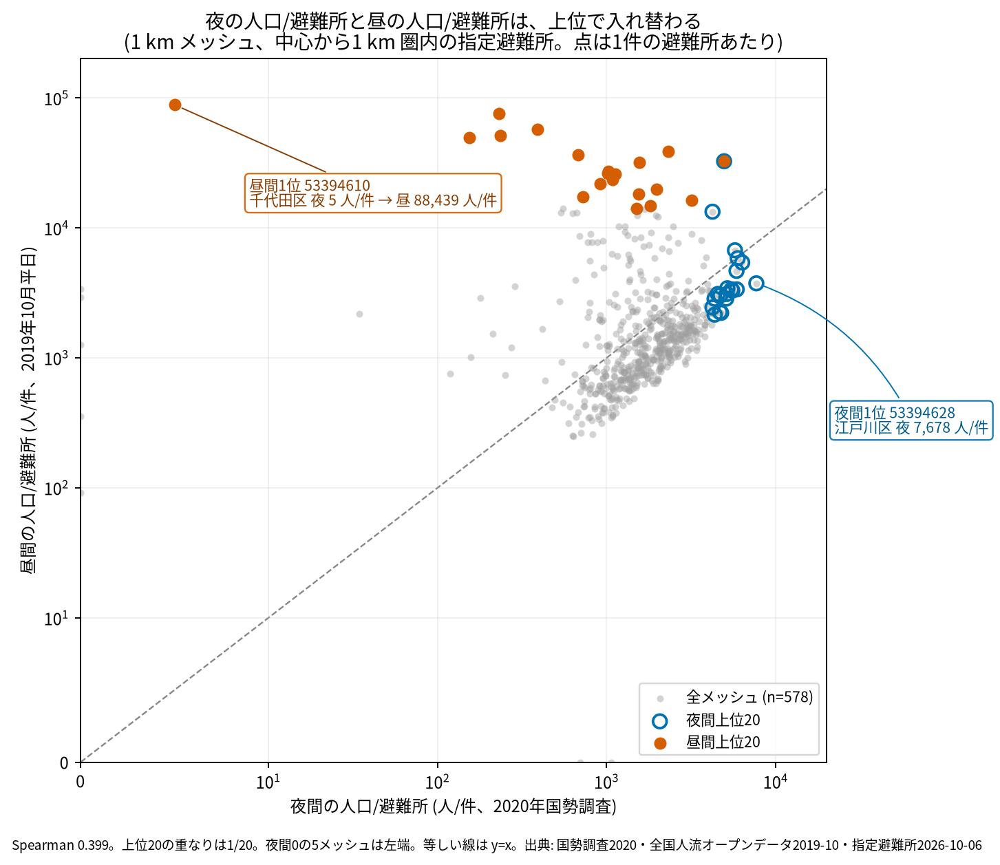
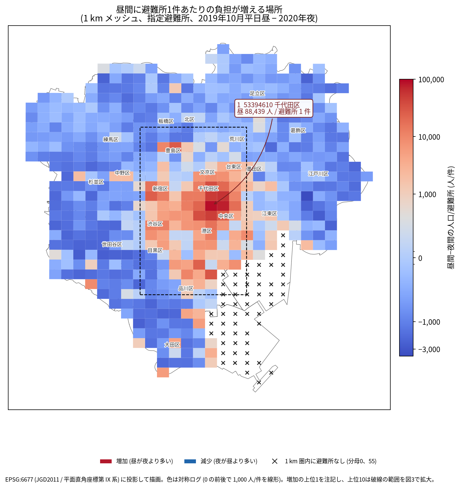
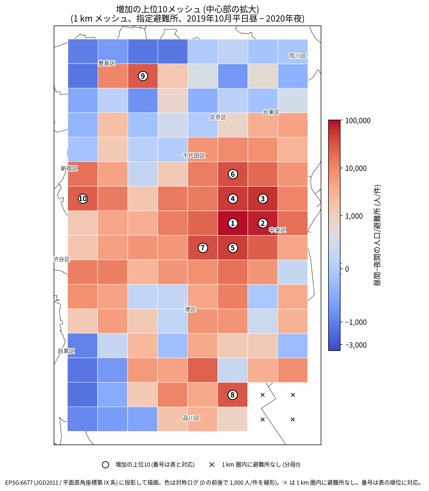

# 東京 23 区の平日昼間人口と避難施設の潜在的逼迫

## 問い
東京 23 区の 1 km メッシュで、平日昼間の滞在人口を 2020 年国勢調査の常住人口の代わりに使うと、避難所 1 件あたりの潜在需要が最も大きく悪化するのはどこか。

## 結論

**要点**

| # | 要点 | 数字 | 根拠 |
|---|---|---|---|
| 1 | 昼夜で上位はほぼ入れ替わる | 上位20の重なり 1/20、順位相関 Spearman 0.399 ([analysis_results.json](outputs/analysis_results.json)) | [図 1](#図-1-夜間の人口避難所と昼間の人口避難所) |
| 2 | 最大の悪化は千代田区の東京駅西側 | 53394610、夜 5 人/件 → 昼 88,439 人/件、Δ 88,434 人/件。夜間順位 573/578 → 昼間順位 1 ([analysis_results.json](outputs/analysis_results.json)、[top20_delta_abs.csv](outputs/top20_delta_abs.csv)) | [図 2](#図-2-昼間に避難所1件あたりの負担が増える場所)、[図 3](#図-3-増加の上位10メッシュ-中心部の拡大)、[表 1](#表-1-悪化の大きい上位5メッシュ) |
| 3 | 単純な昼間人口の順位とは違う | 昼間人口上位20との重なり 13/20。昼間人口 1 位は中央区 53394611 (379,075 人、避難所 5 件) で、Δ は 75,584 人/件の 2 位 ([analysis_results.json](outputs/analysis_results.json)、[top20_day_population.csv](outputs/top20_day_population.csv)) | [表 1](#表-1-悪化の大きい上位5メッシュ) |
| 4 | 上位は都心業務地区に集中する (上野は入らず、新宿・池袋・品川が入る) | Δ 上位20の区別は千代田 9、中央 3、港 3、新宿 3、品川 1、豊島 1 ([top20_delta_abs.csv](outputs/top20_delta_abs.csv)) | [図 3](#図-3-増加の上位10メッシュ-中心部の拡大) |
| 5 | 圏内に避難所が無い 55 メッシュが別に残る | 最大は江東区 53393653 の昼 47,676 人、最寄り避難所 1,003 m ([zero_shelter_top10.csv](outputs/zero_shelter_top10.csv)、[analysis_results.json](outputs/analysis_results.json)) | [表 2](#表-2-圏内に避難所が無いメッシュの上位5) |
| 6 | 順位は半径と年で一部動くが、都心という答えは残る | 半径 500 m で重なり 10/20・0.829、1,500 m で 15/20・0.936、2021 年で 16/20・0.963 ([analysis_results.json](outputs/analysis_results.json)) | [表 3](#表-3-読み方で変わる答え) |

**読み手ごと**

| 読み手 | 結論 | 検討する材料 | 詳しく |
|---|---|---|---|
| 自治体の防災担当 | 平日昼の避難所負担は、千代田・中央・港の都心部で夜の常住人口から見た水準を大きく超える。まずこの範囲の収容と情報提供を点検する。 | 図 3 の上位10、表 1 の上位5 | [top20_delta_abs.csv](outputs/top20_delta_abs.csv) |
| 施設・備蓄の担当 | 施設立地の無い臨海部 (江東・大田・品川) は ratio が定義できず、主のランキングから落ちている。別枠で見る必要がある。 | 表 2、最寄り距離 | [zero_shelter_top10.csv](outputs/zero_shelter_top10.csv) |
| 分析者 | 昼夜の順位はほぼ独立で、半径の取り方に敏感。1 km という設定を明示しないと順位を再現できない。 | 表 3、Moran's I | [analysis_results.json](outputs/analysis_results.json) |

### 図 1: 夜間の人口/避難所と昼間の人口/避難所

578 メッシュの散布図。青丸が夜間上位20、橙が昼間上位20で、重なる点は 1 つだけ。夜間上位は右 (江戸川・世田谷など住宅地) に、昼間上位は上 (千代田・中央・港の業務地) に分かれる。左上の橙 53394610 は夜 5 人/件で、ほぼ常住人口がいないメッシュ。軸は対称ログで、0 付近は線形。

### 図 2: 昼間に避難所1件あたりの負担が増える場所

赤が昼に負担が増えるメッシュ、青が減るメッシュ。赤は千代田・中央・港・新宿・豊島・品川の一部に限られ、郊外は青い。黒い × は 1 km 圏内に避難所が無い 55 メッシュ (江東・大田・品川の臨海部)。破線が図 3 の拡大範囲。色は対称ログなので、赤の濃さは対数で読む。

### 図 3: 増加の上位10メッシュ (中心部の拡大)

上位10の番号は表 1 (上位5) と対応し、6〜10 位は CSV にある。1 位 53394610 は東京駅の西、2 位 53394611 は日本橋・八重洲、3 位 53394621 は神田方面。上位は 1 km 圏内の避難所が 1〜9 件のメッシュで、昼間人口は 31,834 人から 379,075 人。番号の無い × は圏内に避難所が無いメッシュ。

### 表 1: 悪化の大きい上位5メッシュ

| 順位 | メッシュ | 区 | 夜間人口 | 昼間人口 (2019) | 避難所 (1 km) | Δ |
|---|---|---|---|---|---|---|
| 1 | 53394610 | 千代田区 | 5 | 88,439 | 1 | 88,434.0 |
| 2 | 53394611 | 中央区 | 1,157 | 379,075 | 5 | 75,583.6 |
| 3 | 53394621 | 千代田区 | 2,341 | 344,153 | 6 | 56,968.7 |
| 4 | 53394620 | 千代田区 | 235 | 51,564 | 1 | 51,329.0 |
| 5 | 53394600 | 千代田区 | 770 | 247,964 | 5 | 49,438.8 |

ratio は人/件、Δ は昼 ratio − 夜 ratio (人/件)。上位20は [top20_delta_abs.csv](outputs/top20_delta_abs.csv)。

### 表 2: 圏内に避難所が無いメッシュの上位5

| メッシュ | 区 | 夜間人口 | 昼間人口 (2019) | 最寄り避難所 (m) |
|---|---|---|---|---|
| 53393653 | 江東区 | 0 | 47,676 | 1,002.6 |
| 53392652 | 大田区 | 0 | 23,211 | 3,011.1 |
| 53392651 | 大田区 | 0 | 22,568 | 2,019.5 |
| 53393676 | 江東区 | 14 | 21,594 | 1,766.3 |
| 53392662 | 大田区 | 0 | 20,909 | 2,779.9 |

55 メッシュの内訳は大田 25、江東 24、品川 6。5 km 以内に避難所が無いメッシュが 7。全件は [zero_shelter_top10.csv](outputs/zero_shelter_top10.csv)。

### 表 3: 読み方で変わる答え

| 読み方 | 主 | 別の読み方と答え |
|---|---|---|
| 悪化の測り方 | 絶対増加 Δ、1 位 53394610 (88,434 人/件) | 相対比 (昼 ratio ÷ 夜 ratio) でも 1 位は同じ 53394610 (17,687.8 倍) |
| 施設の種類 | 指定避難所、1 位 53394610 | 地震向け指定緊急避難場所 (13 区、320 メッシュ)、1 位は新宿区 53394525 (Δ 234,132) |
| 圏域半径 | 1,000 m、1 位 53394610 | 500 m は 1 位 中央区 53394611 (Δ 377,918)、1,500 m は 1 位 千代田区 53394621 (Δ 26,293) |
| 人流の年 | 2019-10、1 位 53394610 (Δ 88,434) | 2021-10 も 1 位は同じ 53394610 (Δ 52,779) |
| 施設の範囲 | 圏内なら区外も含む、1 位 53394610 | 23 区内だけに絞ると上位20の重なり 19/20 |
| 0 件メッシュ | 主のランキングから除外 (55) | 擬似カウント +1 だと 1 位は 53394611 |
| 集計の単位 | 1 km、上位10%の昼夜重なり 6/58 | 2 km 0/16、ずらし 2 km 2/16、4 km 0/5 |
| 比較する順位 | 夜間 ratio の上位20、重なり 1/20 | 昼間人口の上位20、重なり 13/20 |

## データ

- 夜間人口: 2020 年国勢調査 1 km メッシュ (総務省統計局 e-Stat、`estat-census-mesh-2020` @6c486c8)。`T001140001` を `KEY_CODE` で合計。633 メッシュのうち 580 に常住人口の行があり、53 は行が無いため 0 とした。合計 9,774,907 人。
- 昼間人口: 全国人流オープンデータ (国土交通省、`mlit-1km-fromto-2022-01` @2424a9d) の 2019-10 と 2021-10。平日 (`dayflag=1`)、11〜14 時 (`timezone=0`)、1 か月の 1 日平均。行のあるメッシュは 631 と 629、無い行 (10 人未満) は 0。合計は 14,378,562 人と 12,228,770 人。
- 避難所: 指定避難所 (国土地理院、`gsi-evacuation-sites-jp` @d8ad216、2026-10-06)。23 区に 2,001 件。メッシュ中心から 1 km 以内の件数を供給にした。0 件の 55 メッシュは主のランキングから除いた。
- 副の供給: 同版の地震向け指定緊急避難場所 (`sites.earthquake = true`)。13 区に 631 件、残り 10 区はこの登録が 0 件 (公開が無い)。公開のある 13 区のうち、圏内に 1 件以上ある 320 メッシュだけで比べた。
- 行政界: `jp-admin-2026-09` @e6c87b1 の 23 区 (EPSG:4612)。メッシュ中心の内外判定と地図に使った。
- 除いたもの: 避難所 0 件の 55 メッシュ (主のランキング)。5 km 以内に避難所が無い 7 メッシュは最寄り距離を測っていない。夜間人口 0 は 53 メッシュ (うち主のランキングに入るのは 5)。

## 方法

- 単位: 2020 年版 1 km メッシュの中心が 23 区の面に入る 633 メッシュ。区コードで選ぶ 652 とは別で、面で選ぶ提案の方法を主にした。距離は EPSG:6677 の平面上の直線。
- 指標: `ratio = 人口 ÷ 1 km 圏内の避難所数`。主の悪化は `Δ = 昼 ratio(2019) − 夜 ratio`。施設数は昼夜で同じなので、施設 1 件あたりの負担の増加量を測る。順位は 578 メッシュ、同値はメッシュ番号で決めた。
- 確認の規則: C1〜C6 を結果を見る前に決めた ([EXPERIMENT_PLAN.md](EXPERIMENT_PLAN.md))。主の供給量を地震向け指定緊急避難場所から指定避難所に変えたのは、公開が 13 区だけと分かった後、ランキングを計算する前。実行の記録は [EXPERIMENT_TRACKER.md](EXPERIMENT_TRACKER.md)。
- 頑健性: 半径 500/1,000/1,500 m、人流の年 2019/2021、施設範囲 (区外を含む/23 区内だけ)、0 件の擬似カウント +1、地震向け指定緊急避難場所 13 区。
- 集計の単位 (MAUP): 1 km の行・列番号で 2×2、4×4、原点を 1 メッシュずらした 2×2 のブロックを作り、人口は合計、供給はブロック内のどれかのメッシュ中心から 1 km 以内にある避難所の重複を除いた件数にした。各スケールで上位 10% の昼夜重なりを比べた。
- 空間の依存: 578 メッシュの夜 ratio、昼 ratio、Δ、昼間人口について、k 近傍 3・6・12、999 回の並べ替えで全球 Moran's I を測った。Δ は k=3 で 0.731、k=6 で 0.634、k=12 で 0.534 (いずれも p=0.001)。上位20は独立な標本ではない。
- 地図: EPSG:6677 に投影し、色は `SymLogNorm(linthresh=1000, vmin=-4000, vmax=100000)`。0 件は × で別に示した。文字の重なりは図 2 で番号を図 3 に分けて解消し、フォントの警告は 3 枚とも 0 件。
- 省いた確認: 局所 Moran (LISA) は多重比較の補正が要るので主の結論に使わない。順位の差の検定はしていない。施設の収容人数はデータに無い。

## 確かめていないこと

- 施設の収容人数は使っていない。件数を容量の代理にしており、1 件あたりの面積や収容人員は反映していない。
- 1 km は直線距離で、川・線路・道路の閉鎖を越えない。メッシュ中心に人口と施設を寄せているので、メッシュ内の偏りは入っていない。
- 実際の避難行動ではない。昼間人口はその場にいる人で、帰宅する人・別の場所へ逃げる人は含まない。潜在需要の比較として読む。
- 昼間人口は 2019 年と 2021 年、夜間人口は 2020 年で年がずれる。2021 年は昼間人口の合計が 2019 年より小さく (コロナ下の行動変化)、水準は年に依存する。
- 人流の 10 人未満は行が無く 0 とした。東京駅周辺の 379,075 人のような大きい値は原データのまま使っており、駅・商業施設の重複計上の可能性を排除していない。
- 避難所の登録は 2026-10-06 の版で、2019〜2020 年の状況ではない。0 件は「登録が無い」で、施設が無いとは限らない。臨海部の 55 メッシュはこの影響を受けうる。
- メッシュは区界をまたぐ。中心が 23 区に入るメッシュでも、人口には区の外の部分が含まれる。
- 上位20は空間的に固まっており (Moran's I 0.731)、独立な標本として順位の差を検定していない。1 位のメッシュは半径 500 m で圏内の避難所が 0 件になり、1 位は 53394611 に変わる。正確な 1 位は半径に依存する。
- MAUP の 2 km・4 km は、供給を「ブロック内のどれかの中心から 1 km 以内の重複を除いた件数」と定義した。1 km の件数の合計とは違うので、スケール間の比較はこの定義の下でのみ成り立つ。
- 地震向け指定緊急避難場所の比較は 13 区だけ。23 区全体の主のランキングとは同じ土俵ではない。
