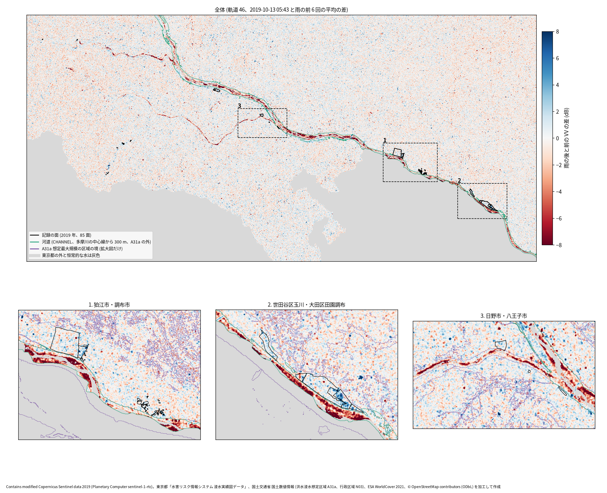
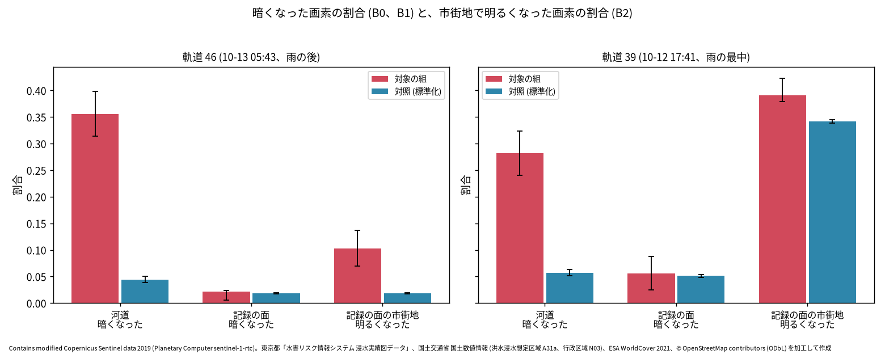
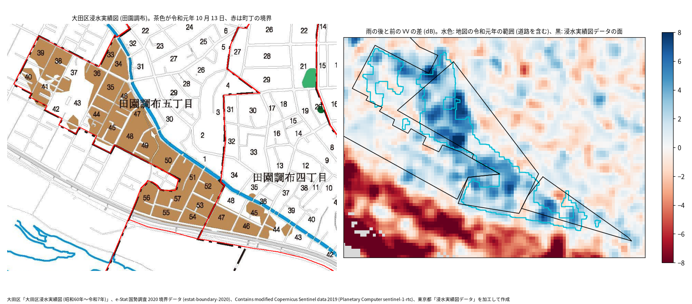

# 台風第 19 号の東京の浸水を Sentinel-1 で見て、浸水実績図と A31a に突き合わせる

問い: 2019-10-12 から 13 日にかけての台風第 19 号 (令和元年東日本台風) で、東京都の浸水実績図に記録された浸水の区域は、雨の止んだ約 7 時間後 (2019-10-13 5 時 43 分) の Sentinel-1 で、浸水しなかったはずの所より多く暗くなった (水面になった) か。記録された区域の半分以上を拾えるか。SAR で暗くなった所は、A31a (洪水浸水想定区域、想定最大規模) の区域に寄るか。

## 結論

記録された浸水は、SAR で「暗くなる」形では見えませんでした。代わりに、記録された区域の市街地は「明るくなって」いました。雨の後の撮影で、記録の面の画素のうち暗くなったのは 2.1 % で、浸水しなかったはずの所 (土地被覆をそろえた対照) の 1.8 % とほとんど変わりません。一方、記録の面の市街地の画素の 10.3 % が 3 dB 以上明るくなり、対照の市街地の 5.6 倍でした。水の溜まった道と建物の壁で電波が二回反射し、強く返ってきたと考えられます。この差は、閾値や平滑化などを変えた 12 通りの全てで保たれました。偽の日付 (雨の前の 2019-10-06) で同じ計算をすると差は出ず、明るくなった画素の 83 % は 2019-10-30 までに元に戻っています。

手順そのものは水を見られていました。多摩川の河道 (堤防の間) では 35.6 % の画素が暗くなり、対照の 8.0 倍でした。つまり、この撮影で見えるのは開けた所の水面で、市街地の内水は暗い面としては見えない、というのが答えです。

SAR で暗くなった画素は、A31a の区域に寄りませんでした (リフト 0.875)。河道と記録の面を除くと、暗くなった画素の多くは背景のばらつきで、「記録に無い浸水の候補」としては読めません。逆に、記録の面の 98.9 % は A31a の区域の中にありました。この台風の東京の記録は、ほぼ多摩川の浸水想定の中で起きています。

### わかったこと

| # | 要点 | 数字 | 根拠 |
|---:|---|---|---|
| 1 | 多摩川の河道は雨の後に暗くなった。手順は開けた所の水を見られる (C0 は支持) | 河道 0.356 [0.3141, 0.3987]、対照 0.0446、比 7.98 [6.6425, 9.6038] ([blocks.json](outputs/blocks.json)) | [図 1](#河道は暗く記録の面の市街地は明るくなった) |
| 2 | 記録の面は、対照より多くは暗くならなかった (C1 は退ける)。半分にはまったく届かない (C2 は退ける) | 記録の面 0.0213、対照 0.0184、比 1.159 [0.295, 1.3199] ([blocks.json](outputs/blocks.json)) | [図 2](#割合の比べ) |
| 3 | 記録の面の市街地は明るくなった (C3 は支持)。12 通りの頑健性の全てで 2 倍を超える | 0.1032 対 0.0185、比 5.582 [3.7629, 7.419]。頑健性の比は 2.983〜8.751 ([blocks.json](outputs/blocks.json)) | [図 2](#割合の比べ) |
| 4 | 偽の日付では差が出ず、明るさは 2 週間ほどで戻った (結果の後の探索) | 偽の日付 0.0046 対 0.0037。2019-10-30 に戻った割合 0.8343、2019-10-18 では 0.3331 ([explore.json](outputs/explore.json)) | [明るくなった所](#明るくなったのは浸水の後だけ) |
| 5 | SAR で暗くなった画素は A31a の区域に寄らない (C4 は退ける) | リフト 0.875 [0.844, 0.909]。区域の割合 0.2453、暗くなった画素の中の割合 0.2146 ([blocks.json](outputs/blocks.json)) | [A31a との関係](#暗くなった所は-a31a-に寄らなかった) |
| 6 | 記録の面のほぼ全ては A31a の区域の中 (SAR を使わない形の重なり) | 0.9887 ([blocks.json](outputs/blocks.json)) | [A31a との関係](#暗くなった所は-a31a-に寄らなかった) |
| 7 | 雨の最中の撮影 (軌道 39) では、どこも一様に明るく、記録の面の市街地の差は消える | 対照の VV の中央値 +1.546 dB。市街地の明るさの比 1.143、河道の比 4.933 ([blocks.json](outputs/blocks.json)) | [図 2](#割合の比べ) |

割合は、組の画素のうち、雨の後と前の平均の VV の差が −3 dB 以下 (暗くなった) か +3 dB 以上 (明るくなった) の画素の割合で、面積の比です。対照は、A31a の区域にも河道にも入らず、記録の面から 300 m 以上離れた東京都の画素で、WorldCover の土地被覆ごとの率を比べる組の土地被覆の割合で重み付けしました。括弧は 90 % 区間です。浸水実績図は「おおよその区域」(配布元の注記) なので、比べた数字は記録との一致度で、真の精度ではありません。

### 読み手ごとに知っておきたいこと

| 読み手 | 結論 | 検討する材料 |
|---|---|---|
| 大雨の直後に SAR で浸水の範囲を見たい担当 | 河川敷や田畑のような開けた所の水は、暗くなる変化として拾える。市街地の内水は暗くならず、明るくなる変化として出る。暗くなる所だけを数えると、市街地の浸水を見落とす | 図 1 の拡大図 2 (世田谷区玉川、大田区田園調布)、市町村ごとの明るくなった割合 |
| 浸水想定 (A31a) と記録を突き合わせたい人 | この台風の東京の記録は、ほぼ全て多摩川の想定の区域の中にある。SAR の暗くなった所は想定の区域に寄らず、想定の外の浸水を探す道具にはならなかった | A31a との関係 |
| 自分の災害で同じ手順を流す人 | Planetary Computer の RTC 版は、この場所でも水の面に対して約 2 画素ずれていた。雨の最中の撮影は、どこも一様に明るくなる | [grid_summary.json](outputs/grid_summary.json)、雨の最中の撮影 |
| 分析を再現、反証する人 | 計画は SAR を取得する前に固定した。明るさの判定 (C3) も計画にあった。偽の日付と、明るさが戻るかは結果を見た後の探索 | [EXPERIMENT_PLAN.md](EXPERIMENT_PLAN.md)、[EXPERIMENT_TRACKER.md](EXPERIMENT_TRACKER.md) |

### 河道は暗く、記録の面の市街地は明るくなった

図 1: 上は範囲の全体で、軌道 46 の 2019-10-13 の 5 時 43 分の VV と、雨の前 6 回 (2019-07-26〜2019-10-06) の平均との差 (3 × 3 の平滑化の後、dB) です。赤は暗くなった所、青は明るくなった所です。黒の線が浸水実績の 2019 年の面、緑の線が河道 (多摩川の中心線から 300 m 以内で A31a の外) です。多摩川の河道は、上流から下流まで赤い帯になっています。八王子市を西から流れる浅川の河道も赤く出ていますが、浅川は河道の組に入れていません。下の 3 つは破線の枠の拡大で、紫の線が A31a の想定最大規模の区域の境です。拡大図 2 (世田谷区玉川、大田区田園調布) では、記録の面の中が青くなっています。拡大図 1 の北の大きな面 (調布市上石原、47 ha) と、拡大図 3 (日野市、八王子市) の面には、はっきりした色の偏りはありません。

図の出典: Contains modified Copernicus Sentinel data 2019 (Planetary Computer sentinel-1-rtc)。東京都「水害リスク情報システム 浸水実績図データ」、国土交通省 国土数値情報 (洪水浸水想定区域 A31a、行政区域 N03)、ESA WorldCover 2021、© OpenStreetMap contributors (ODbL) を加工して作成 ([figure_sources.txt](outputs/figure_sources.txt))。

### 割合の比べ

図 2: 左が雨の後 (軌道 46)、右が雨の最中 (軌道 39) です。赤が対象の組、青が土地被覆をそろえた対照で、ひげは 90 % 区間です。雨の後は、河道の暗くなった割合と、記録の面の市街地の明るくなった割合が、対照より大きく上に出ます。記録の面の暗くなった割合は対照と同じ高さです。雨の最中は、対照の市街地も 0.3419 が明るくなっていて、記録の面の市街地 (0.391) との差はわずかです ([blocks.json](outputs/blocks.json))。この撮影では、強い雨で濡れた地面や屋根が一様に明るく返したと考えられますが、雨と後方散乱の関係はこの分析では確かめていません。

雨の最中の撮影でも、河道の暗くなった割合は 0.2821 で、対照の 4.933 倍でした。計画の規則 (0.3 以上) にはわずかに届いていません。17 時 41 分にはすでに高水敷の一部が水をかぶっていたことになります。

### 明るくなったのは浸水の後だけ

C3 は計画にあった確認ですが、浸水以外の理由 (建物の工事など) で記録の面の市街地がたまたま明るくなった可能性を確かめるため、結果を見た後に 2 つの探索を足しました ([scripts/05_explore.py](scripts/05_explore.py))。

1. 偽の日付: 雨の前の最後の撮影 (2019-10-06) を「雨の後」とみなし、その前の 5 回の平均と比べました。記録の面の市街地で明るくなったのは 0.0046、対照は 0.0037 でした。河道の暗くなった割合も 0.0548 で、対照 (0.0603) と変わりません ([explore.json](outputs/explore.json))。台風の前には、記録の面に特有の変化はありません。
2. 戻るか: 2019-10-13 に明るくなった記録の面の市街地の画素 1,231 のうち、6 日後の 2019-10-18 に +1.5 dB 未満へ戻ったのは 33.3 %、18 日後の 2019-10-30 には 83.4 % で、差の中央値は 0.077 dB でした。対照の市街地の明るくなった画素は、2019-10-30 に 66.1 % が戻りました ([explore.json](outputs/explore.json))。明るさは一時的です。2019-10-18 にまだ明るかった理由 (泥や片付けの物など) は確かめていません。

市町村ごとの、記録の面の市街地の明るくなった割合 ([explore.json](outputs/explore.json)) は次のとおりです。偽の日付の値はどこも 0.0102 以下でした。

| 市町村 | 市街地の画素 | 明るくなった割合 | 偽の日付 |
|---|---:|---:|---:|
| 大田区 | 1,076 | 0.4052 | 0.0019 |
| 狛江市 | 1,042 | 0.1583 | 0 |
| 八王子市 | 882 | 0.0998 | 0.0102 |
| 世田谷区 | 4,360 | 0.0739 | 0.0046 |
| 日野市 | 596 | 0.0721 | 0 |
| 調布市 | 3,944 | 0.0441 | 0.0061 |

大田区 (田園調布 5 丁目の 2 面) が飛び抜けて高く、調布市 (上石原の 1 面) は低くなっています。調布市の面は 47 ha の大きな面で、記録が実際に浸水した範囲よりかなり広く描かれている可能性があります。ただし、これは確かめていません。

### 知らずに探しても田園調布は上位に出る

結果を見た後の探索です ([scripts/06_rank_cells.py](scripts/06_rank_cells.py))。格子のうち 23 区の部分を 250 m の区画に切り、市街地の画素が 200 以上ある 2,943 区画を、明るくなった画素の割合の順に並べました ([rank_cells.json](outputs/rank_cells.json))。記録の面が 20 % 以上を占める区画のうち、大田区田園調布の区画は 1 位 (0.4162)、2 位 (0.2913)、5 位 (0.1973)、8 位 (0.1475) でした。世田谷区玉堤の区画は 3 位 (0.2137) です。区画の中央値は 0.0062 です。偽の日付の同じ区画の順位は 498 位以下で、台風の前には目立ちません。

上位 10 区画のうち、記録の面を含まない区画が 5 つあります。世田谷区に 3 つ、杉並区と練馬区に 1 つずつです (同じファイルの top10_event)。都の集計では、杉並区と練馬区にも床上浸水が 5 ずつあります ([tokyo_sources.csv](../hagibis-tokyo23-sources/outputs/tokyo_sources.csv))。これらの区画が記録されなかった浸水かどうかは、確かめていません。

大田区のうち格子に入るのは面積の 27.8 % だけで、東の低地 (羽田など) は範囲の外です ([rank_cells.json](outputs/rank_cells.json))。区の資料では、浸水したのは田園調布 4、5 丁目でした ([ward_notes.md](../hagibis-tokyo23-sources/outputs/ward_notes.md))。大田区の記録の面の画素で暗くなったのは 0.0051 で、暗くなる変化ではほとんど見えません ([rec_by_municipality.csv](outputs/rec_by_municipality.csv))。

### 大田区の浸水実績図とも合う

結果を見た後の探索です ([scripts/07_ota_map.py](scripts/07_ota_map.py)、[scripts/08_ota_fig.py](scripts/08_ota_fig.py))。頼んだ人から受け取った大田区の「大田区浸水実績図 (昭和60年〜令和7年)」(A1、400 dpi の画像 1 枚) を位置合わせし、凡例の 22 番「令和元年 10月13日 台風 (24時間) 559 件」の茶色の街区を色で取り出しました。

- 位置合わせ: 地図の黒い線を、国勢調査 2020 の町丁の境界 (estat-boundary-2020) と位相相関で合わせました。1 画素 1.016 m (地図に書かれた縮尺と画像の解像度から見込んだ値のとおり)、回転 0 度で相関が最大でした (0.2126、[ota_map.json](outputs/ota_map.json))。田園調布で町丁の境界が地図の一点鎖線に重なることを、図 3 の左で目で確かめています。
- 取り出した範囲: 44 の部分、55,630 m² です (同じファイル)。地図は街区だけを塗り、道路を白く残しているので、25 m で閉じて間の道路を含めた版 (89,381 m²) も作りました。最初の版は、橙色の塗りに黒い文字が重なった縁の色まで拾っていたので、縁を落とす処理を足して取り直しました。
- 浸水実績図データの面との重なり: 道路を含めた版で、大田区の記録の面の画素の 0.5165 が地図の範囲に入り、地図の範囲の画素の 0.6893 が記録の面に入ります ([ota_map.json](outputs/ota_map.json))。

SAR との関係は次のとおりです ([ota_map.json](outputs/ota_map.json))。地図の範囲 (道路を含む) の市街地の画素の 0.4738 が明るくなり、大田区のほかの所 (格子の中) では 0.0195 でした。偽の日付では 0.0023 と 0.0032 です。浸水実績図データの面の外にある地図の範囲 (274 画素) でも、0.3248 が明るくなっています。暗くなった画素は、地図の範囲では 0 でした。区の地図という別の記録に照らしても、田園調布の浸水は「明るくなる」形で出ていて、データの面より地図の範囲によく沿っています。

図 3: 左は大田区浸水実績図の田園調布で、茶色が令和元年 10 月 13 日、赤は位置合わせして重ねた町丁の境界です。右は同じ範囲の雨の後と前の VV の差で、水色が地図から取り出した令和元年の範囲 (道路を含む)、黒が浸水実績図データの面です。青く明るくなった所は水色の線の中にまとまり、左下の赤い帯は多摩川の河道です。取り出した範囲は、色の縁を落としたぶん、街区の塗りより数 m 内側に入っています。

図の出典: 大田区「大田区浸水実績図 (昭和60年〜令和7年)」、e-Stat 国勢調査 2020 境界データ (estat-boundary-2020)、Contains modified Copernicus Sentinel data 2019 (Planetary Computer sentinel-1-rtc)、東京都「浸水実績図データ」を加工して作成。

### 暗くなった所は A31a に寄らなかった

東京都の範囲から河道と記録の面を除いた 7,774,349 画素のうち、A31a の想定最大規模の区域は 24.5 % です。雨の後に暗くなった 169,910 画素のうち区域の中は 21.5 % で、リフトは 0.875 でした ([blocks.json](outputs/blocks.json))。土地被覆ごとに分けても、市街地で 1.029、田畑で 0.542、草地で 0.642 で、2 にはどれも届きません。河道を除くと、暗くなった画素の多くは背景のばらつき (対照でも 2.27 % が暗くなる) で、浸水の想定の区域に集まる信号はありませんでした。

記録の面の画素の 98.9 % は A31a の区域の中にあります ([blocks.json](outputs/blocks.json))。前の例 ([tokyo23-flood-record-vs-a31a](../tokyo23-flood-record-vs-a31a/report.md)) では、1997〜2019 年の 23 区の記録の浸水セルのうち A31a の区域に入るのは 64.6% でした ([b1_main.json](../tokyo23-flood-record-vs-a31a/outputs/b1_main.json))。この台風の東京の浸水は、多摩川の水位が上がったことによる浸水で、想定の区域の中に収まっていたと読めます。公表資料もこの読みと合います ([event_sources.json](outputs/event_sources.json))。国土交通省の災害情報 (第 54 報、2020-04-10) には、多摩川の世田谷区の左岸 17.9 km の溢水が載っています。狛江市の資料は、狛江市と調布市の浸水の原因を「多摩川の水位上昇により２箇所の雨水幹線から放流が十分にできず浸水」、その後「河川水が逆流し浸水が拡大」としていて、床上と床下の合計は 654 世帯 (狛江市 448、調布市 206) です。大田区の田園調布の内水の解析では、等々力排水樋門を計画どおり閉じていれば「多摩川からの逆流がなくなり」、浸水の広がりが小さくなったとしています。これは解析 (シミュレーション) の結果で、観測の記録ではありません。ただし、使った A31a は 令和 7 年度版で、2019 年より後に作り直された区域を含みうるので、「2019 年の時点の想定が当たった」とは言えません。

### 定義と感度分析

計画で固定した 12 通りの頑健性の結果です (軌道 46、[blocks.json](outputs/blocks.json) の o46_variants)。

| 設定 | 河道 (C0) | 記録の面の暗さの比 (C1) | 市街地の明るさの比 (C3) | リフト (C4) |
|---|---|---|---|---|
| 主分析 (±3 dB、3 × 3、VV) | 0.356、支持 | 1.159 | 5.582 | 0.875 |
| ±2 dB | 0.4451、支持 | 0.861 | 3.238 | 0.89 |
| ±4 dB | 0.2869、退ける | 1.664 | 8.719 | 0.884 |
| 平滑化なし | 0.3914、支持 | 0.862 | 3.157 | 0.899 |
| 5 × 5 | 0.336、支持 | 1.804 | 8.751 | 0.91 |
| VH | 0.3542、支持 | 0.946 | 4.102 | 0.896 |
| VV か VH | 0.427、支持 | 1.061 | 4.516 | 0.903 |
| 衛星の違いを補正 | 0.3495、支持 | 1.185 | 5.359 | 0.874 |
| 河道 200 m | 0.4182、支持 | 1.159 | 5.582 | 0.875 |
| 河道 400 m | 0.3171、支持 | 1.162 | 5.588 | 0.879 |
| 対照に A31a の区域も入れる | 0.356、支持 | 1.159 | 5.355 | 0.875 |
| 前は直前の 1 回だけ | 0.3216、支持 | 1.043 | 2.983 | 0.85 |
| 位置を戻さない | 0.3452、支持 | 1.099 | 5.459 | 0.897 |

C1、C2、C4 は全ての設定で退け、C3 は全ての設定で支持でした。C0 は ±4 dB でだけ 0.3 を下回りました。

位置: 雨の前の平均の VV を WorldCover の水の面と位相相関で比べると、軌道 46 は列に 2.35 画素、軌道 39 は行に 2.2 画素ずれていました ([grid_summary.json](outputs/grid_summary.json))。計画の規則 (1 画素を超えたら戻す) により、主分析では整数の 2 画素だけ戻しています。戻さない版でも判断は変わりません。

衛星の違い: 雨の後の撮影は S1B、雨の前の 6 回は S1A です。対照の VV の差の中央値は −0.088 dB で、補正しても判断は変わりません。

## データ

- Sentinel-1 RTC (Planetary Computer sentinel-1-rtc、2026-11-03 取得): 軌道 46 (下り、05:43 JST) の 2019-07-26〜10-30 の 9 回 (雨の前 6 回、10-13 05:43、10-18、10-30)、軌道 39 (上り、17:41 JST) の 2019-07-20〜10-24 の 10 回 ([grid_summary.json](outputs/grid_summary.json))。VV と VH。格子は EPSG:32654、10 m、2,294 × 4,744。
- 浸水実績図: 東京都「水害リスク情報システム 浸水実績図データ」の 2019 年の 85 面 (HF yuiseki/tokyo-flood-record-jp、作業木の commit 4c88d8d)。全て災害名「台風19 号」。画素の中心で 13,308 画素、8 近傍の塊 46 ([blocks.json](outputs/blocks.json))。
- A31a: 国土数値情報 洪水浸水想定区域 (河川単位) FY2025 版の想定最大規模 (HF yuiseki/ksj-a31a-flood-greater-tokyo)。範囲にかかる 207,718 面。
- 行政区域: 国土数値情報 N03 (2026-01-01) の東京都の区市町村。
- 多摩川の中心線: OSM の waterway=river、name=多摩川 の 13 本 (作者の Overpass、2025-09-14 の版)。
- ESA WorldCover 2021 v200: 土地被覆の標準化と、恒常的な水の除外に使った。
- 気象庁の時間雨量 (jma-rain-tokyo): 撮影の時刻と雨の関係を見るためだけに使った (計画の「結果を見る前に知っていたこと」)。
- 出来事の出典 ([event_sources.json](outputs/event_sources.json)、2026-11-03 に確認、PDF は sha256 とともに artifacts の raw/docs に保存): 名称「令和元年東日本台風」は気象庁の報道発表 (2020-02-19)。世田谷区の溢水は国土交通省の災害情報 (第 54 報)。狛江市と調布市の原因と世帯数は狛江市の資料、田園調布の逆流は大田区の内水の解析。Wikipedia 日本語版の「令和元年東日本台風」は出典を探す手がかりにだけ使い、事実は一次資料で確かめた。

組の画素の数は、記録の面 13,308、河道 128,890、A31a の区域 1,907,117、対照 5,836,761 です ([blocks.json](outputs/blocks.json))。土地被覆の割合は、記録の面で市街地 0.8964、河道で林 0.3822、草地 0.2227、田畑 0.2239 です ([groups_landcover.csv](outputs/groups_landcover.csv))。

## 方法

1. 計画 ([EXPERIMENT_PLAN.md](EXPERIMENT_PLAN.md)) を、SAR を取得する前に固定してコミットした。
2. 撮影ごとに線形の強度を同じ格子に積み、軌道ごとに雨の前の平均と雨の後の 1 回を、3 × 3 の箱で平滑化してから比をとった (VV、dB)。−3 dB 以下を暗くなった、+3 dB 以上を明るくなったとした。
3. 組 (記録の面、河道、A31a の区域、対照) は画素の中心で決め、全て東京都の中、恒常的な水でない画素に限った。
4. 対照の率は、WorldCover の土地被覆ごとの率を、比べる組の土地被覆の割合で重み付けした (直接法)。
5. 区間は、記録の面は 8 近傍の塊、ほかの組は 1 km のブロックを単位に 2,000 回引き直した (種 0)。
6. 部品のテスト ([scripts/test_flood.py](scripts/test_flood.py)) は 14 件全て通った。

関門の判断:

- 座標と面積: 全ての入力を UTM 54 帯の 10 m の格子に移し、画素の中心で判定した。面積は画素の数で数えた。浸水実績の JGD2000 と WGS 84 の差は無視した (10 m の格子では 1 画素に満たないと見込んだが、測っていない)。
- 量と水準: 割合とリフトは画素の数の比で、足し合わせていない。
- 空間の依存: 画素は隣と似るので、画素ではなく塊とブロックで引き直した。学習が無く、閾値は結果を見る前に決めたので、リークは無い。
- 基準: 土地被覆をそろえた対照と、無作為 (リフト 1) と比べた。偽の日付は結果の後の探索。
- MAUP: 単位は SAR の画素で、結論は面積の比なので、単位の掃引は流していない。平滑化の大きさは頑健性で変えた。
- 報告: 一致度であり真の精度ではないこと、1 つの台風と 1 回の撮影の結果であることを書いた。明るくなった所を「浸水した」と断定していない。

確認と探索の区別: C0〜C4 と頑健性の表、記録の面の A31a の割合、暗くなった画素が戻る割合は確認 (計画どおり)。偽の日付、明るくなった画素が戻る割合、市町村ごとの明るさは結果を見た後の探索 ([scripts/05_explore.py](scripts/05_explore.py))。計画からの変更は無い。

## 確かめていないこと

- 10-13 05:43 に、どこまで水が残っていたか。記録の面の中で浸水が続いていた時間の記録は読んでいない。
- 記録の面がどれだけ真の浸水の範囲に合うか。とくに調布市上石原の 47 ha の面。
- 後で集めた公表資料 ([hagibis-tokyo23-sources](../hagibis-tokyo23-sources/report.md)) では、23 区の 2019 年の記録の面は世田谷区 3 面と大田区 2 面だけで、都の集計の床上浸水 (世田谷区 372、大田区 203) のごく一部しか描いていない。世田谷区玉川の多摩川の溢水の面も無い。「記録の面の外」には記録されなかった浸水が含まれる。
- 大田区浸水実績図の取り出しの正しさ。色の閾値 (22) と縁を落とす大きさ (5 画素) は 1 回の目視で決め、ほかの値は試していない。地図の作り方 (街区を塗る基準) は確かめていない。地図の PDF は区から頼んだ人が受け取ったもので、リポジトリには入れていない。
- 記録の面の市街地が明るくなった理由が、二回反射であること。建物の向き、道の幅、水深との関係は調べていない。外の知識による解釈。
- 公表資料の浸水の範囲 (狛江市、調布市、大田区、世田谷区の検証の図) と、浸水実績図の面との重なり。資料は原因と世帯数を確かめるためだけに読み、図は地図に重ねていない。
- 世田谷区の検証委員会の報告書の本文 (上野毛・野毛地区と玉堤地区)。委員会のページだけを読んだ。
- 10-18 にまだ明るかった画素の理由。
- 雨の最中の撮影で、どこも一様に明るくなった理由。
- 2019 年の時点の A31a の区域。使ったのは FY2025 版。
- 浅川などの多摩川以外の河道。河道の組に入れていない。
- 神奈川県側 (川崎市など) の浸水。東京都の記録しか無いので比べていない。
- ほかの大雨や、ほかの都市で同じ結果になるか。
