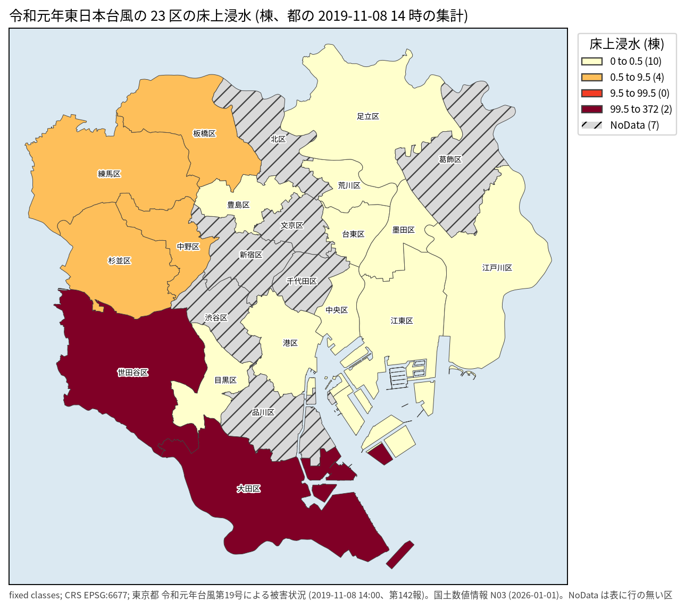
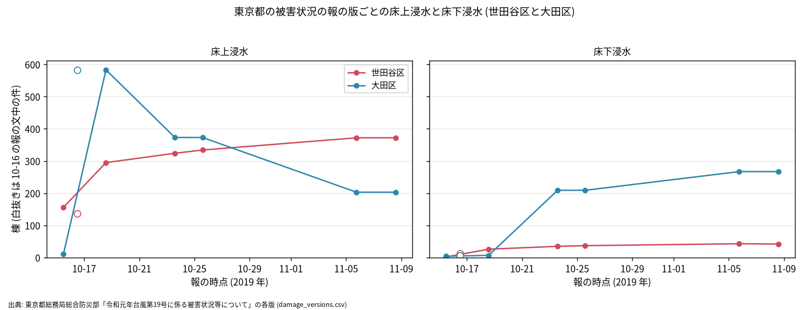
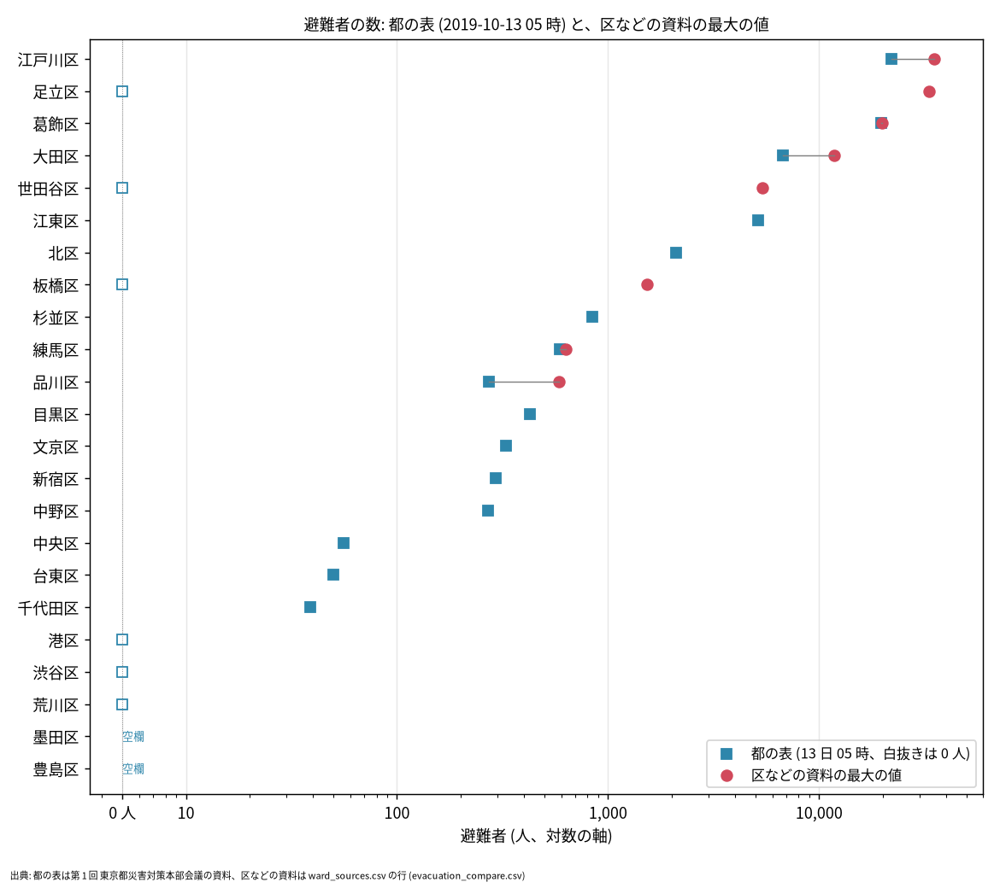

# 令和元年東日本台風 (台風第 19 号) の東京 23 区の公表資料

問い: 令和元年東日本台風で、東京 23 区のどこが、どれだけ、何が原因で浸水し、どれだけの人が避難したか。区、東京都、国、気象庁はそれを何に書き残したか。浸水の範囲の地図や GIS はあるか。SAR の検証 (../hagibis-tokyo-sar-flood-record) の正解に、浸水実績図のほかに使えるものはあるか。

## 結論

23 区で浸水の被害がはっきり大きいのは、多摩川沿いの世田谷区と大田区の 2 区だけでした。東京都の集計 (2019-11-08 14 時の時点) では、床上浸水は世田谷区 372、大田区 203 です。ほかに床上浸水があるのは中野区、杉並区、板橋区、練馬区で、どれも 5 以下でした ([tokyo_sources.csv](outputs/tokyo_sources.csv))。荒川や江戸川に面した東部の区では浸水はほとんど無く、代わりに避難が大規模でした。区の資料によると、足立区は 135 施設で 33,172 人、江戸川区は最大 35,040 名、葛飾区は 19,823 人が避難しています ([ward_sources.csv](outputs/ward_sources.csv))。

手元の浸水実績図 (tokyo-flood-record-jp) は、この台風の 23 区の浸水のごく一部しか描いていません。2019 年の面は世田谷区 3 面 (上野毛 2 丁目、玉堤 1 丁目) と大田区 2 面 (田園調布 4、5 丁目) だけです。面の属性の床上浸水の棟数は、世田谷区で「11(6)」と「2(1)」でした ([record_vs_reports.csv](outputs/record_vs_reports.csv))。都の集計の 372 とは桁が違います。国土交通省の資料が書く世田谷区玉川の多摩川の溢水 (約 0.7 ha、家屋約 40 戸) の面もありません ([ward_sources.csv](outputs/ward_sources.csv))。SAR の検証で「記録の面」とした区域は、23 区の側では記録された浸水の一部だけを指していたことになります。

浸水の範囲の GIS (Shapefile、GeoJSON、KML) は、どの区からも、都、国からも見つかりませんでした。地図は PDF だけで、次の 3 つです。

- 大田区: 浸水実績図 (平成 30 年〜令和 7 年、A1 のラスタの PDF)
- 世田谷区: 検証の最終報告書のシミュレーションの浸水範囲の図
- 国土交通省: 多摩川緊急治水対策プロジェクトの資料の、多摩川沿いの浸水範囲の図

数は資料の版によって大きく違います。東京都の数は速報で、日を追って変わりました。世田谷区の床上浸水は 2019-10-15 に 156、2019-11-08 に 372 です ([tokyo_sources.csv](outputs/tokyo_sources.csv))。区の罹災証明の集計 (2019-12-09) では床上浸水 13 件、半壊 319 件で、数え方 (棟、件、罹災証明の区分) が違います ([ward_sources.csv](outputs/ward_sources.csv))。数を比べるときは、どの資料の何時の何の数かを必ず添えてください。

### わかったこと

| # | 要点 | 数字 | 根拠 |
|---:|---|---|---|
| 1 | 23 区の床上浸水は世田谷区と大田区に集中する (2019-11-08 14 時の時点の都の集計) | 世田谷区 372、大田区 203 ([tokyo_sources.csv](outputs/tokyo_sources.csv)) | 東京都 第 142 報の PDF |
| 2 | 浸水実績図の 2019 年の 23 区の面は 5 面だけ | 世田谷区 3 面、大田区 2 面 ([record_vs_reports.csv](outputs/record_vs_reports.csv)) | tokyo-flood-record-jp |
| 3 | 東部の区は浸水がほぼ無く、避難が大規模だった | 足立区 33,172 人、江戸川区 35,040 名、葛飾区 19,823 人 ([ward_sources.csv](outputs/ward_sources.csv)) | 各区の振り返りの資料 |
| 4 | 都の避難所の表 (2019-10-13 05 時) は 23 区を全て載せるが、ピークの値ではない | 足立区 0 人、世田谷区 0 人、都の合計 80,397 人 ([tokyo_sources.csv](outputs/tokyo_sources.csv)) | 第 1 回 対策本部会議の資料 |
| 5 | 同じ区の同じ量が、資料ごとに違う | 大田区の床上浸水は都の 2019-10-16 の集計で 583、区の浸水実績一覧で 559 件 ([ward_sources.csv](outputs/ward_sources.csv)) | 都と区の資料 |
| 6 | 浸水の範囲の GIS は見つからない。PDF の地図は 3 つ | 大田区、世田谷区、国土交通省 ([ward_sources.csv](outputs/ward_sources.csv)) | 各資料 |

### 床上浸水は多摩川沿いの 2 区に集まる

図 1: 東京都の集計 (2019-11-08 14 時の時点、第 142 報) の、区ごとの床上浸水の棟数です。値は [wards23_values.csv](outputs/wards23_values.csv) にあります。階級は 0、1〜9、10〜99、100 以上で、凡例の 0.5、9.5、99.5 はその境です。世田谷区 (372) と大田区 (203) だけが 100 以上で、杉並区、板橋区、練馬区 (5 ずつ) と中野区 (1) が 1〜9 です。斜線の 7 区は、この表に行が無い区で、0 とは分けて描きました。区を丸ごと塗っていますが、浸水した所は区の一部です (大田区は田園調布四丁目と五丁目、[ward_notes.md](outputs/ward_notes.md))。数は棟数そのもので、区の面積や人口で割っていません。描いたスクリプトは、大きな区ほど数が多くなるという警告を出しました。問いが「どの区に何棟か」なので、数のまま描きました。

図の出典: 東京都「令和元年台風第19号による被害状況 (11月8日14時時点)」、国土交通省 国土数値情報 行政区域 N03 (2026-01-01) を加工して作成。

### 床上浸水の数は版ごとに大きく動く

図 2: 東京都の被害状況の報の版ごとの、世田谷区と大田区の床上浸水 (左) と床下浸水 (右) です ([damage_versions.csv](outputs/damage_versions.csv))。点は報の版で、全ての値を保存した PDF の文字と照らしました。白抜きは 2019-10-16 の報で、表ではなく文中の件数です。大田区の床上浸水は、2019-10-18 の 583 から 2019-10-23 に 373、2019-11-05 に 203 へ減り、その間に床下浸水が 7 から 209、267 へ増えています。床上と床下の区分が版の間で付け直されたように見えますが、理由は報に書かれていません。世田谷区の床上浸水は 156 から 372 へ増え続けました。

図の出典: 東京都総務局総合防災部「令和元年台風第19号に係る被害状況等について」の各版。

### 避難者の数は、都の 1 枚の表だけでは読めない

図 3: 区ごとの避難者の数です ([evacuation_compare.csv](outputs/evacuation_compare.csv))。四角は都の表 (2019-10-13 05 時の時点) で、23 区を全て載せた唯一の表です。白抜きの四角は 0 人、「空欄」は表の欄が空の区です。丸は区など (大田区は国土交通省の資料) が書いた最大の値で、8 区にあります。都の表の時点はピークの後なので、足立区 (区の資料で 33,172 人)、世田谷区 (5,376 人)、板橋区 (1,529 人) は 0 人になっています。丸の値は、最大、総数、ピーク時、特定の時刻など、資料ごとに意味が違います (同じファイルの ward_doc_kind)。横軸は対数です。

図の出典: 東京都総務局総合防災部 (第 1 回 東京都災害対策本部会議の資料)、各区と国土交通省の資料 ([ward_sources.csv](outputs/ward_sources.csv) の行)。

### 読み手ごとに知っておきたいこと

| 読み手 | 結論 | 検討する材料 |
|---|---|---|
| SAR や予測を浸水実績図で評価する人 | 2019 年の 23 区の面は、被害のごく一部しか描いていない。面の外にも浸水があった前提で、誤検出と見逃しを読む | [record_vs_reports.csv](outputs/record_vs_reports.csv)、大田区の浸水実績図の PDF |
| 数を引用する人 | 都の数は速報で版ごとに変わる。区の罹災証明の数とは数え方が違う。資料、時点、単位を添える | [tokyo_sources.csv](outputs/tokyo_sources.csv)、[ward_sources.csv](outputs/ward_sources.csv) |
| 避難の規模を知りたい人 | 都の 2019-10-13 05 時の表は、ピークを過ぎた後の値。ピークは区の振り返りの資料にある | [ward_notes.md](outputs/ward_notes.md) |

## データ

- 東京都総務局総合防災部の被害状況の報 (第 1 回と第 2 回の対策本部会議の資料、第 142 報の PDF ほか)。2026-11-03 に取得し、PDF は `artifacts/_flood/hagibis-tokyo23-sources/raw/docs/` に sha256 とともに保存した。
- 23 区の区の資料、国土交通省、気象庁の資料。区ごとの調べは、サブエージェント 1 つが行った ([ward_sources.csv](outputs/ward_sources.csv) の 141 行、[ward_notes.md](outputs/ward_notes.md))。行ごとに出典の URL、保存した PDF、sha256、引用がある。表を転記した行には「[表から転記]」、画像の PDF を目で読んだ行には「[画像PDFから目視転記]」の印がある。
- 浸水実績図: tokyo-flood-record-jp (ローカルの作業木の commit 4c88d8d) の 2019 年の面。
- いただいた URL: 東京都の防災ホームページの 2 ページ、世田谷区の検証のページ、江戸川区の対応のページ。

## 方法

1. 東京都の報の PDF を読み、23 区の行を [tokyo_sources.csv](outputs/tokyo_sources.csv) に写した (55 行)。避難所の表は文字として取れなかったので、ページを画像にして読み取った。
2. 23 区それぞれの区の公式のページと PDF を、サブエージェントが検索して読み、[ward_sources.csv](outputs/ward_sources.csv) に写した。Wikipedia と報道は、一次資料を探す手がかりにだけ使った。
3. サブエージェントの数のうち、足立区の 33,172 人、世田谷区の罹災証明の表 (2019-12-09)、大田区の 559 件を、保存した PDF の文字と照らして確かめた。
4. 浸水実績図の 2019 年の面と都の集計を、区ごとに並べた ([scripts/01_record_vs_reports.py](scripts/01_record_vs_reports.py))。
5. 図の値を、出どころの PDF や行を添えた小さな表に書き出した ([scripts/02_tables.py](scripts/02_tables.py))。大田区の 2019-10-25 の版はサブエージェントの表に無かったので、PDF から足した。版ごとの数は全て PDF の文字と照らした。
6. 図 1 は `analysis-visualize` の `classify_map.py` で描いた (区の形は [scripts/03_units.py](scripts/03_units.py))。値の種類は件数、区切りは固定 (0.5、9.5、99.5)、表に行の無い区は NoData。分位と Fisher-Jenks の区切りでは、階級の入れ替わる区の割合が 0.375 と 0.25 だった ([map_above_floor.json](outputs/map_above_floor.json))。図 2 と図 3 は [scripts/04_figures.py](scripts/04_figures.py)。どの図も、文字は Noto Sans CJK JP で描けることを `cjk_font.py` で確かめ、同じ名前の JSON に問い、入力、点の数を残した。保存した PNG を開いて、文字の抜けと重なりが無いことを目で確かめた。

関門の判断: この調べは数を集めて並べるだけで、推定も地図の計算もしない。座標、空間の依存、基準の関門は関係しないと判断した。数は資料に書かれたままで、足し合わせや換算をしていない。量の単位 (棟、件、世帯、人) は資料ごとに違うので、そのまま写した。

## 確かめていないこと

- 東京都の報のうち、読んでいない版 (第 142 報より後に被害の数の更新があったか)。
- 404 で読めなかった資料: 杉並区の委員会資料 (2019-12-02)、文京区の庁議資料 (2019-11-06)、北区の検討委員会の議事要旨と区報の水害特集、大田区の避難場所の検証の資料。
- 大田区の避難者 12,002 人は、検索の抜粋でしか見ていない。
- 141 行のうち、上の 3 つ以外の数は、サブエージェントの転記のままで、私は照らしていない。
- 大田区の浸水実績図の PDF の、2019 年の範囲が浸水実績図の面とどれだけ違うか。地図を位置合わせしていない。
- 国土交通省と世田谷区の浸水範囲の図の中身。
