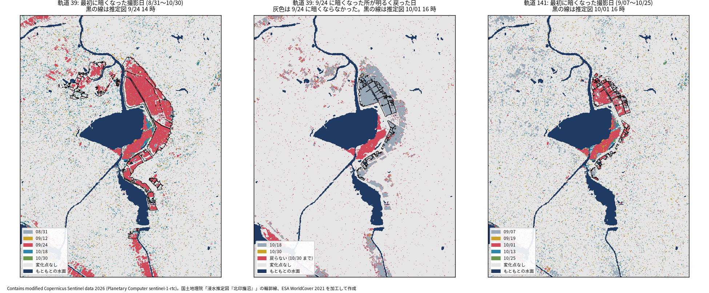
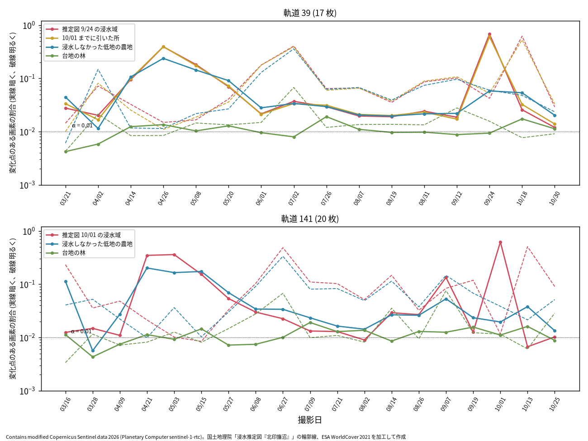

# 北印旛沼の Sentinel-1 時系列で、画素ごとの変化点を当てる

問い: Sentinel-1 の同じ軌道の 2026 年 3〜10 月の撮影を並べ、画素ごとに平均の明るさが変わった撮影日を検定で決めると、令和8年台風第25号の浸水は、浸水した所で、浸水の始まった撮影日に、浸水しなかった農地よりはっきり多く変化点として出るか。水が引いた日も出るか。

## 結論

出ました。軌道 39 では、9/24 の推定図の浸水域の 68.2 % に、9/24 に暗くなる変化点が出ました。浸水しなかった低地の農地は同じ日に 5.8 % でした。撮る向きと日の違う軌道 141 でも、10/01 の推定図の浸水域の 63.0 % に変化点が出ました。そのほとんどは 10/01 の撮影で、9/19 の撮影 (17 時 33 分) では 1.3 % だけでした。北の干拓地は、9/19 の夕方にはまだ浸水していなかったことになります。10/01 までに水が引いた所では、9/24 に暗くなった画素の 85.3 % が、次の撮影の 10/18 に明るく戻りました。

ただし、この浸水のような大きな変化では、時系列を撮り溜めた利点はほとんどありませんでした。誤警報の率をそろえて比べると、隣り合う 2 枚の差との違いは 2.0 ポイントでした。また、変化の少ないはずの台地の林でも、浸水の前の日ごとに 2.8〜3.2 % の画素に変化点が出ました。模擬の誤警報の 2.3〜2.5 倍で、計画の規則 (2 倍以下) を外れています。RTC の 10 m の画素は隣の画素と強く似ていて、そのために ENL (スペックルの見かけの枚数) を大きく見積もった可能性が高いです。変化点の数をそのまま「誤警報 1 % の検定の結果」として読まないでください。

### わかったこと

| # | 要点 | 数字 | 根拠 |
|---:|---|---|---|
| 1 | 浸水域では浸水の始まった日に変化点が出て、浸水しなかった農地の 10 倍を超える (C1 は支持) | 9/24 の浸水域 0.682、農地 0.0582 ([blocks.json](outputs/blocks.json)) | [図 1](#浸水域は-924-にまとめて暗くなった) |
| 2 | 軌道 141 でも同じ。変化はほぼ全て 10/01 の撮影で、9/19 にはまだ浸水していない (C2 は支持) | 10/01 の浸水域 0.6297、農地 0.0429。内訳は 10/01 が 0.6232、9/19 が 0.0126 ([blocks.json](outputs/blocks.json)) | [図 1](#浸水域は-924-にまとめて暗くなった) |
| 3 | 水が引いた所は次の撮影で明るく戻る (C3 は支持)。ただし、農地で 9/24 に暗くなった画素も半分は戻る | 引いた所 0.8532、農地 0.5126 ([blocks.json](outputs/blocks.json)) | [図 2](#日ごとの変化点の割合) |
| 4 | 誤警報の率をそろえると、時系列の検定は隣り合う 2 枚の差とほぼ同じだけしか拾わない (C4 は退ける) | 時系列 0.7242、2 枚の差 0.7043 (閾値 6.54 dB)、差 0.0199 ([blocks.json](outputs/blocks.json)) | [比較](#隣り合う-2-枚の差との比較) |
| 5 | 台地の林でも誤警報が模擬の 2 倍を超える (C0 は退ける)。ENL を 0.75 倍にすると模擬と合う | 比 2.309 (軌道 39)、2.532 (軌道 141)。ENL 4.8 では 0.913 と 1.002 ([blocks.json](outputs/blocks.json)) | [誤警報](#台地の林の誤警報は模擬の-2-倍を超えた) |
| 6 | RTC の画素は隣の画素と強く似ていて、日ごとの位置はそろっている | 区画の平均を引いた後の ln 比の隣どうしの相関 0.624〜0.768、位置のずれ 0.05 画素以下 ([quality.json](outputs/quality.json)) | [方法](#方法) |

割合は、組の画素のうち変化点のある画素の数の比 (面積の比) です。推定図は国土地理院の浸水推定図「北印旛沼」で、これも推定です。比べた数字は推定図との一致度で、真の精度ではありません。

### 読み手ごとに知っておきたいこと

| 読み手 | 結論 | 検討する材料 |
|---|---|---|
| 災害の後に、いつどこが浸水したかを知りたい担当 | 撮り溜めた時系列に変化点の検定を当てると、浸水の範囲と、浸水の始まった撮影日、水の引いた撮影日が画素ごとに出る。軌道 141 の結果から、9/19 の夕方には北の干拓地はまだ浸水していなかった | 図 1 の日付の地図 |
| 2 枚の差で足りるか迷う人 | この浸水のように深く広い変化では、2 枚の差でもほぼ同じだけ拾える。時系列の利点は、前後の 2 枚を人が選ばなくても日付が出ることにある | 隣り合う 2 枚の差との比較 |
| 検定を自分のデータに当てる人 | RTC の 10 m の画素は隣と強く似る。区画の分散から ENL を出すと大きく出て、誤警報が増える。ENL は変化の無いはずの所で誤警報を数えて確かめるとよい | 台地の林の誤警報、[scripts/test_cp.py](scripts/test_cp.py) |
| 分析を再現、反証する人 | 計画は実データで検定を流す前に固定した。ENL は決め方を先に決め、結果を見て変えていない | [EXPERIMENT_PLAN.md](EXPERIMENT_PLAN.md)、[EXPERIMENT_TRACKER.md](EXPERIMENT_TRACKER.md) |

### 浸水域は 9/24 にまとめて暗くなった



図 1: 左は軌道 39 で、8/31〜10/30 のうち最初に暗くなる変化点が出た撮影日です。9/24 の推定図の輪郭線 (黒) の中が、ほぼ一面に 9/24 (赤) です。輪郭線の外の農地には、日付の違う点がまばらに散っています。中央は、9/24 に暗くなった画素が明るく戻った撮影日です。10/01 の輪郭線 (黒) の外の多くは 10/18 に戻り、輪郭線の中も 10/18 に戻っています。沼の南の岸の帯は 10/30 まで戻りません。この帯は推定図の輪郭線の外で、兄弟のプロジェクトでも推定図に無い判定として残った所です。右は軌道 141 です。10/01 の輪郭線の中が 10/01 (赤) で、9/19 (黄) はほとんどありません。

図の出典: Contains modified Copernicus Sentinel data 2026 (Planetary Computer sentinel-1-rtc)。国土地理院「浸水推定図『北印旛沼』」の輪郭線、ESA WorldCover 2021 を加工して作成 ([figure_sources.txt](outputs/figure_sources.txt))。

### 日ごとの変化点の割合



図 2: 撮影日ごとに、組の画素のうち暗くなる変化点 (実線) と明るくなる変化点 (破線) のある割合です。縦軸は対数で、点線が α = 0.01 です。浸水域の実線は 9/24 (軌道 39) と 10/01 (軌道 141) で跳ね、次の撮影で破線が跳ねます。浸水しなかった農地も、4〜5 月と 6〜7 月に浸水域と同じくらい変わっていて、9/24 にも少し暗くなり、10/18 に明るくなっています。数字は [daily_o39.csv](outputs/daily_o39.csv) と [daily_o141.csv](outputs/daily_o141.csv) にあります。4〜5 月の変化は田植えの前に水を張る時期と重なりますが、これは外の知識で、この分析では確かめていません。

農地で 9/24 に暗くなった画素の 51.3 % が 10/18 に戻ったことから、「暗くなって次に戻る」という形だけでは、浸水から水が引いたのか、雨で湿った地面が乾いたのか、誤警報が対で出たのかを分けられません。引いた日を読むのは、浸水したと分かっている所に限るのが安全です。

### 隣り合う 2 枚の差との比較

台地の林の、浸水の前の日ごとの変化点の割合を時系列の検定 (0.02832) とそろえると、隣り合う 2 枚の差の閾値は 6.54 dB になりました。この閾値で、9/24 の浸水域で 9/24 に変化点が出た割合は 0.7043 で、時系列の検定の 0.7242 と 0.0199 しか違いません。浸水しなかった農地の率でそろえた参考の版では、差は −0.0074 です ([blocks.json](outputs/blocks.json))。浸水で 10 dB 近く暗くなる所では、基準が 1 枚でも十分に検出できるためと考えられます。模擬では、3 dB の低下なら基準が 12 枚のほうが多く拾えました ([scripts/test_cp.py](scripts/test_cp.py))。浅い浸水のような小さな変化で時系列が効くかは、確かめていません。

### 台地の林の誤警報は模擬の 2 倍を超えた

台地の林の、浸水の前の日ごとの変化点の割合の平均は、軌道 39 で 0.02832、軌道 141 で 0.03156 でした。同じ枚数と ENL の模擬は 0.01227 と 0.01246 です ([blocks.json](outputs/blocks.json))。7/02 (軌道 39) と 6/27、9/07 (軌道 141) には 7.5〜8.8 % まで上がる日もあり、林そのものが変わった日もあると考えられます。それ以外の日も 2 % 前後で、模擬より高めです。

ENL を 0.75 倍の 4.8 にすると、比は 0.913 と 1.002 になり、模擬と合いました。計画の決め方では、10 × 10 画素の区画の分散から ENL を出しました。隣の画素の ln 比の相関が 0.624〜0.768 あるため、区画の中の分散が小さく出て、ENL が大きく出た可能性が高いです。結果を見た後なので、主分析の ENL は 6.4 のままにしています。

### 定義と感度分析

| 設定 | C1 (9/24 の浸水域 / 農地) | C2 (10/01 の浸水域 / 農地) | C3 | C0 の比 (軌道 39 / 141) |
|---|---|---|---|---|
| 主分析 (α 0.01、ENL 6.4、VV と VH、3 月から) | 0.682 / 0.0582 | 0.6297 / 0.0429 | 0.8532 | 2.309 / 2.532 |
| α 0.001 | 0.6307 / 0.0382 | 0.5308 / 0.0134 | 0.8225 | 7.053 / 7.451 |
| α 0.05 | 0.7245 / 0.0943 | 0.7119 / 0.1214 | 0.8707 | 1.394 / 1.5 |
| ENL 0.75 倍 (4.8) | 0.6455 / 0.0426 | 0.561 / 0.018 | 0.8324 | 0.913 / 1.002 |
| ENL 1.25 倍 (8.0) | 0.7055 / 0.0751 | 0.6776 / 0.0783 | 0.8653 | 4.404 / 4.815 |
| VV だけ | 0.6065 / 0.0356 | 0.5016 / 0.0233 | 0.8618 | 1.958 / 2.057 |
| 7 月から | 0.6805 / 0.0562 | 0.6287 / 0.0401 | 0.8574 | 1.726 / 2.606 |
| 土地被覆の境界から 20 m 以内を除く | 0.7721 / 0.0726 | 0.6627 / 0.0439 | 支持 | 2.087 / 2.243 |

C1〜C3 は全ての設定で支持のままでした ([blocks.json](outputs/blocks.json) の variants と edge_excluded)。C0 は α と ENL で大きく動きます。α 0.001 で比が大きくなるのは、模擬の誤警報が α とともに減る一方で、林の本当の変化は減らないためです。

## データ

| データ | 版 | 使ったこと |
|---|---|---|
| Sentinel-1 RTC (Planetary Computer、sentinel-1-rtc、CC BY 4.0) | Sentinel-1C、軌道 39 の 17 枚 (2026-03-09〜10-30)、軌道 141 の 20 枚 (03-04〜10-25)。2026-11-03 取得 | VV と VH の線形の γ0。欠測は 0 画素 ([grid_summary.json](outputs/grid_summary.json)) |
| 国土地理院 浸水推定図「北印旛沼」の輪郭線 | gsi-inundation-estimate-kita-inbanuma-jp-2026-10@e760fba | 浸水域 (9/24 14 時、10/01 16 時) と、農地と林の組から除く範囲 (4 版) |
| 国土地理院 標高タイル | DEM5A (z15)、DEM10B (z14)、2026-11-03 取得 | 低地 (10 m 未満) と台地 (15 m 以上) の区別 |
| ESA WorldCover 2021 (Planetary Computer、CC BY 4.0) | v200 | もともとの水面 (除く)、農地と草地、樹林、クラスの境界 |

画素の組は、9/24 の浸水域 49,245、10/01 の浸水域 13,153、10/01 までに引いた所 36,113、浸水しなかった低地の農地 1,261,657、台地の林 1,134,304 画素です ([blocks.json](outputs/blocks.json))。取得したファイルの URL、バイト数、sha256 は `artifacts/_flood/kita-inbanuma-sar-changepoint/raw/MANIFEST.json` にあります。

## 方法

- 撮影日 (JST): 軌道 39 は 3/09、3/21、4/02、4/14、4/26、5/08、5/20、6/01、7/02、7/26、8/07、8/19、8/31、9/12、9/24、10/18、10/30 の 17 時 41 分ごろ。軌道 141 は 3/04、3/16、3/28、4/09、4/21、5/03、5/15、5/27、6/08、6/27、7/09、7/21、8/02、8/14、8/26、9/07、9/19、10/01、10/13、10/25 の 17 時 33 分ごろ。推定図の版は 9/24 14 時と 10/01 16 時を浸水域に使い、9/22 14 時と 9/25 11 時も対照から除く範囲に使った。
- 格子: RTC の格子 (EPSG:32654、10 m) の 1,700 × 2,700 画素。37 枚とも同じ格子で、投影し直していません。
- 変化点の検定: Conradsen ら (2016) の逐次の尤度比検定を、VV と VH の強度を独立なガンマ分布とみなして当てました。画素ごとに、最後の変化からの n 枚の和 S と、次の 1 枚 X について

  ```math
  \ln R = L\left[(n+1)\ln(n+1) - n\ln n + n\ln S + \ln X - (n+1)\ln(S+X)\right]
  ```

  を偏波で足し、p 値が α = 0.01 未満なら変化点とし、基準をその日から作り直します。L は ENL です。変化のない帰無仮説の下で X/(S+X) は正確にベータ分布 Beta(L, nL) に従うので、p 値はベータ分布から引いた帰無分布 (n ごとに 40 万回) で出しました。論文のカイ二乗近似とは 0.1 ポイント以内で一致します。変化の向きは、VV のその日と基準の平均の比の符号で決めました ([scripts/cp.py](scripts/cp.py))。
- ENL: 浸水しなかった低地の農地の 10 × 10 画素の区画で、隣り合う 2 枚の比の対数の分散 (= 2 ψ′(L)) から逆算した L の中央値 6.4 (両方の軌道、全ての日、両方の偏波の 70 個)。決め方は検定を流す前に計画に書きました。
- 手法の確かめ: 答えの分かる模擬 ([scripts/test_cp.py](scripts/test_cp.py)) で、最初の変化までは日ごとの誤警報が α になること、10 dB の低下をその日に見つけること、ENL を大きく仮定したときと平均が日ごとに揺れるときに誤警報が増えることを確かめてから、実データに当てました。模擬で、誤警報の後は基準がその極端な 1 枚になるので、次の日も変化点になりやすい (誤警報が対で出る) ことも分かりました。17 枚では日ごとの誤警報が約 1.3 α になります。
- 基準の手法: 隣り合う 2 枚の差。VV か VH の差の絶対値が閾値以上なら変化点。閾値は、台地の林の浸水の前の日ごとの割合を時系列の検定とそろえて、0.01 dB 刻みで決めました。
- 事前の判定基準: 計画は実データで検定を流す前に固定し、コミットしました ([EXPERIMENT_PLAN.md](EXPERIMENT_PLAN.md))。要点 1〜5 は全て確認の区画 (B0〜B4) です。要点 6 は流す前に測った生のデータの性質です。記録: [EXPERIMENT_TRACKER.md](EXPERIMENT_TRACKER.md)。
- 空間の依存: 画素は隣と強く似る (要点 6) ので、割合に区間を付けず、面積の比として書きました。単位はセンサーの画素で、分析者が選んだ集計の単位ではありません。結論は輪郭線の中の面積の比なので、格子の大きさを変える確かめは流していません。

## 確かめていないこと

ENL の本当の値は確かめていません。0.75 倍で台地の林の誤警報が模擬と合いましたが、林の本当の変化 (雨で濡れた葉など) が混ざっているので、それだけで ENL が 4.8 だとは言えません。画素の相関を考えた ENL の推定 (区画を間引く、隣と離れた画素だけを使う) は試していません。

浅い浸水のような小さな変化で、時系列の検定が 2 枚の差より多く拾うかは確かめていません。模擬では基準が長いほど小さな変化を拾えましたが、実データでは、夏の農作業で基準が作り直され、基準が短くなっている画素が多いはずです。

推定図の撮影 (14 時、16 時) と衛星 (17 時半ごろ) の間の変化は、見逃しや誤検出に数えられています。浸水域で変化点が出なかった 3 割の画素が、浅い所なのか、建物や植生の中なのかは調べていません。

9/19 の撮影で浸水がほとんど出なかったことの確認の区画 (B2) は、北の干拓地 (10/01 の輪郭線) についてのものです。結果を見た後の探索として、9/24 の輪郭線のうち 10/01 までに水が引いた所も軌道 141 で数えると、9/19 に暗くなった画素は 0.01858 で、浸水しなかった農地の 0.02353 と同じ程度でした ([daily_o141.csv](outputs/daily_o141.csv))。この所も 9/19 の夕方には浸水していなかったと読めますが、確認ではありません。決壊の時刻そのものは、どの資料でも確かめていません。
