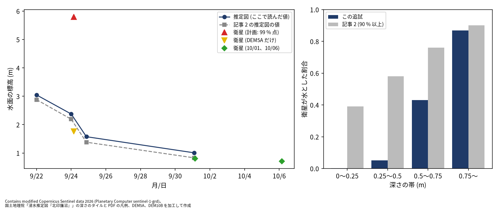
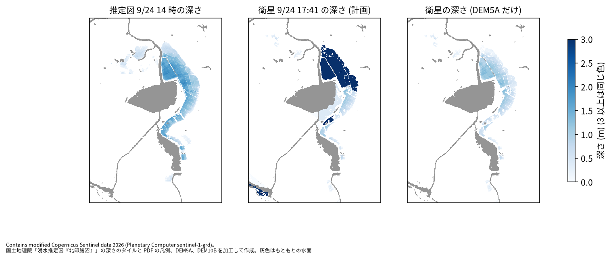

# 北印旛沼の浸水を Sentinel-1 で解析した note 記事 2 本の追試

問い: 北印旛沼の浸水を Sentinel-1 で解析した note 記事 2 本 (Mark.n、2026-09-26 と 2026-10-23) の主張は、公開データと、記事の記述から組み直したスクリプトで再現するか。

## 結論

浸水の範囲の主張は、半分ほど再現しました。VV だけの判定は見逃しが多く誤検出が少ないこと、見逃した所は VV より VH で暗くなることは、手順を組み直しても保たれました。深さの主張は、ほとんど再現しませんでした。再現したのは「浅い水ほど衛星は見落とす」ことだけで、この追試ではその傾向が記事よりはるかに強く出ました。そのため、衛星の水の範囲から決める水面と深さが大きく外れました。無料の SAR で浸水の深さを出すには、浅い水をどれだけ拾えるかが全てを左右し、記事の手順の記述だけではその部分を再現できない、というのがこの追試の答えです。

取り組んだのは、記事の手順の記述を流す前に計画書に固定し、主張ごとに再現とみなす数字の幅も先に決めて、組み直したスクリプトで確かめることです。記事 1 (浸水の範囲) を段 A、記事 2 (深さ、水面、水が引く過程) を段 B としました。途中で、Planetary Computer の RTC 版の画像が、地図に対して 2 画素ほどずれていることが分かりました。段 B は、GRD から自分で処理した画像で流しました。

### わかったこと

| # | 要点 | 数字 | 根拠 |
|---:|---|---|---|
| 1 | VV だけの判定は、推定図に比べて見逃しが多く誤検出が少ない (記事 1 の A2 は再現) | 検出率 61.1 %、適合率 75.4 % ([blocks.json](outputs/blocks.json))。記事は 56 % と 89 % ([article_claims.json](outputs/article_claims.json)) | [図 2](#vh-を足しても見逃しはほとんど減らなかった) |
| 2 | 見逃した所は VV ではあまり暗くならず、VH ではより暗くなる (A4 は再現)。VH を足しても見逃しはほとんど減らない (A3 は再現しない) | 見逃しの変化量の中央値 VV −1.16 dB、VH −3.03 dB。VH を足した検出率 64.4 % ([blocks.json](outputs/blocks.json))。記事は 80 % ([article_claims.json](outputs/article_claims.json)) | [図 2](#vh-を足しても見逃しはほとんど減らなかった) |
| 3 | RTC 版の画像は地図に対して 2 画素ほどずれていた。自分で処理した GRD はそろっていて、それで流し直すと A1 (干拓地の中心部) も再現する | WorldCover の水域に対し RTC 版は行 −1.826、列 2.5 画素、自分の GRD は 0.55 画素以内 ([grd_check.json](outputs/grd_check.json))。中心部 94.6 % ([blocks_a_grd.json](outputs/blocks_a_grd.json)) | [画像の位置](#rtc-版の画像は地図に対してずれていた) |
| 4 | 浅い水ほど衛星は見落とす (記事 2 の D3 は再現)。ただし浅い所の検出率は記事よりはるかに低い | 推定図の深さ 0〜0.25 m で 0.2 %、0.25〜0.5 m で 5.2 %、0.75 m 以上で 86.9 % ([blocks_b.json](outputs/blocks_b.json))。記事は 39 %、58 %、90 % 以上 ([article_claims.json](outputs/article_claims.json)) | [図 3](#衛星の水面は浅い縁の見落としで外れた) |
| 5 | 衛星の水から決めた干拓地の水面は外れた (D1、D2 は再現しない)。計画の 99 % 点は、水路の上の標高の穴を埋めた値に引き上げられた | 9/24 の水面 5.8 m、推定図からの内挿 2.234 m ([blocks_b.json](outputs/blocks_b.json))。押し上げた 226 画素のうち 223 画素が DEM10B で埋めた所 ([explore_b.json](outputs/explore_b.json)) | [図 3](#衛星の水面は浅い縁の見落としで外れた) |
| 6 | 推定図の深さを地図のタイルから読むと、区画の中の水面は平らで、記事と同じ傾きで下がるが、どの版も記事より少し高い | 9/24 の区画の中のばらつき 0.028 m。記事との差 0.166〜0.194 m ([blocks_b.json](outputs/blocks_b.json)) | [図 3](#衛星の水面は浅い縁の見落としで外れた) |

検出率は推定図の浸水域のうち衛星も水とした割合、適合率は衛星が水とした所のうち推定図も浸水だった割合です。推定図は国土地理院の浸水推定図「北印旛沼」で、これも推定です。比べた数字は推定図との一致度で、真の精度ではありません。

### 読み手ごとに知っておきたいこと

| 読み手 | 結論 | 検討する材料 |
|---|---|---|
| 災害の直後に SAR で浸水の範囲を見積もる担当 | VV だけの判定は深い浸水をよく捉え、浅い浸水を見逃す。この性質は手順を組み直しても保たれた | 見逃しが出やすい所 (図 2 の黄)、深さの帯ごとの検出率 (図 3 の右) |
| SAR から浸水の深さを出したい担当 | 衛星の水の範囲から水面を決める方法は、浅い縁を拾えないと水面が低く出る。標高の穴を別の DEM で埋めると、逆に高く外れる | 9/24 の水面の決め方ごとの値 (定義と感度分析の表) |
| Planetary Computer の RTC 版を使う人 | この場所では、地図に対して 2 画素ほどずれていた。境界の細かい比較の前に、位置を確かめるとよい | [outputs/grd_check.json](outputs/grd_check.json) |
| 分析を再現、反証する人 | 判定は計画の規則のまま。GRD の検査の基準と、9/24 と 10/01 の画像を GRD に替えたことは、段 B の結果を見る前に計画の変更に記録した | [EXPERIMENT_PLAN.md](EXPERIMENT_PLAN.md)、[EXPERIMENT_PLAN_B.md](EXPERIMENT_PLAN_B.md) |

### 決壊した干拓地は大雨の後に暗くなった

図 1: 赤に大雨の前 (2026-09-12)、緑と青に大雨の後 (2026-09-24 17:41) の VV を当てた合成です。赤いほど、大雨の後に暗くなった所です。黄の線は推定図の輪郭線です。干拓地は輪郭線の中がほぼ一面に赤く、記事 1 の図 2 と同じ見え方です。沼の南東の岸にも赤い帯がありますが、推定図の輪郭線の外です。この図は段 A の RTC 版で描いたもので、後で述べる約 2 画素のずれを含みます。

図の出典: Contains modified Copernicus Sentinel data 2026 (Planetary Computer sentinel-1-rtc)。国土地理院「浸水推定図『北印旛沼』」の輪郭線、DEM5A、ESA WorldCover 2021 を加工して作成。

### VH を足しても見逃しはほとんど減らなかった

図 2: 左が VV だけの判定、右が VV と VH の判定です。緑は両方で浸水、黄は推定図だけ (見逃し)、赤は判定だけ、紺はもともとの水面です。破線が比較範囲です。左と右で、黄の所はほとんど変わりません。赤の多くは、沼の南東の岸の帯です。

図の出典: 図 1 と同じ。

VV で見逃した 19,170 画素のうち 66.9 % は、地形でつないで判定を限る範囲の外にありました ([explore_a3.json](outputs/explore_a3.json))。記事 1 のとおり、確実に水になった所の縁の標高から水位を決めると、浅い縁を見逃した分だけ水位が低く出て、範囲が狭くなります。水位を記事 2 の決め方にし、VH の閾値を記事の −3.3 dB にすると、検出率は 80.7 % で記事に届きますが、適合率は 42.2 % に落ちます (同じファイル)。

### RTC 版の画像は地図に対してずれていた

段 B の計画では、自分で処理した GRD を、9/24 の RTC 版と並べて位置を確かめる予定でした。並べると、行で 1.77 画素、列で −2.721 画素ずれていました ([grd_check.json](outputs/grd_check.json))。どちらがずれているかを決めるため、第三の基準として、光学衛星から作られた WorldCover 2021 の水域と比べました。自分の GRD は 5 枚とも、行も列も 0.55 画素以内でそろいました。RTC 版は軌道 39 の 9/24 で行 −1.826、列 2.5 画素ずれていました (同じファイル)。撮る向きの違う軌道 141 でも自分の GRD はそろったので、ずれているのは RTC 版の側と判断し、段 B は GRD で流しました。

段 A を自分の GRD で流し直すと、干拓地の中心部を浸水とした割合は 94.6 % で、A1 の基準 (90 % 以上) を満たしました。A2 と A4 は再現のまま、A3 と A5 は再現しないままです ([blocks_a_grd.json](outputs/blocks_a_grd.json))。これは段 A の判定の後に足した探索です。

### 衛星の水面は浅い縁の見落としで外れた

図 3: 左は、船形干拓の水面の標高の推移です。青の線が、この追試で推定図の深さから出した水面、灰色の破線が記事 2 の値です。2 本はほぼ平行で、この追試のほうが少し高くなっています。三角は 9/24 の衛星の水面で、赤 (計画の 99 % 点) は高すぎ、黄 (DEM5A の値がある所だけ) は低すぎます。右は、推定図 9/24 の深さの帯ごとに、衛星が水とした割合です。

図の出典: Contains modified Copernicus Sentinel data 2026 (Planetary Computer sentinel-1-grd)。国土地理院「浸水推定図『北印旛沼』」の深さのタイルと PDF の凡例、DEM5A、DEM10B を加工して作成。

推定図の浸水域のうち、衛星も水とした割合は 0.651 で、記事 2 の約 8 割より低くなりました ([blocks_b.json](outputs/blocks_b.json))。深さ 0.5 m 未満の所をほとんど拾っていないためです。区画の地面の上位 1 % を水面とする記事の決め方は、浅い縁まで水と判定できていることを前提にしています。この追試の判定では、深い所の地面しか残らないので、DEM5A の値がある所だけで決めると水面は 1.758 m になり、推定図からの内挿より 0.476 m 低く出ました ([explore_b.json](outputs/explore_b.json))。計画どおり DEM10B で穴を埋めた標高を使うと、水路やもともとの水面の近くの埋めた値が上位 1 % を占め、水面は 5.8 m になりました。

図 4: 左が推定図 9/24 14 時の深さ、中央が計画どおりの衛星の深さ、右が DEM5A の値がある所だけで決めた衛星の深さです。中央の干拓地の北部が濃紺なのは、水面が 5.8 m に押し上げられたためです。右は、干拓地の形は合っていますが、推定図より浅く出ています。

図の出典: 図 3 と同じ。灰色はもともとの水面。

### 定義と感度分析

| 項目 | 主分析 | 代わりの定義 |
|---|---|---|
| 段 A の画像 | RTC 版: 中心部 89.2 %、検出率 61.1 % | 自分の GRD: 中心部 94.6 %、検出率 61.1 %、適合率 77.3 % |
| 段 A の水らしさの閾値 | 事後確率 0.5 | 0.3: 中心部 91.9 %、0.7: 中心部 86.5 % |
| 段 A の確実な水の塊の最小 | 100 画素: VV の判定 6.896 km² | 25 画素: 38.715 km² に膨らみ、適合率 58.1 % |
| 段 B の 9/24 の水面 | 区画の地面の 99 % 点: 5.8 m | 95 % 点: 1.666 m、IoU が最大の高さ: 1.494 m、DEM5A の値がある所だけ: 1.758 m |
| 段 B の 9/24 の水 | 自分の GRD | RTC 版: 水面 4.116 m、D1〜D7 は全て再現しない |

段 A の頑健性は [blocks.json](outputs/blocks.json) の variants、段 B は [blocks_b.json](outputs/blocks_b.json) の variants と [explore_b.json](outputs/explore_b.json) にあります。段 B で再現した主張の数は、水面の決め方を 95 % 点か IoU にすると 2 つ (D3、D4) で、計画の 99 % 点では 1 つ (D3) です。

## データ

| データ | 版 | 使ったこと |
|---|---|---|
| Sentinel-1 RTC (Planetary Computer、sentinel-1-rtc、CC BY 4.0) | 軌道 39 の 2026-09-12、09-24。軌道 141 の 09-19、10-01。2026-10-31 取得 | 段 A の判定。段 B の頑健性 |
| Sentinel-1 GRD (Planetary Computer、sentinel-1-grd) | 軌道 39 の 2026-09-12、09-24、10-06。軌道 141 の 09-19、10-01。2026-10-31 取得 | 段 B の判定。自分で校正、雑音の除去、位置合わせをした |
| 国土地理院 浸水推定図「北印旛沼」の輪郭線 | gsi-inundation-estimate-kita-inbanuma-jp-2026-10@e760fba | 推定図の浸水域 (4 版) |
| 国土地理院 浸水推定図の深さのタイルと PDF | 地理院地図の `20260924typhoon25_kitainbanuma_<MMDD>dansaizu` の z16 (2026-10-31 取得)、PDF は上と同じ版 | 推定図の深さ (PDF の凡例の色から読んだ) |
| 国土地理院 標高タイル | DEM5A (z15)、DEM10B (z14)、2026-10-31 取得 | 台地、水位、水面、深さ |
| ESA WorldCover 2021 (Planetary Computer、CC BY 4.0) | v200、タイル N33E138 | もともとの水面、画像の位置の検査 |
| note 記事 2 本 | 2026-09-26 (追記 2026-09-27) と 2026-10-23。2026-10-31 取得 | 主張の数字 ([outputs/article_claims.json](outputs/article_claims.json)) |

取得したファイルの URL、バイト数、sha256 は `artifacts/_flood/kita-inbanuma-sar-replication/raw/MANIFEST.json` と `raw_b/MANIFEST.json` にあります。出典の表示: Contains modified Copernicus Sentinel data 2026。国土地理院の浸水推定図と標高タイルを加工して作成。

## 方法

- 格子: RTC の格子 (EPSG:32654、10 m) の 1,700 × 2,700 画素に、全ての入力をそろえました ([outputs/grid_summary.json](outputs/grid_summary.json))。
- 段 A の判定: もともとの水面と標高 15 m 以上の陸に正規分布を当てた事後確率、確実な水の塊の縁の標高の中央値から決めた水位で限る範囲、VH の追加です ([outputs/detect_fit.json](outputs/detect_fit.json))。
- GRD の処理: 校正の表と熱雑音の表 (距離方向と方位方向) で σ0 にし、入射角の余弦で割りました。位置は、製品の対応表を緯度経度について線形に内挿し、DEM5A にジオイド高 (EGM96) を足した楕円体高との差の分を距離方向にずらしました。
- 推定図の深さ: PDF に埋め込まれた凡例の帯の色を 0〜10 m に並べ、タイルの画素ごとに最も近い色の深さを読みました。凡例から遠い色はありませんでした ([outputs/gsi_depth.json](outputs/gsi_depth.json))。
- 段 B の水面と深さ: 衛星の水の区画ごとに、9/24 は地面の 99 % 点、10/01 と 10/06 は水の範囲と「地面が水面より低い範囲」の IoU が最大の高さを水面にし、深さ = 水面 − 地面としました。
- 事前の判定基準: 計画は流す前に固定しました ([EXPERIMENT_PLAN.md](EXPERIMENT_PLAN.md)、[EXPERIMENT_PLAN_B.md](EXPERIMENT_PLAN_B.md))。要点 1 と 2 は段 A の A2、A4、A3、要点 4 は段 B の D3、要点 5 は D1 と D2、要点 6 は D5 に当たります。要点 3 と、A3 と水面の切り分けは、結果を見た後の探索です。GRD の検査の基準を WorldCover に替え、段 B の 9/24 と 10/01 の水を GRD から作ることにしたのは、段 B の主張の結果を見る前で、計画の変更に記録しました。記録: [EXPERIMENT_TRACKER.md](EXPERIMENT_TRACKER.md)。
- 段 B のほかの主張: D4 (最大の深さを衛星だけだと浅く見積もる) は、衛星の水面が 5.8 m に押し上げられたので再現しませんでした (差の中央値 0.0 m)。D6 (10/06 に水が残る) は、10/06 の衛星の水が 0.4373 km² で基準の 0.5 km² に届かず、そのうち 0.996 が 10/01 の輪郭線の中でした。D7 (10/01 の衛星が泥を水とする) は 0.0088 km² で、記事の 0.38 km² を再現しませんでした ([outputs/blocks_b.json](outputs/blocks_b.json))。
- 空間の依存: 画素は隣どうしで強く似るので、割合は面積の比として書き、区間は付けていません。

## 確かめていないこと

推定図から出した水面が、どの版も記事より 0.17〜0.19 m 高い理由は確かめていません。記事は PDF の地図の色を読み、この追試は地理院地図のタイルの色を読みました。PDF の地図では深さの色が地図の上に透かして描かれているので、色が薄く見え、浅く読まれた可能性があります。使った 5 m の標高が違う可能性もあります。

RTC 版がずれている理由は確かめていません。この場所の 4 枚では 20 m ほどずれていましたが、他の場所や他の日付でも同じかは分かりません。

この追試の判定は、浅い水を記事よりはるかに拾いませんでした。記事は「水中の植生・建物」の区分を持っていますが、手順が書かれていないので組み込んでいません。記事の判定の細部 (分布の当て方、閾値) の違いがどれだけ効いたかは分けられていません。

建物の仕分け (記事 2 の 449 棟) は扱っていません。基盤地図情報の建築物の外周線のダウンロードに、利用者の登録が要るためです。

沼の南東の岸の、判定だけで浸水とした帯が何なのかは確かめていません。推定図は 14 時、衛星は 17 時 41 分の撮影で、その間に水が引いた所は見逃しに数えられています。
