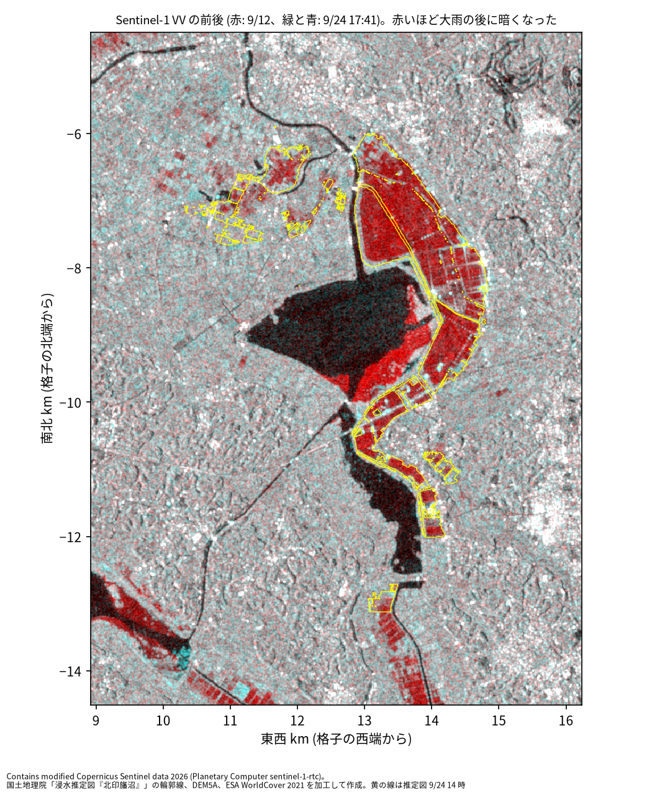
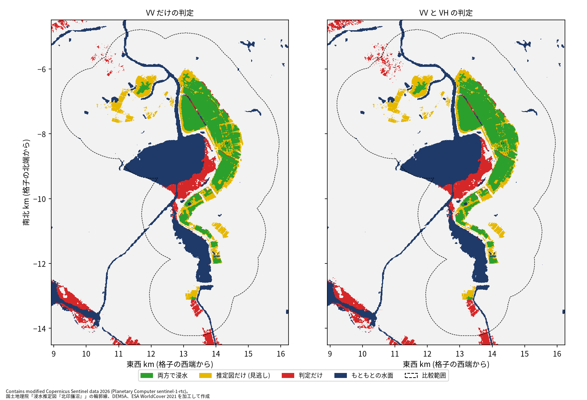

# 北印旛沼の浸水を Sentinel-1 で検知した note 記事の追試 (段 A)

問い: note 記事「千葉の台風25号豪雨災害を、無料のレーダー衛星データで解析してみた」(Mark.n、2026-09-26) の 5 つの主張は、公開データと、記事の記述から組み直したスクリプトで再現するか。

## 結論

記事の主張のうち、VV だけの判定が「見逃しが多く誤検出が少ない」こと (A2) と、見逃した所が VV より VH で暗くなること (A4) は再現しました。VH を足すと見逃しが約半分になること (A3) は再現しませんでした。A3 は、記事に書かれていない手順の細部に左右されると考えます。無料の SAR で浸水の範囲を見積もるとき、VV だけの判定の性質は手順によらず保たれますが、VH の上乗せはまだ手順を決めないと使えません。

取り組んだのは、記事 1 の手順の記述 (シーンから水と陸の分布を学ぶ確率の判定、確実な水の縁の標高から推定した水位で範囲を限る、VH の追加) を、流す前に計画書に固定して組み直すことです。入力は Planetary Computer の RTC 版の画像で、記事が自分で作った γ0 ではありません。主張ごとに、再現とみなす数字の幅も先に決めました。

### わかったこと

| # | 要点 | 数字 | 根拠 |
|---:|---|---|---|
| 1 | VV だけの判定は、推定図に比べて見逃しが多く、誤検出が少ない (A2 は再現) | 検出率 61.1 %、適合率 75.4 % ([blocks.json](outputs/blocks.json))。記事は 56 % と 89 % ([article_claims.json](outputs/article_claims.json)) | [図 2](#vh-を足しても見逃しはほとんど減らなかった) |
| 2 | 見逃した所は、VV ではあまり暗くならず、VH ではより暗くなる (A4 は再現) | 見逃しの変化量の中央値は VV −1.16 dB、VH −3.03 dB。両方で浸水の所は VV −11.96 dB ([blocks.json](outputs/blocks.json))。記事は −2.5 dB、−5 dB、−13 dB ([article_claims.json](outputs/article_claims.json)) | [図 1](#決壊した干拓地は大雨の後に暗くなった) |
| 3 | VH を足しても、検出率はほとんど上がらない (A3 は再現しない) | 検出率 61.1 % → 64.4 %、見逃しの面積は 0.915 倍 ([blocks.json](outputs/blocks.json))。記事は 56 % → 80 % ([article_claims.json](outputs/article_claims.json)) | [図 2](#vh-を足しても見逃しはほとんど減らなかった) |
| 4 | VH が効かなかったのは、見逃しの多くが、水位で限った範囲の外にあったから | 見逃した 19,170 画素のうち 66.9 % が範囲の外。範囲の中で VH が閾値以下は 8.5 % ([explore_a3.json](outputs/explore_a3.json)) | [見逃しの内訳](#見逃しの多くは水位で限った範囲の外にあった) |
| 5 | 決壊した干拓地の中心部は、ほとんどを浸水と判定したが、事前の基準にわずかに届かない (A1 は再現しない) | 中心部の 89.2 % ([blocks.json](outputs/blocks.json))。基準は 90 % 以上 | [図 2](#vh-を足しても見逃しはほとんど減らなかった) |
| 6 | 27 × 17 km の判定の面積は、VH を足しても大きく増えない (A5 は再現しない) | VV だけ 6.896 km²、VV と VH で 7.516 km² ([blocks.json](outputs/blocks.json))。記事は 4.8 km² と 9.2 km² ([article_claims.json](outputs/article_claims.json)) | [定義と感度分析](#定義と感度分析) |

検出率は、推定図の浸水域のうち判定も浸水とした面積の割合です。適合率は、判定が浸水とした面積のうち推定図も浸水だった割合です。比べた推定図は、国土地理院の浸水推定図「北印旛沼」の 2026-09-24 14:00 の版です。推定図も推定なので、どちらの数字も推定図との一致度で、真の精度ではありません。

### 読み手ごとに知っておきたいこと

| 読み手 | 結論 | 検討する材料 |
|---|---|---|
| 災害の直後に SAR で浸水の範囲を見積もる担当 | VV だけの判定は、深い浸水をよく捉え、浅い浸水を見逃す。この性質は手順を組み直しても保たれた | 見逃しが出やすいのは、干拓地の縁、区画の間、沼の北西の田 (図 2 の黄) |
| 記事の手順を使う、または改める人 | VH の上乗せの効き目は、水位の決め方と VH の閾値で大きく変わる。水位を高めにすると検出率は記事に近づくが、適合率が落ちる | [outputs/explore_a3.json](outputs/explore_a3.json) の 4 つの試し |
| 分析を再現、反証する人 | 判定は計画の規則のまま。A3 の切り分けは結果を見た後の探索 | 定義と感度分析の表、[EXPERIMENT_PLAN.md](EXPERIMENT_PLAN.md) の計画の変更 |

### 決壊した干拓地は大雨の後に暗くなった

図 1: 赤に大雨の前 (2026-09-12)、緑と青に大雨の後 (2026-09-24 17:41) の VV を当てた合成です。赤いほど、大雨の後に暗くなった所です。黄の線は推定図の輪郭線です。干拓地は輪郭線の中がほぼ一面に赤く、記事の図 2 と同じ見え方です。沼の南東の岸にも赤い帯がありますが、推定図の輪郭線の外です。

図の出典: Contains modified Copernicus Sentinel data 2026 (Planetary Computer sentinel-1-rtc)。国土地理院「浸水推定図『北印旛沼』」の輪郭線、DEM5A、ESA WorldCover 2021 を加工して作成。

両方で浸水の所は、VV が −8.37 dB から −20.4 dB に下がりました。見逃した所は、VV が −8.3 dB から −9.52 dB へ、VH が −14.04 dB から −17.39 dB へ下がりました ([blocks.json](outputs/blocks.json))。

### VH を足しても見逃しはほとんど減らなかった

図 2: 左が VV だけの判定、右が VV と VH の判定です。緑は両方で浸水、黄は推定図だけ (見逃し)、赤は判定だけ、紺はもともとの水面です。破線が比較範囲です。左と右で、黄の所はほとんど変わりません。赤の多くは、沼の南東の岸の帯です。

図の出典: 図 1 と同じ。

比較範囲は、推定図の輪郭線を 1,101.4 m 広げた 38.0 km² で、記事の約 38 km² に合わせました。もともとの水面を除くと 33.461 km² です ([blocks.json](outputs/blocks.json))。

### 見逃しの多くは水位で限った範囲の外にあった

記事は、確実に水になった所の縁の標高から水位を推定し、その水位より低くつながる所に判定を限っています。計画ではこれを、確実な水の塊の縁の標高の中央値としました。塊の水位の中央値は 1.31 m で、最も大きい塊は 1.0 m でした ([explore_a3.json](outputs/explore_a3.json))。VV が浅い縁を見逃すと、確実な水の縁は深い所に来るので、水位は低く出ます。記事 2 (2026-10-23) が「水際から決めると水面が低く出る」と書いているのと同じ仕組みです。合成データのテストでも、この偏りを確かめました (`scripts/test_sar.py`)。

結果を見た後の探索として、水位と閾値を変えました ([explore_a3.json](outputs/explore_a3.json))。

| 試し | 検出率 (VV と VH) | 適合率 (VV と VH) |
|---|---|---|
| 計画のまま (縁の中央値、閾値 −6.105 dB) | 64.4 % | 74.9 % |
| 閾値を記事の −3.3 dB に | 67.3 % | 73.1 % |
| 水位を記事 2 の決め方 (塊の地面の上位 1 %) に | 74.1 % | 55.7 % |
| 両方 | 80.7 % | 42.2 % |

両方を変えると検出率は記事の約 80 % に届きますが、適合率は記事の約 81 % を大きく下回ります。記事の検出率と適合率を同時に再現する手順は、記述から組み直した範囲では見つかりませんでした。

### 定義と感度分析

| 項目 | 主分析 | 代わりの定義 |
|---|---|---|
| 水らしさの閾値 | 事後確率 0.5: 中心部 89.2 %、検出率 61.1 % | 0.3: 中心部 91.9 % (A1 は再現側)、0.7: 中心部 86.5 % |
| 確実な水の塊の最小 | 100 画素: VV の判定 6.896 km² | 25 画素: 38.715 km² に膨らみ、適合率 58.1 %。400 画素: 検出率 53.6 % |
| 水位 | 縁の標高の中央値 | 縁の 75 % 点: VV と VH の検出率 72.7 %、適合率 61.6 % |
| VH の閾値 | 台地の変化量の 1 % 点 (−6.105 dB) | 5 % 点: VV と VH の検出率 66.2 % |
| 地形の範囲 | 水位でつながる所に限る | 限らない: 適合率 58.1 %、VV と VH の判定 46.167 km² |
| 比較範囲 | 輪郭線を広げた 38.0 km² | 輪郭線の外接矩形: 検出率 61.1 %、適合率 78.1 % |

A2 と A4 は、塊の最小 25 画素、水位の 75 % 点、地形の範囲なしでは A2 が外れますが、それ以外の設定では再現のままです。A3 はどの設定でも再現しませんでした (全て [blocks.json](outputs/blocks.json) の variants)。塊の最小を 25 画素にすると、台地の小さな塊が高い水位を持ち、範囲が一帯に広がります。地形でつなぐ手順は、水位の推定が外れると、範囲を限る働きを失います。

## データ

| データ | 版 | 使ったこと |
|---|---|---|
| Sentinel-1 RTC (Planetary Computer、sentinel-1-rtc、CC BY 4.0) | S1C 2026-09-12 08:41 UTC と 2026-09-24 08:41 UTC、軌道 39。2026-10-31 取得 | VV と VH の γ0。27 × 17 km を切り出した |
| 国土地理院 浸水推定図「北印旛沼」の輪郭線 | gsi-inundation-estimate-kita-inbanuma-jp-2026-10@e760fba | 2026-09-24 14:00 の版を比較に、2026-10-01 16:00 の版を干拓地の中心部に |
| 国土地理院 標高タイル | DEM5A (z15) 651 枚、DEM10B (z14) 176 枚、2026-10-31 取得 | 台地の判定、水位、範囲 |
| ESA WorldCover 2021 (Planetary Computer、CC BY 4.0) | v200、タイル N33E138 | もともとの水面 (クラス 80) |
| note 記事 2 本 | 2026-09-26 (追記 2026-09-27) と 2026-10-23。2026-10-31 取得 | 主張の数字 ([outputs/article_claims.json](outputs/article_claims.json)) |

取得したファイルの URL、バイト数、sha256 は `artifacts/_flood/kita-inbanuma-sar-replication/raw/MANIFEST.json` にあります。出典の表示: Contains modified Copernicus Sentinel data 2026。国土地理院の浸水推定図と標高タイルを加工して作成。

## 方法

- 格子: RTC の格子 (EPSG:32654、10 m) のまま、1,700 × 2,700 画素。SAR を投影し直していません。標高は DEM5A を画素の中心で双一次に内挿し、欠ける所 (沼の上など) を DEM10B で埋めました ([outputs/grid_summary.json](outputs/grid_summary.json))。
- 判定: もともとの水面の後の VV と、標高 15 m 以上の陸の後の VV にそれぞれ正規分布を当て、事前確率を等しくした事後確率を出しました。確実な水 (事後確率 0.9 以上、VV が陸の変化量の 5 % 点より暗い、100 画素以上の塊) の縁の標高の中央値を水位とし、水位以下でつながる範囲で事後確率 0.5 以上を浸水としました。VH は、同じ範囲で、変化量が台地の 1 % 点以下の所を足しました ([outputs/detect_fit.json](outputs/detect_fit.json))。
- 事前の判定基準: 計画は流す前に固定しました ([EXPERIMENT_PLAN.md](EXPERIMENT_PLAN.md))。要点 1 は A2 (区画 B2)、要点 2 は A4 (B4)、要点 3 は A3 (B3)、要点 5 は A1 (B1)、要点 6 は A5 (B5) です。要点 4 と、水位と閾値を変えた試しは、結果を見た後の探索で、計画の変更に記録しました。記録: [EXPERIMENT_TRACKER.md](EXPERIMENT_TRACKER.md)。
- 空間の依存: 画素は隣どうしで強く似るので、検出率と適合率は面積の比として書き、画素を独立な標本とした区間は付けていません。
- 面積: EPSG:32654 の画素で数えました。9/24 の輪郭線を塗った面積は 4.9391 km² で、EPSG:6677 で測った 4.939 km² と合います。

## 確かめていないこと

記事は GRD から校正と地形補正を自分で組んでいますが、この追試は Planetary Computer の RTC 版を使いました。処理系の違いが数字にどれだけ効くかは確かめていません。段 B で GRD から自分で処理するときに並べます。記事の、製品の対応表 210 点を 1.5 cm で再現したという確認と、前後の位置のずれ 0.16 m も試していません。

記事の判定には「水中の植生・建物」(2 回散乱で明るくなる所) の区分がありますが、手順が書かれていないので組み込んでいません。記事の 27 × 17 km の範囲の位置も分からないので、輪郭線の重心を中心に置きました。A5 の面積は、この位置の違いを含みます。

沼の南東の岸の、判定だけで浸水とした帯が何なのかは確かめていません。WorldCover では水域になっておらず、大雨の前は明るく、後に暗くなっています。水辺の植生が水に浸かった所か、もともと水面だった所かは、この追試のデータでは分けられません。

推定図は 14:00 の時点で、Sentinel-1 の撮影は 17:41 です。その約 3.7 時間に水が引いた所は、見逃しに数えられています。
