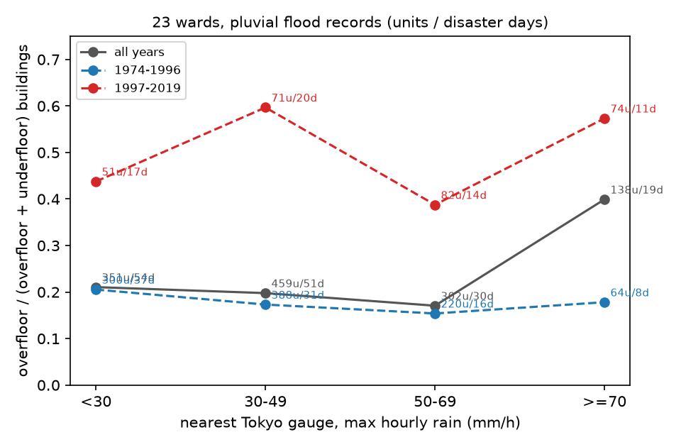

# 東京都の浸水実績にもとづく、時間雨量と床上浸水の割合の関係の検証

問い: 東京都の浸水実績 (1974〜2019 年) で、都の雨量計の時間雨量が 70 mm/h 以上の記録は床上浸水の割合が高いか、気象庁の観測所が強い雨を見落とす割合は観測所から遠いほど高いか。

## 結論

70 mm/h を床上浸水の対策の境にする根拠は、この記録からは弱いと考えます。期間をまとめると 70 mm/h で床上浸水の割合は跳ね上がって見えますが、同じ期間の中ではほとんど変わりません。一方、気象庁の観測所だけで強い雨を判断すると、都の雨量計の 50 mm/h 以上の半分ほどを見落とします。

取り組んだのは、東京都の浸水実績の調査単位について、記録に書かれた雨量計の時間雨量の帯ごとに、床上浸水の割合を比べることです。期間をまとめた比較は先行の調査で既に出ていたので、それをなぞるのではなく、まだ見ていない切り方を流す前に決めて試しました。前半と後半の期間ごとの比較、災害日を単位にした区間、災害日を 1 日ずつ抜いた比較、観測所からの距離による比較です。

### わかったこと

| # | 要点 | 数字 |
|---:|---|---|
| 1 | 期間をまとめると、23 区の内水では 70 mm/h 以上の記録で床上浸水の割合が高い | 差 0.21 [0.02, 0.33]、どの 1 日を抜いても 0.13 より大きい |
| 2 | 同じ期間の中では、差はほとんど無いか小さい。期間をそろえた差は 0 と区別できない | 前半 0.002 [−0.10, 0.11]、後半 0.085 [0.017, 0.21]、そろえた差 0.047 [−0.02, 0.15] |
| 3 | 弱い雨 (50 mm/h 未満) で溢水が内水より床上浸水の割合が高いのは、前半だけ | 全期間 0.29 [0.09, 0.48]、前半 0.31 [0.10, 0.49]、後半 0.03 [−0.03, 0.13] |
| 4 | 都の雨量計が 50 mm/h 以上を記録したとき、最寄りの気象庁の観測所は半分ほどで 50 mm/h に届かない | 119 事象のうち 54% [42%, 67%]。本土のどの観測所でも届かないのは 30% |
| 5 | 見落としは観測所から遠い側で多いが、差は 0 と区別できない | 6.1 km より遠い側 61%、近い側 47%、差 0.14 [−0.01, 0.28] |

床上浸水の割合は、帯の中の床上浸水の棟数の合計を、床上と床下の棟数の合計で割った値です。差は、70 mm/h 以上の帯の割合から、70 mm/h 未満の帯の割合を引いた値です。括弧は、災害日を単位に引き直した 90% 区間です。

要点 1 の差 0.21 は、そのまま「70 mm/h で床上浸水が増える」とは読めません。要点 2 のとおり、差の大半は期間の違いから来ています。

### 読み手ごとに知っておきたいこと

| 読み手 | 結論 | 検討する材料 |
|---|---|---|
| 区市町村の水防と住宅の助成の担当 | 70 mm/h を床上浸水の対策の境にする根拠は弱い。同じ期間の中では、雨の強さで床上浸水の割合はほとんど変わらない | 図 1、期間ごとの差 |
| 警戒の判断をする担当 | 気象庁の観測所だけでは、都の雨量計の 50 mm/h 以上の半分ほどを見落とす。観測所から 6 km の内側でも半分近くを見落とす | 見落としの節 |
| 分析を再現、反証する人 | 期間をまとめた差は、期間ごとの床上浸水の割合の違いを含む。境を 60 mm/h、80 mm/h に動かすと事前の判定基準の判定が入れ替わる | 定義と感度分析の表、[outputs/within_period.json](outputs/within_period.json) |

### 期間をまとめたときの跳ね上がりは、後半の床上浸水の割合の高さから来る

後半は、どの雨の帯でも床上浸水の割合が高くなっています。全ての帯をまとめた割合は、前半 0.18 に対して後半 0.53 です。さらに、70 mm/h 以上の 138 単位のうち 74 単位が後半にあります。期間をまとめると、後半の高い割合が 70 mm/h 以上の帯に集まり、跳ね上がりに見えます。

図 1: 灰色は全期間、青は 1974〜1996 年、赤は 1997〜2019 年です。点の横の数は、調査単位の数と災害日の数です。青の線はほぼ平らで、赤の線は高い位置で上下しています。灰色の線だけが 70 mm/h で跳ね上がります。

図の出典: 東京都「水害リスク情報システム 浸水実績図データ」を加工して作成。

後半に床上浸水の割合が高い理由は試していません。確かめていないことの節に、考えられる説明を挙げました。

### 気象庁の観測所は、都の雨量計の強い雨の半分ほどを見落とす

都の雨量計が 50 mm/h 以上を記録した 119 の事象 (50 日) で、最寄りの気象庁の観測所が同じ期間に 50 mm/h に届かなかったのは 54% でした。言い換えると、気象庁の最寄りの観測所が 50 mm/h 以上を記録したのは半分足らずです。都の雨量計と最寄りの観測所の時間雨量の差は、中央値で 19 mm/h でした。

事象の位置から最寄りの観測所までの距離の中央値は 6.1 km です。遠い側の見落としは 61%、近い側は 47% でした。事前に決めた判定基準では、差の区間が 0 をわずかにまたぐので、距離で見落としが増えるとは言えません。

### 定義と感度分析

| 項目 | 主分析 | 代わりの定義 |
|---|---|---|
| 雨量計の範囲 | 全ての単位。期間をまとめた差 0.21 | 区市町村の中の雨量計の単位だけ: 差 0.24、前半 0.046、後半 0.019 |
| 跳ね上がりの境 | 70 mm/h | 60 mm/h: 後半の差が −0.001 で、判定は「退ける」に変わる。80 mm/h: 判定は変わらないが、前半の 80 mm/h 以上は 13 単位、3 日だけ |
| 割合の数え方 | 帯の中の棟数を合計してから割る | 単位ごとの割合の平均: 差 0.14 [−0.01, 0.26]、前半 −0.03、後半 0.13 |
| 期間の扱い | 全期間をまとめる | 期間の中で比べ、境の上の単位数で重みづけた平均: 0.047 [−0.02, 0.15] |

境を 60、70、80 mm/h と動かすと、事前の判定基準の判定が入れ替わります。床上浸水の割合が跳ね上がる雨の強さは、この記録からは決まりません。

## データ

| データ | 版 | 使ったこと |
|---|---|---|
| tokyo-flood-record-jp | 354b0d9 の flood_area (5,845 行) | 調査単位、雨量計の時間雨量 (nro_60min)、床下と床上の棟数、浸水の原因 |
| jma-rain-tokyo | 4391f76 の daily と stations | 本土の観測所の日の最大 1 時間雨量 |

入力は [tokyo23-flood-record-vs-a31a](../tokyo23-flood-record-vs-a31a/) の 01_fetch.py が固定版で取ったものを読みました。

## 方法

- 調査単位: 分割して収録された面を、layer、区市町村、災害名、開始日、地区、面積、総棟数の 7 列で束ねました。日付のある単位は 2,052 です。23 区の内水で雨量の読める単位は 1,250 です。
- 雨量: 記録の nro_60min の先頭の数値です。`(280)` のように括弧で始まる値と、`-` や空の値は欠測としました。
- 期間: 開始日の年が 1996 年以前を前半、1997 年以降を後半としました。
- 区間: 災害日を単位に、復元抽出で 2,000 回引き直した 5% 点と 95% 点です。同じ日の記録は同じ雨の中にあるので、記録を独立に数えていません。
- 気象庁の雨量: 区市町村の中の雨量計 (nro_flag が 0) の事象ごとに、面の重心から最も近く、災害の期間に値のある本土の観測所を選び、その期間の最大 1 時間雨量と比べました。50 mm/h に届かなければ見落としとしました。
- 事前の判定基準: 計画は流す前に固定しました ([EXPERIMENT_PLAN.md](EXPERIMENT_PLAN.md))。要点 1 と 2 は計画の C1、要点 3 は C2、要点 4 と 5 は C3 に当たります。計画の基準では C1 と C2 は「支持」、C3 は「判定できない」です。ただし C1 の基準の一部「各期間で差が 0 より大きい」は、前半の差 0.002 でも通る弱いものでした。期間の中の区間と期間をそろえた差は、結果を見た後に足した探索で、計画の変更に記録しました。記録: [EXPERIMENT_TRACKER.md](EXPERIMENT_TRACKER.md)。結果: [outputs/blocks.json](outputs/blocks.json)、[outputs/within_period.json](outputs/within_period.json)。

## 確かめていないこと

後半に床上浸水の割合が高い理由は確かめていません。後半は記録の数が少なく、23 区の内水は前半 1,048 単位に対して後半 280 単位です。軽い床下浸水を記録しなくなった、調査の仕方が変わった、半地下の建物が増えた、などの説明がありえますが、どれも試していません。

雨量計の時間雨量が、何分おきの移動窓で測ったものかは記録に書かれていません。気象庁の最大 1 時間雨量は 10 分おきの移動窓です。窓の取り方の違いは、見落としの割合に含まれています。

見落としは、浸水が起きた事象だけで数えています。浸水が起きなかった強い雨は記録に無いので、気象庁の観測所が強い雨一般をどれだけ見落とすかは、この記録からは分かりません。

棟数の列には `12(2)` のような括弧付きの値があり、先頭の数を使いました。括弧の中の意味は確かめていません。
