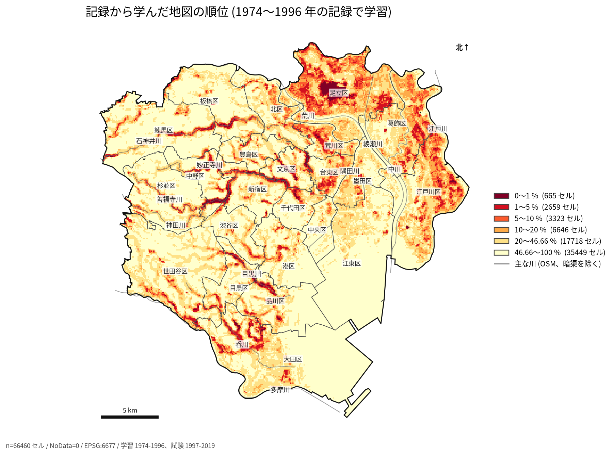
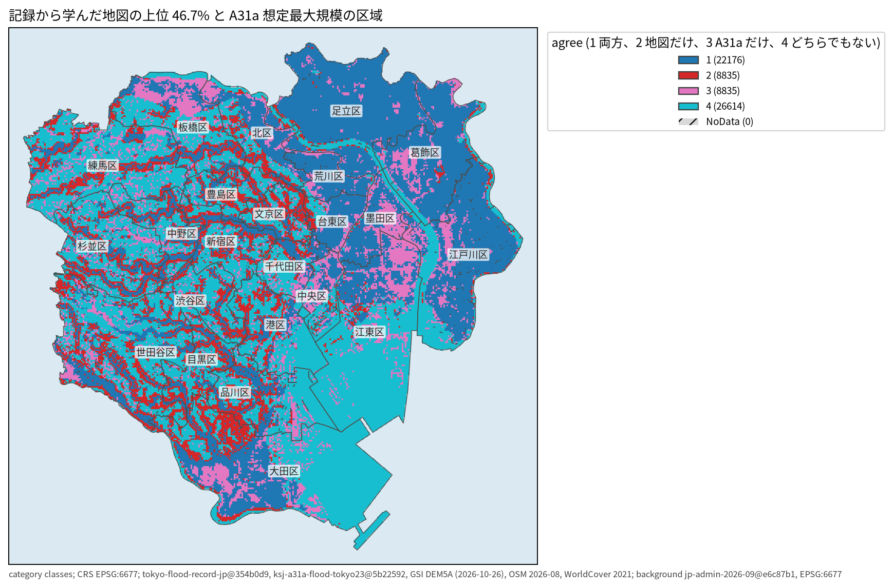
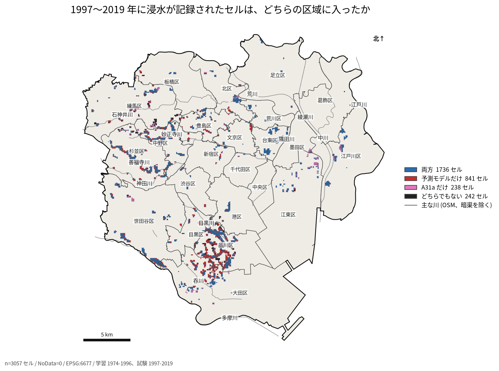
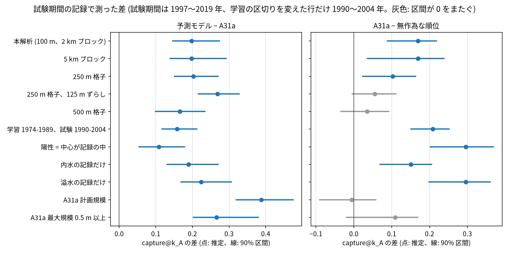
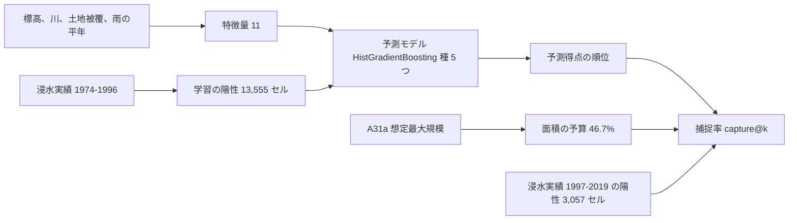

# 東京23区の浸水実績から学習した予測モデルと、国の洪水浸水想定区域 (A31a) の比較

問い: 東京 23 区の 100 m セルで、1974〜1996 年の浸水の記録から学習した予測モデルの上位の区域は、1997〜2019 年に記録された浸水を、A31a (洪水浸水想定区域、想定最大規模) と同じ面積でどれだけ多く含むか。

## 結論

浸水への備えの重点を A31a の区域だけで決めると、後の期間に記録された浸水セルのうち A31a の区域に入るのは 64.6% にとどまります。同じ面積で、予測モデルの上位の区域は 84.3% を含みます。ただし、前の期間に記録があったセルを記録の多い順に並べるだけでも 79.4% を含むので、上乗せの大半は「前に浸水した場所がまた浸水する」ことから来ています。重点の区域は、A31a に加えて、過去の浸水の記録が繰り返す場所を見て決めるのがよいと考えます。

A31a は河川の氾濫 (外水) の想定で、記録の 86.5% は内水です。この比較は A31a の誤りを示すものではなく、記録された浸水に対して、重点を置く区域としてどちらが多くを含むかの比較です。

取り組んだのは、23 区を 100 m のセルに分け、前の期間の記録から予測モデルを学習し、後の期間の記録で試すことです。A31a、無作為な順位、標高の低い順、記録の多い順と、同じ面積で比べました。年ごとの雨を足して、どの年に浸水するかを予測できるかも試しています。

### わかったこと

| # | 要点 | 数字 |
|---:|---|---|
| 1 | A31a と同じ面積 (23 区の 46.7%) で、予測モデルの上位の区域は試験の浸水セルを A31a の区域より多く含む | 捕捉率 84.3% 対 64.6%、差 +0.197 [+0.147, +0.273] ([b1_main.json](outputs/b1_main.json)) |
| 2 | 面積を絞るほど、差は開く | 上位 5% で 20.1% 対 2.5%、上位 10% で 31.9% 対 6.2% ([b1_main.json](outputs/b1_main.json)) |
| 3 | 予測モデルの上位の区域だけに入る試験の浸水セルは、台地を刻む谷の多い区に偏る | 841 セルのうち品川区 245、大田区 158、杉並区 88 ([test_cells_by_ward.csv](outputs/test_cells_by_ward.csv)、[fig3_test_cells.json](outputs/fig3_test_cells.json)) |
| 4 | A31a の区域は無作為な順位より多くを含むが、格子と区域の定義を変えると差が 0 をまたぐ | 主分析 +0.170 [+0.089, +0.218]、500 m 格子 +0.035 [−0.034, +0.092] ([b1_main.json](outputs/b1_main.json)、[rob_grid_500.json](outputs/rob_grid_500.json)) |
| 5 | 年ごとの雨を足すと、セル × 年の予測はかえって悪くなる | AP 0.0087 → 0.0063、差 −0.0023 [−0.0042, −0.0006] ([b3_main.json](outputs/b3_main.json)) |
| 6 | 予測モデルは、記録の多い順をわずかに上回るだけ | 記録の多い順で 79.4%、差 +0.049 [+0.014, +0.088] ([b1_main.json](outputs/b1_main.json)) |

予測モデルは、標高、周りとの比高、水路までの距離、土地被覆、雨の平年の 11 の特徴量から、1974〜1996 年に浸水が記録されたセルかを学習した分類モデルです。各セルに出す確率を予測得点と呼び、予測得点の高い順に並べます。捕捉率は、上位の区域に入る試験の浸水セル (1997〜2019 年に記録の面が重なった 3,057 セル) の割合です。括弧は、2 km のブロックを引き直した 90% 区間です。

### 読み手ごとに知っておきたいこと

| 読み手 | 結論 | 検討する材料 |
|---|---|---|
| 区の防災と下水道の担当 | A31a の区域の外で、浸水が繰り返し記録された場所がある。試験の浸水セル 3,057 のうち 841 は、予測モデルの上位の区域にだけ入る ([fig3_test_cells.json](outputs/fig3_test_cells.json)) | 台地を刻む谷に沿ったセル (図 1、図 3)、区ごとの数 ([test_cells_by_ward.csv](outputs/test_cells_by_ward.csv)) |
| 浸水想定を作る、使う人 | 内水の記録の浸水セルのうち A31a の区域に入るのは 63.2% (予測モデルは 82.1%)。溢水の記録では A31a の区域が 75.7% を含むが、予測モデルは 98.1% で、溢水のセルは 527 と少ない | 内水の想定 (この比較に入っていない) との比べ方 |
| 分析を再現、反証する人 | 結論は、時間で分けた 1 回の試験とブロックの引き直しの区間による。残差の空間の偏りは 2 km でも残る | 5 km のブロック、格子の大きさとずらし、記録の偏り |

### 同じ面積で、予測モデルの上位の区域は A31a の区域より多くの浸水を含む

A31a の区域の面積 (23 区の 46.7%) を予算として、予測モデルの上位の区域と比べました。面積を絞るほど差は開きます。

| 上位の面積 | 予測モデル | A31a | 差 [90% 区間] |
|---:|---:|---:|---|
| 5% | 20.1% | 2.5% | +0.176 [+0.132, +0.218] |
| 10% | 31.9% | 6.2% | +0.257 [+0.197, +0.319] |
| 46.7% (A31a の面積) | 84.3% | 64.6% | +0.197 [+0.147, +0.273] |

A31a は、区域の中の深さの階級の順に並べました。同じ階級の中は計画規模の階級、次に種を固定した乱数で並べています。上位 5% と 10% は A31a の区域の一部だけを使う比べ方で、A31a の作り方が想定していない使い方です。

図 1: 66,460 セルを予測得点の高い順に並べた百分位です (上位 1%、5%、10%、20%、46.66%)。46.66% は A31a の区域の面積の割合に合わせた区切りで、ここより上が比べた面積の予算です。上位は足立区の低地と、神田川、石神井川、目黒川、呑川など台地を刻む谷に沿って並びます。区切りを変えると色は変わるので、色の境を危険の閾値として見ないでください。

図 2: 同じ面積の 2 つの区域の重なりです。「両方」は 22,176 セルで、予測モデルの上位の区域の 71.5% は A31a の区域の中にあります。面積をそろえたので、「予測モデルだけ」と「A31a だけ」は同じ 8,835 セルです。A31a だけの区域は荒川、中川、江戸川の低地 (葛飾区、江戸川区) にまとまり、予測モデルだけの区域は西側の台地の谷に細く延びます。

図の出典 (図 1〜3): 東京都「水害リスク情報システム 浸水実績図データ」、国土交通省 国土数値情報 (洪水浸水想定区域)、国土地理院 基盤地図情報 数値標高モデル、© OpenStreetMap contributors (ODbL)、ESA WorldCover 2021 (CC BY 4.0) を加工して作成。

### 予測モデルの上位の区域だけに入る浸水は、台地を刻む谷に偏る

図 3: 1997〜2019 年に記録の面が少しでも重なった 3,057 セルだけを塗りました。両方 1,736、予測モデルだけ 841、A31a だけ 238、どちらでもない 242 です。品川区と大田区の境の谷に、赤 (予測モデルだけ) がまとまります。後の期間の記録は西側と南側に多く、東側の低地では少なくなっています。

| 区 | 両方 | 予測モデルだけ | A31a だけ | どちらでもない | 計 |
|---|---:|---:|---:|---:|---:|
| 品川区 | 285 | 245 | 13 | 97 | 640 |
| 大田区 | 170 | 158 | 20 | 7 | 355 |
| 杉並区 | 231 | 88 | 18 | 24 | 361 |
| 練馬区 | 111 | 74 | 41 | 64 | 290 |
| 中野区 | 171 | 65 | 11 | 10 | 257 |

全ての区は [test_cells_by_ward.csv](outputs/test_cells_by_ward.csv) にあります。品川区だけで試験の浸水セルの 2 割を占め、どの区域の捕捉率もこの区の記録に強く左右されます。

### A31a の区域は無作為な順位より多くを含むが、定義によっては区別できない

図 4: 左が予測モデル − A31a、右が A31a − 無作為な順位の、A31a の面積での捕捉率の差です。灰色は区間が 0 をまたぐ行です。左は 11 行全てで下限が 0 を上回ります。右は 500 m 格子、250 m 格子のずらし、計画規模、深さ 0.5 m 以上で 0 をまたぎます。学習と試験の区切りを変えた行だけ、試験の期間が 1990〜2004 年です。

### 年ごとの雨を足しても、どの年に浸水するかの予測はよくならない

| 比べたもの | 指標 | 値 | 差 [90% 区間] |
|---|---|---|---|
| セル × 年の予測: 雨あり − 雨なし | AP | 0.0063 対 0.0087 | −0.0023 [−0.0042, −0.0006] |
| セル × 年の予測: 雨あり − 雨の年を並べ替えたもの | AP | 0.0063 対 0.0060 | +0.0004 [−0.0013, +0.0023] |
| 学習の前半の記録の数を特徴量に足す (探索) | 捕捉率の差 | | +0.010 [−0.010, +0.028] |
| 予測モデル − 記録の多い順 | 捕捉率 | 84.3% 対 79.4% | +0.049 [+0.014, +0.088] |
| 予測モデル − 標高の低い順 | 捕捉率 | 84.3% 対 28.7% | +0.556 [+0.417, +0.630] |

セル × 年の予測は、各セルが各年に浸水するかを予測するもので、評価は AP (平均適合率) です。雨は気象庁の本土の観測所の値で、使える観測所が各年 5〜6 か所しかありません。この粗さの雨では足りないことを示すだけで、雨が効かないことは示しません。

### 定義と感度分析

| 項目 | 主分析 | 代わりの定義 |
|---|---|---|
| 浸水セルの定義 | 記録の面が少しでも重なる。予測モデル − A31a は +0.197 | セルの中心が面の中: +0.109 [+0.054, +0.178] |
| 格子 | 100 m | 250 m: +0.203、125 m ずらし: +0.268、500 m: +0.166 |
| A31a の区域 | 想定最大規模。A31a − 無作為な順位は +0.170 | 計画規模: −0.006 [−0.091, +0.058]、最大規模の 0.5 m 以上: +0.109 [−0.020, +0.168] |
| 記録の原因 | 全て | 内水だけ: 予測モデル − A31a +0.190。溢水だけ: +0.224、A31a − 無作為な順位 +0.296 |
| 区間のブロック | 2 km | 5 km: 予測モデル − A31a [+0.140, +0.292]、A31a − 無作為な順位 [+0.036, +0.238] |
| 学習と試験の区切り | 1996 年と 1997 年 | 学習 1974〜1989 年、試験 1990〜2004 年: 予測モデル − A31a +0.158 |

予測モデルが A31a の区域より多くを含むという答えは、どの定義でも変わりません。A31a の区域が無作為な順位より多くを含むという答えは、格子と区域の定義で変わります。

## データ

全て版を固定して取りました ([01_fetch.py](scripts/01_fetch.py))。

| データ | 版 | 範囲と使い方 |
|---|---|---|
| 浸水実績 tokyo-flood-record-jp | 354b0d9 | 23 区に重なる面 4,759 (内水 4,116、溢水 344、両方 248、その他 51)。セル × 年の陽性 |
| 洪水浸水想定区域 ksj-a31a-flood-tokyo23 | 5b22592 | セルの中心を含む区域の深さの階級。想定最大規模と計画規模 |
| 雨 jma-rain-tokyo | 4391f76 | 本土の観測所の時別と日別の降水量 |
| 標高 国土地理院 DEM5A | z15 タイル、2026-10-26 取得 | 1,278 枚 (165 枚は 404 で無し)。標高、周りとの比高、傾きのばらつき |
| OSM の waterway osm-tokyo23-src-2026-08 | 38f7a5f | 水路と開いた川までの距離。23 区の切り出しなので区の外の川は無い |
| 土地被覆 ESA WorldCover 2021 (100 m) | 6f006f6 | 建物、水、樹木の割合 |
| 区界 jp-admin-2026-09 | e6c87b1 | 格子の範囲と地図の背景 |

出典: 東京都「水害リスク情報システム 浸水実績図データ」、国土交通省 国土数値情報 (洪水浸水想定区域)、気象庁「過去の気象データ・ダウンロード」、国土地理院 基盤地図情報 数値標高モデル、© OpenStreetMap contributors (ODbL)、ESA WorldCover 2021 (CC BY 4.0) を加工して作成。

## 方法

- 格子: EPSG:6677 (平面直角座標系 IX 系) の 100 m。23 区の面に中心が入る 66,460 セル (664.6 km²) です。
- 予測モデル: HistGradientBoostingClassifier (max_iter 300) を種 5 つで学習し、確率を平均したものを予測得点としました。陽性は 1974〜1996 年に記録の面が重なったセルです。
- 特徴量: elev、rel_elev_300、rel_elev_1000 (周り 1 km との比高)、elev_min_rel、slope_sd、d_waterway、d_river_open、built、water、tree、rain_clim (学習期間の最寄りの観測所の、年あたりの 30 mm 以上の時間数)。
- 評価: 全ての順位 (予測モデル、A31a、無作為な順位、標高の低い順、記録の多い順) を同じ規則 (得点、次の鍵、種を固定した乱数) で並べ、上位 k の面積に入る試験の浸水セルの割合 (capture@k) を測りました。区間は 2 km のブロックを 1,000 回引き直し、引くたびに上位 k を選び直した差の 5% と 95% の分位点です。
- セル × 年の予測: 1976〜2019 年、学習 1976〜1996 年、試験 1997〜2019 年、評価は AP。雨は、セルに最も近い本土の観測所の、その年の最大 1 時間雨量、最大日雨量、30 mm 以上の時間数です。1 年の 8 割以上の時別値がある観測所だけを使いました。
- 計画は流す前に固定しました ([EXPERIMENT_PLAN.md](EXPERIMENT_PLAN.md))。わかったことの要点 1 と 2 は計画の C1、要点 4 は C2、要点 5 は C3、記録の数を足す探索は C4 に当たります。計画の判定は C1 が支持、C2 が条件つき、C3 が不支持です。計画から変えたのは 2 つです ([EXPERIMENT_TRACKER.md](EXPERIMENT_TRACKER.md))。rain_clim の観測所を 15 年以上の値がある所に限りました (調布の値の欠けを見た後、決め手の前)。履歴の特徴量 (B4) が学習の陽性と同じ記録から作られて漏れた (−0.148) ので、履歴とラベルの期間を分けた B4b を足しました。
- 図 1〜3 は [11_spatial_maps.py](scripts/11_spatial_maps.py) が analysis-visualize の `spatial_result_map.py` で描きました。文字の重なりは 3 枚とも 0 です ([fig1_model_rank.json](outputs/fig1_model_rank.json) など)。

### 関門

1. 座標と距離、面積: 格子、距離、面積は全て EPSG:6677 (メートル) で測りました。格子の面積 664.6 km² は区の面 664.5 km² と合います。
2. 量と水準: 陽性はセルに記録があるかの 0/1 で、按分はしていません。記録の数で重みを付けた捕捉率でも 87.7% 対 67.5% と、順は変わりません。
3. 空間の依存とリーク: 評価は時間で分けました。rain_clim は学習期間の雨だけから作りました。B4 の漏れは上に書いたとおりです。
4. 基準と雑音の上限: 無作為な順位、標高の低い順、記録の多い順と同じ評価で比べました。記録の多い順が 79.4% を含むので、同じ場所の繰り返しだけで上限に近い所まで届きます。
5. 残差と頑健性: 残差の Moran's I は 100 m で 0.63、2 km で 0.09、5 km で 0.03 です ([checks.json](outputs/checks.json))。2 km のブロックでは依存が残るので、5 km でも区間を出しました。局所の検定はしていません。
6. 報告: セルの関係を、個々の建物や世帯の浸水の起こりやすさとして書きません。特徴量の寄与 (並べ替えで捕捉率が最も下がったのは rel_elev_1000 の 0.196、次に elev の 0.071) は予測モデルが頼る入力であり、浸水の原因ではありません。

## 確かめていないこと

A31a は外水の想定で、内水を含みません。この比較は A31a の想定の正しさを測っていません。都や区の内水の想定とは比べていません。

標高、OSM、土地被覆は今の状態で、記録の時点の状態ではありません。1974 年以降の暗渠化、下水道や調整池の整備、建物の増加は入っていません。整備で浸水が減った場所を、学習期間の記録と今の地形で誤って学習しうるものです。

記録は区が把握した浸水で、調べ方と報告の付き方は区と年で違います。予測モデルが学習したのは「浸水が起きやすい場所」ではなく「浸水が記録されやすい場所」です。rain_clim (並べ替えで捕捉率が 0.043 下がる) は 5〜6 か所の観測所の値をセルに配っただけで、雨よりも観測所ごとの区域を表している疑いがあります。

試験の浸水セルの 2 割は品川区にあり、1 つの区の記録の付き方が結果を大きく動かしえます。区を 1 つずつ外した確かめはしていません。

雨の観測所はまばらで、1974〜1975 年の本土は東京の 1 地点だけです。レーダー雨量 (解析雨量) は使っていません。

予測得点は記録されやすさの順位で、浸水の確率や深さではありません。
