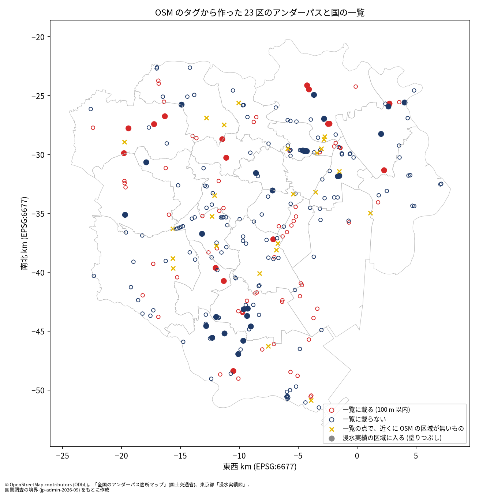

# OSM のタグから作った東京 23 区のアンダーパスと、国の一覧に載る箇所の比較

問い: OSM のタグから作った東京 23 区のアンダーパスのうち、国の一覧に載るのはどれだけで、一覧は東京都の浸水実績の区域に入る箇所に寄っているか。

## 結論

国の一覧を、アンダーパスの母集団としても、冠水の正解としても使うべきではないと考えます。OSM のタグから作ったアンダーパスのうち、一覧に載るのは 3 割ほどです。載るかどうかは、浸水の記録より、道路の格と長さで大きく分かれます。浸水実績の区域に入るアンダーパスの 6 割以上は、一覧に載っていません。

取り組んだのは、凍結の OSM で `tunnel` が yes か covered、または `layer` が負の道路を 15 m の緩衝でまとめ、23 区のアンダーパスの母集団を作ることです。国の一覧と冠水想定箇所の点が 100 m 以内にあるか、浸水実績の区域と交わるかを、それぞれのラベルにしました。判定の規則は流す前に固定しました。

### わかったこと

| # | 要点 | 数字 | 根拠 |
|---:|---|---|---|
| 1 | 国の一覧に載るのは、OSM のアンダーパスの 3 割ほど (C1 は支持) | 252 か所のうち 80 か所、31.7 % [26.3 %, 37.2 %] ([blocks.json](outputs/blocks.json)) | [図 1](#一覧に載るのは幹線の長いアンダーパスに偏る) |
| 2 | 載るかどうかは、道路の格と長さで大きく分かれる | trunk と primary は 77.2 %、それより細い道路は 5.7 %。長い 3 分の 1 は 63.1 %、短い 3 分の 1 は 6.0 % ([b4_by_kind.csv](outputs/b4_by_kind.csv)) | [図 1](#一覧に載るのは幹線の長いアンダーパスに偏る) |
| 3 | 一覧が浸水実績の区域に入る箇所に寄っているとは言えない (C2 は判定できない) | 区域に入る割合は、載る箇所 20.0 %、載らない箇所 16.3 %。差 0.037 [−0.067, 0.148] ([blocks.json](outputs/blocks.json)) | [定義と感度分析](#定義と感度分析) |
| 4 | 浸水実績の区域に入るアンダーパスの 6 割以上は、一覧に載らない (C3 は支持) | 区域に入る 44 か所のうち 63.6 % [47.2 %, 78.1 %] ([blocks.json](outputs/blocks.json)) | [図 1](#一覧に載るのは幹線の長いアンダーパスに偏る) |
| 5 | 冠水想定箇所は、国の一覧とほぼ同じ箇所を指す | 冠水想定箇所が 100 m 以内にある 69 か所のうち、67 か所は一覧にも載る ([blocks.json](outputs/blocks.json)) | - |

括弧は、区域の代表点を 2 km の格子の升に入れ、升を単位に引き直した 90 % 区間です。近い箇所は同じ雨と同じ排水の中にあるので、箇所を独立に数えていません。

### 読み手ごとに知っておきたいこと

| 読み手 | 結論 | 検討する材料 |
|---|---|---|
| アンダーパスの冠水を分析する人 | 国の一覧や冠水想定箇所を母集団や正解にすると、細い道路の短いアンダーパスがほとんど抜ける。一覧の中だけで比べた結果は、選ばれた側の中の違いにすぎない | 要点 2 の表 ([outputs/b4_by_kind.csv](outputs/b4_by_kind.csv)) |
| 区の道路と防災の担当 | 浸水実績の区域に入るのに一覧に載らないアンダーパスが 28 か所ある ([blocks.json](outputs/blocks.json))。一覧の外の点検の候補になる | 図 1 の紺の塗りつぶし |
| 分析を再現、反証する人 | 判定は計画の規則のまま。OSM の母集団は「タグの付いたもの」で、タグの無いガード下は入らない | [EXPERIMENT_PLAN.md](EXPERIMENT_PLAN.md)、[outputs/unmatched_list_points.csv](outputs/unmatched_list_points.csv) |

### 一覧に載るのは幹線の長いアンダーパスに偏る

図 1: 赤は国の一覧の点が 100 m 以内にあるアンダーパス、紺は無いアンダーパスです。塗りつぶしは、東京都の浸水実績の区域と交わるものです。黄の × は、一覧の点のうち 100 m 以内に OSM のアンダーパスが無いものです。紺の点は 23 区の全域に散らばり、塗りつぶしの紺 (浸水実績の区域に入るのに一覧に無いもの) も多くあります。

図の出典: © OpenStreetMap contributors (ODbL)。「全国のアンダーパス箇所マップ」(国土交通省)、東京都「浸水実績図」、国勢調査の境界 (jp-admin-2026-09) をもとに作成。

一覧の点のうち 24 点は、100 m 以内に OSM のアンダーパスがありません ([build_summary.json](outputs/build_summary.json)、[unmatched_list_points.csv](outputs/unmatched_list_points.csv))。名前を見ると、明神坂ガード下、宮益架道橋下、第一大久保ガードのような鉄道のガード下と、羽田空港トンネルのような長いトンネルの入口から離れた点が多くを占めます。

### 定義と感度分析

| 項目 | 主分析 | 代わりの定義 |
|---|---|---|
| 一覧に載る距離 | 100 m: 31.7 %、差 0.037 | 50 m: 29.8 %、差 0.055。200 m: 35.3 %、差 0.025 |
| 浸水実績の区域 | 区域と交わる: 区域に入る 44 か所のうち載らない 63.6 % | 30 m 以内: 差 −0.001、載らない 68.3 %。原因が内水の区域だけ: 差 −0.007、載らない 69.2 % |
| 母集団 | 主の道路 252 か所 | service の道路を足す 481 か所: 載る 17.3 %、差 0.08 [−0.009, 0.171] |
| ガード下 | 主の母集団に入れない | 鉄道の橋の下を通る道路 1,153 か所: 載る 4.3 % |

どの行でも、C1 は支持、C2 は判定できない、C3 は支持のままです ([blocks.json](outputs/blocks.json) の variants)。

## データ

| データ | 版 | 使ったこと |
|---|---|---|
| osm-tokyo23-src-2026-08 | 38f7a5f の planet_osm_line (OSM 2026-08-31) | アンダーパスの母集団 (主 489 本の道路から 252 か所)、ガード下の候補 |
| mlit-underpass | 4d00072 (国土交通省「全国のアンダーパス箇所マップ」、2025-03-31 時点) | 23 区の 99 点 |
| mlit-kansui-flood-prone-points-jp-2026-09 | d4e2e1f | 東京都の冠水想定箇所 135 点 |
| tokyo-flood-record-jp | 354b0d9 の flood_area (5,845 行、1974〜2019 年) | 浸水実績の区域 |
| jp-admin-2026-09 | e6c87b1 の 23 区の面 | 範囲 |

件数は [outputs/build_summary.json](outputs/build_summary.json) にあります。出典の表示: © OpenStreetMap contributors (ODbL)。「全国のアンダーパス箇所マップ」(国土交通省) をもとに作成。東京都「浸水実績図」を加工して作成。

## 方法

- 母集団: OSM の道路のうち、trunk、primary、secondary、tertiary とその link、unclassified、residential、living_street で、`tunnel` が yes か covered、または `layer` が負のもの。EPSG:6677 で 15 m 広げて和をとり、つながった面を 1 か所としました。評価の課題 28 と同じ作り方です。
- ラベル: 国の一覧と冠水想定箇所は、点が面から 100 m 以内なら載るとしました。浸水実績は、全ての年と原因の区域の面が交われば入るとしました。
- 事前の判定基準: 計画は流す前に固定しました ([EXPERIMENT_PLAN.md](EXPERIMENT_PLAN.md))。要点 1 は C1、要点 3 は C2、要点 4 は C3 に当たります。要点 2 と 5 は、計画で判定をしない記述として決めた区画 B4 と、冠水想定箇所の集計です。記録: [EXPERIMENT_TRACKER.md](EXPERIMENT_TRACKER.md)。
- 道路の格は、区域に含まれる道路のうち最も格の高いもの、長さは区域の中の道路の長さの三分位です。

## 確かめていないこと

OSM の `tunnel` や負の `layer` の道路が、一覧の定義 (前後の区間より急に低くなる区間) に当たるかは確かめていません。細い道路のもの (区域の中の道路の長さの中央値 25.3 m) には、建物の下を抜ける通路や、低くならずに構造物の下を通るだけの道路が含まれているはずで、その割合は分かりません。一覧に載る割合が 3 割という数字は、この母集団の作り方に左右されます。

浸水実績は建物の浸水の調査の区域で、道路の冠水の記録ではありません。区域に入ることは、周りが浸水したことを意味するだけです。また、浸水実績は 2019 年までで、一覧は 2025-03-31 時点です。

一覧に載せる箇所の選び方は、配布元に書かれていません。道路の格で分かれることは、管理者 (国、都、区) ごとに載せ方が違うことでも、危ない箇所を選んだ結果でも説明でき、どちらかは分けられていません。

このプロジェクトの母集団は、評価の課題 28 (OSM から 23 区のアンダーパスを推測する) の答えにほぼ当たります。課題 28 を、このプロジェクトを含む版の作業場所で流すと、答えが漏れます。
