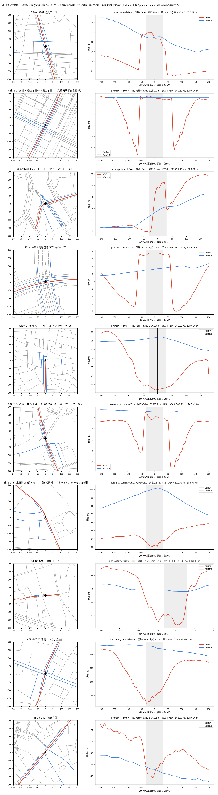

# 公開の標高と道路で測るアンダーパスの溜まりやすさの順位

## 問い

全国のアンダーパス 3,841 か所で、公開の標高タイルと OSM の道路から測った溜まりやすさの順位は、標高タイルが窪みを捉えているか、設定でどれだけ変わり、浸水や冠水の記録とどの程度合うか。

## 結論

要点は次のとおり。

| 主張 (流す前の予想) | 結果 | 判定 |
|---|---|---|
| C1: 標高タイルが 2 m 以上の窪みを捉える箇所は半分に満たない | 全ての箇所の 31% (1,189 / 3,841)。測れた箇所の 37% | 支持 |
| C2: 設定を変えると上位 10% の半分以上が入れ替わる | 変えた 6 つのうち 3 つで重なりが 0.5 未満。ただし 2 つは区間が 0.5 をまたぐ | 規則の上では支持、際どい |
| C3: 順位は東京都の浸水実績と区別できない | AUC 0.57 [0.43, 0.70]、140 か所、陽性 15 | 支持 (区別できない) |
| C4: 順位は箇所表の冠水の実績とも区別できない | 府県ごとの AUC の重みつき平均 0.61 [0.57, 0.64]、11 府県 835 か所 | 退けた (弱いが合う) |

読み手ごとに言えることは次のとおり。

| 読み手 | 言えること |
|---|---|
| 道路管理者 | 公開の DEM5A で 2 m 以上の掘り込みが見える箇所は約 3 割。見える箇所の深さの順位は、近畿などで箇所表に冠水の実績が書かれた箇所とわずかに合う (AUC 0.61)。1 つの順位で優先順位を決めるには、設定による入れ替わりが大きい |
| データを集める人 | DEM10B は掘り込みをほとんど写さない。DEM5A の無い箇所は、この方法では測れない。覆いや構造物の下の路面はどちらにも写らない |
| 次の研究 | 道路の縦断をつなぐ規則が、506 か所で片側 50 m に届かなかった。測れない理由の大半は標高ではなく道具の側にある |

### C1: 窪みを捉えた箇所

- 2 m 以上の窪みが写ったのは 1,189 か所 (全ての 31%、測れた 3,256 か所の 37%)。
- ほぼ全てが DEM5A による。DEM5A で測れた 3,148 か所のうち 1,188 か所、DEM10B しか使えなかった 108 か所のうち 1 か所。
- 閾値を 1 m にすると 48%、3 m にすると 17% (全ての箇所に対して)。どの閾値でも半分に届かない。
- 地方ごとの、測れた箇所に対する割合は、1 か所だけの沖縄を除いて 31%〜54% (北海道 25 / 46、関東 321 / 815、近畿 200 / 647)。

### C2: 設定による入れ替わり

主の設定 (DEM5A があれば DEM5A、L = 100 m、深さ) の上位 10% との重なり (|A ∩ B| / |A|) は次のとおり。

| 変えた設定 | 箇所 | 重なり | 90% 区間 | Jaccard |
|---|---:|---:|---|---:|
| DEM10B だけ | 3,255 | 0.11 | 0.08〜0.14 | 0.06 |
| 面の方法 (最も単純な解法) | 3,254 | 0.37 | 0.33〜0.41 | 0.22 |
| L = 50 m | 3,256 | 0.49 | 0.45〜0.53 | 0.33 |
| 深さと集水の面積 | 3,255 | 0.50 | 0.46〜0.54 | 0.33 |
| L = 200 m | 2,794 | 0.56 | 0.53〜0.62 | 0.39 |
| DEM5A だけ | 3,148 | 1.00 | | 1.00 |

- 「DEM5A だけ」の 1.00 は、主の設定が DEM5A の使える所で DEM5A を使うため、同じ得点を比べている。安定の証拠ではない (設計の重なり)。
- 計画の規則 (半分以上の設定で 0.5 未満) は満たす (6 つのうち 3 つ)。ただし L = 50 m は区間が 0.5 をまたぎ、深さと集水の面積はちょうど 0.50 で、判定は点の推定の側に寄っている。はっきり入れ替わるのは、DEM10B と面の方法。
- 反証の条件 (全ての Jaccard ≥ 0.7 と、C1 の割合 ≥ 0.8) はどちらも満たさない。単純な標高差で足りるとは言えないので、この候補は落とさない。

### C3: 東京都の浸水実績

- 測れた東京都の 140 か所のうち、浸水実績の面か点から 30 m 以内は 15 か所。AUC 0.57、90% 区間 0.43〜0.70 で、0.5 と区別できない。
- 距離を 0 m、100 m にしても、強い雨 (最寄りの観測所の日最大 1 時間 30 mm、50 mm 以上) の日に絞っても、区間は 0.5 を含む。
- 1997 年以降に絞ると陽性が 2 か所だけで、AUC 0.97 は評価にならない。

### C4: 箇所表の冠水の実績

- 実績の手がかりが陽性と陰性の両方に 3 以上ある 11 府県の 835 か所 (陽性 303)。府県の中で比べた AUC の重みつき平均 0.61、90% 区間 0.57〜0.64。予想に反して、深さの順位は実績の書かれた箇所とわずかに合う。
- 北陸の「1m以上の冠水」の欄は、掘り込みが深ければ有になりやすい。これを外して文章の実績だけにすると、9 府県 594 か所 (陽性 180) で 0.60 [0.55, 0.64]。合う向きは、その欄だけから来てはいない (探索)。
- 排水ポンプと水位センサーの有無に対する AUC は 0.52、0.54 (記述。設備は対策の結果でもあり、向きを解釈しない)。

### 計画の変更 (目視の後に足した規則)

東京都の 10 か所の縦断を図にしたところ、4 か所で点の上は覆いや構造物で高く写り、50〜80 m 離れた両側のアプローチだけが低く写っていた (図 1)。計画の規則は底を点から ±30 m で探すので、これらを浅いとする。判定は計画の規則のまま行い、底を縦断の全体で探す規則を探索として並べた。

| 主張 | 計画の規則 | 縦断の全体で探す規則 (探索) |
|---|---|---|
| C1 (全ての箇所に対する割合) | 0.31 | 0.32 |
| C2 (重なりが 0.5 未満の設定) | 3 / 6 | 4 / 6 (L = 200 m が 0.49 に下がる) |
| C3 (AUC) | 0.57 [0.43, 0.70] | 0.56 [0.43, 0.70] |
| C4 (AUC) | 0.61 [0.57, 0.64] | 0.60 [0.57, 0.64] |

点では低く写らず、離れた所にだけ 2 m 以上の掘り込みが写る箇所は 98 か所 (測れた箇所の約 3%)。C1、C3、C4 の判定はどちらの規則でも同じ。C2 は探索の規則のほうが入れ替わりが大きい。

図 1: 無作為に選んだ東京都の 10 か所 (種 0)。左は OSM の道路 (赤が下を通る道路として選んだ線、青が 50 m 以内の他の候補、灰色の破線が橋)、右はその縦断の標高 (赤 DEM5A、青 DEM10B)。DEM10B は掘り込みを写さない。徳丸、八重洲、湾岸道路下、南千住では、点の上が高く、両側のアプローチだけが低い。

### 読み方で変わる答え

| 読み方 | 変わること |
|---|---|
| 窪みの閾値 1 m と 3 m | C1 の割合が 48% と 17%。半分に届かないことは同じ |
| 対応の距離 15 m と 50 m | C1 の割合 31%、C2 の重なり、C3 の AUC はほぼ同じ |
| tunnel の付いた線を外す | 1,627 か所が外れ、残りで測れた 1,818 か所のうち 565 か所が窪みを捉える。日本の OSM は掘り込みの区間にも tunnel を付けるので、外す読み方は本当のトンネルだけを外さない |
| 上位 5%、20% | 5% では重なりが下がり (L = 200 m 0.46)、20% では上がる (L = 200 m 0.74)。DEM10B と面の方法は、どちらでも低い |

## データ

| データ | 版 | 使ったこと |
|---|---|---|
| mlit-underpass | 4d00072 (地図は 2025-03-31) | 3,841 か所の点 |
| osm-japan-src-2026-08 | 9a9b4a7 (2026-08-31) | highway の線。点から 400 m の 530,211 本を切り出した |
| 国土地理院の標高タイル | 2026-10-31 取得 (版の番号なし)。DEM5A z15 7,198 枚 (404 は 98)、DEM10B z14 3,885 枚 | 縦断と面の標高、集水 |
| tokyo-flood-record-jp | 354b0d9 | C3 の陽性 |
| jma-rain-tokyo | 4391f76 | C3 の強い雨の読み方 |
| mlit-kansui-flood-prone-points-jp-2026-09、pdf | d4e2e1f、34e24d0 | C4 の陽性 |

## 方法

- 道路への対応: 点から 30 m 以内の最も近い道路の線 (橋と layer が正の線を除く)。向きが 45 度以内で続く線をつないで縦断にした。対応できたのは 3,767 か所。近くに向きの違う別の線がある「曖昧」は 1,754 か所で、最も近い線を使った。
- 深さ: 縦断に沿って 2.5 m おきに標高を読み、点から ±30 m の最低を底、その両側の最大の小さいほうを堰として、堰 − 底。標高の無い標本が 10% を超えるか、片側が L / 2 に届かない箇所は「測れない」とし、深さ 0 にしない。
- 集水の面積: 点の周り 300 m の窓で最急降下の向きに流し、底から 15 m 以内で止まる画素の面積。窪みは埋めない。
- 区間: 箇所の引き直し 1,000 回 (C4 は府県の中で引き直す) の 5% 点と 95% 点。
- 計画: [EXPERIMENT_PLAN.md](EXPERIMENT_PLAN.md) (流す前に固定、変更は表に記録)。記録: [EXPERIMENT_TRACKER.md](EXPERIMENT_TRACKER.md)。結果: [outputs/blocks.json](outputs/blocks.json)。

## 確かめていないこと

- 標高タイルの地表が路面を表すか。図 1 のように、覆いや構造物の下の路面は写らない。DEM5A が掘り込みを写した箇所でも、写った深さが路面の深さかは現地と照らしていない。Mapterhorn の日本の範囲には国土地理院の 1 m DEM があり、写り方が変わるかは試していない。
- 箇所表の実績の手がかりは、局と府県の書き方で決まる。書かれていない箇所は冠水しなかった箇所ではない。C4 の合う向きは、深い箇所ほど実績を書く書き方の違いでも説明できる。
- 浸水実績は建物の浸水の調査で、道路の冠水ではない。C3 は陽性が 15 か所しかなく、区別できないことは、合わないことの証拠ではない。
- 縦断をつなぐ規則は、交差点で 45 度より曲がる道路や、途中の節点でつながる線を追わない。測れない 511 か所のうち 506 か所はこのために片側が 50 m に届かなかった。
- 得点は物理的な溜まりやすさの順位で、冠水の確率、事故の起こりやすさ、排水の能力ではない。
