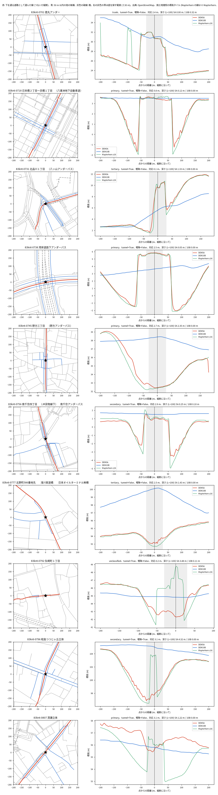

# 公開の標高タイルと道路データによる、全国のアンダーパスの窪みの深さの測定と冠水記録との照合

問い: 全国のアンダーパス 3,841 か所で、公開の標高タイルと OSM の道路から測った窪みの深さの順位は、標高タイルが窪みを捉えているか、設定でどれだけ変わり、浸水や冠水の記録とどの程度合うか。

## 結論

公開の標高タイルだけで、全国のアンダーパスの冠水対策の優先順位を決めることはできないと考えます。2 m 以上の窪みが写るのは全体の 3 割ほどで、覆いや構造物の下の路面はどの標高タイルにも写りません。窪みの深さの順位は、設定を変えると上位が大きく入れ替わり、冠水の記録とはわずかにしか合いません。窪みが写る 3 割を候補の絞り込みに使い、残りは現地の測量や冠水の記録を集めて判断するのがよいと考えます。

取り組んだのは、全国のアンダーパスの点ごとに、下を通る道路を OSM から選び、その道路に沿った縦断の標高から窪みの深さを測ることです。標高タイルは国土地理院の DEM5A と DEM10B を使い、後から Mapterhorn の約 1 m の標高タイルでも測り直しました。深さの順位を、東京都の浸水実績と、国の冠水想定箇所の箇所表に書かれた冠水の実績と照らしました。

### わかったこと

| # | 要点 | 数字 |
|---:|---|---|
| 1 | 2 m 以上の窪みが写るのは、全体の 3 割ほど | 全ての箇所の 31% (1,189 / 3,841)、測れた箇所の 37% |
| 2 | 窪みが写るのは、ほぼ DEM5A のある箇所だけ | DEM10B しか使えなかった箇所では 108 か所中 1 か所 |
| 3 | 覆いや構造物の下の路面は、どの標高タイルにも写らない | 東京都の 10 か所のうち 4 か所で点の上が高く写る。約 1 m の Mapterhorn でも同じ |
| 4 | 設定を変えると、深さの上位 10% が大きく入れ替わる | 6 つの設定のうち 3 つで重なりが 0.5 未満。DEM10B だけでは 0.11 |
| 5 | 東京都の浸水実績とは、区別できない | ROC AUC 0.57 [0.43, 0.70]、140 か所、陽性 15 |
| 6 | 箇所表に冠水の実績が書かれた箇所とは、わずかに合う | ROC AUC 0.61 [0.57, 0.64]、11 府県 835 か所、陽性 303 |

窪みの深さは、道路に沿った縦断で、点から ±30 m の最低の標高 (底) と、その両側の最も高い所のうち低いほう (堰) との差です。縦断の片側が 50 m に届かない箇所や、標高の無い区間が多い箇所は「測れない」として数えました。重なりは、ある設定の上位 10% のうち、主の設定の上位 10% にも入る割合です。ROC AUC は、深い順に並べたとき、記録のある箇所が記録の無い箇所より上に来る確率で、0.5 なら区別できません。括弧は、箇所を引き直した 90% 区間です。

### 読み手ごとに知っておきたいこと

| 読み手 | 結論 | 検討する材料 |
|---|---|---|
| 道路管理者 | 公開の DEM5A で 2 m 以上の掘り込みが見える箇所は約 3 割。深さの順位は、箇所表に冠水の実績が書かれた箇所とわずかに合う (ROC AUC 0.61)。1 つの順位で優先順位を決めるには、設定による入れ替わりが大きい | 設定ごとの重なりの表、府県ごとの ROC AUC ([outputs/blocks.json](outputs/blocks.json)) |
| データを集める人 | DEM10B は掘り込みをほとんど写さない。DEM5A の無い箇所は、この方法では測れない。覆いや構造物の下の路面は、約 1 m の標高タイルにも写らない | 図 1、図 2 |
| 分析を再現、反証する人 | 測れない 511 か所のうち 506 か所は、縦断の片側が 50 m に届かなかった。理由の大半は、道路が曲がるか橋に続くことにある | 縦断が止まる理由の表 |

### 公開の標高タイルで 2 m 以上の窪みが写るのは、全体の 3 割ほど

2 m 以上の窪みが写ったのは 1,189 か所で、全ての箇所の 31%、測れた 3,256 か所の 37% です。ほぼ全てが DEM5A によるもので、DEM5A で測れた 3,148 か所のうち 1,188 か所、DEM10B しか使えなかった 108 か所のうち 1 か所でした。

窪みとみなす深さを 1 m にすると 48%、3 m にすると 17% です (全ての箇所に対して)。どの深さでも、半分には届きません。地方ごとの、測れた箇所に対する割合は、1 か所だけの沖縄を除いて 31%〜54% です (北海道 25 / 46、関東 321 / 815、近畿 200 / 647)。

### 覆いや構造物の下の路面は、どの標高タイルにも写らない

東京都の 10 か所を無作為に選んで縦断を図にしたところ、4 か所 (徳丸、八重洲、湾岸道路下、南千住) で、点の上は覆いや構造物で高く写り、50〜80 m 離れた両側のアプローチだけが低く写っていました (図 1)。底を点から ±30 m で探す主の規則では、これらを浅いとします。

図 1: 無作為に選んだ東京都の 10 か所 (種 0) です。左は OSM の道路で、赤が下を通る道路として選んだ線、青が 50 m 以内の他の候補、灰色の破線が橋です。右はその縦断の標高で、赤が DEM5A、青が DEM10B です。DEM10B は掘り込みを写しません。

図の出典 (図 1、図 2): © OpenStreetMap contributors (ODbL)、国土地理院 標高タイル (DEM5A、DEM10B)、Mapterhorn (標高タイル、版 0.0.13) を加工して作成。

約 1 m の Mapterhorn の標高タイルでも、覆いの下は写りませんでした (図 2)。東京都の 10 か所では、Mapterhorn はほぼ DEM5A と同じ形で、覆いのある 4 か所は点の上が高いままです。矢崎町では窪みの中に構造物のような高まりを写し、清瀬では DEM5A よりアプローチを数 m 低く写していて、2 つが食い違います。

図 2: 図 1 と同じ 10 か所に、Mapterhorn z16 の縦断 (緑) を足しました。

底を縦断の全体で探す規則でも、点では低く写らず、離れた所にだけ 2 m 以上の掘り込みが写る箇所は 98 か所でした。

### 設定を変えると、深さの上位 10% が大きく入れ替わる

主の設定 (DEM5A があれば DEM5A、縦断の長さ L = 100 m、深さだけで並べる) の上位 10% と、設定を変えた上位 10% の重なりは次のとおりです。

| 変えた設定 | 箇所 | 重なり | 90% 区間 | Jaccard |
|---|---:|---:|---|---:|
| DEM10B だけ | 3,255 | 0.11 | 0.08〜0.14 | 0.06 |
| 面の方法 (点の周りの面の標高差で測る) | 3,254 | 0.37 | 0.33〜0.41 | 0.22 |
| L = 50 m | 3,256 | 0.49 | 0.45〜0.53 | 0.33 |
| 深さと集水の面積で並べる | 3,255 | 0.50 | 0.46〜0.54 | 0.33 |
| L = 200 m | 2,794 | 0.56 | 0.53〜0.62 | 0.39 |
| DEM5A だけ | 3,148 | 1.00 | | 1.00 |

「DEM5A だけ」の 1.00 は、主の設定が DEM5A の使える所で DEM5A を使うため、同じ得点を比べているだけです。安定の証拠ではありません。

6 つのうち 3 つで重なりが 0.5 未満ですが、L = 50 m は区間が 0.5 をまたぎ、深さと集水の面積はちょうど 0.50 です。はっきり入れ替わると言えるのは、DEM10B だけと面の方法です。

### 窪みの深さの順位は、冠水の記録とはわずかにしか合わない

東京都の浸水実績とは区別できません。測れた東京都の 140 か所のうち、浸水実績の面か点から 30 m 以内は 15 か所で、ROC AUC は 0.57 [0.43, 0.70] です。距離を 0 m、100 m にしても、強い雨 (最寄りの観測所の日最大 1 時間 30 mm、50 mm 以上) の日に絞っても、区間は 0.5 を含みます。1997 年以降に絞ると陽性が 2 か所だけで、ROC AUC 0.97 は評価になりません。

箇所表とは、わずかに合います。箇所表の冠水の実績の手がかりが、陽性と陰性の両方に 3 以上ある 11 府県の 835 か所 (陽性 303) で、府県の中で比べた ROC AUC の重みつき平均は 0.61 [0.57, 0.64] です。北陸の「1m以上の冠水」の欄は、掘り込みが深ければ有になりやすい欄です。これを外して文章の実績だけにすると、9 府県 594 か所 (陽性 180) で 0.60 [0.55, 0.64] でした。合う向きは、その欄だけから来てはいません。排水ポンプと水位センサーの有無に対する ROC AUC は 0.52、0.54 です。設備は対策の結果でもあるので、向きは解釈しません。

### 測れない箇所の多くは、道路のつながり方による

測れない 511 か所のうち 506 か所は、縦断の片側が 50 m に届きませんでした。途中の節点でつながる道路もたどるようにすると、測れる箇所は 3,256 から 3,304 に増えますが、2 m 以上の窪みが写る割合は全体の 31% (0.311)、東京都の浸水実績との ROC AUC は 0.55 [0.41, 0.69] で、答えは変わりません。

それでも片側が 50 m に届かない 458 か所の止まる理由は次のとおりです ([outputs/chain_stops_vertices.json](outputs/chain_stops_vertices.json))。

| 縦断が止まる理由 | 箇所 |
|---|---:|
| 45 度より曲がる | 275 |
| 橋に続く | 144 |
| 別の種類の道に続く | 22 |
| 行き止まり | 17 |

橋の上の路面は標高タイルに写らないので、つなぎ方を変えても測れるようにはなりません。

### 定義と感度分析

| 項目 | 主分析 | 代わりの定義 |
|---|---|---|
| 窪みとみなす深さ | 2 m。全体の 31% | 1 m で 48%、3 m で 17%。半分に届かないことは同じ |
| 底を探す範囲 | 点から ±30 m | 縦断の全体: 全体の 32%、入れ替わる設定は 4 / 6 (L = 200 m が 0.49 に下がる)、浸水実績との照合 0.56 [0.43, 0.70]、箇所表との照合 0.60 [0.57, 0.64] |
| 道路への対応の距離 | 30 m | 15 m と 50 m: 窪みの割合 31%、重なり、ROC AUC はほぼ同じ |
| tunnel の付いた線 | 含める | 外すと 1,627 か所が外れ、残りで測れた 1,818 か所のうち 565 か所が窪みを捉える。日本の OSM は掘り込みの区間にも tunnel を付けるので、外しても本当のトンネルだけが外れるわけではない |
| 上位の範囲 | 10% | 5% では重なりが下がり (L = 200 m 0.46)、20% では上がる (L = 200 m 0.74)。DEM10B と面の方法は、どちらでも低い |
| 縦断のつなぎ方 | 端点でつながる道路だけ | 途中の節点も: 測れる箇所 3,304、全体の 31% (0.311)、浸水実績との照合 0.55 [0.41, 0.69]、箇所表との照合 0.61 [0.57, 0.64] |
| 標高タイル | DEM5A、無ければ DEM10B | Mapterhorn z16: 測れる箇所 2,874、全体の 30% (0.305)、測れた箇所の 41%、主の設定との重なり 0.62、浸水実績との照合 0.53 [0.38, 0.65]、箇所表との照合 0.60 [0.56, 0.64] |

Mapterhorn で測れる箇所が少ないのは、タイルの欠けのためです。取れたのは 9,915 枚で、1,330 枚は 404 でした。DEM5A で測れて Mapterhorn で測れない 381 か所は、全て周りに 404 のタイルがあります ([outputs/mt_lost_measurable.txt](outputs/mt_lost_measurable.txt))。DEM5A で測れず Mapterhorn で測れたのは 107 か所です。両方で測れた 2,767 か所では、2 m 以上の窪みが両方に写るのが 904、Mapterhorn だけ 231、DEM5A だけ 143 でした。

## データ

| データ | 版 | 使ったこと |
|---|---|---|
| mlit-underpass | 4d00072 (地図は 2025-03-31) | 3,841 か所の点 |
| osm-japan-src-2026-08 | 9a9b4a7 (2026-08-31) | highway の線。点から 400 m の 530,211 本を切り出した |
| 国土地理院の標高タイル | 2026-10-31 取得 (版の番号なし)。DEM5A z15 7,198 枚 (404 は 98)、DEM10B z14 3,885 枚 | 縦断と面の標高、集水 |
| tokyo-flood-record-jp | 354b0d9 | 東京都の浸水実績の陽性 |
| jma-rain-tokyo | 4391f76 | 強い雨の日に絞った場合 |
| mlit-kansui-flood-prone-points-jp-2026-09、pdf | d4e2e1f、34e24d0 | 箇所表の冠水の実績の陽性 |
| Mapterhorn | 0.0.13 (2026-10-31 取得)。z16 9,915 枚 (404 は 1,330) | 約 1 m の標高タイルでの縦断 |

## 方法

- 道路への対応: 点から 30 m 以内の最も近い道路の線 (橋と layer が正の線を除く) を、下を通る道路としました。向きが 45 度以内で続く線をつないで縦断にしました。対応できたのは 3,767 か所です。近くに向きの違う別の線がある「曖昧」な箇所は 1,754 か所で、最も近い線を使いました。
- 深さ: 縦断に沿って 2.5 m おきに標高を読み、堰 − 底を求めました。標高の無い標本が 10% を超えるか、片側が L / 2 に届かない箇所は「測れない」とし、深さ 0 にはしていません。
- 集水の面積: 点の周り 300 m の窓で最急降下の向きに流し、底から 15 m 以内で止まる画素の面積です。窪みは埋めていません。
- 区間: 箇所を 1,000 回引き直した 5% 点と 95% 点です。箇所表との照合は、府県の中で引き直しました。
- 計画は流す前に固定しました ([EXPERIMENT_PLAN.md](EXPERIMENT_PLAN.md))。わかったことの要点 1 と 2 は計画の C1、要点 4 は C2、要点 5 は C3、要点 6 は C4 に当たります。計画の判定は、C1 支持、C2 は基準の上では支持だが際どい、C3 支持 (区別できない)、C4 退ける (弱いが合う) です。底を縦断の全体で探す規則は目視の後に、文章の実績だけの照合、縦断のつなぎ方、Mapterhorn は結果の後に足した探索で、どれも判定には使っていません。変更は計画の末尾の表に記録しました。記録: [EXPERIMENT_TRACKER.md](EXPERIMENT_TRACKER.md)。結果: [outputs/blocks.json](outputs/blocks.json)、[outputs/blocks_vertices.json](outputs/blocks_vertices.json)、[outputs/blocks_mt.json](outputs/blocks_mt.json)。

## 確かめていないこと

標高タイルの地表が路面を表すかは確かめていません。図 1、図 2 のように、覆いや構造物の下の路面は写りません。DEM5A が掘り込みを写した箇所でも、写った深さが路面の深さかは現地と照らしていません。Mapterhorn z16 の画素が 1 m、5 m、10 m のどの DEM から来たかは、タイルに書かれておらず、確かめていません。

箇所表の実績の手がかりは、局と府県の書き方で決まります。書かれていない箇所は、冠水しなかった箇所ではありません。箇所表とわずかに合う向きは、深い箇所ほど実績を書くという書き方の違いでも説明できます。

浸水実績は建物の浸水の調査で、道路の冠水ではありません。東京都の照合は陽性が 15 か所しかなく、区別できないことは、合わないことの証拠ではありません。

窪みの深さは物理的な溜まりやすさの順位で、冠水の確率、事故の起こりやすさ、排水の能力ではありません。
