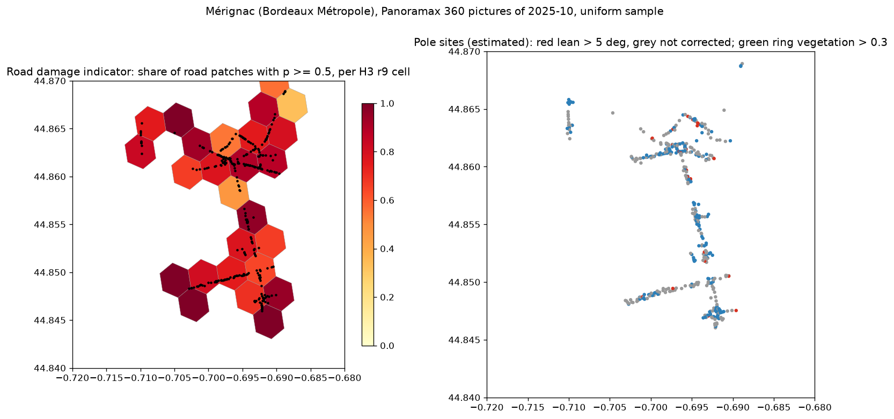

# メリニャック (ボルドー都市圏) の通りの画像から柱と路面を測る (オープンデータ版 Street View Insights)

## 問い

オープンな 360 度の通りの画像から、柱 (電柱、街灯) の傾きと、柱にかかる植生と、路面の損傷と材質を測り、地図と格子の集計にできるか。測った値は、画像を目で見た判定と、公開の損傷データと、OpenStreetMap とどれだけ合うか。

## 結論

Panoramax の Bordeaux Métropole の 360 度画像 (2025 年 10 月撮影) で、範囲の 3,982 枚から一様に選んだ 300 枚に、手順を最後まで流した ([fetch_audit.json](outputs/fetch_audit.json))。流すことはできたが、確かめた結果、この画像で当たりを確かめられたのは柱の検出 (40 中 32) だけだった。柱の位置は照合できるデータが無く、傾き、植生、損傷、材質はこの画像では使えなかった。

| 要点 | 値 | 出どころ |
|---|---|---|
| 柱の検出 | 1,200 の画像から細長い柱の枠 928、位置を推定したもの 858、まとめた柱の場所 446 | [poles_audit.json](outputs/poles_audit.json) |
| 柱の検出の当たり | 一様に選んだ 40 の枠のうち、柱だったもの 32、柱でないもの (木、フェンス、標識の枠) 6、判断できないもの 2 | [review_summary.json](outputs/review_summary.json) |
| 柱の傾き | 補正できた 373 枠の傾きの中央値は 1.16 度、5 度を超えたもの 36。目で見た 40 枠に、傾いて見える柱は 0 で、5 度を超えた 3 枠は全て誤り | [summary.json](outputs/summary.json)、[review_summary.json](outputs/review_summary.json) |
| 植生 | 葉が柱の上部に重なって見えた 2 枠で、植生の割合は 0.3 を超えなかった (全ての枠で超えたものは 0) | [review_summary.json](outputs/review_summary.json) |
| 損傷のプローブ (公開データでの試験) | チェコの写真単位の試験で AUC 0.957、学習に使っていない米国で AUC 0.967 | [damage_train.json](outputs/damage_train.json)、[damage_eval_united_states.json](outputs/damage_eval_united_states.json) |
| 損傷のプローブ (この画像) | 300 枚のうち 263 枚で、路面のパッチの半分以上を損傷とした。目で見て、ひびの見える 7 枚は 7 枚とも、見えない 26 枚のうち 21 枚も損傷とした | [summary.json](outputs/summary.json)、[review_summary.json](outputs/review_summary.json) |
| 材質 (ゼロショット) | OSM の surface のある 265 枚は全てアスファルトで、モデルは 189 枚をコンクリートとした。一致 0.377 に対し、全てをアスファルトと答える基準は 1 | [material_vs_osm.json](outputs/material_vs_osm.json) |
| 柱の位置の照合 | 範囲の OSM には街灯 38、鉄塔 2 しか無く、電柱が無い。照合できない | [poles_vs_osm.json](outputs/poles_vs_osm.json) |

- 損傷のプローブは、公開の損傷データでは国をまたいでも当たるのに、この画像ではほぼ全てを損傷とした。学習した画像 (スマートフォンの前向き、明るい) と、この画像 (Ladybug の 360 度から切り出した帯、灰色がかって低い解像度) の違いと読める。左の地図の色の違いは、路面の状態の違いとして読まない。
- 柱の傾きは、補正 (同じ画像の縦の線の中央値を引く) をしても、5 度を超える誤りが残った。補正できない枠 (周りに縦の線が足りない) が 347 ある ([summary.json](outputs/summary.json))。傾きの角度を現地で測ったデータが無いので、角度の精度は測れない。
- 植生の指標 (2G − R − B > 20) は、この灰色がかった画像では葉をほとんど拾わない。
- PCI は出していない。現地で測った PCI と同じ場所の画像の組が、オープンデータに見つからなかった。

## データ

- 画像: Panoramax (api.panoramax.xyz、キー不要)、撮影者 Bordeaux Métropole、カメラ Ladybug、360 度、2025-09-01 以降の撮影、範囲は経度 -0.72〜-0.68、緯度 44.84〜44.87。範囲の 3,982 枚から種 20261112 で 300 枚。hd (7022 × 3511)。ライセンス etalab-2.0 (画像ごとにマニフェストに記録)。この報告の一覧の画像 (review_*_sheet.jpg) は、その画像を切り出したもの (出典: Bordeaux Métropole / Panoramax、etalab-2.0)。
- 損傷の学習と試験: RDD2022 (CC BY 4.0、figshare 21431547) のチェコ (2,829 枚) と米国 (4,805 枚)。
- 照合: OpenStreetMap (ODbL)、自前の Overpass (データ時刻 2025-09-14T23:59:55Z) の道路の surface と、power=pole、power=tower、highway=street_lamp。
- モデル: OWLv2 (google/owlv2-base-patch16-ensemble、Apache-2.0)、OpenCLIP ViT-B-32 (laion2b_s34b_b79k、MIT)。

## 方法

1. `panoramax_fetch.py` で範囲の全ての画像を区画ごとに数え、撮影者、360 度、撮影日で絞り、一様に 300 枚を選んだ。
2. 柱: 各画像から水平な 4 方向 (画角 90 度、1024 × 1024) を切り出し、OWLv2 (「a utility pole」「a street light pole」「a telegraph pole」、閾値 0.15) で枠を出し、縦横比 3 以上で高さが画像の 15% 以上の枠を残した。傾きは、枠の中の縦に近い線分の角度から、枠の外の長い縦の線の角度の中央値を引いた ([views-and-geometry](../../../.agents/skills/street-imagery-inspection/references/views-and-geometry.md))。位置は、足の俯角とカメラの高さ 2.5 m (仮定) から距離を出し、撮影の向きと合わせて推定し、4 m 以内をまとめた。
3. 損傷: RDD2022 のチェコで、損傷の枠と、損傷の無い路面の正方形を OpenCLIP で埋め込み、ロジスティック回帰を学習した (写真単位の 5 分割で試験)。米国の全ての写真で、学習し直さずに試験した。画像には、前方、ピッチ -15 度、画角 70 度の画像の、地平線と車体のあいだの帯 (高さの 0.36〜0.64、幅の 0.2〜0.8) を 3 つのパッチに分けて当てた。
4. 材質: 同じ帯を OpenCLIP のゼロショットで 4 つに分け、写真から 12 m 以内の車の通る道の OSM の surface と比べた。
5. 目で確かめる: 結果を見る前に決めた種で、路面の帯 40 枚と柱の枠 40 個を一様に選び、結果を描いた一覧 ([review_road_sheet.jpg](outputs/review_road_sheet.jpg)、[review_pole_sheet.jpg](outputs/review_pole_sheet.jpg)) を作った。判定は Claude (Opus 5.5、画像を読む AI) が一覧を見て付けた。人の判定ではない ([review_road.csv](outputs/review_road.csv)、[review_poles.csv](outputs/review_poles.csv))。

## 失敗の型

| 型 | 判定 | 根拠 |
|---|---|---|
| F1 | 確かめた | 画像の数え上げと標本 ([fetch_audit.json](outputs/fetch_audit.json))、柱の枠の数を段ごとに数えた ([poles_audit.json](outputs/poles_audit.json)) |
| F2 | 確かめた | 材質を、全てをアスファルトと答える基準と並べ、基準より悪いことを示した |
| F3 | 確かめた | 損傷のプローブは写真単位で分け、学習と試験に同じ写真が入らないことを数えた。米国は学習に使っていない |
| F4 | 確かめた | 公開データで高い AUC のプローブが、この画像ではほぼ全てを損傷とした。正と負のパッチの大きさの違いに頼っている部分は分けていない |
| F5 | 確かめた | 損傷の割合の地図の濃淡を、路面の状態の違いとして読まないと書いた |
| F6 | 確かめた | 報告の設定 (画角、帯、閾値、カメラの高さ、種) は `scripts/run.py` とスキルのスクリプトと同じ |
| F7 | 確かめていない | 帯の位置と画角を変えたときの損傷の結果は試していない |
| F8 | 確かめた | 表の数字は全て outputs のファイルへリンクした |
| F9 | 確かめた | 撮影者、機材、撮影日で絞り、画像ごとのライセンスとハッシュをマニフェストに残した |

## 確かめていないこと

- 目で見た判定は AI のもので、人は見ていない。一覧の画像と CSV を残したので、人が同じ標本を見直せる。
- 柱の傾きの角度の精度 (現地の測定が無い)。柱の位置の精度 (照合できる台帳が無い)。
- 損傷のプローブを、この機材の画像で較正すれば使えるか (ラベルの付いた画像が要る)。
- 帯の位置、画角、植生の閾値を変えたときの結果 (F7)。

## 再現

`README.md` の手順。
