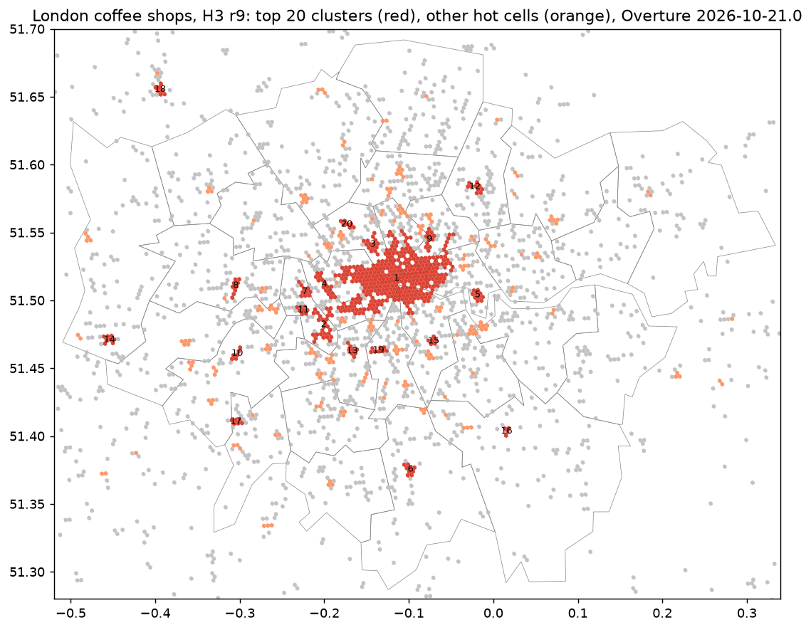

# ロンドンのコーヒーショップの集積 (オープンデータ版 Places Insights)

## 問い

ロンドンのコーヒーショップは、H3 の格子で数えるとどこに集まっていて、上位 20 の集積はどこか。区ごとに、密度、人口あたりの数、ブランドの寡占、近くの競合、人口の近さはどう違うか。

## 結論

Overture Maps の places (版 2026-10-21.0) から、ロンドンの範囲のコーヒーショップ 5,080 店を取り出した ([extract_coffee.json](outputs/extract_coffee.json))。H3 の解像度 9 で Gi* を計算すると、集積は 102 のクラスターになった ([hotspots_h3r9_audit.json](outputs/hotspots_h3r9_audit.json))。

| 要点 | 値 | 出どころ |
|---|---|---|
| 最大の集積 | 中心部 (カムデン、ウェストミンスター、シティ) が 1 つにつながり、328 セル、1,456 店 | [top20_clusters.csv](outputs/top20_clusters.csv) |
| 上位 20 の例 | 2 位はハマースミス・アンド・フラム (75 店)、14 位はヒースロー空港の付近 (21 店) | [top20_clusters.csv](outputs/top20_clusters.csv) |
| 解像度による違い | クラスターの数は、解像度 8 で 8、9 で 102、10 で 736。最大の集積の店数は 1,936、1,456、804 | [sensitivity.csv](outputs/sensitivity.csv) |
| 人口 1 万人あたり | 最多はシティ (288.344)、最少はバーキング・アンド・ダゲナム (1.58632) | [boroughs_coffee.csv](outputs/boroughs_coffee.csv) |
| 500 m 以内に住む人の割合 | ウェストミンスター 0.998865、ハバリング 0.386086 | [boroughs_coffee.csv](outputs/boroughs_coffee.csv) |
| OSM との一致 | 解像度 8 のセルごとの店数の順位相関 0.6977 (カフェを含めた 10,778 店と OSM の 7,040 件) | [crosscheck_osm.json](outputs/crosscheck_osm.json) |

- 「上位 20 の集積」は、格子の大きさで答えが変わる。解像度 9 では中心部がひとかたまりになり、2 位以下は郊外の商店街になる。解像度 10 では中心部が分かれる。使い道 (出店の候補を探すのか、競合の多い地区を避けるのか) に合わせて解像度を決め、その理由を書く。
- 営業状態は、2,818 店が不明 (営業中 2,257、閉業 253) で、不明を営業中とは数えていない ([coffee_status.csv](outputs/coffee_status.csv))。閉業の 253 店は除いた。
- Google の Places Insights にある評価 (rating) と、細かい営業時間は、Overture にも OSM にも無い。評価を使う分析は、このデータでは行えない。

## データ

- POI: Overture Maps Foundation、places/place、版 2026-10-21.0 (`s3://overturemaps-us-west-2/release/2026-10-21.0/theme=places/type=place/`)。範囲 (経度 -0.52〜0.34、緯度 51.28〜51.70) の 756,060 件。取り出したコーヒーショップの出どころとライセンスは、Overture (CDLA-Permissive-2.0) が 5,080、meta 2,373、BrightQuery 2,075、Foursquare (Apache-2.0) 613、AllThePlaces (CC0-1.0) 101 など ([coffee_sources.csv](outputs/coffee_sources.csv))。1 店が複数の出どころを持つ。
- 区: Overture divisions (ODbL-1.0)、同じ版、subtype が county の 33 区 ([boroughs.json](outputs/boroughs.json))。
- 人口: Kontur Population (CC BY 4.0)、2023-11-01 版、英国、H3 解像度 8。範囲内 4,080 セル、10,490,488 人 ([population.json](outputs/population.json))。
- 照合: OpenStreetMap (ODbL) の amenity=cafe、自前の Overpass (データ時刻 2025-09-14T23:59:55Z)、7,040 件 ([osm_cafe.json](outputs/osm_cafe.json))。

## 方法

1. 範囲の全ての行を 1 回だけ S3 から写し、`poi_extract.py` で、basic_category か taxonomy の階層に coffee_shop を持つ行を取り出した。閉業 (permanently_closed) を除き、営業状態の欠けは unknown とした。全ての行を、他のカテゴリ、閉業、信頼度の低さ、採用のどれかに数えた。
2. `grid_hotspots.py` で、範囲の H3 セル (解像度 9、29,536 セル、空のセルを含む) の店数から Gi* (自分と隣接 1 環、2 値の重み) を計算した。片側の p 値に Benjamini-Hochberg (0.05) をかけ、店のある有意なセルを hot とし、隣り合う hot セルをつないでクラスターにした。
3. 解像度 8 と 10、S2 のレベル 14 で数え直し、信頼度 0.5 未満を除いて解像度 9 で数え直した。
4. `poi_compare.py` で、区ごとに店数、面積、密度、人口 (セルの中心が入る区に数える)、1 万人あたりの数、ブランドの割合、HHI (ブランドの無い店はそれぞれ 1 社)、営業状態不明の割合、別ブランドの最寄りの店までの距離の中央値、店から直線 500 m 以内に住む人の割合を出した。
5. Overture のカフェとコーヒーショップ (10,778 店) を、OSM の amenity=cafe と、解像度 8 のセルごとの店数で比べた。

数式: Gi* は、セル i の重み付き和を、全体の平均と分散から求めた期待値と標準偏差で標準化したもの。

    z_i = (Σ_j w_ij x_j − x̄ Σ_j w_ij) / (s √((n Σ_j w_ij² − (Σ_j w_ij)²) / (n − 1)))

PySAL (esda の G_Local、star=True) と数値で一致することを、スキルのテストで確かめた。

## 失敗の型

| 型 | 判定 | 根拠 |
|---|---|---|
| F1 | 確かめた | 抽出で全ての行を理由ごとに数え、合わなければ止まる。最初の実行で、カテゴリが空の行が数えられていないことでこれが止まり、直した ([extract_coffee.json](outputs/extract_coffee.json)) |
| F2 | 確かめた | 集積の判定は、空のセルを含む全体の分布と比べた Gi* で、店数の多いセルを並べただけの基準より厳しい。並べただけの順位とは比べていない |
| F3 | 当てはまらない | 予測をしていない |
| F4 | 確かめていない | 店の数は、Overture の出どころ (データの集め方) に左右される。OSM との一致 0.6977 は、両方に共通する偏りを取り除かない |
| F5 | 確かめた | ヒースロー空港の集積は、空港の店舗で説明できる |
| F6 | 確かめた | 報告の設定 (解像度、範囲、閉業の除外、500 m) は `scripts/run.py` と同じ |
| F7 | 確かめた | 解像度を 3 段と S2 で変え、答えが変わることを書いた ([sensitivity.csv](outputs/sensitivity.csv)) |
| F8 | 確かめた | 表の数字は全て outputs のファイルへリンクした |
| F9 | 確かめた | 版を固定し、範囲の件数 756,060 を記録した。区は名前の一覧で選んだ (同じ範囲の county には、ロンドンの外の 3 つが入っていた) |

## 確かめていないこと

- 営業状態が本当に正しいか (現地や公式の情報との照合)。不明が 2,818 店ある。
- 店の位置の精度。Overture の点の位置は出どころごとに違う。
- 人口あたりの比較は、住む人の数で、働く人と観光客を含まない。シティの 288.344 は、住む人が少ないことによる。
- 500 m は直線の距離で、道のりではない。
- F4 (データの集め方の偏り) は確かめていない。

## 再現

`README.md` の手順。
