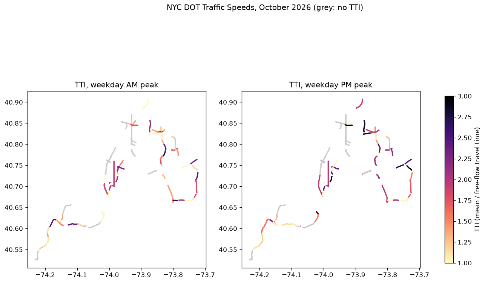

# ニューヨークの道路の朝夕の遅れと信頼性 (オープンデータ版 Roads Management Insights)

## 問い

ニューヨーク市の幹線道路で、平日の朝と夕のラッシュの遅れはどの路線でどれだけ違い、どの区間が遅く、どの区間の所要時間が読めないか。

## 結論

NYC DOT の Traffic Speeds (2026 年 10 月、状態 0 の 641,416 行、94 区間) で、15 分ごとの旅行時間から TTI と LOTTR を出した ([status0_audit.json](outputs/status0_audit.json))。

| 要点 | 値 | 出どころ |
|---|---|---|
| 夕が朝より遅い区間 | 94 区間のうち 49 区間で、日の引き直しの 95% 区間が 0 を含まずに夕が遅い。朝が遅いのは 19 区間 | [corridor_summary.json](outputs/corridor_summary.json) |
| 朝夕の差が最大の区間 | BQE 南行き Leonard St〜Atlantic Ave。朝 823.5 秒、夕 1834.7 秒、差 1011.2 秒 (946.2〜1089.9) | [am_pm_links.csv](outputs/am_pm_links.csv) |
| 朝のほうが遅い例 | Gowanus 北行き 7th Ave〜9th St。差 -324.7 秒 (-466.1〜-164.0) | [am_pm_links.csv](outputs/am_pm_links.csv) |
| 夕の TTI が最も高い区間 | Gowanus 北行き 9th St〜Atlantic Ave、TTI 9.173 (自由流の 9 倍の時間) | [bottlenecks_pm_tti.csv](outputs/bottlenecks_pm_tti.csv) |
| 路線ごとの夕の TTI (上位) | GWB 東行き 5.061、Laurelton Pkwy 北行き 4.873、Belt Pkwy 東行き 4.806、BQE 南行き 4.689 | [corridor_am_pm.csv](outputs/corridor_am_pm.csv) |
| 信頼できる区間 (FHWA の基準で、全時間帯の LOTTR が閾値未満) | 82 区間のうち 33 | [corridor_summary.json](outputs/corridor_summary.json) |
| 最も読めない区間 | SIE 西行き Bradley Ave〜Wooley Ave、LOTTR 3.007 | [unreliable_links.csv](outputs/unreliable_links.csv) |

- 朝と夕で遅れの向きが逆の路線がある (GWB 東行きと Gowanus 北行きは朝の TTI が高く、BQE 南行きと Belt Pkwy 東行きは夕が高い)。マンハッタンへ向かう流れと出る流れの違いと読めるが、流れの向きは確かめていない。
- 観測なしの印の行 ([status_codes.csv](outputs/status_codes.csv) の状態 -101) を外さずに流すと、信頼できない区間の数は 60 から 62 に変わった ([status0_audit.json](outputs/status0_audit.json)、[all_audit.json](outputs/all_audit.json))。主の結論は変わらない。
- Google の例はボストンの路線だった。ボストンには、区間ごとの旅行時間を誰でも取れる形で出すオープンデータが見つからなかった (米国の NPMRDS は公的機関向けで、一般には配られない)。ここでは、同じ問いをニューヨークのオープンデータで行った。

## データ

- NYC DOT「DOT Traffic Speeds」(NYC Open Data、データセット i4gi-tjb9)。2026-10-01〜2026-10-31 の全ての行を 2026-11-12 に取得。125 区間、1,053,140 行 ([prepare.json](outputs/prepare.json))。ライセンスの欄は空で、NYC Open Data の利用規約に従う。
- 状態 -101 は 411,724 行で速度の中央値 0、状態 0 は 641,416 行 ([status_codes.csv](outputs/status_codes.csv))。2026-10-12 は配信元に行が無い ([rows_per_day.csv](outputs/rows_per_day.csv))。
- 時刻はニューヨークの地方時と読んだ。速度の中央値は 4 時台に最も速く、17 時台に最も遅い ([hourly_speed.csv](outputs/hourly_speed.csv))。

## 方法

1. 日ごとに全ての行を取り、区間と時刻の重複を除いた。状態 0 の行だけを主に使い、全ての行を使った場合も流した。
2. FHWA の閾値は LOTTR 1.5。`ttr_metrics.py` で、区間と 15 分の区切りごとに旅行時間を平均し、FHWA の時間帯 (平日の朝 6〜10 時、昼 10〜16 時、夕 16〜20 時、週末と祝日の 6〜20 時) ごとに指標を出した。祝日は 2026-10-12。
3. 指標の式。t は時間帯に入る 15 分の区切りの旅行時間、t_ff は自由流の旅行時間 (0〜5 時の区切りの 15 パーセンタイル)。

       LOTTR = P80(t) / P50(t)    TTI = mean(t) / t_ff    PTI = P95(t) / t_ff    遅延 = mean(t) − t_ff

4. 朝と夕の差は、両方に観測のある日ごとの平均の差を、日を 1,000 回引き直した 95% 区間で示した。
5. 路線は、区間の名前の道路と向き (BQE S など) でまとめ、15 分ごとに全ての区間がそろった区切りだけ、区間の旅行時間を足した。区間がつながっているかは確かめていない。朝と夕の両方で 10 日以上そろった路線だけを表にした。

## 失敗の型

| 型 | 判定 | 根拠 |
|---|---|---|
| F1 | 確かめた | 全ての行を、外した行 (旅行時間 0 以下) と使った行に数えた ([all_audit.json](outputs/all_audit.json))。区間の id の型の違いで結合が止まり、直した |
| F2 | 当てはまらない | 予測をしていない。指標は定義どおりの要約 |
| F3 | 当てはまらない | 予測をしていない |
| F4 | 確かめていない | 状態 0 を拾える区間と時刻は、感知器の動き方に左右される。夜の観測が少ない区間では自由流が歪む |
| F5 | 確かめていない | 朝と夕で向きが逆の路線を、流れの向きで説明したが、通勤の流れのデータで確かめていない |
| F6 | 確かめた | 時間帯、祝日、自由流の定義、10 日の下限は `scripts/run.py` と `ttr_metrics.py` と同じ |
| F7 | 確かめた | 状態 -101 を外す場合と外さない場合で、信頼できない区間の数を比べた |
| F8 | 確かめた | 表の数字は全て outputs のファイルへリンクした |
| F9 | 確かめた | 期間、行数、区間の数を記録し、欠けた日を配信元の数と突き合わせた (10-11〜10-13 の 48,375 行) |

## 確かめていないこと

- 自由流の旅行時間の決め方 (夜の 15 パーセンタイル) を、法定の速度など別の決め方と比べていない。TTI は自由流で変わる。
- 区間の長さと位置の精度。`link_points` は切れていて、地図の線は近似。
- 交通量が無いので、台時間の遅延は出していない。
- 路線の区間がつながっているかは確かめていない。
- F4 と F5 は確かめていない。

## 再現

`README.md` の手順。
