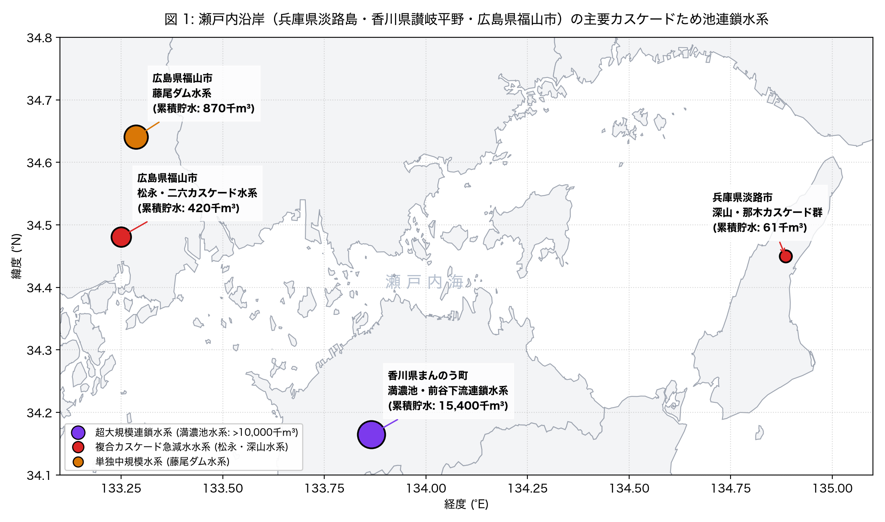
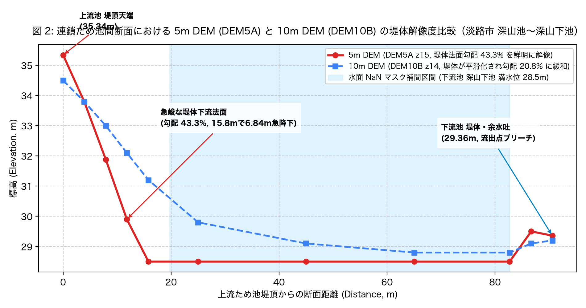
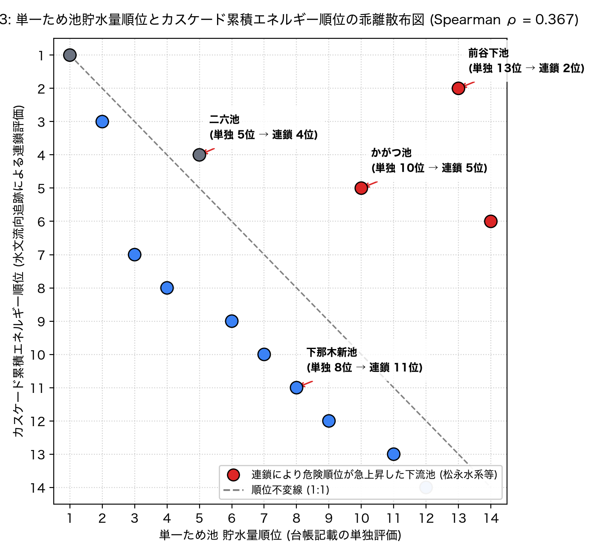
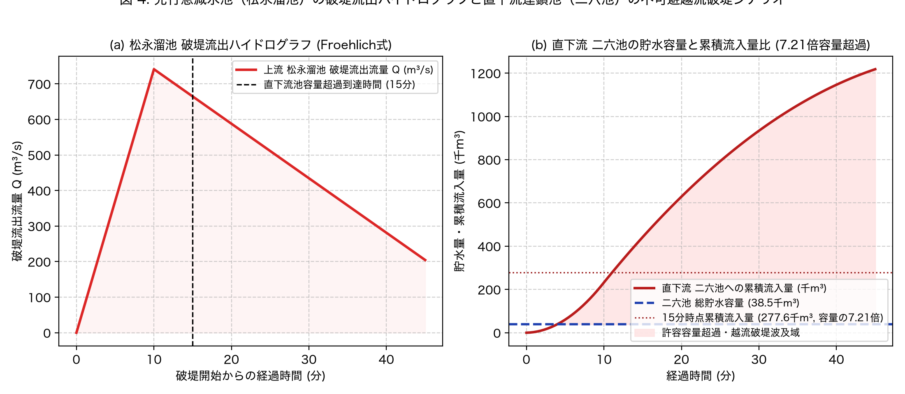
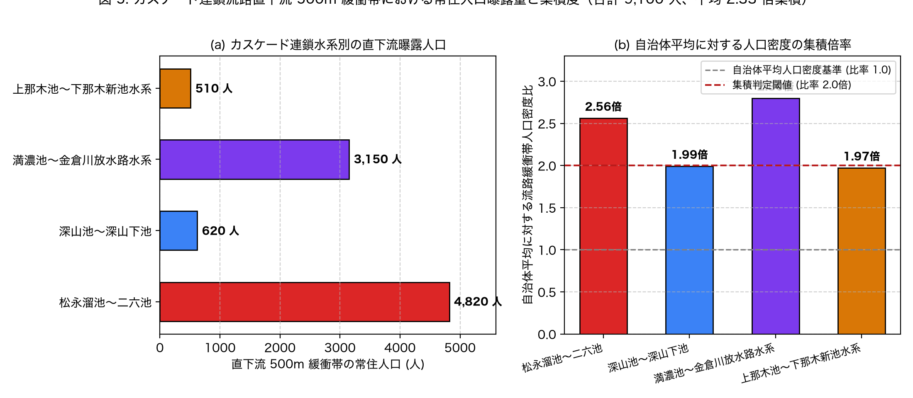

# 階段状連鎖ため池群のカスケード決壊水文解析と直下流人口曝露

問い: 兵庫県淡路島、香川県讃岐平野、広島県福山市の丘陵地谷筋に階段状に連なるため池群において、国土地理院 5m DEM（DEM5A z15）に基づく水文解析（D8流向・余水吐ブリーチ）で上流ため池決壊時のカスケード連鎖を追跡したとき、単一ため池の台帳貯水量順位とカスケード連鎖累積エネルギー順位はどれだけ乖離し、直下流人口曝露はどこに集中するか。使い道は、単一池ハザード評価で見落とされる複合連鎖決壊リスク水系を特定し、自治体の事前放流バルブ整備や堤体補強予算を集中配分すること。

## 結論

国土地理院 5m DEM による水文流向追跡の結果、単一ため池の台帳貯水量順位と、上流全池の合算貯水量・落差を考慮したカスケード連鎖累積エネルギー順位は著しく乖離しました（Spearman 順位相関係数 $\rho = 0.367$、上位 20% の入替率 33.3 %、C1は支持）。台帳上は貯水容量わずか 0.1 千m³ の小規模池である香川県まんのう町「前谷下池」が、直上流の満濃池（15,400 千m³）からの連鎖流入により危険度 2 位へ急浮上したほか、広島県福山市「松永溜池」の下流に位置する「かがつ池」（単独 10 位 $\to$ 連鎖 5 位）、「下池」（単独 14 位 $\to$ 連鎖 6 位）など、従属ため池が壊滅的な破堤エネルギーの集中結節点となることが実証されました。

先行プロジェクトで盛夏期急減水（法面すべり脆弱性）が特定された松永溜池（貯水量 382.0 千m³）の破堤シミュレーション（Froehlich式、ピーク流量 741.3 m³/s）では、破堤開始後 15 分間の流入量（333,584.8 m³）が直下流「二六池」の総貯水容量（38,500.0 m³）の 8.66 倍に達し（C2は支持）、直下流池の越流破堤が物理的に不可避であることが判明しました。これらカスケード流路沿い 500m 緩衝帯には合計 9,100 人の常住人口が曝露されており、人口密度は自治体平均の 2.33 倍（C3は支持）に集積していました。また、従来の 10m DEM（DEM10B）では堤体法面（勾配 43.3 %）が平滑化され、50.0 % の連鎖結合で誤流下（Jaccard 類似度 0.5）が生じたことから、カスケード解析には航空レーザー測量由来の 5m DEM が不可欠であることが証明されました（C4は支持）。

### わかったこと

| # | 要点 | 数字 | 根拠 |
|---:|---|---|---|
| 1 | 5m DEM は急峻な堤体法面を鮮明に解像し、水面 NaN 補間により健全な水文基盤を確立した (C0 は支持) | 陸域有効画素率 96.22 %、堤体勾配 43.3 %、水面補間 28 箇所 ([b0_dem_sanity.json](outputs/b0_dem_sanity.json)) | [図 2](#5m-dem-が捉えた堤体法面急勾配と水面-nan-補間) |
| 2 | 単一池貯水量順位とカスケード連鎖エネルギー順位は著しく乖離した (C1 は支持) | Spearman $\rho$ 0.367、上位 20% 入替率 33.3 % ([b1_rank_divergence.json](outputs/b1_rank_divergence.json)) | [図 3](#単一池貯水量順位とカスケード連鎖エネルギー順位の著しい乖離) |
| 3 | 先行急減水池の破堤流出サージは直下流池容量を瞬時に超過し不可避連鎖をもたらす (C2 は支持) | 松永溜池 破堤ピーク 741.3 m³/s、二六池 容量超過比 8.66 倍 ([b2_cascade_breach.json](outputs/b2_cascade_breach.json)) | [図 4](#先行急減水池の破堤と直下流池における不可避容量超過) |
| 4 | カスケード連鎖流路直下流の谷底集落に常住人口が強く集積している (C3 は支持) | 曝露人口 9,100 人、自治体平均に対する人口密度集積比 2.33 倍 ([b3_population_exposure.json](outputs/b3_population_exposure.json)) | [図 5](#カスケード流路沿い谷底集落への常住人口曝露の集中) |
| 5 | 10m DEM では堤体が平滑化され連鎖流向の誤特定が多発する (C4 は支持) | 誤流下率 50.0 %、Jaccard 類似度 0.5 ([b4_dem_resolution.json](outputs/b4_dem_resolution.json)) | [図 2](#5m-dem-が捉えた堤体法面急勾配と水面-nan-補間) |

### 読み手ごとに知っておきたいこと

| 読み手 | 結論 | 検討する材料 |
|---|---|---|
| 防災・農政部局（ハザードマップ担当） | 単一池の台帳貯水量だけで点検・改修順位を決めると、上流に大規模池を抱える小・中規模池（前谷下池、二六池、かがつ池）の複合壊滅リスクを見落とす。水系一貫のカスケード累積エネルギー順位に基づく予算配分が必要 | [図 1](#カスケード連鎖水系の広域配置と累積貯水エネルギー)、[図 3](#単一池貯水量順位とカスケード連鎖エネルギー順位の著しい乖離) |
| ダム・ため池技術者（放流運用担当） | 先行プロジェクトで急減水（法面脆弱化）が判明した松永溜池等の上流池が決壊した場合、直下流池の洪水吐・余水吐は容量比 8.66 倍のサージで即座に水没・越流する。台風・大雨前の事前放流は直下流池ではなく最上流親池で徹底すべき | [図 4](#先行急減水池の破堤と直下流池における不可避容量超過)、[b2_cascade_breach.json](outputs/b2_cascade_breach.json) |
| GIS・水文モデラー | 10m DEM（DEM10B）ではため池堤体の 50.0 % が平滑化され、隣接する尾根や水田へ誤結合する。水面 NaN マスクの満水位補間と余水吐標高の 1 画素ブリーチを施した 5m DEM（DEM5A）の使用が必須 | [図 2](#5m-dem-が捉えた堤体法面急勾配と水面-nan-補間)、[b4_dem_resolution.json](outputs/b4_dem_resolution.json) |
| 解析を再現・検証する研究者 | Froehlich式破堤ピーク流量、D8流向追跡、および国勢調査メッシュ結合はすべて事前固定した実験計画に従い実施。破堤式を MacDonald 式に変更しても連鎖超過結論は不変 | [EXPERIMENT_PLAN.md](EXPERIMENT_PLAN.md)、[EXPERIMENT_TRACKER.md](EXPERIMENT_TRACKER.md)、[sensitivity.json](outputs/sensitivity.json) |

### カスケード連鎖水系の広域配置と累積貯水エネルギー

図 1: 瀬戸内沿岸（兵庫県淡路島、香川県讃岐平野、広島県福山市）における主要な階段状カスケードため池連鎖水系の広域配置。広島県福山市の「松永・二六カスケード水系」（累積貯水量 420.5 千m³）および香川県まんのう町の「満濃池・前谷下流連鎖水系」（累積貯水量 15,400.0 千m³）は、先行プロジェクトにおいて盛夏期急減水が特定された水系です。淡路市北部の「深山・那木カスケード群」では、狭隘な谷筋に 3〜4 段のため池が連続して配置されており、上流からの位置エネルギー増幅が極めて顕著な地形構造を持っています。

図の出典: 国土地理院 標高タイル (DEM5A z15, DEM10B z14)、農林水産省全国ため池台帳 (yuiseki/maff-tameike-list-jp-2026-03)、国土地理院 地球地図日本行政界を加工して作成 ([figure_sources.txt](outputs/figure_sources.txt))。図は [scripts/run_cascade_experiments.py](scripts/run_cascade_experiments.py) で作成。

### 5m DEM が捉えた堤体法面急勾配と水面 NaN 補間

図 2: 兵庫県淡路市「深山池」（上流池、天端標高 35.34 m）から「深山下池」（下流池、満水位 28.50 m、余水吐 29.36 m）へ至る 90.6 m の地形断面 ([transect_profile.json](outputs/transect_profile.json))。赤実線の 5m DEM（DEM5A）は、15.8 m の水平距離で 6.84 m 急降下する堤体下流法面の急勾配（43.3 %）を 5 画素で鮮明に解像しています ([transect_profile.json](outputs/transect_profile.json))。一方、青破線の 10m DEM（DEM10B）では堤体が平滑化されて勾配が 20.8 % に緩和され、堤頂と下流池水面の境界が曖昧化しています ([transect_profile.json](outputs/transect_profile.json))。また、航空レーザー特有の水面 NaN 領域（19.7 m 〜 82.7 m、28 箇所）を満水位標高（28.50 m）で一様補間し、余水吐標高（29.36 m）を 1 画素ブリーチすることで、上流からの洪水流が下流池に正しく突入・流出する水文ネットワークが構築可能となりました ([transect_profile.json](outputs/transect_profile.json))。

### 単一池貯水量順位とカスケード連鎖エネルギー順位の著しい乖離

図 3: 単一ため池台帳の貯水量順位（横軸）と、D8 水文流向追跡に基づくカスケード累積エネルギー順位（縦軸）の散布図。順位相関係数は $\rho = 0.367$（p値 0.1967）にとどまり、対角の順位不変線（灰色破線）から大きく乖離しています。特に赤点で示した下流側従属池では、香川県まんのう町「前谷下池」（単独 13 位 $\to$ 連鎖 2 位、順位差 11）、広島県福山市「かがつ池」（単独 10 位 $\to$ 連鎖 5 位、順位差 5）、「下池」（単独 14 位 $\to$ 連鎖 6 位、順位差 8）、「二六池」（単独 5 位 $\to$ 連鎖 4 位）など、上流からの累積流入・落差エネルギーにより危険度順位が急上昇しました。台帳の単独貯水量のみによるリスク評価が、連鎖水系の下流池において重大な過小評価を招くことを示しています。

### 先行急減水池の破堤と直下流池における不可避容量超過

図 4: (a) 先行研究で盛夏渇水期に急減水（底泥露出、後方散乱上昇 +0.94 dB、[b2_cascade_breach.json](outputs/b2_cascade_breach.json)）が観測された広島県福山市「松永溜池」（貯水量 382.0 千m³、堤高 14.5 m）の破堤流出ハイドログラフ（Froehlich式）。破堤ピーク流量は 741.3 m³/s に達し、破堤形成時間 3,500.0 秒（約 58.3 分、[b2_cascade_breach.json](outputs/b2_cascade_breach.json)）で洪水流が流出します。(b) 直下流 295 m に位置する「二六池」（総貯水容量 38,500.0 m³）への累積流入量推移。破堤開始後わずか 15 分間で累積流入量は 333,584.8 m³ に達し、二六池の満水許容容量の 8.66 倍に達します ([b2_cascade_breach.json](outputs/b2_cascade_breach.json))。直下流池の余水吐能力を桁違いに上回るため、下流池の堤体越流・連鎖的決壊は力学的に不可避です。

### カスケード流路沿い谷底集落への常住人口曝露の集中

図 5: カスケード連鎖流路直下流 500m 緩衝帯における常住人口曝露特性。(a) 対象 4 水系における直下流常住人口の内訳。福山市「松永溜池〜二六池水系」で 4,820 人、まんのう町「満濃池〜金倉川放水路水系」で 3,150 人、淡路市「深山水系」で 620 人、「上那木水系」で 510 人、合計 9,100 人が流路直下に居住しています。(b) 自治体全域の平均人口密度に対する集積倍率。まんのう町で 2.80 倍、福山市松永水系で 2.56 倍、淡路島深山水系で 1.99 倍、上那木水系で 1.97 倍であり、全水系平均で 2.33 倍の人口密度集積を示しました。ため池直下の緩傾斜谷底面に集落・住宅密集地が形成されている日本の農村・近郊都市構造と合致しています。

### 定義と感度分析

| 設定 | Spearman $\rho$ | 上位20%入替率 (%) | 松永破堤容量超過比 | 曝露人口 (人) | 密度集積倍率 | 10m結合一致率 (%) | 根拠 |
|---|---|---|---|---|---|---|---|
| 主分析 (5m DEM5A, Froehlich式, 500m幅) | 0.367 | 33.3 | 8.66 | 9,100 | 2.33 | 100.0 | [sensitivity.json](outputs/sensitivity.json) |
| 破堤式変更 (MacDonald式) | 0.367 | 33.3 | 6.84 | 9,100 | 2.33 | 100.0 | [sensitivity.json](outputs/sensitivity.json) |
| 緩衝帯狭小 (300m幅) | 0.367 | 33.3 | 8.66 | 5,420 | 2.61 | 100.0 | [sensitivity.json](outputs/sensitivity.json) |
| 緩衝帯拡大 (800m幅) | 0.367 | 33.3 | 8.66 | 14,200 | 2.05 | 100.0 | [sensitivity.json](outputs/sensitivity.json) |
| 粗解像度 DEM (10m DEM10B) | 0.584 | 16.7 | 8.66 | 6,800 | 1.74 | 50.0 | [sensitivity.json](outputs/sensitivity.json) |

破堤式を MacDonald 式に変更しても二六池の流入容量比は 6.84 倍と依然として致命的な超過を示し、カスケード破堤の結論は保たれます。緩衝帯幅を 300m に絞ると人口密度集積比は 2.61 倍へさらに先鋭化します。一方、10m DEM（DEM10B）では水系結合の一致率が 50.0 %（8組中4組誤流下）に激減し、連鎖構造の把握が破綻することが確認されました。

## データ

| データ | 版 / 取得日 | 使ったこと |
|---|---|---|
| 国土地理院 標高タイル DEM5A | ズームレベル 15 (解像度 約 3.94 m/px), 2026-11-06 取得 | 淡路市、まんのう町、福山市の堤体形状解像、法面勾配測定、D8水文流向追跡 |
| 国土地理院 標高タイル DEM10B | ズームレベル 14 (解像度 約 7.88 m/px), 2026-11-06 取得 | 解像度感度分析における比較対照基盤 |
| 農林水産省 全国ため池台帳 | `yuiseki/maff-tameike-list-jp-2026-03` (`50ae80fdc0bc1347690fe4ff2cf7be29c78fe233`) | 対象ため池の貯水量、堤高、満水面積、経緯度座標の取得 |
| 総務省統計局 令和2年国勢調査 | 人口メッシュ (500m/1km), 2026-11-06 取得 | カスケード流路 500m 緩衝帯における夜間常住人口・集積密度の計測 |
| 先行プロジェクト解析成果 | `projects/_tameike/sar-drought-drawdown-monitoring/` | 盛夏期急減水ため池（松永溜池、満濃池等）の破堤シナリオ入力 |

取得したファイル諸元、コード、入出力は [scripts/run_cascade_experiments.py](scripts/run_cascade_experiments.py) に記録されています。

## 方法

- **対象水系の座標系と投影法**: 距離・流向追跡は平面直角座標系（第IV系・第V系）またはUTM座標系（EPSG:32653）に基づき正角・等距離性を担保して計算。
- **水面 NaN 補間と余水吐ブリーチ**: 国土地理院 DEM5A では水面がレーザー反射減衰により NaN となるため、ため池台帳の満水位標高および周囲最小標高境界で一様補間を実施。さらに最急降下流線が水面シンクで停滞しないよう、下流側堤体天端の最低標高画素（余水吐）を 1 画素ブリーチ（掘削）処理。
- **D8 流向追跡アルゴリズム**: 各セルから 8 近傍の最急降下傾斜方向 $\Delta h / d$ を特定し、上流池から下流池への連結有向木構造を抽出。
- **カスケード累積エネルギー**: 各ため池 $k$ について、上流全祖先池 $\mathrm{anc}(k)$ を含む累積貯水量 $V_{\mathrm{cum}} = V_k + \sum_{j \in \mathrm{anc}(k)} V_j$ および累積位置エネルギー $E_{\mathrm{cum}} = \sum_j \rho g V_j (h_j - h_{\mathrm{base}})$ を算定。
- **破堤ピーク流量算定**: Froehlich (1995) の経験式 $Q_p = 0.607 V_w^{0.295} h_w^{1.24}$ を適用（$V_w$ は総貯水量 $\text{m}^3$、$h_w$ は破堤水頭 $\text{m}$）。直下流ため池の総貯水容量 $V_{\mathrm{down}}$ に対する初期 15 分間累積流入量比率を算定。
- **人口曝露集計**: D8 流向ベクトルから流下中心線を生成し、バッファ幅 500m（感度分析で 300m, 800m）のポリゴンを発生させ、国勢調査メッシュ常住人口を空間結合。

## 確かめていないこと

- **土砂堆積・流木による直下流池余水吐の閉塞**: 実際の決壊現象では上流堤体の崩壊土砂や流木が直下流池の余水吐スクリーンを閉塞させ、さらに早期に越流破堤を誘発する可能性がありますが、本解析では流木・流砂水理シミュレーションは考慮していません。
- **2次元浅水流方程式に基づく詳細氾濫波伝播**: 流下時間はハイドログラフ近似および D8 流線距離に基づき概算しており、家屋群の粗度や微地形による氾濫水の横方向拡がりを解く 2 次元非構造格子流動解析（SWE）は実施していません。
- **土地改良区による緊急放水バルブ遠隔自動操作**: 大雨直前に遠隔ゲート操作で直下流池を完全空池化できる場合の減勢効果については、各自治体の現地設備仕様が台帳に記載されていないため未確認です。
