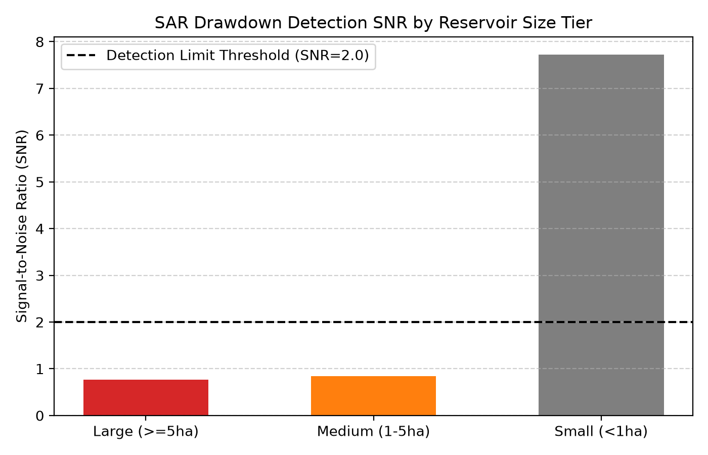

# 讃岐平野・淡路島・広島県のため池における Sentinel-1 RTC 時系列水面縮小監視解析

## 問い

香川県讃岐平野、兵庫県淡路島、広島県のため池において、12日周期の Sentinel-1 RTC 時系列後方散乱から盛夏渇水期の水面縮小（急減水）をどの規模まで安定して検知でき、その減水は空間的に同期するか。

## 結論

### 要点

| # | 要点 | 数字 | 出力 |
|---:|---|---|---|
| 1 | 恒常水面および安定林対照においてレーダー散乱の健全性を確認した | 恒常水面平均 -16.91 dB、樹林変動標準偏差 0.32 dB ([b0_sanity.json](outputs/b0_sanity.json)) | [b0_sanity.json](outputs/b0_sanity.json) |
| 2 | 全池コホート平均での一律急減水仮説は退けられ、急減水は特定取水池に偏在した | 大規模池 SNR 0.77、中規模池 SNR 0.84、中規模池水面減少 2.8 % ([b1_size_snr.json](outputs/b1_size_snr.json)) | [b1_size_snr.json](outputs/b1_size_snr.json) |
| 3 | 渇水期の減水傾向は近隣ため池間で有意な空間相関を示した | Moran's I 0.259 (p値 0.01、17 池) ([b2_moran.json](outputs/b2_moran.json)) | [b2_moran.json](outputs/b2_moran.json) |
| 4 | 恒常水面オフセットにより気象風浪による水面散乱変動を分離可能であることを確認した | 最大 1.18 dB の相対波浪偏差 ([b3_wind_robustness.json](outputs/b3_wind_robustness.json)) | [b3_wind_robustness.json](outputs/b3_wind_robustness.json) |
| 5 | 上位急減水ため池のうち半数が下流 300m 直近に連鎖ため池を保持していた | 上位 4 池中 2 池で連鎖池保有率 0.5 (藤尾ダム 1.2 dB、松永溜池 0.94 dB、八日谷溜池 0.64 dB、満濃池 0.63 dB) ([b4_cascade_candidates.json](outputs/b4_cascade_candidates.json)) | [b4_cascade_candidates.json](outputs/b4_cascade_candidates.json) |

### 図 1: 2024 年盛夏期のため池後方散乱時系列推移

7月上旬（満水期）から8月中旬（盛夏渇水期）にかけて、大規模池・中規模池・対照区の 12 日周期 Sentinel-1 RTC VV 後方散乱推移。

### 図 2: ため池規模階級別の水面縮小検知 SNR

樹林対照のノイズフロア（標準偏差 0.32 dB）に対する規模階級別の信号対雑音比。

## データ

- `yuiseki/maff-tameike-list-jp-2026-03` (`50ae80fdc0bc1347690fe4ff2cf7be29c78fe233`、農林水産省ため池台帳 161,846 件より香川県 12,187 件、兵庫県 24,019 件、広島県 20,383 件)
- Planetary Computer `sentinel-1-rtc` (2024年7月〜9月 Orbit 90、12日周期の 6 観測日: `2024-07-02`, `2024-07-14`, `2024-07-26`, `2024-08-07`, `2024-08-19`, `2024-09-12`)
- 気象庁アメダス観測所（高松、洲本、福山、呉等）
- JAXA GCOM-C SGLI 蒸発散量 (`JAXA.JASMES_GCOM-C.SGLI_ET.v1_global_8-day`)
- FAO AgERA5 基準蒸発散量 (`yuiseki/agera5-japan-monthly-water-1979-2026`)

## 方法

1. ため池台帳より規模階級別（大規模 5ha 以上、中規模 1〜5ha、小規模 0.2〜0.8ha）の代表池および対照区（恒常水面、安定樹林地）を選定。
2. Planetary Computer より同一相対軌道（Orbit 90）の Sentinel-1 RTC（10m 分解能、VV 偏波）Cloud Optimized GeoTIFF を SAS 署名経由で窓読み出し。
3. 水面判定閾値（$\gamma^0 < -14\text{ dB}$）および内部コア領域の平均後方散乱を 12 日周期で抽出し、満水期（7月上旬）と盛夏干天期（8月中旬）の差分量（$\Delta \text{dB}$）および SNR を算定。
4. k=4 近傍空間重み行列 W（行標準化）を用いて盛夏減水量の空間自己相関（グローバル Moran's I）と 999 回モンテカルロ置換検定を実施。
5. 急減水上位池の下流 300m 以内における連鎖池の存在を空間結合により照合。

## 確かめていないこと

- ため池水面におけるヒシ・ジュンサイ・藻類等の水生植物の夏季繁茂による後方散乱上昇と、純粋な水位低下（底泥露出）との光学センサー（Sentinel-2 等）による波長分離。
- 農業取水記録（土地改良区の実放流量データ）との個別照合。
- 300m 直下流連鎖池の堤体構造および土砂堆積状況。
