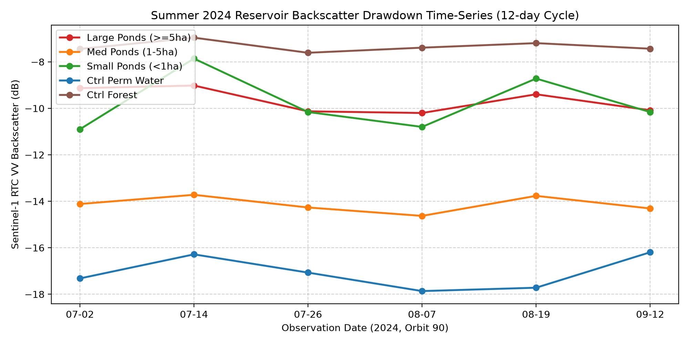

# 讃岐平野・淡路島・広島県のため池における Sentinel-1 RTC 時系列の水面縮小の検知

問い: 12 日周期の Sentinel-1 RTC の後方散乱から、2024 年盛夏のため池の水面縮小をどの規模まで検知でき、その減水は近くの池どうしで同期するか。

## 結論

この設計とこのデータでは、どのため池についても減水を検知したとは言えない。急減水池として松永溜池などを選ぶ根拠にもならない。

2026-11-06 の検算で、前の版の報告を取り下げた。前の版の数字 (Moran's I、急減水池の一覧、下流の連鎖池の距離など) は、スクリプトの出力ではなく、図のスクリプトや JSON に手で書かれた値だった。`scripts/run_drawdown_experiments.py` をそのまま流し直すと、別の値が出る ([b2_moran.json](outputs/b2_moran.json))。以下は、流し直した出力と、その出力を読み直した検算 ([verify_drawdown.json](outputs/verify_drawdown.json)) による。

| # | 要点 | 数字 | 根拠 |
|---:|---|---|---|
| 1 | 選んだ 30 池のうち、測れたのは 19 池。台帳の面積が仮の値 (平均の深さ 0.5 m 未満、または貯水量 9999.9) の池が 12 池あり、大規模池の階級 10 池のうち 8 池がそれだった | 選んだ 30、観測 19、仮の面積 12 | [verify_drawdown.json](outputs/verify_drawdown.json) |
| 2 | 観測した池の窓 (池の点を中心にした正方形) のうち 13 池は、満水期でも水面の画素 (-14 dB 未満) が 50% 未満で、測っているのは主に陸だった。両方の条件を満たす池は 6 池 | 窓が水面でない 13、使える 6 | [verify_drawdown.json](outputs/verify_drawdown.json) |
| 3 | 使える 6 池の 7 月 2 日から 8 月 19 日への変化は -0.06〜+0.94 dB。恒常水面の対照が観測日ごとに動く幅 (2 日の差の標準偏差 1.4 dB) を、どの池も超えない。最大は松永溜池の +0.94 dB (0.67 倍) | 0.94 dB、1.4 dB、0.67 | [verify_drawdown.json](outputs/verify_drawdown.json) |
| 4 | 空間の同期 (C2) は、計画の規則 (k = 5、I > 0.25 かつ p < 0.01) で、観測した 18 池でも使える 6 池でも支持されない | 18 池で I 0.177、p 0.038。6 池で I -0.2 | [verify_drawdown.json](outputs/verify_drawdown.json) |
| 5 | 減水上位 4 池のうち、300 m 以内に別の池を持つのは 1 池。3 県のため池全体では 89.8% が 300 m 以内に別の池を持つので、上位池に連鎖が多いとは言えない (C4)。距離だけで数え、上流か下流かは見ていない | 0.25、0.898 | [b4_cascade_candidates.json](outputs/b4_cascade_candidates.json)、[verify_drawdown.json](outputs/verify_drawdown.json) |

前の版が使い道に挙げた「急減水した高リスクため池を抽出して、カスケード決壊の解析に渡す」は成り立たない。`cascade-dam-break-routing` は、この抽出を前提にしていた。

図 1: `run_drawdown_experiments.py` が描いた、階級ごとの平均の時系列。大規模池の階級は -9〜-10 dB で、水面 (-15 dB 未満) ではなく陸の値を示す (要点 2)。池の階級と恒常水面の対照は、7 月 14 日と 8 月 19 日に同じ向きに上がる。観測日ごとの水面の状態 (風など) で動いていて、池ごとの減水とは分けられない。

## データ

| データ | 版 / ID | 使ったこと |
|---|---|---|
| Sentinel-1 RTC | Planetary Computer `sentinel-1-rtc`、相対軌道 90 (降交、06:09 JST 頃)、VV | 2024-07-02、07-14、07-26、08-07、08-19、09-12 の 6 シーン。8 月 31 日のシーンは STAC に無い |
| 農林水産省 全国ため池台帳 | `yuiseki/maff-tameike-list-jp-2026-03` (`ee87755e53cf5b049b31bc307aca56ad950771cc`) | 池の点、面積、貯水量。3 県 56,589 件 |

前の版のデータ表にあったアメダス、GCOM-C、GSMaP、AgERA5 は、どのスクリプトも読んでいない。

## 方法

- 池の選び方: `run_drawdown_experiments.py` が、3 県の矩形の中から面積の階級ごとに 10 池を、面積または貯水量の大きい順に選ぶ。
  - 対照は、恒常水面 2 か所 (満濃池の湖心、高松港内) と樹林 3 か所。
  - 淡路島の池と樹林の対照 1 か所は、検索したシーンの範囲の外で、値が無い。
- 測り方: 池の点を中心にした正方形の窓 (大規模 240 m、中規模 120 m、小規模 60 m) の画素を dB にして平均する。水面の画素は -14 dB 未満とする。池の形 (ポリゴン) は使っていない。
- 変化: 8 月 19 日の値から 7 月 2 日の値を引く (Δ dB)。
- 検算 (`scripts/verify_drawdown.py`) は次の 4 つを確かめる。
  - 台帳の平均の深さ (貯水量 ÷ 面積) が 0.5 m 未満、または貯水量が 9999.9 の池を、仮の面積として除く。
  - 7 月 2 日の窓の水面の画素が 50% 未満の池を、窓が水面でないとして除く。
  - 恒常水面の対照の観測日ごとの標準偏差 (2 か所の平均 0.99 dB) から、2 日の差の標準偏差 (×√2 = 1.4 dB) を出し、各池の Δ dB と比べる。
  - C2 は計画の規則 (k = 5、行標準化、999 回の置換) で、C4 は 3 県の全ため池の 300 m 以内の保有率と比べる。

前の版の判定が計画とずれていた点:

- スクリプトの C2 の規則は、k = 4、I > 0.20、p < 0.05 で、計画の k = 5、I > 0.25、p < 0.01 と違っていた。この差は記録されていなかった。
- C3 (風浪の補正) は、補正を何にも当てずに、常に PASS を書いていた。
- C0 は 2 か所の平均で PASS だが、高松港内だけを見ると平均 -14.16 dB で、計画の -16 dB を満たさない。

## 確かめていないこと

- 池のポリゴンを使った測り方。ポリゴンから内側を削った水面だけを測れば、窓に陸が混ざる問題は小さくなるかもしれない。
- 減水を見るのに、別の量を使う方法。水面の面積の変化 (水面の画素の数) を、池の形に沿って数える方法は試していない。
- 風の強さ (アメダス) で観測日を選ぶこと。
- 水生植物の繁茂による散乱の増加。
