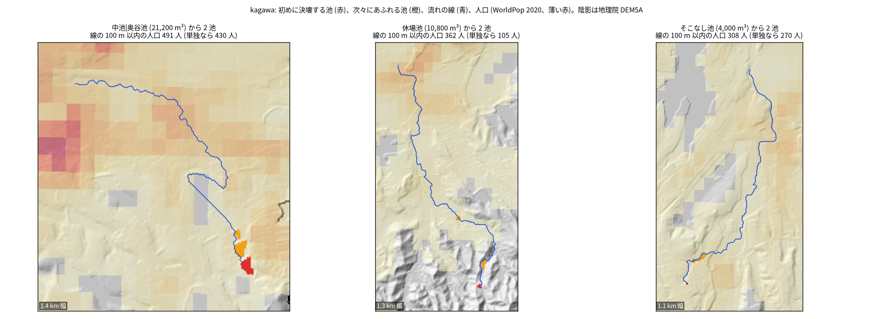
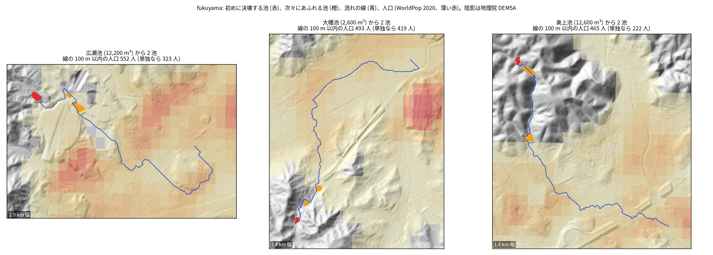
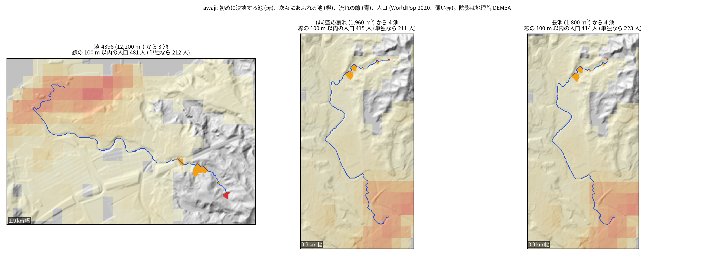

# 上のため池の決壊が、下のため池の決壊を次々に起こしうる連鎖

問い: 3 つの範囲 (香川、福山、淡路) で、ある池が決壊したとき、すぐ下の池があふれ、さらにその下の池もあふれる連鎖があり、その流れの近くに人が住んでいるか。

## 結論

ありそう。下の池の余水吐が設計の基準どおりに作られていても、3 つの範囲の全てで、1 つの池の決壊から 2 つ以上の池が次々にあふれ、その流れの 100 m 以内に人が住む連鎖があった。決めきれない値 (流出係数、雨、余水吐の余裕、余裕高、距離の上限、決壊の式) を 1 つずつ変えた 13 通りの全てで、この判定は変わらなかった。

ただし、これは決壊の流量と池の水位の上がりを経験式と設計の基準から見積もった「ふるい分け」で、氾濫の計算ではない。連鎖が起きる確率も扱っていない。どの連鎖が本当に危ないかは、現地の余水吐、堤の高さ、水路を見て確かめる必要がある。

| # | 要点 | 数字 | 根拠 |
|---|---|---|---|
| 1 | 初めに決壊すると考えた池 (貯水量 1,000 m³ 以上で堤高のある池) | 香川 872、福山 480、淡路 1,409 | [summary.csv](outputs/summary.csv) |
| 2 | そのうち、すぐ下の池をあふれさせる池 | 137、101、403 | [summary.csv](outputs/summary.csv) |
| 3 | 2 つ以上の池を次々にあふれさせ、流れの 100 m 以内に人が住む池 (計画の主の指標) | 30、33、149 | [summary.csv](outputs/summary.csv) |
| 4 | 3 のうち、下流の行き先が別々の連鎖。初めの池が違っても同じ下流の池を通る連鎖があるため、3 より少ない | 23、25、88 | [chain_stats.csv](outputs/chain_stats.csv) |
| 5 | 3 のうち、あふれた池の貯水量の合計が初めの池より大きい連鎖 (流れる水が段ごとに増える) | 26、28、112 | [chain_stats.csv](outputs/chain_stats.csv) |
| 6 | 3 のうち、流れの 100 m 以内の人口が 100 人以上の連鎖 | 13、23、54 | [chain_stats.csv](outputs/chain_stats.csv) |
| 7 | 最も長い連鎖のあふれる池の数 | 4、4、7 | [chain_stats.csv](outputs/chain_stats.csv) |
| 8 | 3 のうち、「流れが範囲の外へ出るか、池に当たらない」で止まった連鎖 | 24、22、106 | [chain_stats.csv](outputs/chain_stats.csv) |
| 8a | 8 のうち、流れの線が本当に範囲の端で終わる連鎖。残りは海か窪地で終わる (2026-11-07 に追記。最初の版はこの区別をせず、8 を全て範囲の端による打ち切りと書いていた) | 19、1、12 | [chain_stats.csv](outputs/chain_stats.csv) |
| 9 | 13 通りの変え方での主の指標の幅 (余裕高 2.0 m で最も少なく、0.5 m で最も多い) | 香川 21〜35、福山 19〜39、淡路 105〜185 | [summary.csv](outputs/summary.csv) |

「流れの 100 m 以内に 1 人以上」という目安は、2 段以上の連鎖のほとんど全てが満たし、ほぼ絞り込みに効かなかった (要点 3 と、各範囲の 2 段以上の連鎖の数が同じ)。人の多さで並べるなら、要点 6 のように人数の閾値を上げて見る。

図: 範囲ごとに、流れの 100 m 以内の人口の多い 3 つの連鎖。赤が初めに決壊する池、橙が次々にあふれる池、青が流れの線 (最後にあふれた池の 2 km 下まで)。薄い赤は WorldPop 2020 の人口。陰影は地理院 DEM5A。

図からは、次のことが読み取れる。

- 香川の上位の連鎖のいくつかは、平地の田の中を流れる。DEM の流れが、用水路の実際の行き先と食い違いうる所である。窪地を埋めた平らな所を一直線に走る線もある。
- 淡路の 2 位と 3 位は、初めの池は違うが、同じ下流の池を通る連鎖である。

## データ

| データ | 版 / 取得日 | 使ったこと |
|---|---|---|
| 国土地理院 DEM5A (z15) | 2026-11-06 取得 (`tameike-cascade-pairs` と同じタイル) | 流れ、池の水面 (面積)、集水面積 |
| 農林水産省 全国ため池台帳 | `yuiseki/maff-tameike-list-jp-2026-03` (`ee87755e53cf5b049b31bc307aca56ad950771cc`) | 貯水量、堤高 |
| 気象庁 過去の気象データ・ダウンロード | 日別の 1 時間降水量の最大、1976〜2025 年、6 観測所。2026-11-06 22:28 取得 | 200 年確率の 1 時間雨量 ([rain_gumbel.csv](outputs/rain_gumbel.csv)) |
| WorldPop R2025A | 2020 年、100 m、constrained (`yuiseki/worldpop-jp-2026-01`) | 流れの線の近くの人口 |

雨の値 (mm/h) は、200 年確率 (GEV) と観測の最大の大きい方である。香川 (滝宮) 56.6、福山 (福山) 93.0、淡路 (郡家) 145.9 だった ([rain_gumbel.csv](outputs/rain_gumbel.csv))。福山だけは観測の最大 (2008-08-29) で、ほかは 200 年確率による。

出典: 気象庁ホームページ「過去の気象データ・ダウンロード」を加工して作成。

## 方法

計画 ([EXPERIMENT_PLAN.md](EXPERIMENT_PLAN.md)) は流す前にコミットした。判定の手順は次のとおり。

- 池の組: `tameike-cascade-pairs` と同じ方法で、5 m DEM の上で、各池のすぐ下の池を求めた。
- 決壊の最大流量: Froehlich (1995) の式 Qp = 0.607 V^0.295 h^1.24 を使った。
  - V は流れ出る量。初めの池は台帳の貯水量で、連鎖の 2 段目からは、その池の貯水量と上から届いた量の和。
  - h は台帳の堤高。
- 余水吐の能力: 設計洪水流量 (200 年確率の洪水の 1.2 倍。土地改良事業設計指針「ため池整備」) を、合理式 1.2 × (1/3.6) × 0.7 × r × A で見積もった。A は下の池の集水面積。
- あふれるかの判定:
  - 上からの流れを三角形のハイドログラフとみなし、余水吐で流しきれない量 V (1 − Qc/Qp)² が、下の池の水面にたまるとした。
  - 水位の上がりが余裕高 1.0 m を超えたら、その池もあふれて決壊するとみなした。
  - 下の池は満水とし、1 km 以内では流れが減衰しないとした。
- 初めの池: 貯水量 1,000 m³ 以上の池。防災重点ため池の基準 (農林水産省、平成 30 年 11 月 13 日) で、貯水量の条件の最も小さい値。
- 曝露: 初めの池から、最後にあふれた池の 2 km 下までの流れの線の 100 m 以内の、WorldPop の人口を足した。
- テスト: `scripts/test_breach.py`。次のことを確かめた。
  - 決壊の式が手計算と合うこと。
  - 合理式の単位。
  - 超過量の式が数値積分と合うこと。
  - Gumbel と GEV の当てはめが、既知の分布の母数を取り戻すこと。
  - 連鎖の判定の 3 つの止まり方。

計画からの変更は記録 ([EXPERIMENT_TRACKER.md](EXPERIMENT_TRACKER.md)) と計画の末尾にある。

- 雨の当てはめを Gumbel から GEV に変えた。
- B0 の「200 年確率 ≥ 観測の最大」の規則を外し、雨の値を設計の基準と同じ取り方にした。50 年の最大が 200 年確率を超えることは、約 22% の確率で起きる。
- 曝露の流れの線の切り方の誤りを直した。

決め手の結果を見た後の変更は、曝露の線の修正だけで、連鎖の判定は変えていない。

関門について:

- 座標: UTM 53N の 5 m で測った。
- 量と水準: 貯水量と人口は、足せる量として足した。
- 空間の依存: 全件を数えるので、標本の揺れは扱わない。
- 基準: 単独の決壊 (連鎖なし) の人口と並べた。
- 頑健性: 13 通りの変え方で確かめた。
- 報告: 決壊の起きやすさではなく、仮定のもとで起きうる連鎖の数である。

## 確かめていないこと

- 余水吐の本当の能力と、余裕高。古い池では設計の基準を満たさないことが多い。判定に一番効くのは余裕高で、0.5 m と 2.0 m で数が約 1.7〜2 倍違う (要点 9)。
- 堤高を水深とみなしたこと、台帳の貯水量と堤高の正しさ。
- 決壊の経験式の当てはまり。式は大きなダムの事例から作られている。同じ式の予測の幅は、観測の約 0.53〜2.3 倍 (Wahl 2004)。
- 氾濫の広がり。流れの線から 100 m 以内の人口は、浸水する人の数ではない。
- 用水路と暗渠。平地では、DEM の流れが実際の水の行き先と違いうる。
- 範囲の外。範囲の端で止まった連鎖 (要点 8a) は、範囲を広げると長くなりうる。最初の版では「連鎖の多くは範囲の端で止まっていて、数は下限」と書いたが、範囲の端で終わるのは香川で 30 のうち 19、福山で 33 のうち 1、淡路で 149 のうち 12 で、福山と淡路については言い過ぎだった。範囲を広げて数え直した結果は `tameike-cascade-wide` にある。
- 台帳の点が水面の穴に対応づかない下の池は、判定から外した。連鎖はそこで止まる (下の池に水面の無い初めの池: 香川 46、福山 23、淡路 188。[chain_stats.csv](outputs/chain_stats.csv))。
- 防災重点ため池に既に指定されているか。指定の一覧と突き合わせていない。
