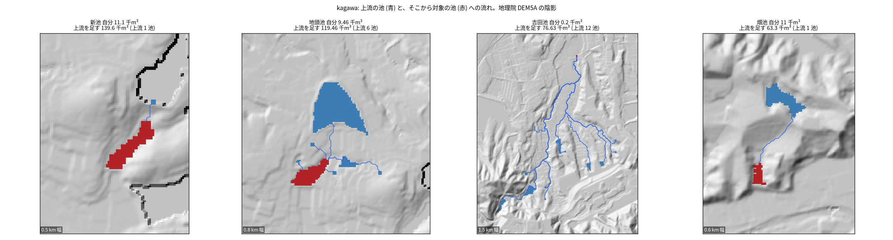
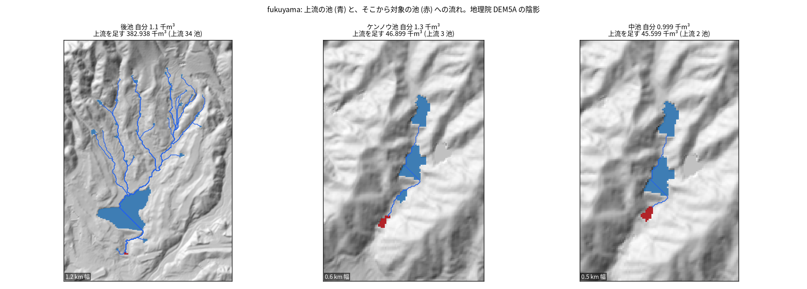
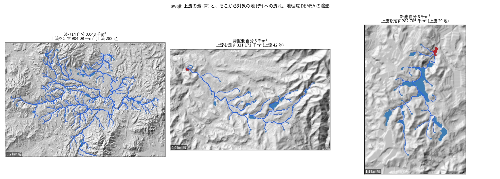

# ため池の上下流の組と、上流の貯水量を足した順位

問い: 3 つの範囲のため池で、5 m DEM の上で、上流の池の貯水量を足して並べると、台帳の貯水量だけの順で上位に入らない池が上位に入るか。

## 結論

入る。3 つの範囲の全てで、自分の貯水量では上位 10% に入らず、上流の池の貯水量を足すと上位 10% に入る池があった (計画の C1 を支持)。上位の割合 (5%、20%) や、台帳の点を水面に対応づける距離 (60 m) を変えても、0 にはならなかった。

| # | 要点 | 数字 | 根拠 |
|---:|---|---|---|
| 1 | 上流の貯水量を足したときだけ上位 10% に入る池の数。上位 10% の枠の大きさは 193、126、428 | 香川 32、福山 28、淡路 128 | [summary.csv](outputs/summary.csv) |
| 2 | 流れが別の池に入る池 (水面) の割合 | 香川 40.0%、福山 56.0%、淡路 66.3% | [summary.csv](outputs/summary.csv) |
| 3 | 目視した 10 件のうち、谷に沿った連鎖は 7 件。1 件 (吉田池) は平地の田の中の流れで疑わしく、2 件 (淡-714、常盤池) は川の本流に沿って数 km 上流の池まで足していた | 7、1、2 | [fig_check_verdicts.csv](outputs/fig_check_verdicts.csv) |
| 4 | 探索: 流れの距離が 500 m 以内の上流の池だけを足しても、上位 10% に入る池は残る | 香川 27、福山 24、淡路 119 | [summary.csv](outputs/summary.csv) |
| 5 | 5 m と 10 m の DEM で、上下の組の一致 (Jaccard 係数) は半分から 7 割 | 0.546、0.679、0.519 | [summary.csv](outputs/summary.csv) |

点検や改修の順を台帳の貯水量だけで決めると、自分は小さいが上流に大きな池を抱える池を見落とす。ただし、ここで足した量は、上流の池が全て空になって流れ込んだときの量の上限で、決壊の流量や到達時間ではない。

要点 5 のとおり、10 m の DEM では組の約半分が変わる。このため、全県へ広げるなら 5 m の DEM を使う。

図: 上流の貯水量を足したときだけ上位 10% に入った池 (赤) と、上流の池 (青)、上流の池から流れ出る流れ (青い線)。地理院 DEM5A の陰影。範囲ごとに、上流を足した量の大きい順に 4、3、3 件を描いた (`scripts/figure_checks.py`)。

## データ

| データ | 版 / 取得日 | 使ったこと |
|---|---|---|
| 国土地理院 標高タイル DEM5A (z15) と dem (z14) | 2026-11-06 取得。`artifacts/_tameike/tameike-cascade-pairs/` に保存 | 5 m の流れ。水面の穴 (値なし)。10 m の流れ (B2) |
| 農林水産省 全国ため池台帳 | `yuiseki/maff-tameike-list-jp-2026-03` (`ee87755e53cf5b049b31bc307aca56ad950771cc`) | 範囲の中の池の点と貯水量。香川 2,106、福山 1,335、淡路 4,479 件 |

範囲の経緯度は、香川 133.78〜133.94、34.13〜34.27、福山 133.20〜133.36、34.42〜34.56、淡路 134.78〜134.94、34.40〜34.54。計画 ([EXPERIMENT_PLAN.md](EXPERIMENT_PLAN.md)) に、流す前に書いた。

## 方法

- 格子: DEM5A のタイルをつないで、UTM 53N の 5 m の格子に再投影した (標高は双線形、値なしの所は最近傍)。
- 水面: 範囲の端に触れない値なしの穴を、ため池などの水面とした。穴の縁の最も低い標高で、平らに埋めた。
- 池の対応づけ:
  - 台帳の点が、穴の中か穴から 30 m 以内にあれば、その穴を池の水面とした。
  - 対応づかない池は、点の画素とその 8 近傍を池とみなした。
  - 1 つの穴に点が 2 つ以上あれば、1 つの水面 (節) として貯水量を足した。
- 流れ: `terrain-hydrology` の `hydro.flow` を使った (窪地を埋めてから、8 近傍の最急降下)。各水面の流出点 (集水面積の最大のセル) から流れをたどり、最初に入る別の水面を、その下の池とした。
- 足す量: V_cum(k) = V_k + Σ_{j は k より上流} V_j を求め、範囲ごとに V と V_cum の上位 10% を比べた。仮の貯水量 9999.9 は 0 として数えた。
- B2 (10 m との比較): 地理院の dem (z14) を 10 m の格子に再投影し、同じ水面で流した。
- テスト: `scripts/test_cascade_pairs.py`。合成の谷で、穴の埋め方、点の対応づけ、上の池から下の池へ流れること、足し方、距離の上限、循環で止まることを確かめた。
- 健全性: 既に確かめた淡路の 2 組 (上那木池から下那木新池、深山池から深山下池) が再現した ([summary.csv](outputs/summary.csv) の expected_pairs_reproduced)。

計画からの変更は、記録 ([EXPERIMENT_TRACKER.md](EXPERIMENT_TRACKER.md)) に書いた。

- 既知の組の検査を「直下」から「下流のどこか」に直した。
- 目視の 10 件の選び方は、一覧を見てから決めた。
- 距離の上限 (要点 4) は、目視の後に足した探索。

関門について:

- 座標: UTM 53N で測った。
- 量と水準: 貯水量は足せる量として足した。
- 空間の依存: 予測でも推定でもないので、考えなくてよいと判断した。
- 基準: 台帳の貯水量の順を比べる相手にした。
- 頑健性: 上位の割合、対応の距離、DEM の解像度、距離の上限を変えて確かめた。
- 報告: 池の順位であり、被害の大きさの順ではない。

## 確かめていないこと

- 台帳の点の半分ほどが、水面の穴に対応づかない。対応した割合は、香川 36.6%、福山 56.8%、淡路 46.9% ([summary.csv](outputs/summary.csv))。香川の範囲では台帳の点の 72.2% が小数 3 桁 (約 100 m) で、それらの点が穴に対応づいた割合は 30.4% (細かい座標の点は 47.3%) だった ([coord_precision.csv](outputs/coord_precision.csv))。対応づかない池は点で表したので、その池の流出点の位置は不確か。
- 用水路、暗渠、余水吐の水路。DEM に表れない水路でつながる池は入らず、平地の流れは DEM の微地形で決まる (目視の吉田池)。
- 決壊の流量、到達時間、下の池があふれるか。足した量は上限であって、流れ込む量ではない。
- 下流の人口や家屋。
- 範囲の外への広がり。範囲の外から流れ込む池は数えていない。
