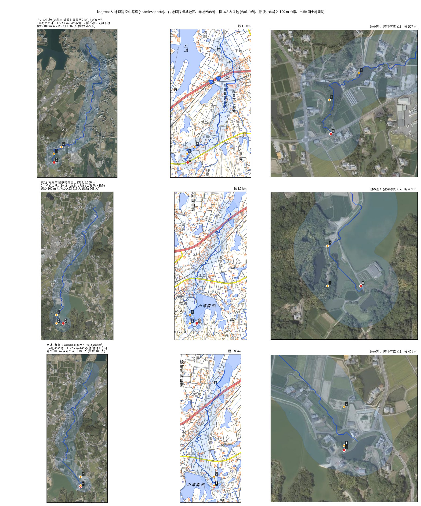
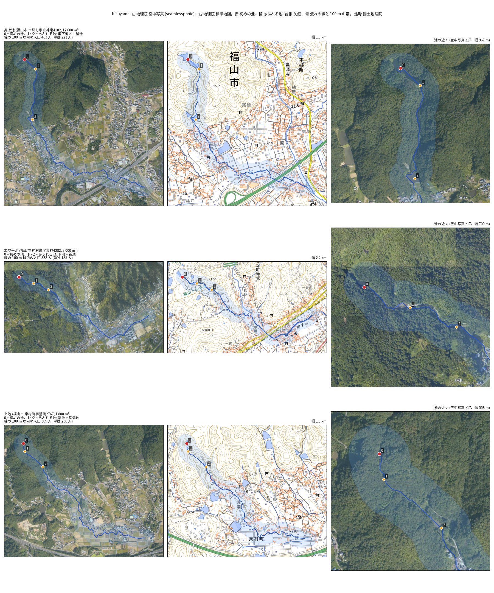
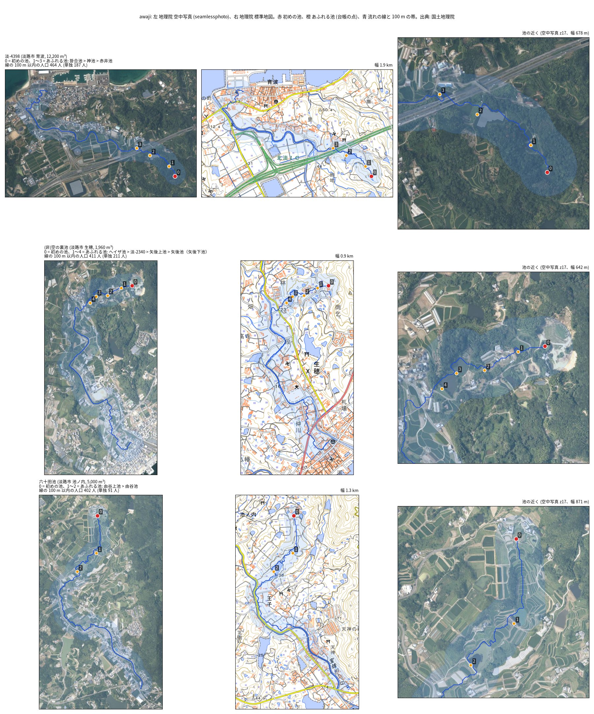

# 範囲の端で止まった連鎖を先まで追い、指定されていない候補を空中写真で確かめる

問い: 流れの計算の範囲を広げると、連鎖の数と、防災重点農業用ため池に指定されていない連鎖の初めの池の数はどう変わるか。あわせて、指定されていない初めの池のうち人口の多い池は、空中写真と地図で見て、池があり、流れの近くに家があるか。

## 結論

範囲を四方に約 4 km 広げても、数はほとんど変わらなかった。2 つ以上の池が次々にあふれ、流れの近くに人が住む連鎖は、香川 30 から 29、福山 33 のまま、淡路 149 から 152 になった。指定されていない連鎖の初めの池は、香川 23、福山 10、淡路 73 で、前の数 (24、10、70) とほぼ同じだった。

前の報告の「連鎖の多くは範囲の端で止まっていて、数は下限」は言い過ぎだった。「範囲の外へ出た」とされた連鎖の多くは、流れが海か窪地で終わっていた。範囲を広げても、端で終わっていた連鎖が長くなったのは淡路の 3 つだけだった。香川だけは、広げた範囲の端で終わる連鎖が 29 のうち 6 残り、まだ下限である。

空中写真と地図で見た 9 つの候補では、全てで流れの線の 100 m 以内に 10 棟以上の建物があった。一方、池が写真にはっきり写っていたのは 1 つだけだった。谷の池は林に隠れ、写真では水面が見えない。初めの池の 1 つは掘られた裸地、あふれる池の 1 つは造成地だった。候補の池が今もあるか、満水になるかは、現地で確かめる必要がある。

| # | 要点 | 香川、福山、淡路 | 根拠 |
|---|---|---|---|
| 1 | 元の範囲の中の再現: 「範囲の外へ出た」以外の理由で止まった初めの池で、あふれる池の並びが元と同じ割合 (計画の関門を超えた) | 1.0、0.9878、0.9932 | [b0.csv](outputs/b0.csv) |
| 2 | 2 段以上で、流れの近くに人が住む連鎖 (元 → 広げた後) | 30 → 29、33 → 33、149 → 152 | [b1.csv](outputs/b1.csv) |
| 3 | 2 のうち、流れの線が計算の範囲の端で終わる連鎖 (元 → 広げた後) | 19 → 6、1 → 0、12 → 3 | [b1.csv](outputs/b1.csv) |
| 4 | 元の連鎖のうち、広げて長くなった数と、短くなった数 | 長く 0、0、3。短く 1、2、7 | [b1.csv](outputs/b1.csv) |
| 5 | 決めきれない値を 1 つずつ変えたときの、2 の幅 (広げた後) | 20〜35、19〜39、108〜188 | [b1.csv](outputs/b1.csv) |
| 6 | 2 のうち、指定されていない初めの池 | 23、10、73 | [b2.csv](outputs/b2.csv) |
| 7 | 6 を、指定を多めに数える照合にしたとき (下限) | 18、9、64 | [b2.csv](outputs/b2.csv) |
| 8 | 6 のうち、流れの近くの人口が 100 人以上の池 | 7、4、29 | [b2.csv](outputs/b2.csv) |

香川で連鎖が 1 つ減ったのは、休場池 (丸亀市) の連鎖である。元の計算では市ノ谷池と水門池の 2 つをあふれさせていたが、広げた計算では水門池だけになった。元の範囲の端が、水面か流れを切っていたためと考えられる。休場池は前の報告で香川の候補の 1 位だったが、今回は候補から外れた。

## 空中写真と地図での確かめ (探索)

範囲ごとに、連鎖の人口の多い候補を 3 つずつ図にした。左は地理院の空中写真、中は標準地図 (どちらも z16)、右は池の近くの空中写真 (z17)。判定は図を見て手で書いた ([visual_verdicts.csv](outputs/visual_verdicts.csv))。

| 範囲 | 初めの池 | 池 | 帯の中の建物 | 流れ | 見たこと |
|---|---|---|---|---|---|
| 香川 | そこなし池 | 一部 | 10 棟以上 | 混ざる | 初めの池の点は交差点の脇で、水面が見えない |
| 香川 | 東池 | 全て | 10 棟以上 | 混ざる | 林の中の池から小津森池の縁を通り、集落へ |
| 香川 | 西池 | 一部 | 10 棟以上 | 平地 | 2 つ目にあふれる池の点は造成地 |
| 福山 | 奥上池 | 一部 | 10 棟以上 | 混ざる | 林で水面が見えない。標準地図には池がある |
| 福山 | 加屋平池 | 一部 | 10 棟以上 | 混ざる | 同上。谷を下って河手川沿いの町へ |
| 福山 | 上池 | 判断できない | 10 棟以上 | 混ざる | 写真でも地図でも池を見分けられない |
| 淡路 | 淡-4398 | 一部 | 10 棟以上 | 混ざる | 谷から育波の集落へ |
| 淡路 | (非)空の裏池 | 一部 | 10 棟以上 | 混ざる | 初めの池の点は掘られた裸地。廃止か用途の変更の疑い |
| 淡路 | 六十田池 | 一部 | 10 棟以上 | 混ざる | 棚田の谷から宝珠川沿いの集落へ |

この判定は、Claude が図を見て書いたもので、人が見直していない。林の中の池は、空中写真では判定できないことが多かった。

## データ

| データ | 版 / 取得日 | 使ったこと |
|---|---|---|
| 国土地理院 DEM5A (z15) | 2026-11-06〜07 取得 (広げた分は 2026-11-07) | 流れ、水面、集水面積 |
| 農林水産省 農業用ため池一覧 | 令和 8 年 3 月末時点 (`yuiseki/maff-tameike-list-jp-2026-03`、`ee87755`) | 貯水量、堤高、照合の相手 |
| WorldPop R2025A | 2020 年、100 m、constrained | 流れの線の近くの人口 |
| 気象庁 過去の気象データ・ダウンロード | `tameike-cascade-breach` と同じ | 設計の雨 |
| 香川県、広島県、兵庫県の防災重点農業用ため池の一覧 | `tameike-cascade-designation` と同じ (香川は 17 市町の全て) | 指定の有無 ([sources.csv](outputs/sources.csv)) |
| 国土地理院 空中写真 (seamlessphoto)、標準地図 (std) | z16、z17。2026-11-07 取得 | 目視の確かめ |

## 方法

計画 ([EXPERIMENT_PLAN.md](EXPERIMENT_PLAN.md)) は流す前にコミットした。

- 判定のしかたと値は `tameike-cascade-breach` と全て同じ。流れの計算の範囲だけを、元の範囲の四方に 0.04 度広げた。初めの池は、元の範囲の中に台帳の点がある池だけにした。
- 連鎖の最後の池 (無ければ初めの池) から流れをたどり、計算の格子の縁で終わるかを記録した。
- 指定の照合は `tameike-cascade-designation` と同じ 4 つの鍵。香川県は 17 市町の全ての一覧を使った。広げた範囲に一覧の無い県の池は無かった ([b2_match.csv](outputs/b2_match.csv))。

計画からの変更は 1 つで、計画の末尾と記録 ([EXPERIMENT_TRACKER.md](EXPERIMENT_TRACKER.md)) にある。

- 空中写真の確かめに、池の近くを z17 で見る図を足し、判定に「判断できない」を足した。最初の図を見た後の変更で、この区画は探索である。

ほかに次のことがあった。

- 地理院のタイルの取得が接続の切断で 2 回止まった。取得に再試行を足した。結果の計算は変えていない。
- 前の報告の書き方を、`tameike-cascade-breach` の報告で直した (要点 8a)。

## 確かめていないこと

- `tameike-cascade-breach` と `tameike-cascade-designation` の「確かめていないこと」は、全てここにも当てはまる。
- 香川の 6 つの連鎖は、広げた範囲の端でも終わっている。さらに広げると長くなりうる。
- 空中写真の判定は 1 人 (Claude) で、撮影の時期も確かめていない。池が今もあるか、満水になるかは、現地で確かめる必要がある。
- 「範囲の外へ出るか、池に当たらない」で止まった連鎖のうち、端で終わらない連鎖は海か窪地で終わる。海に面した池の連鎖は、そこで本当に終わる。
