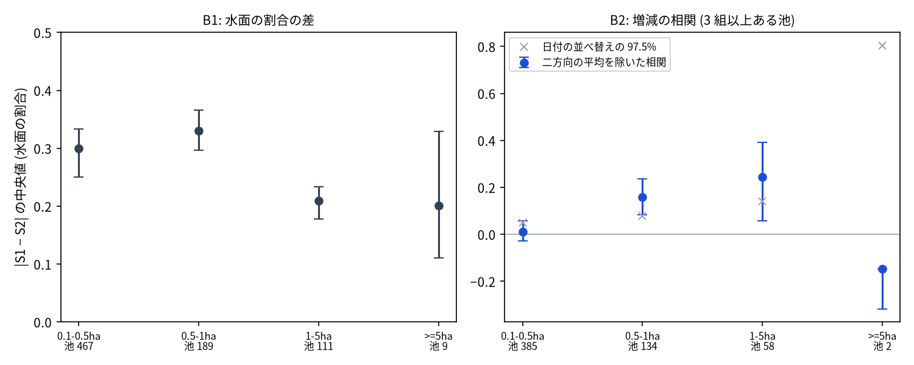

# Sentinel-1 で測るため池の水面の割合と Sentinel-2 の比較

問い: 3 つの範囲のため池で、Sentinel-1 RTC で測る池の中の水面の割合は、近い日の Sentinel-2 の割合と、どの大きさの池まで合い、池ごとの増減を追えるか。

## 結論

Sentinel-1 で測った池の水面の割合は、0.5〜5 ha の池では Sentinel-2 の増減と弱く同じ向きに動いた。0.5 ha 未満の池では、増減を追えなかった。5 ha 以上の池は、比べられる組が少なく、判断できない。

計画の規則に当てた結果は次のとおり。

- C0 (陽性の対照): 支持。
- C1 (池が大きいほど差が小さい): 退ける。
- C2 (1〜5 ha と 5 ha 以上の両方で増減を追える): 5 ha 以上を判断できないので、規則のうえでは支持されない。

| # | 要点 | 数字 | 根拠 |
|---|---|---|---|
| 1 | 陽性の対照: 5 ha 以上の池の内側は、多くの日に両方の衛星で水と判定された (計画の規則 0.8 以上を満たす) | 水面の割合の中央値 S1 0.823、S2 0.9413 | [b0.json](outputs/b0.json) |
| 2 | S1 の位置は、池の輪郭に対して 1 行と 2〜4 列ずれていた (10 m の画素)。S2 はずれていなかった。直してから数えた | 香川と福山 (-1, -4)、淡路 (-1, -2) | [b0.json](outputs/b0.json) |
| 3 | 2 日以内に S1 と S2 がそろった組は少ない | 日付の組 8、5、16。池と日の組 4,125 | [b0.json](outputs/b0.json)、[pairs.csv](outputs/pairs.csv) |
| 4 | S1 と S2 の水面の割合の差 (中央値) は、池が大きいほど小さいとは言えなかった (C1 は退ける)。0.5 ha 未満の池では、S2 が水をほとんど見ない (中央値 0) のに、S1 は 4 割近くを水と判定した | 差 0.3、0.3303、0.209、0.2007。0.1〜0.5 ha の S1 0.375、S2 0 | [b1.csv](outputs/b1.csv) |
| 5 | 池ごとの平均と日ごとの平均を除いた増減の相関は、0.5〜1 ha と 1〜5 ha で正。区間は 0 を含まず、日付を並べ替えた相関の分布の上端 (perm_p975) を上回った。0.5 ha 未満では 0 の周り | 0.1596 [0.0828, 0.2374]、0.2437 [0.0587, 0.391]、0.0119 [-0.0289, 0.0573] | [b2.csv](outputs/b2.csv) |
| 6 | 5 ha 以上で 3 組以上ある池は 2 つだけで、増減の相関は判断できない | 2 池 | [b2.csv](outputs/b2.csv) |
| 7 | 1〜5 ha の相関は、S1 の閾値 (-13、-17 dB)、S2 の閾値 (0.1)、削らない輪郭でも、区間が 0 を含まなかった。S2 の閾値 -0.1 では区間の下端が 0 に触れ、S2 の SCL の水の分類を使うと相関が消えた | -0.0002 (S2 -0.1 の下端)、0.043 (SCL) | [robustness.csv](outputs/robustness.csv) |

図: 左は、池と日の組の、S1 と S2 の水面の割合の差 (絶対値の中央値)。右は、池ごとの平均と日ごとの平均を除いた後の、S1 と S2 の割合の相関。縦の線は、池で引き直したブートストラップの 95% 区間。灰色の × は、池の中で S1 の日付を並べ替えたときの相関の 97.5% 点 (`scripts/figure.py`)。

使い道への答え: Sentinel-1 だけで、個々の池の減水を見張ることはまだできない。増減の向きは、0.5〜5 ha の池で Sentinel-2 と同じ向きに出るが、相関は 0.16〜0.24 と弱い。0.5 ha 未満の池は、水面の割合そのものが Sentinel-2 と合わない。前のプロジェクト `sar-drought-drawdown-monitoring` (取り下げ) のように、1 つの池の後方散乱の変化から減水を判定することは、この結果では支えられない。

## データ

| データ | 版 / 取得日 | 使ったこと |
|---|---|---|
| Sentinel-1 RTC (Planetary Computer `sentinel-1-rtc`) | 2024 年。相対軌道 90 (香川、福山)、17 (淡路)、どれも下り。2026-11-06 取得 | VV (線形の γ0) を dB にして、-15 dB 未満を水とした |
| Sentinel-2 L2A (Planetary Computer `sentinel-2-l2a`) | 2024 年、雲 60% 未満の撮影。2026-11-06 取得 | B03、B08 の NDWI > 0 を水とした (処理基準 04.00 以降は 1000 を引く)。SCL で雲と雲の影を除いた |
| 国土地理院 DEM5A (z15) | 2026-11-06 取得 | 値なしの穴を池の輪郭にした |
| 農林水産省 全国ため池台帳 | `yuiseki/maff-tameike-list-jp-2026-03` (`ee87755e53cf5b049b31bc307aca56ad950771cc`) | 穴に台帳の点が 30 m 以内で対応づいたものだけを池とした |

撮影の一覧は `outputs/<範囲>_scenes.csv`、池の一覧と面積は `outputs/<範囲>_ponds.csv`。範囲は `tameike-cascade-pairs` と同じ。

## 方法

- 池の輪郭: DEM5A の値なしの穴 (5 m) のうち、台帳の点が 30 m 以内に対応づいたものを、10 m の格子に移した (2 × 2 の多数決)。そこから 1 画素削り、内側だけを数えた。大きさの階級は、穴の面積で決めた (台帳の面積は使わない。仮の値があるため)。
- 格子: S1 と S2 は、範囲ごとの 10 m の格子 (EPSG:32653) に最近傍で読んだ。
- 位置のずれ: 全ての撮影の中央値の画像と池の輪郭の相互相関で、±5 画素の中から測った。整数の画素で直した。
- 水面の割合と組:
  - 池と撮影ごとに、内側の画素のうち水の割合を出した。
  - 各 S1 の撮影に、2 日以内の最も近い S2 の撮影を組にした。
  - 内側の画素が 4 つ以上あり、S2 で池の画素の 90% 以上が雲と雲の影でない組だけを使った。
- B1: 階級ごとに |S1 − S2| の中央値を出し、池で引き直すブートストラップ (1,000 回) で 95% 区間を付けた。
- B2:
  - 組が 3 つ以上ある池について、S1 と S2 の割合から、池の平均と、範囲ごとの日付の平均を除いた (二方向の平均を除く)。その残りの相関を、階級ごとに出した。
  - 比べる相手は、池の中で S1 の日付を並べ替えた相関 (200 回)。
- テスト: `scripts/test_water_stats.py`。既知のずれを取り戻すこと、遠くの大きな水面を外してずれを測ること、池ごとの割合の数え方、二方向の平均の除き方、日付の組の作り方を確かめた。

計画 ([EXPERIMENT_PLAN.md](EXPERIMENT_PLAN.md)) は、流す前にコミットした。記録は [EXPERIMENT_TRACKER.md](EXPERIMENT_TRACKER.md) にある。

淡路の位置のずれの相関が低かったため、池の近くの画素だけでずれを測る版を、探索として流した (`outputs/explore_shift_near_ponds/`)。選ばれたずれは同じで、結果も同じだった。

関門について:

- 座標: 全て EPSG:32653 の 10 m の格子で数えた。
- 量と水準: 水面の割合は水準なので、池の中で数え、池をまたいで足していない。
- 空間の依存: 区間は池で引き直し、日付の効果は範囲ごとに除いた。
- 基準: 日付の並べ替えを比べる相手にした。
- 頑健性: 閾値と輪郭の定義を変えて確かめた。
- 報告: 一致度であり、どちらの衛星も真の水面ではない。

## 確かめていないこと

- 真の水面。S2 の NDWI も誤る。たとえば水生植物や濁りがあると、水を水と判定しない。0.5 ha 未満の池で S2 が水をほとんど見ないのは、水面が植物で覆われているか、輪郭の中に水が無い可能性がある。
- 撮影の時刻の違い。S1 は 06 時頃、S2 は 11 時頃に撮る。2 日の間に、水位が変わっていないと仮定した。
- 5 ha 以上の池の増減。比べられる池が 2 つしかない。
- 風の強さ。日付の平均を除いたが、範囲の中で場所ごとに違う風の効果は残る。
- 2024 年以外の年と、ほかの軌道。
