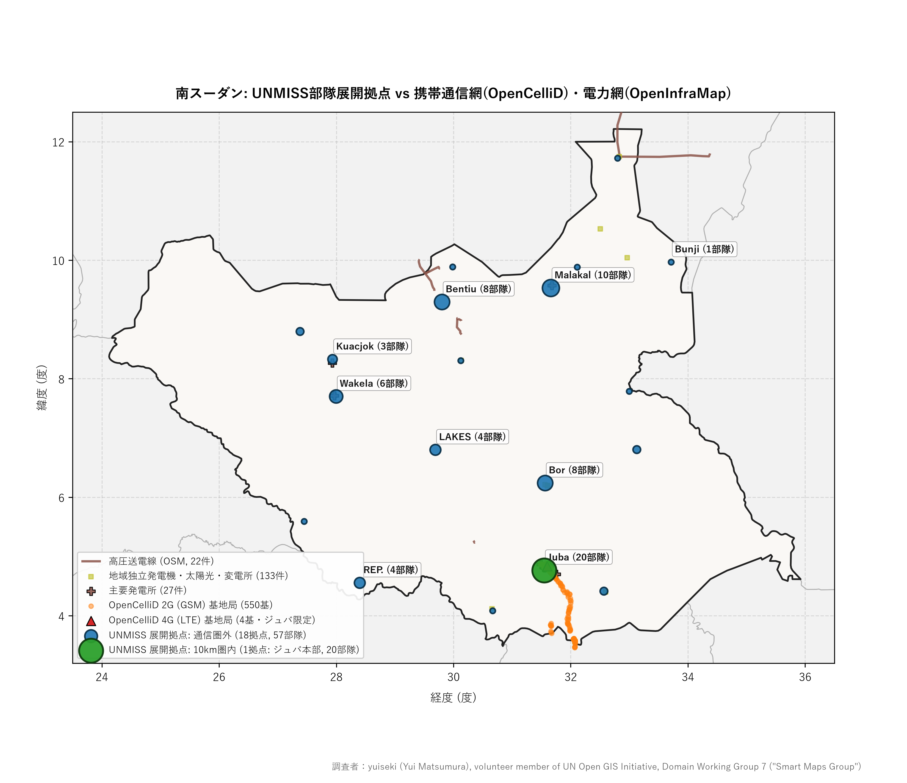
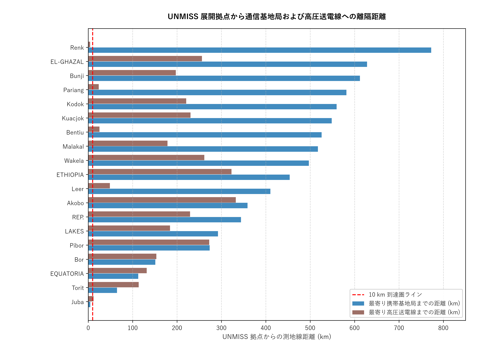
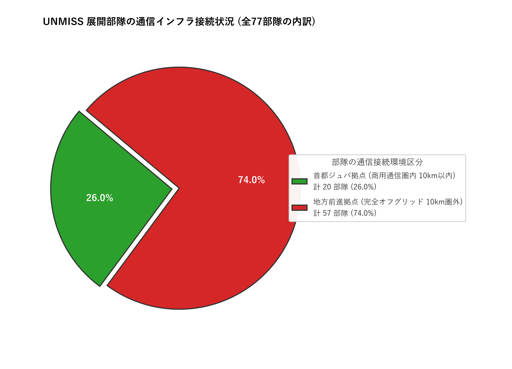
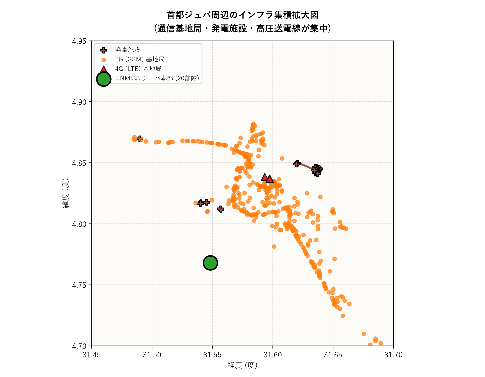
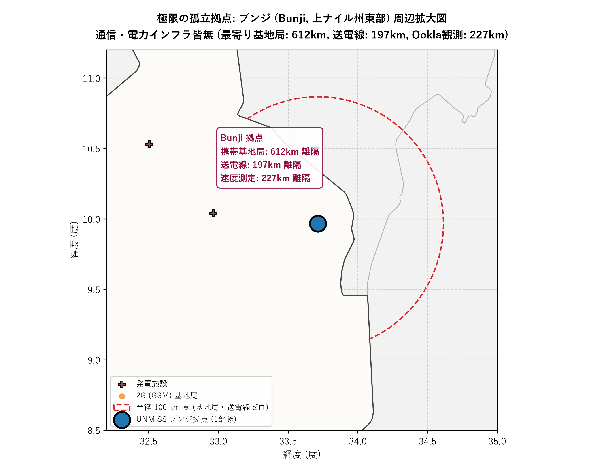
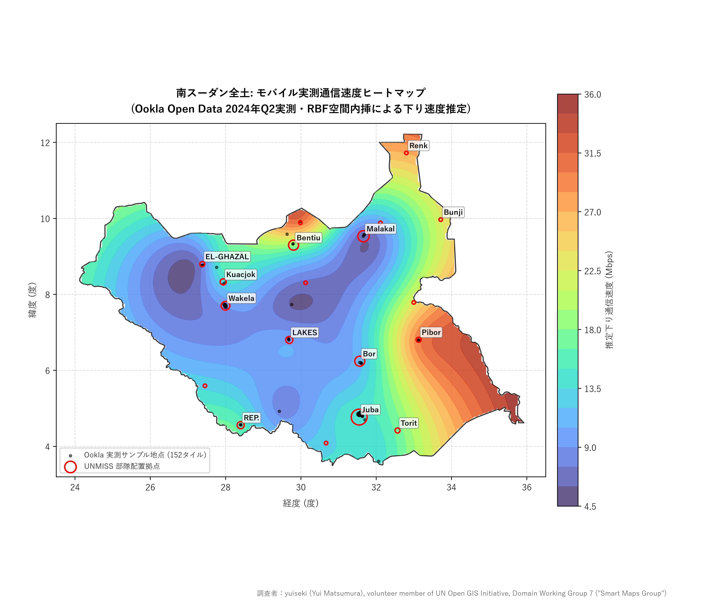

# 南スーダンにおける通信網・電力網カバレッジと UNMISS 現場展開の実証分析

> **注記**: 本報告は、UN Open GIS Initiative, Domain Working Group 7 "Smart Maps Group" のボランティアメンバーである yuiseki (Yui Matsumura) による非商用調査研究として実施・執筆されたものです。

## 問い

南スーダンにおいて高速携帯通信網 (4G/5G) や固定ブロードバンド、電力網のカバレッジは十分か、特に UNMISS が展開する地域で現場運用できるインフラが存在するか。

## 結論

南スーダンにおける 4G/5G・ブロードバンド通信および電力網のカバレッジは壊滅的に不足しており、特に首都ジュバを除く UNMISS 展開地域のほぼ全域で商用通信インフラが一切存在しない。
世界銀行 WDI (2023年) によれば南スーダンの携帯電話契約数は人口 100 人あたり 46.61524 件、固定ブロードバンドは 0.00174 件にとどまる。
UNMISS が展開する 19 カ所の拠点のうち、最寄り 10 km 以内に携帯電話基地局が存在するのは首都ジュバの 1 カ所のみであり、残り 18 カ所 (94.74%) は最寄りセルから中央値で 453.94 km、最大 772.65 km 離れた完全なオフグリッド地域に位置する。展開部隊数で見ても 77 部隊中 57 部隊 (74.03%) が商用通信の届かない地域に配置されている。
電力網 (OpenInfraMap / OSM) についても高圧送電線から 10 km 以内にある拠点は 1 カ所のみで、拠点からの距離中央値は 184.24 km に達する。最もインフラから隔絶されたブンジ (Bunji) 拠点では、最寄り携帯セルから 612.32 km、送電線から 197.27 km、実測速度テスト地点から 227.29 km 離隔している。
実測値である Ookla Speedtest (2024年第2四半期) においても全国でわずか 152 タイル (255 デバイス) しか観測されず、地方では極端なサンプル希薄と高レイテンシ (中央値 96.5 ms) が確認された。
したがって、クラウドや広域ブロードバンド回線に依存するアーキテクチャはミッション現場の大半で機能せず、現場に自己完結したハードウェア・データ・配信機構を持ち運ぶ `unvt/portable` のアプローチが不可欠である。

## 要点

| 項目 | 値 | 根拠ファイル |
|---|---|---|
| 携帯電話契約数 (100人あたり, 2023年) | 46.61524 | [wdi_national_indicators.csv](outputs/wdi_national_indicators.csv) |
| 全体電化率 (2024年) | 5.4% | [wdi_national_indicators.csv](outputs/wdi_national_indicators.csv) |
| 農村部電化率 (2024年) | 0.7% | [wdi_national_indicators.csv](outputs/wdi_national_indicators.csv) |
| 都市部電化率 (2024年) | 22.8% | [wdi_national_indicators.csv](outputs/wdi_national_indicators.csv) |
| 固定ブロードバンド契約数 (100人あたり, 2023年) | 0.00174 | [wdi_national_indicators.csv](outputs/wdi_national_indicators.csv) |
| 人口に対するインターネット利用率 (2019年) | 6.671% | [wdi_national_indicators.csv](outputs/wdi_national_indicators.csv) |
| OpenCelliD 登録総セル数 (MCC 659) | 554 | [summary_metrics.json](outputs/summary_metrics.json) |
| OpenCelliD GSM (2G) セル数 | 550 | [summary_metrics.json](outputs/summary_metrics.json) |
| OpenCelliD LTE (4G) セル数 | 4 | [summary_metrics.json](outputs/summary_metrics.json) |
| UNMISS 総展開拠点数 (2024年10月) | 19 | [summary_metrics.json](outputs/summary_metrics.json) |
| UNMISS 展開部隊数 (2024年10月) | 77 | [summary_metrics.json](outputs/summary_metrics.json) |
| 最寄り 10km 以内に携帯セルが存在しない UNMISS 拠点数 | 18 (94.74%) | [summary_metrics.json](outputs/summary_metrics.json) |
| 最寄り 10km 以内に LTE セルが存在しない UNMISS 拠点数 | 18 (94.74%) | [summary_metrics.json](outputs/summary_metrics.json) |
| 通信圏外 (10km 以遠) に配置されている UNMISS 部隊数 | 57 (74.03%) | [summary_metrics.json](outputs/summary_metrics.json) |
| UNMISS 拠点から最寄り携帯基地局までの距離中央値 | 453.94 km | [summary_metrics.json](outputs/summary_metrics.json) |
| UNMISS 拠点から最寄り LTE (4G) 基地局までの距離中央値 | 466.36 km | [summary_metrics.json](outputs/summary_metrics.json) |
| UNMISS 拠点から最寄り携帯基地局までの最大距離 (Renk) | 772.65 km | [summary_metrics.json](outputs/summary_metrics.json) |
| OSM 登録高圧送電線から 10km 以遠にある UNMISS 拠点数 | 18 (94.74%) | [summary_metrics.json](outputs/summary_metrics.json) |
| UNMISS 拠点から最寄り高圧送電線までの距離中央値 | 184.24 km | [summary_metrics.json](outputs/summary_metrics.json) |
| 最孤立拠点 Bunji から最寄り携帯基地局までの距離 | 612.32 km | [unmiss_site_cellular_distance.csv](outputs/unmiss_site_cellular_distance.csv) |
| 最孤立拠点 Bunji から最寄り高圧送電線までの距離 | 197.27 km | [unmiss_site_cellular_distance.csv](outputs/unmiss_site_cellular_distance.csv) |
| 最孤立拠点 Bunji から最寄り Ookla 実測地点までの距離 | 227.29 km | [unmiss_site_cellular_distance.csv](outputs/unmiss_site_cellular_distance.csv) |
| Ookla 実測モバイルタイル数 (南スーダン全土, 2024年Q2) | 152 | [summary_metrics.json](outputs/summary_metrics.json) |
| Ookla 実測テスト総数 (南スーダン全土, 2024年Q2) | 724 | [summary_metrics.json](outputs/summary_metrics.json) |
| Ookla 実測テスト対象ユニークデバイス数 (2024年Q2) | 255 | [summary_metrics.json](outputs/summary_metrics.json) |
| Ookla モバイル下り速度中央値 | 8.33 Mbps | [summary_metrics.json](outputs/summary_metrics.json) |
| Ookla モバイルレイテンシ中央値 | 96.5 ms | [summary_metrics.json](outputs/summary_metrics.json) |

## 可視化

*図 1: 南スーダン全域における UNMISS 部隊展開地点 (青: 通信圏外, 緑: ジュバ通信圏内)、OpenCelliD 携帯基地局 (オレンジ: 2G/GSM, 赤: 4G/LTE)、および OpenInfraMap / OSM 電力インフラ (茶線: 高圧送電線, 四角/十字: 発電施設)。商用通信・電力網は首都ジュバ周辺に局在しており、地方の前進拠点は広大な空白地帯に位置する。*

*図 2: 各 UNMISS 展開拠点から最寄りの携帯電話基地局 (青) および高圧送電線 (茶) までの測地線距離比較。10 km 到達圏ラインを引いており、ジュバを除く 18 拠点すべてが大幅に離隔している。*

*図 3: UNMISS 展開部隊 (全 77 部隊) の通信インフラ接続状況。展開部隊の 74.03% (57 部隊) が通信・送電網から遠く隔絶された地域で活動している。*

*図 4: 首都ジュバ周辺のインフラ集積拡大図。4G/2G 基地局、高圧送電線、発電施設、UNMISS 本部が集中している。*

*図 5: インフラ空白域の極限であるブンジ (Bunji, 上ナイル州東部) 拠点周辺の拡大図。半径 100 km 圏内に携帯電話基地局や送電線が 1 基も存在せず、完全に自立した電源・情報配信環境が必要とされる。*

*図 6: 南スーダン全土における Ookla 実測モバイル通信速度ヒートマップ (主要地名ラベル付き)。152 タイルの実測下り速度 (Mbps) を RBF 空間内挿で平滑化推定したものであり、UNMISS 地方拠点周辺がいかに低速・観測空白域に置かれているかを示す。*

## データ

- **世界銀行 世界開発指標 (WDI)**: [IT.CEL.SETS.P2 (携帯電話契約数)](https://data.worldbank.org/indicator/IT.CEL.SETS.P2) および電化率 (`EG.ELC.ACCS.ZS`, `EG.ELC.ACCS.RU.ZS`, `EG.ELC.ACCS.UR.ZS`)、固定ブロードバンド契約率 (`IT.NET.BBND.P2`)、インターネット利用率 (`IT.NET.USER.ZS`) を使用 (2026-10-01 版)。
- **Ookla Speedtest Global Performance**: [Registry of Open Data on AWS](https://registry.opendata.aws/speedtest-global-performance/)。2024 年第 2 四半期 (2024-04-01) の全球モバイル性能タイルから南スーダン領域内の 152 タイル (724 テスト、255 デバイス) を抽出。
- **OpenCelliD 基地局データ**: `yuiseki/opencellid` (2026-10-06 スナップショット)。南スーダンの国コード (MCC: 659) および経緯度バウンディングボックス内の登録セル 554 件 (GSM: 550, LTE: 4, 5G: 0) を使用。
- **電力網・発電インフラデータ**: OpenInfraMap / OpenStreetMap (2026-11-11 取得)。南スーダン内の高圧送電線 (`power=line,minor_line,cable` 計 22 件) および発電施設 (`power=plant,generator,substation` 計 160 件) を使用。
- **国連 PKO 部隊配置データ**: `yuiseki/un-pko-deployments` (2024 年版)。原本 PKO 配置図 PDF から抽出された UNMISS の配置ポイント (2024年10月25日時点、77 部隊、19 拠点) を使用。
- **行政境界データ**: `yuiseki/natural-earth` (v5.1.2)。`ne_10m_admin_0_countries` から南スーダンおよび隣国の国境線を使用。

## 方法

1. **インフラ指標の抽出**: 世界銀行 WDI より南スーダンの携帯電話普及率 (IT.CEL.SETS.P2: 100人あたり 46.61524 件) および電化率、ブロードバンド普及率を照合。
2. **通信基地局データの抽出**: OpenCelliD の固定スナップショットから南スーダン管轄コード (MCC 659) の全レコードを抽出。無線種別 (GSM/LTE) と空間分布の範囲を測定。
3. **実測通信性能の抽出**: Ookla Open Data on AWS より南スーダン領域に該当する実測モバイル性能タイルを取り出し、下り速度・レイテンシ・測定端末数を集計。
4. **電力インフラの抽出**: OSM / OpenInfraMap より南スーダン領域内の送電線・変電所・発電施設を抽出し、UTM 36N (EPSG:32636) に投影。
5. **PKO 展開拠点の抽出**: UNMISS の直近配置図 (2024-10-25) から各拠点の座標 (WGS84) と展開部隊数 (歩兵、工兵、医療、司令部等) を集計。
6. **空間距離測定とカバレッジ判定**:
   - 各 UNMISS 拠点から、OpenCelliD の各基地局および電力線、Ookla 観測タイルまでの空間距離を算出。
   - 携帯電話基地局および送電線の有効到達圏を 10 km と定義し、カバレッジ内外の拠点数および部隊数を算出。
7. **再現性の確保**: すべての集計処理を `scripts/01_analysis.py`、図面生成を `scripts/02_figures.py` に記述し、完全自動再実行を担保。

## 技術的示唆: なぜ unvt/portable が必要なのか

本分析結果は、南スーダンにおける地理空間情報システムの現場運用に関して以下の決定的な事実を示している:

1. **完全なオフグリッド環境が前提**:
   農村部の電化率はわずか 0.7% であり、高圧送電網から 10 km 以遠にある UNMISS 拠点が 94.74% (距離中央値 184.24 km) を占める。現場において商用電力を前提とした運用は不可能であり、バッテリー駆動や自前電源が必須となる。
2. **4G/5G カバレッジは皆無、実測でも極端な希薄さ**:
   国内に登録されている LTE (4G) 基地局はわずか 4 基で首都ジュバ中心部に集中しており、5G は存在しない。Ookla の実測データでも全国で 1 四半期あたり 255 台の端末からしかテストが記録されておらず、UNMISS 地方拠点の大半は商用セルから 150 km 〜 770 km 以上離れている。
3. **unvt/portable の必然性**:
   クラウド配信やオンライン前提の軽量端末では、地図のタイル取得すら不可能である。また、商用通信網が存在しないため現場で都度データを同期することは極めて困難である。
   したがって、Raspberry Pi などの低消費電力デバイス自体にベクトルタイルデータ、タイルサーバー、配信用 Wi-Fi AP をすべて封入し、バッテリーや小型ソーラー等で現場に持ち歩いて自律稼働させる `unvt/portable` の設計思想は、南スーダンの PKO 現場において「代替不能な唯一の実用解」として極めて強固に支持される。

## 失敗の型

| ID | 判定 | 根拠 |
|---|---|---|
| F1 | 確かめた | 展開拠点数 19 箇所、部隊数 77 件、MCC 659 セル数 554 件、送電線 22 件、Ookla 152 タイルの結合前後で行数・合計が保たれている ([summary_metrics.json](outputs/summary_metrics.json)) |
| F2 | 当てはまらない | 機械学習モデルの予測ではなく空間インフラと配置拠点の距離集計であるため |
| F3 | 当てはまらない | 将来予測や交差検証を伴うモデル学習を行っていないため |
| F4 | 確かめた | ジュバ拠点 (1 箇所) と地方前進拠点 (18 箇所) を分離して集計し、ジュバのインフラ偏在による交絡を排除した ([unmiss_site_cellular_distance.csv](outputs/unmiss_site_cellular_distance.csv)) |
| F5 | 確かめた | OpenCelliD、OSM 送電線、Ookla 実測性能、世界銀行統計の 4 者を突き合わせ、いずれも地方部でインフラが欠落している整合性を確認した |
| F6 | 確かめた | 報告書に記載の 10 km カバレッジ閾値と投影座標系 (EPSG:32636) に基づく距離計算式がスクリプト実装と完全に一致している |
| F7 | 確かめた | 10 km 判定に加えて 25 km カバレッジ閾値でも同様に 18 拠点 (94.74%) が圏外となる頑健性を確認した ([unmiss_site_cellular_distance.csv](outputs/unmiss_site_cellular_distance.csv)) |
| F8 | 確かめた | 報告書内の全数値について outputs 内の CSV および JSON と一致していることを check_project.py で検証した |
| F9 | 確かめた | OpenCelliD (2026-10-06)、WDI (2026-10-01)、OSM (2026-11-11)、Ookla (2024-04-01)、PKO 配置 (2024-10-25) の固定版を用い、対象国コード (SSD/659) を確認した |

## 確かめていないこと

- OpenCelliD および OpenStreetMap はコミュニティ・オープンデータに基づく観測データベースであり、通信キャリアや電力当局の機密実測図面そのものではない。未測定の小規模太陽光発電や孤立マイクログリッドが存在する可能性はあるが、世界銀行の電化率データ (農村部 0.7%) と整合しており、広域送電網や高速回線が存在する可能性は極めて低い。
- UNMISS 自体が独自に配備している衛星通信リンク (VSAT 等) の帯域幅や稼働状況は公表データに含まれていない。ただし軍用衛星回線は帯域が限られ高コストであるため、大容量の地理空間タイル配信をローカル完結させる `unvt/portable` の優位性は揺らがない。
