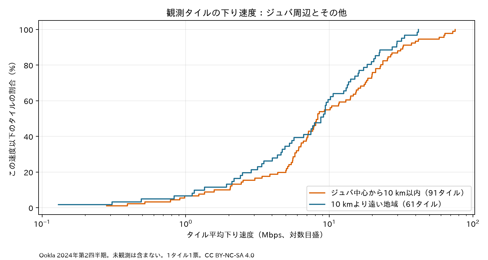
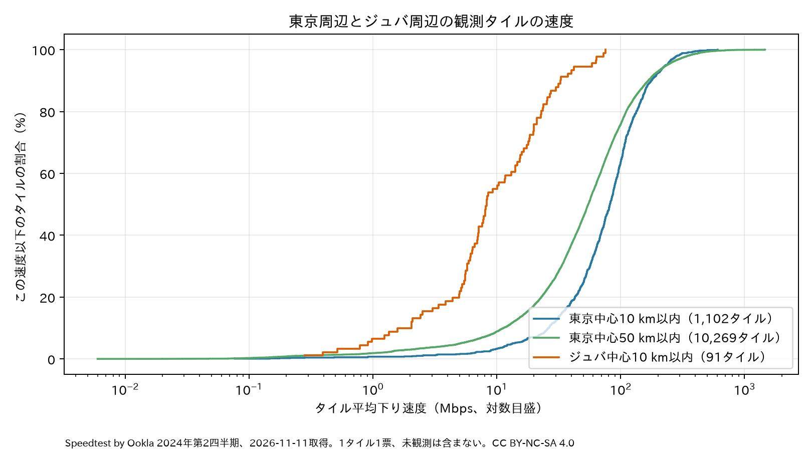
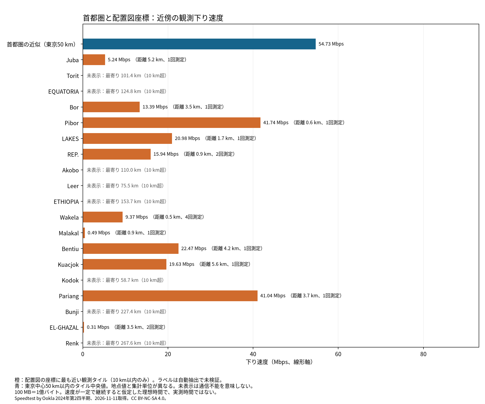
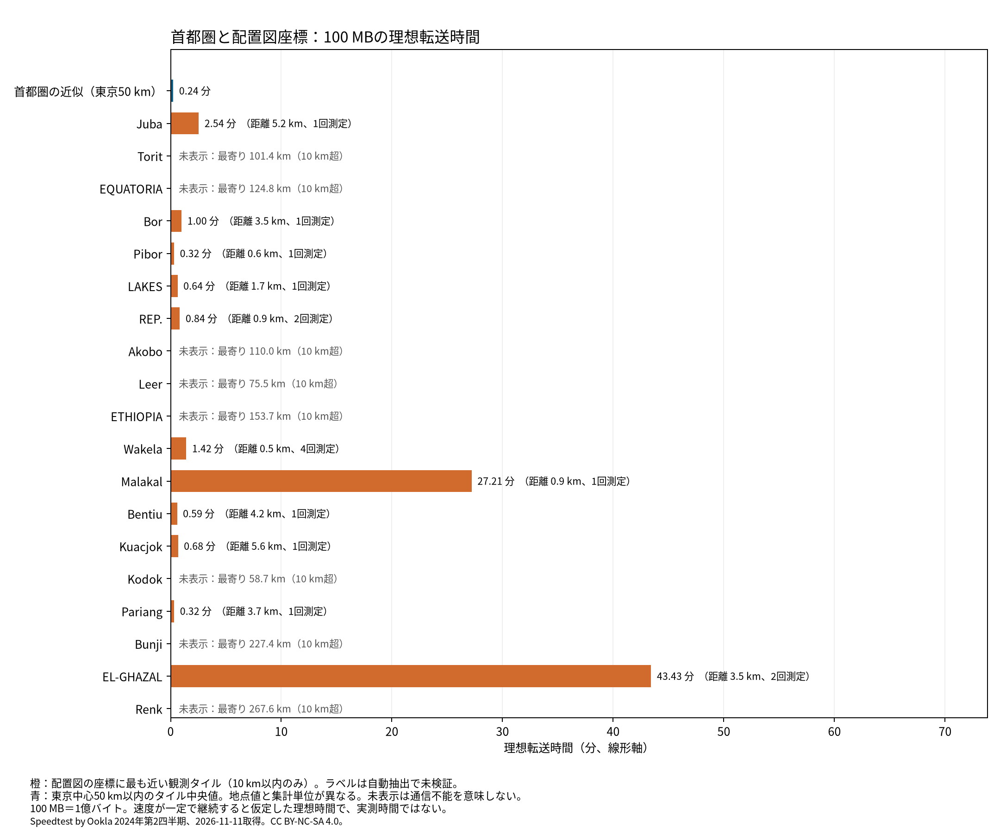
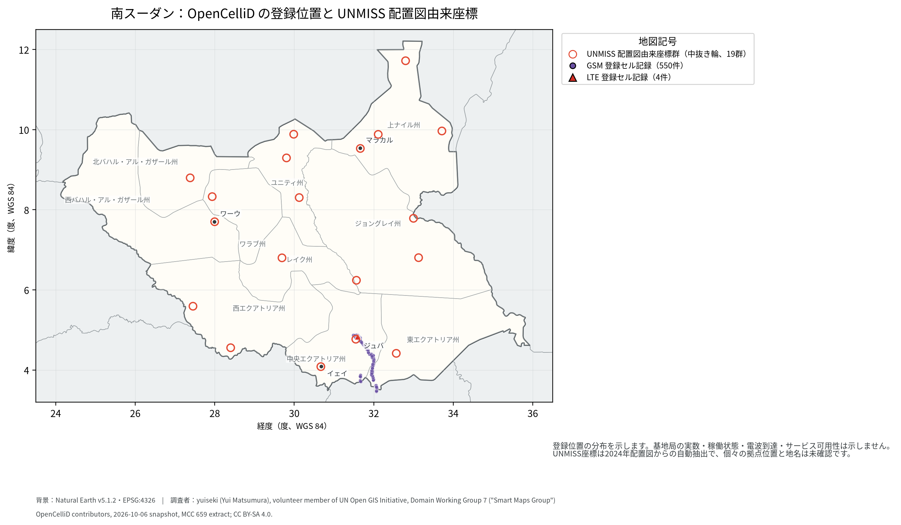
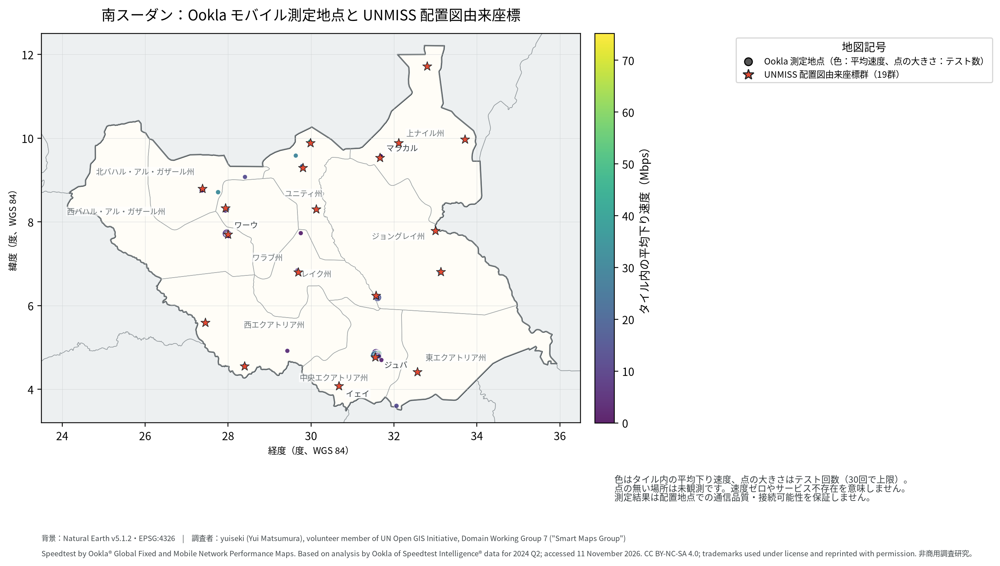
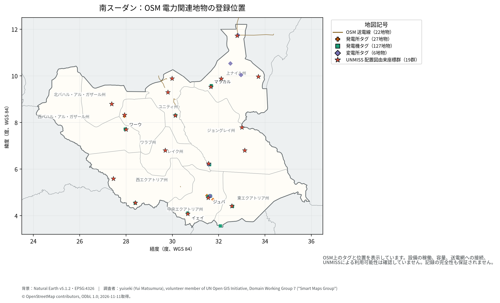
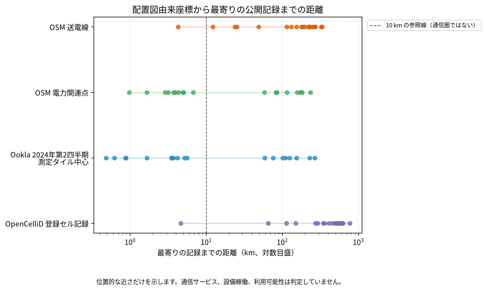

# 南スーダンの UNMISS 配置図と公開通信・電力データの空間的照合

> 調査者：yuiseki (Yui Matsumura), volunteer member of UN Open GIS Initiative, Domain Working Group 7 ("Smart Maps Group")
>
> **注記**: 本報告は、UN Open GIS Initiative, Domain Working Group 7 "Smart Maps Group" のボランティアメンバーである yuiseki (Yui Matsumura) による非商用調査研究として実施・執筆されたものです。

## 問い

2024年の UNMISS 配置図から抽出された座標群の周辺に、公開通信・電力データの記録がどの程度あるかを照合し、そこから言える範囲を確認する。

## 結論

照合したのは実際の基地や利用可能なサービスではなく、配置図から抽出された座標群と、各データベースに登録された記録との距離です。2024年10月25日付の配置図から得た記録は、座標を小数第4位で丸めると19群・77レコードになりました。原データは自動抽出で正確性を保証せず、`nearest_text` は地名の手がかりにすぎません ([un-pko-deployments.md](../../../.agents/skills/dataset-discovery/references/huggingface/yuiseki/un-pko-deployments.md))。

OpenCelliD の固定版には MCC 659 の登録セルレコードが554件 (GSM 550件、LTE 4件) あり、配置図座標から最寄りレコードまでの距離中央値は454.120 km、最大は768.025 kmでした。10 km以内にレコードがある座標群は1群です ([opencellid_summary.csv](outputs/opencellid_summary.csv), [opencellid_record_proximity_summary.json](outputs/opencellid_record_proximity_summary.json))。これは OpenCelliD 上の登録状況を示すだけで、基地局の実数・稼働・電波到達・通信サービスの有無は示しません。

一方、2024年第2四半期の Ookla モバイル測定タイル中心点は、19座標群のうち11群から10 km以内にありました ([observation_proximity_audit.json](outputs/observation_proximity_audit.json))。OpenCelliD の記録分布と Ookla の測定記録が一致しない地域があることは分かりますが、タイル中心点が配置地点の正確な位置や、継続的な接続可能性を証明するわけではありません。2026年取得の OSM 電力データでも、電力関連点が10群、送電線が1群で10 km以内に記録されています。これも設備の稼働や UNMISS による利用可能性を示すものではなく、配置図との時点も一致していません ([observation_proximity_audit.json](outputs/observation_proximity_audit.json))。

したがって、この分析から「地方拠点は通信圏外／完全なオフグリッド」「`unvt/portable` が唯一の実用解」とは結論できません。言えるのは、公開データの記録が空間的に食い違い、拠点単位のサービス利用可能性をこれらの資料だけでは確定できないことです。

### 地図の事前配布に向けた速度の探索

観測されたタイルの平均下り速度の中央値は、ジュバ中心から10 km以内で8.307 Mbps、その他で8.756 Mbpsでした。各タイルをテスト数で加重した平均では、それぞれ19.842 Mbps、10.210 Mbpsです。集計方法によって比較の見え方が変わり、都市と地方の一般的な速度差は判定できません ([speed_comparison.json](outputs/speed_comparison.json))。

中央値の速度が途切れず続くと仮定すると、1 GB（10億バイト）の転送に必要な理想時間は、ジュバ周辺で約16.1分、その他で約15.2分です。これは実際のダウンロード時間ではなく、通信の途切れ、混雑、サーバー、端末、データ料金は含みません ([speed_comparison.json](outputs/speed_comparison.json))。

線は測定タイルをそれぞれ1票とした累積分布です。ジュバ周辺は91タイル・477テスト、その他は61タイル・247テストです。測定のない場所は含まれず、利用者や地域全体を代表する標本ではありません ([speed_comparison.json](outputs/speed_comparison.json))。配置図由来の各座標から最近傍のタイルまでの距離と、そのタイルの速度・テスト数は [一覧](outputs/nearest_observed_speed_by_map_coordinate.csv) に残しました。座標の名前と位置は未検証で、近くのタイルの速度は拠点内の速度ではありません。

### 日本の首都圏との比較

同じ四半期・同じ公開ファイルの測定タイルを、都市中心からの距離で比べました。東京の半径50 kmは首都圏の便宜的な近似であり、行政上の境界とは異なります。

| 範囲 | 測定タイル数 / テスト数 | タイル平均下り速度の中央値 | 1 GBの理想転送時間 | 根拠 |
|---|---:|---:|---:|---|
| 東京中心から10 km以内 | 1,102 / 26,943 | 81.899 Mbps | 1.63分 | [集計](outputs/capital_speed_comparison.json) |
| 東京中心から50 km以内 | 10,269 / 90,868 | 54.729 Mbps | 2.44分 | [集計](outputs/capital_speed_comparison.json) |
| ジュバ中心から10 km以内 | 91 / 477 | 8.307 Mbps | 16.05分 | [集計](outputs/capital_speed_comparison.json) |

観測された範囲では、ジュバ周辺の分布は東京の両範囲より低速側です。いずれもタイル平均を1タイル1票とした比較であり、個々の速度テストや通信不能地点の分布ではありません。東京の50 kmと10 kmは重複します。テスト数による加重平均や四分位数も[集計](outputs/capital_speed_comparison.json)に残しています。

### 配置図の各座標と首都圏の比較

配置図の19座標群をすべて並べ、10 km以内に測定タイルがある11群だけ速度と時間を示しました。残る8群の未表示は圏外や通信不能を意味しません ([図の記録](outputs/site_observed_speed.json))。各座標は自動抽出され、横の名前も近くの文字列であってサイト名とは限りません。橙色は最寄りの単一タイルの平均、青色は東京中心50 km以内の複数タイルの中央値です。座標で実測した速度ではなく、棒に添えた距離と測定回数の範囲で解釈してください。

100 MBは1億バイトとし、棒の速度が途切れず続くと仮定して時間を算出しました。横軸は0から始まる線形軸です。中断、混雑、サーバー性能や端末性能を含まないため、実際のダウンロード時間ではありません ([計算結果](outputs/site_transfer_comparison.csv))。

### 地図配布方式への含意

[UNVT Portable](https://github.com/unvt/portable/tree/a3e0c6d8004661ae2a3aa78b516e10885ae82815) は、事前に用意した地図を Raspberry Pi のローカルネットワークからブラウザーへ配信する方式です。[unvt-offgrid](https://github.com/yuiseki/unvt-offgrid/tree/ac9e17207894d4f3e1978f5b3cf0a25548f10cf5) は、PMTiles を事前に各ブラウザーの OPFS に取得し、取得後はオフラインで使用します。後者は途中再開に対応しますが、サーバーが Range を無視した場合は最初から取得し直します。端末の保存容量・ブラウザー対応・電力が必要で、保存の永続化は要求しても保証されません。確認した版の地域カタログは日本の関東の実証用で、南スーダン用のデータ準備や動作は確認していません。

観測された速度は、一部で事前ダウンロードが成立しうることと整合しますが、現場で安定して取得できることを示しません。拠点に到着する前に端末へデータを入れる運用も考えられ、通信が弱いことだけで `unvt-offgrid` が成立しないとは言えません。一方、事前に準備した Portable を現地へ運べば、各端末がインターネットから大容量データを取得せずに共有できる可能性があります。両方式とも現地の電源と機器の運用条件は別途必要です。両者の優劣は、現地での接続・電力・端末と運用の実測なしには決められません。

次に必要なのは、拠点と活動地域の双方で、複数時刻・複数回線の実効速度、切断と再開、料金、電源の稼働時間、端末の空き容量を確かめることです。事前取得した端末を持ち込む場合、Portable を持ち込む場合、拠点で取得する場合について、同一の地図データと利用人数で準備時間・配布時間・失敗を記録すれば、方式の選択を現場の条件に近づけられます。

## 要点

| 項目 | 値 | 根拠 |
|---|---:|---|
| 配置図由来の座標群 / 抽出レコード | 19群 / 77件 | [opencellid_record_proximity_summary.json](outputs/opencellid_record_proximity_summary.json) |
| OpenCelliD MCC 659 登録セルレコード | 554件 (GSM 550、LTE 4) | [opencellid_summary.csv](outputs/opencellid_summary.csv) |
| 最寄り OpenCelliD レコード距離 | 中央値 454.120 km、最大 768.025 km | [opencellid_record_proximity_summary.json](outputs/opencellid_record_proximity_summary.json) |
| 10 km以内の記録数 (OpenCelliD / Ooklaタイル / OSM電力関連点 / OSM送電線) | 1 / 11 / 10 / 1 群 | [observation_proximity_audit.json](outputs/observation_proximity_audit.json) |
| Ookla モバイル測定タイル / テスト数 | 152 / 724 | [summary_metrics.json](outputs/summary_metrics.json) |

## 可視化

### 記録地点の地図

この地図は登録されたセル位置と配置図から自動抽出された座標群を、Natural Earth の国境・州境・都市名と合わせて示します。登録位置は基地局の実数、稼働、電波到達、サービス可用性を示しません。

2024年第2四半期の測定地点を示します。未観測地域は速度ゼロではなく、配置地点での通信品質も保証しません。地図上の Ookla データは CC BY-NC-SA 4.0 の非商用利用条件で掲載しています。

OSMに登録された送電線・電力関連点の位置です。地物の稼働、容量、送電網への接続、UNMISSからの利用可能性は確認していません。

### 距離の補助図

距離は各データベース内の記録への幾何学的な近さです。サービス提供、設備稼働、現場からの利用可能性を表しません。OpenCelliD は固定スナップショットから抽出した登録セルに対する WGS84 楕円体測地線距離です。

色は各タイルの平均下り速度、点は観測タイル中心です。点のない場所は未観測であり、速度ゼロやサービス不存在ではありません。空間補間はしていません。

## データ

- **UN PKO 配置点**: `yuiseki/un-pko-deployments` 固定版 `528afe3d…`。2024年版のうち `map_date=20241025` を使用。PDFから自動抽出された点で正確性保証なし。日付はPDF作成日で、配置状況の基準日とは限らない。
- **OpenCelliD**: `yuiseki/opencellid` 固定版 `82e4acdb…`、2026-10-06スナップショット。MCC 659 の554レコード。位置はコミュニティ測定による推定で、測量されたアンテナ位置・稼働状態ではない。`range` と `samples` は行ごとに保持したが、網羅性を検証する参照目録はない。元データと座標抽出は CC BY-SA 4.0 ([データカード](../../../.agents/skills/dataset-discovery/references/huggingface/yuiseki/opencellid.md))。
- **Ookla Speedtest Global Performance**: 2024年第2四半期の南スーダン内モバイルタイル。152タイル、724テスト。AWS Registry の説明では、アプリ由来の測定を約610 m（赤道上）のタイルに集計したデータで、ライセンスは CC BY-NC-SA 4.0 です ([AWS Open Data Registry](https://registry.opendata.aws/speedtest-global-performance/))。図中の表記は「Speedtest by Ookla® Global Fixed and Mobile Network Performance Maps. Based on analysis by Ookla of Speedtest Intelligence® data for 2024 Q2; accessed 11 November 2026. CC BY-NC-SA 4.0; trademarks used under license and reprinted with permission.」です。`devices` の合計255はタイルごとの値の合計で、全国の重複排除済み端末数とは解釈しない。
- **OSM / OpenInfraMap 電力関連データ**: 2026-11-11取得。送電線22地物、電力関連点160地物。点には `plant`、`generator`、`substation` が混在する。UNMISS配置図より後の時点で、完全性・稼働・接続可能性は未確認。© OpenStreetMap contributors、ODbL 1.0 ([著作権とライセンス](https://www.openstreetmap.org/copyright))。
- **地図の背景**: Natural Earth v5.1.2 (2022年版) の国境・州境・都市データ。Public Domain、EPSG:4326 ([固定データカード](../../../.agents/skills/dataset-discovery/references/huggingface/yuiseki/natural-earth.md))。
- **補助資料**: [GSMA の南スーダン携帯通信報告](https://www.gsma.com/solutions-and-impact/connectivity-for-good/public-policy/wp-content/uploads/2026/01/Mobile-Sector-Tax-South-Sudan-v2.pdf) は、2024年のモバイルブロードバンド圏外人口を本文では22%、図では23%と記載し、記載値が一致しない。また、圏内でもモバイルインターネットを利用していない人の割合、データ料金の負担を推計している。全国人口の推計であり、UNMISSの回線、拠点、活動地域を代表しない。加入・利用率は4Gカバレッジ率ではない。
- World Bank の「携帯電話契約数（人口100人当たり）」は、人口カバレッジ率や配置地点の利用可能性と同じ指標ではありません ([World Bank 指標ページ](https://data.worldbank.org/indicator/IT.CEL.SETS.P2))。既存 WDI 出力はこの空間照合の結論には使っていません。全国平均を配置地点の状態へ読み替えないため、報告の根拠から外しました。

## 方法

2024-10-25付配置図の点を経度・緯度の小数第4位でまとめ、座標群ごとに記録数を集計した。`nearest_text` は確認済みサイト名ではなく、図上に近接する文字列として扱う。固定 OpenCelliD 全体から MCC 659 の554行を抽出し、WGS84 楕円体上の測地線距離を再計算した。10 km と25 kmは記録の近接を数える便宜的な閾値で、通信可能範囲を意味しない。OSM地物とOoklaタイル中心点への距離は EPSG:32636 で計算した。地図背景は Natural Earth v5.1.2 (2022年版) の境界・地名、EPSG:4326。点・線は各ソースの記録位置を示し、サービス範囲は補間していない。2024年の配置図、2024年第2四半期のOokla、2026年のOSMは時点が異なるため、同時点の状態比較ではない。

Ookla図は保存済みタイルの観測値だけを描き、従来の未検証RBF内挿面を表示しない。OpenCelliD の再計算は保存済み成果物ではなく、固定版から改めて抽出した554レコードを使った。従来の `legacy_unmiss_site_cellular_distance.csv` にあった OpenCelliD 距離は度ベース近似であるため、この報告では再計算値に置き換え、旧値を根拠に使わない。この `legacy_` ファイルは、保存済み OSM / Ookla 投影距離から近接数を再集計するためだけに残している。

今回の checkout には WDI・PKO 等の入力キャッシュが無いため、全工程の再実行はしていない。固定版 OpenCelliD から MCC 659 を抽出して測地線距離を再計算し、Ookla・OSMの距離はコミット済み成果物の投影距離を使って記録近接数を再集計した。したがって、後者は保存済み入力の再検証であり、2026年の元 OSM 抽出からの再構築ではない。

速度比較は既存の南スーダン抽出結果と Natural Earth v5.1.2 の Juba 都市点を用い、タイル中心から WGS84 測地線距離で10 km以内とそれ以外に分けた。20 kmでも中央値の順位は変わらず、ジュバ周辺8.224 Mbps・その他8.950 Mbpsだった ([speed_comparison.json](outputs/speed_comparison.json))。加重平均はタイル平均をテスト数で重み付けし、中央値は各タイルを等重みとした。集計済みタイルから個々の速度分布や通信方式（4G/5G）は分からない。計画は結果を見た後の探索であり、近接タイル一覧は比較結果を見て追加した ([EXPERIMENT_PLAN.md](EXPERIMENT_PLAN.md), [EXPERIMENT_TRACKER.md](EXPERIMENT_TRACKER.md))。

東京との比較では、2026-11-11に同一の Ookla 公開ファイルから両都市の周辺を抽出し、Natural Earth の Tokyo と Juba の都市点からタイル中心までの WGS84 測地線距離で選択した。1 GBは10億バイトとし、中央値の速度が継続する場合の時間を計算した。ジュバ周辺の集計は既存抽出と一致した。都市中心の半径は恣意的な近似で、端末、測定時刻、事業者、測定者は都市間で揃えていない。

## 失敗の型

| ID | 判定 | 根拠 |
|---|---|---|
| F1 | 確かめた | 配置座標群19、抽出レコード77、OpenCelliD MCC 659の554件を照合。出力行数は各リンク先を参照。 |
| F2 | 当てはまらない | 予測モデルを学習していない。 |
| F3 | 当てはまらない | 将来予測・交差検証を行っていない。 |
| F4 | 確かめていない | F4: 地域差とデータベースの記録・観測努力の差を分離できていない。 |
| F5 | 確かめていない | F5: OpenCelliD、Ookla、OSMは独立の完全な参照データではなく、相互一致を真値として扱えない。 |
| F6 | 確かめた | OpenCelliD距離を WGS84 Geod により再計算し、従来の度ベース近似を報告根拠から外した。 |
| F7 | 確かめていない | F7: 時点差、配置点の位置誤差、近接閾値の選択に対する頑健性は未評価。 |
| F8 | 確かめた | 数値は出力ファイルに対応づけた。これは転記整合性の確認で、データの真実性を保証しない。 |
| F9 | 確かめた | 各データの固定版・取得時点を記録し、時点差を明示した。 |

## 確かめていないこと

- F4/F5: 実際の通信事業者カバレッジ、基地局の稼働、現地での信号強度・速度・接続安定性。データベースの網羅性と記録努力。
- 配置図抽出点が個々の実際の駐屯地を示すか、`nearest_text` が正しい地名か。座標群の位置誤差が最近傍判定へ及ぼす影響。
- F7: OSM電力地物の稼働状態、容量、送電網への接続、UNMISS側の利用権・実際の電源、近接閾値を変えたときの頑健性。
- UNMISSの衛星回線、ミッション内ネットワーク、ローカルキャッシュ等の運用。これらを比較していないため、オフライン配信方式の優劣や必要性は判断していない。
- 通信テストは速度計測アプリを利用した人の選択的な記録で、未観測や低速時の接続失敗を代表しない。測定期間の各時刻での速度、安定性、料金、4G/5G別の品質とカバレッジ、拠点や活動地域内での品質、現地電源や端末、実際のダウンロード完了率は未確認。過去の観測を現在の性能とは扱わない。
