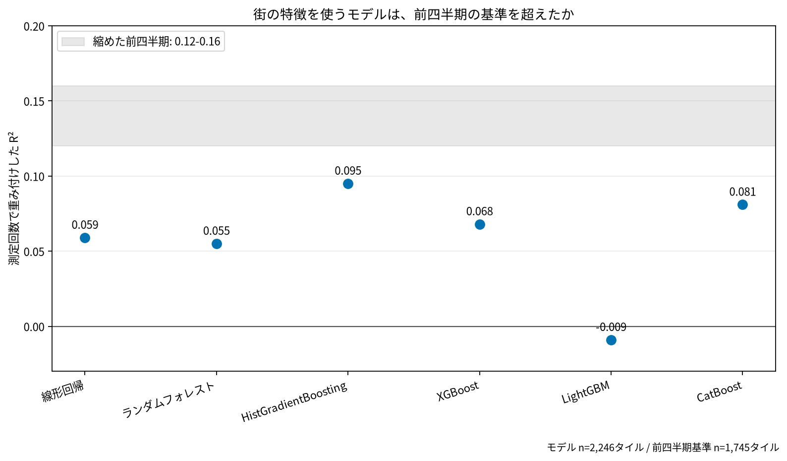

# 東京23区の携帯通信速度予測

## 問い

人口、建物、POI、街路、基地局などの公開データから、測定の無い場所の携帯の下り速度を推定し、通信環境を良くすべき場所を絞れるか。

## 結論

### 要点

| # | 要点 | 数字 | 図 |
|---:|---|---|---|
| 1 | 街の特徴から速度を予測する力は弱い | どの単独のモデルも R² 0.1 未満 (最良は HistGradientBoosting の0.095)。最良の組み合わせでも0.175 | [図 1](#図-1-モデルごとの-r²) |
| 2 | 同じ場所の前の四半期の速度でも、ほとんど当たらない。目的変数の雑音が上限を決めている | 平均へ縮めた前四半期の R² は0.12〜0.16。測定回数の少ないタイルほど誤差が大きい | [図 1](#図-1-モデルごとの-r²) |
| 3 | 測定の無い場所を想定すると、さらに当たらない | 時間と空間で分けた評価では、どのモデルも R² 0.08以下 | 移植元の事例 |
| 4 | 次に要るのは複雑なモデルではなく、別のデータ | 事業者別の速度、測定の多い地点、基地局の実際の位置と混雑 | |

### 読み手ごとに知るべきこと

| 読み手 | 結論 | 検討する材料 | 詳しく |
|---|---|---|---|
| 通信の改善の候補を選ぶ担当 (自治体、事業者) | 公開の街の特徴だけで、設備投資の候補を高い精度で順位付けすることはできない | 測定の多い地点の実測、事業者が持つ混雑のデータ | [図 1](#図-1-モデルごとの-r²) |
| 予測モデルを作る担当 | モデルを複雑にしても、前の四半期の速度 (0.12〜0.16) を大きく超えない | 測定回数で重みを付けた評価、時間と空間を分けた評価 | 移植元の事例 |

### 図 1: モデルごとの R²

点は街の特徴を使うモデルの R² (測定回数で重み付け、2,246タイル)。線形回帰0.059、ランダムフォレスト0.055、XGBoost 0.068、CatBoost 0.081、LightGBM −0.009。灰色の帯は、平均へ縮めた前の四半期の速度の R² の範囲 (0.12〜0.16、1,745タイル) で、推定の区間ではない。どのモデルも帯に届かない。

### 読み方で変わる答え

| 読み方 | 主 | 別の読み方 |
|---|---|---|
| 評価の分け方 | ランダム分割、最良0.175 (組み合わせ) | 時間と空間を同時に分けると、どのモデルも0.08以下 |
| 比べる基準 | 前の四半期の速度 (0.12〜0.16) | 全体の平均、地域の平均 |
| 重み | 測定回数で重み付け | 重みなしでは、測定の少ないタイルの雑音が効く |

## データ

- Ookla Speedtest の東京23区2,246タイル (ズーム16、約610m四方)。中央値93 Mbps。
- OpenCelliD の86,795セル。周りの環境の特徴は WorldPop、Overture、みちよみなどから作った。
- 数字は移植元が2026-09-29にまとめた実験の結果。元データの版は未確認で、データ本体はこのプロジェクトに複製していない。
- 移植元: [`study-geoai-algo-py` 事例001 (commit 6880b32)](https://github.com/yuiseki/study-geoai-algo-py/blob/6880b32c097a7c65a6bd72a38682ce1dce1c9a2b/case-studies/001-mobile-speed/README.md)。

## 方法

- 線形回帰、ランダムフォレスト、勾配ブースティングの数種を、ランダム分割、空間のブロック、時間の分割、時間と空間の同時の分割で比べた。
- 全体の平均、地域の平均、前の四半期、平均へ縮めた前の四半期を基準にし、測定回数で重み付けした R² で評価した。3つの四半期をまとめた目的変数、基地局の特徴の追加、分割の乱数による揺れも比べた。
- 図は元の事例の数字を [source-values.csv](outputs/source-values.csv) に写し、[plot.py](scripts/plot.py) で描いた。

## 確かめていないこと

- 事業者別の速度、端末、時間帯、基地局の実際の位置と混雑を使ったときの改善の余地。
- 分析は実行し直しておらず、数字は固定した元の報告から写した。
- 場所ごとの残差。どこで外れるかの地図は、元のリポジトリにも生成済みの画像が無い。
