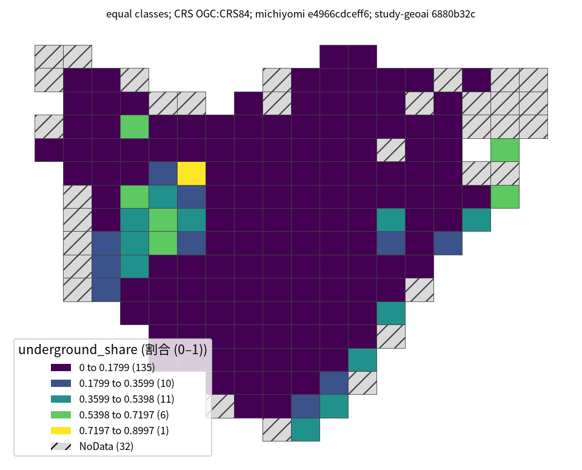

# 街路画像による無電柱化分類

## 問い

無電柱化の記録が無い道路について、街路画像から整備済みかを推定し、現地調査や整備状況の確認の候補を絞れるか。

## 結論

### 要点

| # | 要点 | 数字 | 図 |
|---:|---|---|---|
| 1 | 道の見た目から、無電柱化はかなり分類できる。新しい場所に当てると下がる | 台東区でランダム分割の AUC 0.931、2kmブロックで0.870 ([source-values.csv](outputs/source-values.csv)) | [図 1](#図-1-評価の分け方と-auc) |
| 2 | 23区全体では、場所を分けても AUC がほぼ落ちない | ランダム0.894、2kmブロック0.892、区単位0.887 ([source-values.csv](outputs/source-values.csv)) | [図 1](#図-1-評価の分け方と-auc) |
| 3 | 電柱の数は答えの言い換えで、特徴にできない | 電柱の数を入れると AUC 0.849が0.988になる。街灯の数にも間接の漏れの疑い ([source-quotes.json](outputs/source-quotes.json)) | 移植元の事例 |
| 4 | 近所の正解率を使う特徴は、空間で分けて正しく作ると、無いときより悪い | ランダム分割では高い得点になる | 移植元の事例 |
| 5 | 台東区の中で、無電柱化と読まれたシーンの割合は格子で大きく違う | 判定できる163格子のうち、等間隔で135格子が0〜約18%。値0の格子が63 ([map-summary.json](outputs/map-summary.json)、[taito-underground-share.json](outputs/taito-underground-share.json)、[taito-underground-share-quantile.json](outputs/taito-underground-share-quantile.json)) | [図 2](#図-2-台東区の無電柱化シーンの割合) |

確率として優先順位に使うなら、AUC だけでなく較正が要る。isotonic 較正で ECE は0.005以下に保たれた (移植元の事例、[source-quotes.json](outputs/source-quotes.json))。

### 読み手ごとに知るべきこと

| 読み手 | 結論 | 検討する材料 | 詳しく |
|---|---|---|---|
| 道路の整備状況を確かめる担当 | 新しい場所での AUC は0.87〜0.89。候補を絞る目安には使えるが、正解は VLM の読み取りで、台帳ではない | 割合が高い格子と、判定できない32格子 | [図 2](#図-2-台東区の無電柱化シーンの割合) |
| 分類モデルを作る担当 | 電柱の数、近所の正解率のような漏れる特徴を外し、空間で分けて評価する | 2kmブロックと区単位の分け方 | [図 1](#図-1-評価の分け方と-auc) |

### 図 1: 評価の分け方と AUC

台東区では、ランダム0.931、撮影系列0.927、250m格子0.924、1kmブロック0.889、2kmブロック0.870と、分け方が場所から離れるほど下がる。23区では0.887〜0.894でほぼ同じ。台東区を試験にした23区のモデルは0.890。縦軸は偶然 (0.5) から完全 (1.0) までで、差を拡大していない。

### 図 2: 台東区の無電柱化シーンの割合

250m格子ごとの、判定できたシーンのうち無電柱化と読まれた割合。道路の延長に対する整備率ではない。195格子のうち、シーンが30以上の163格子を塗り、32格子は斜線の NoData ([map-summary.json](outputs/map-summary.json))。同じ値を分位の5階級で塗った図 ([分位の図](outputs/taito-underground-share-quantile.png)) と比べると、多くの格子の色が変わる (変わった格子の割合は出力に残していない)。値0の格子が63あり、分位の色ごとの数は揃わない。色だけで厳密な順位や施策の対象を決めない。

### 読み方で変わる答え

| 読み方 | 主 | 別の読み方 |
|---|---|---|
| 評価の分け方 (台東区) | 2kmブロック0.870 | ランダム0.931 |
| 特徴 | 電柱の数を除く (0.849) | 入れると0.988。答えの言い換え ([source-quotes.json](outputs/source-quotes.json)) |
| 近所の正解率の特徴 | 空間分割で作り直す (無いより悪い) | ランダム分割では高い得点 |
| 地図の階級 | 等間隔5階級 | 分位5階級で多くの格子の色が変わる (割合は出力に残していない) |

## データ

- みちよみの Mapillary 街路画像を VLM が読み取ったデータ。欠損と隔離を除き、台東区32,593シーン、23区988,619シーン。配布データの版は未確認。
- 無電柱化と読まれた割合は台東区11.6%、23区21.4%。
- 目的変数と特徴が同じ VLM の読み取りから来ている。正解は現地で確かめた無電柱化の台帳ではない。
- 移植元: [`study-geoai-algo-py` 事例003 (commit 6880b32)](https://github.com/yuiseki/study-geoai-algo-py/blob/6880b32c097a7c65a6bd72a38682ce1dce1c9a2b/case-studies/003-undergrounding/README.md)。

## 方法

- ロジスティック回帰、決定木、ランダムフォレスト、XGBoost、TabPFN を、AUC、ECE、Brier スコアで比べた。ランダム、撮影系列、250m格子、1kmと2kmのブロック、区単位、時間の分け方で、空間と時間の漏れを調べた。分割の外の SHAP、部分依存、特徴の重要度を照らした。
- 図 1 は元の事例の AUC を [source-values.csv](outputs/source-values.csv) に写し、[plot.py](scripts/plot.py) で描いた。表に無い元の事例の値は、[quote_source.py](scripts/quote_source.py) が固定コミットの元の README から行ごと引用して [source-quotes.json](outputs/source-quotes.json) に書き出す。
- 図 2 は、判定できたシーンが30以上の格子だけを塗る ([reproduce_map.py](scripts/reproduce_map.py) の MIN_SCENES)。格子の数は [summarize_map.py](scripts/summarize_map.py) が [map-summary.json](outputs/map-summary.json) に書き出す。
- 図 2 は元のコードの `tasks.undergrounded` と250m格子の定義を [reproduce_map.py](scripts/reproduce_map.py) で実行し直し、`analysis-visualize` の `classify_map.py` で描いた。座標は OGC:CRS84。階級と件数は [taito-underground-share.json](outputs/taito-underground-share.json)。

## 確かめていないこと

- VLM の読み取りと実際の無電柱化の一致。街灯の数が電柱の代わりになっているか。
- AUC の評価と SHAP は実行し直していない。地図の集計だけ実行し直した。
- 格子の中の撮影の位置と年の偏り、格子の幅や30シーンの閾値を変えたときの頑健さ、現地の台帳との照合。
- 地図の割合の高さは、工事の効果や予測の精度を意味しない。
