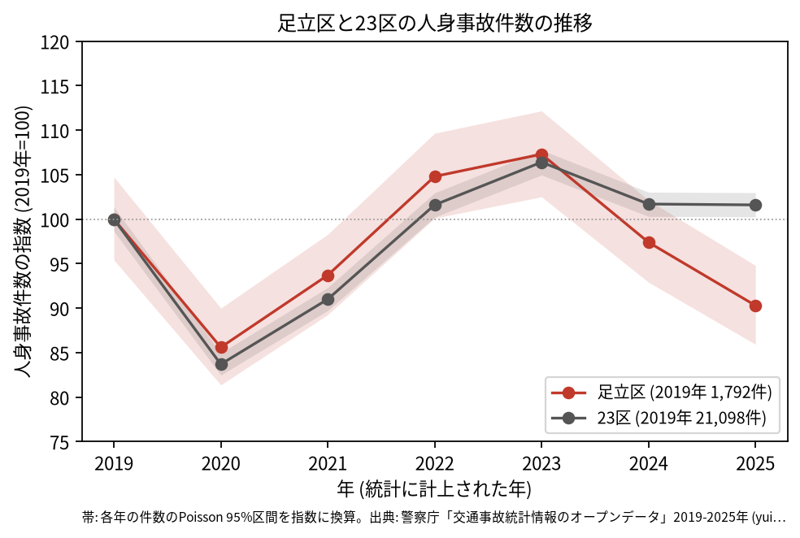
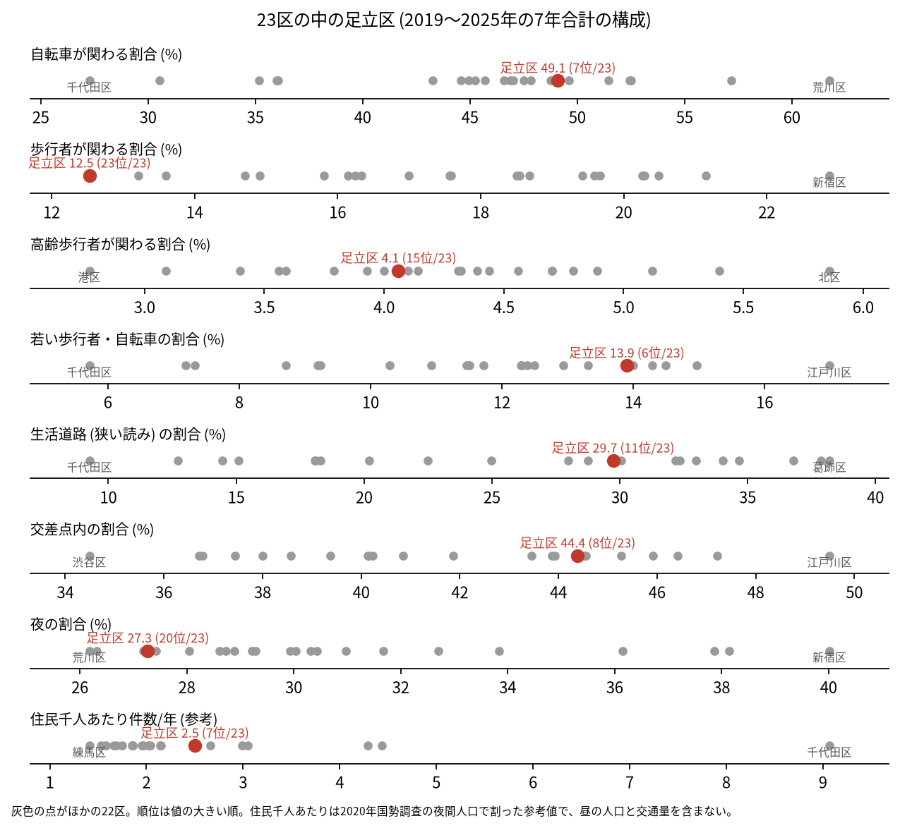
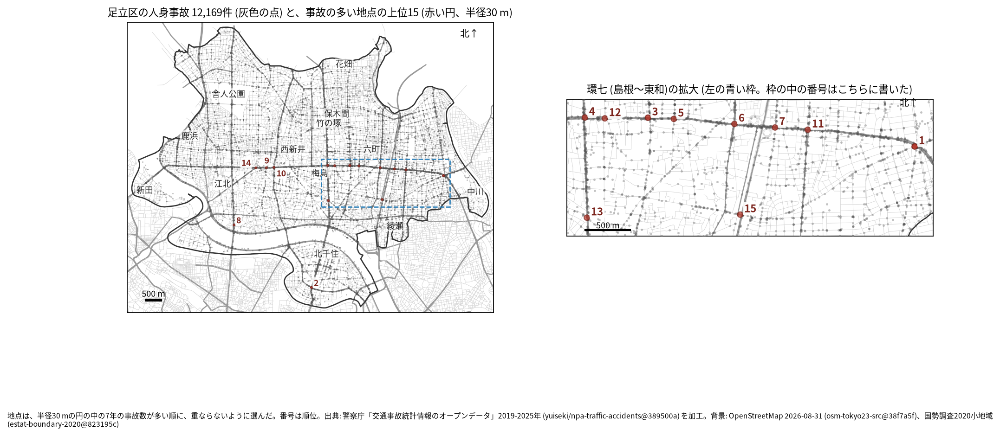
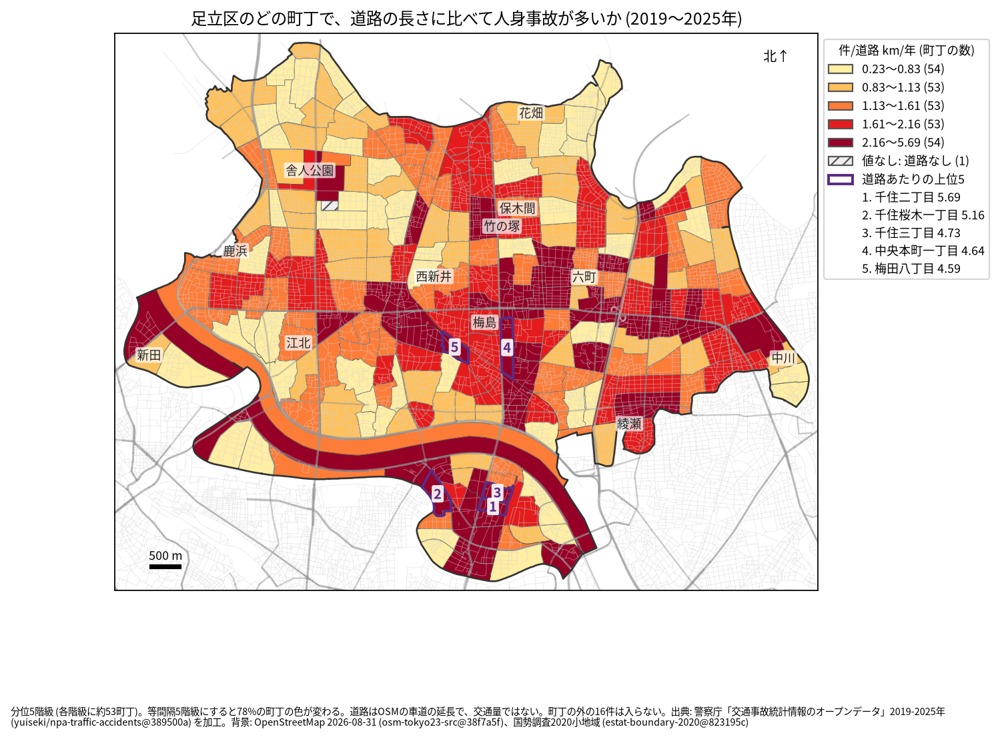
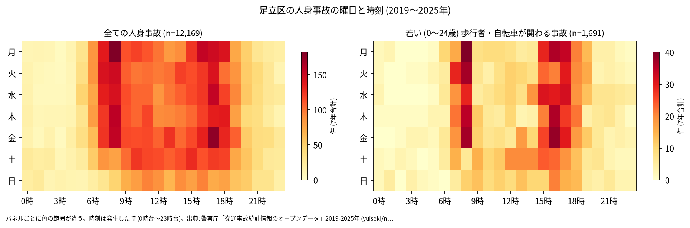
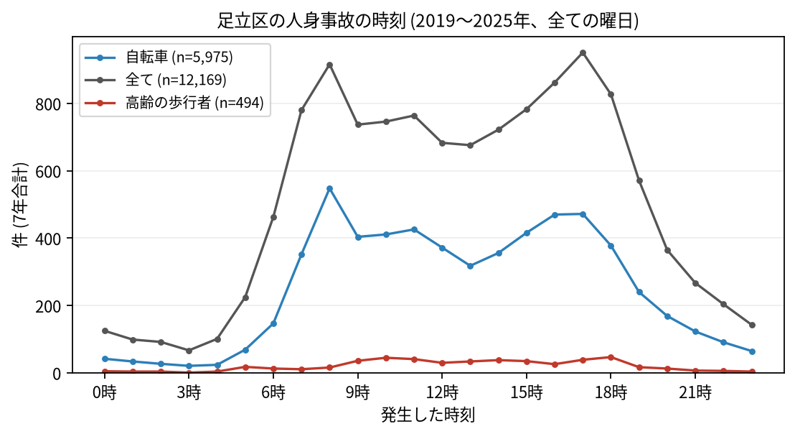
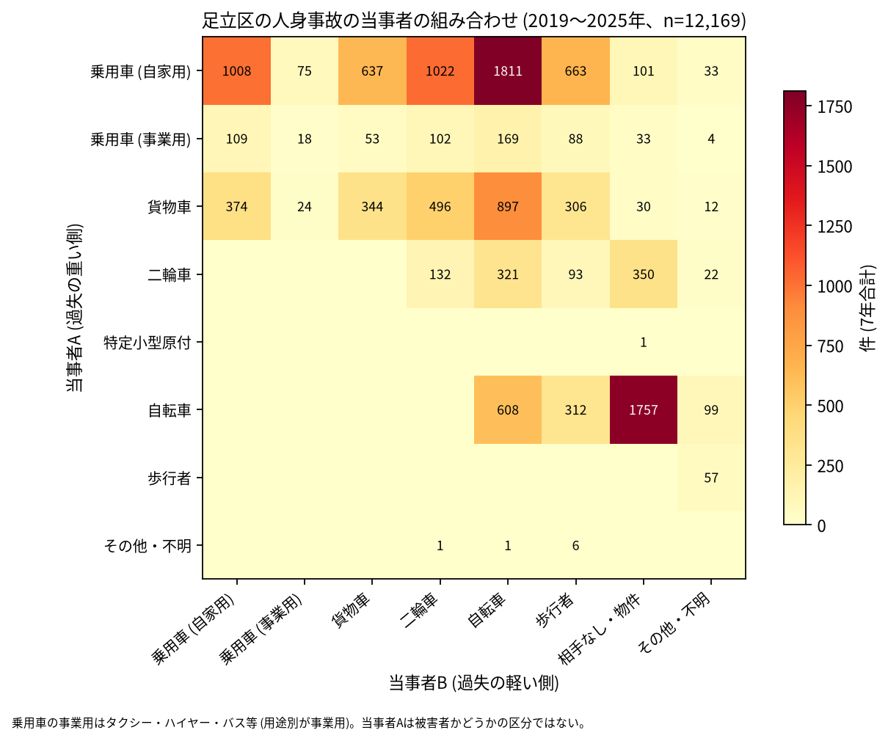

# 足立区の交通事故 2019〜2025 年: 図で読む要点

## 問い

2019〜2025 年の警察記録の人身事故で、足立区の事故はいつ、どこで、誰が関わって起きているか。

## 結論

### 要点

| # | 要点 | 数字 | 図 |
|---:|---|---|---|
| 1 | 件数は 2020 年に減り、2023 年に 2019 年を上回った後、2025 年は 2019 年より少ない | 7 年で 12,169 件、死者 59 人、負傷者 13,473 人。指数 (2019 年=100) は 2020 年 85.6、2023 年 107.3、2025 年 90.3。2025 年の区間 1540.1〜1698.8 件は 2019 年の 1710.0〜1876.9 件と重ならない ([yearly.csv](outputs/yearly.csv)、[summary.txt](outputs/summary.txt)) | [図 1](#図-1-件数の推移) |
| 2 | 事故の半分に自転車が関わり、歩行者の関わる割合は 23 区で最も低い | 自転車 49.1% (23 区の 7 位)、歩行者 12.5% (23 位)、若い歩行者・自転車 13.9% (6 位) ([wards.csv](outputs/wards.csv)、[analysis.json](outputs/analysis.json)) | [図 2](#図-2-23-区の中の足立区) |
| 3 | 事故の多い地点は環七通りに並ぶ | 上位 15 のうち 10 地点で、中心に最も近い道が環七通り。最多は環七通り × 王子金町市川線の 37 件 ([summary.txt](outputs/summary.txt)、[hotspots.csv](outputs/hotspots.csv)) | [図 3](#図-3-事故の集まる地点) |
| 4 | 自転車の単独の事故が多い | 当事者 A が自転車で B が相手なし・物件の事故が 1,757 件で、自家用の乗用車と自転車の 1,811 件に次ぐ ([party_matrix.csv](outputs/party_matrix.csv)) | [図 6](#図-6-誰と誰の事故か) |
| 5 | 死亡事故では歩行者と、当事者 A の貨物車が多い | 死亡事故 59 件で亡くなった歩行者 26 人 (65 歳以上が 17 人)。当事者 A が貨物車の事故が 25 件 ([summary.txt](outputs/summary.txt)) | [表 1](#表-1-死亡事故) |

### 読み手ごとに知るべきこと

| 読み手 | 結論 | 検討する材料 | 詳しく |
|---|---|---|---|
| 区の交通安全担当 | 生活道路の法定速度 30 km/h (2026-09-01 から) が当たるのは事故の 29.7〜43.8% (読み方による)。地点の上位は環七通りの交差点に並ぶ | 自転車 (単独の事故を含む)、環七通り、高齢の歩行者の死亡事故 | [municipality.md](reports/municipality.md) |
| 学校と PTA | 若い (0〜24 歳) 歩行者と自転車の事故は 1,691 件。平日は 8 時台 (178 件) と 16 時台 (161 件) が多い | 学校の円の中で、平日 7〜8 時台と 14〜17 時台の点が並ぶ道 | [school-pta.md](reports/school-pta.md) |
| 道路安全診断 | 上位は環七通り × 王子金町市川線 (37 件)、日光街道 × 墨堤通り (35 件)、環七通り × 花畑大橋通り (32 件)。半径を変えると上位 15 のうち 8 地点しか残らない | 環七通りの連なる交差点、信号ありが 0 件の 8 位と 12 位 | [road-safety-auditor.md](reports/road-safety-auditor.md) |
| 住民 | 道路あたりで多いのは千住二丁目 (年 5.69 件/道路 km)、千住桜木一丁目 (5.16 件)、千住三丁目 (4.73 件)。事故は 8 時台と 17 時台に多い | 自分の町の色、朝と夕方の自転車、夜の歩行 | [resident.md](reports/resident.md) |

### 図 1: 件数の推移

2020 年の落ち込み (85.6) は 23 区全体 (83.7) とほぼ同じ。2023 年 (107.3) の後に下がり、2025 年 (90.3) は 23 区全体 (101.6) より低い。2025 年の 95% 区間は 2019 年の区間と重ならないので、2025 年は 2019 年より減ったと書ける。年ごとの、コードで数えた件数と面に入る件数の差は 2 件以内で ([analysis.json](outputs/analysis.json))、区への付け方の変化では説明できない。

### 図 2: 23 区の中の足立区

赤い点が足立区。自転車 (7 位) と若い歩行者・自転車 (6 位) が高く、歩行者 (12.5%) は 23 区で最も低い。夜の割合 (27.3%) は 20 位。生活道路は狭い読みで 29.7% (11 位)、広い読みで 43.8% (8 位)。住民千人あたり (2.5 件/年、7 位) は昼の人口を含まない参考値。

### 図 3: 事故の集まる地点

半径 30 m の円の中の 7 年の件数で選んだ上位 15 (22〜37 件)。番号は順位で、環七の島根から東和までの 10 地点は右の拡大図に番号を書いた。

| 順位 | 近い道路 (OSM) | 町丁 | 件数 | 前半 件/年 | 後半 件/年 |
|---:|---|---|---:|---:|---:|
| 1 | 環七通り × 王子金町市川線 | 東和四丁目 | 37 | 6.00 | 4.75 |
| 2 | 日光街道 × 墨堤通り | 千住宮元町 | 35 | 6.33 | 4.00 |
| 3 | 環七通り × 花畑大橋通り | 一ツ家一丁目 | 32 | 4.67 | 4.50 |
| 4 | 環七通り × 日光街道 | 島根一丁目 | 26 | 4.00 | 3.50 |
| 5 | 環七通り | 一ツ家三丁目 | 24 | 4.33 | 2.75 |

前半は 2019〜2021 年、後半は 2022〜2025 年。半径を 20 m にすると上位 15 のうち 8 地点、50 m でも 8 地点しか残らないので、順位は断定しない。6〜15 位は [hotspots.csv](outputs/hotspots.csv)。

### 図 4: 町丁ごとの事故

町丁の事故数を、OSM の車道の延長と 7 年で割った値。紫の枠が上位 5 (千住二丁目、千住桜木一丁目、千住三丁目、中央本町一丁目、梅田八丁目)。分位と等間隔で 78% の町丁の色が変わるので、色の細かい差は読まない。荒川に沿う帯の形の宮城二丁目 (238 件) と鹿浜二丁目 (213 件) は件数では区で最も多いが、面積 (2.0469 km²、2.24 km²) と道路 (15.604 km、19.449 km) も大きい ([towns.csv](outputs/towns.csv))。道路の長さは交通量ではない。

### 図 5: いつ起きるか

全体は平日の朝 8 時台と夕方 16〜18 時台に多く、最多は 17 時台 (951 件)。若い歩行者と自転車は、平日の 8 時台 (178 件) と 16 時台 (161 件) に寄る。

自転車は 8 時台 (548 件) が最多で、17 時台 (472 件) が次。高齢の歩行者は 18 時台 (47 件) と 10 時台 (45 件)。

### 図 6: 誰と誰の事故か

最も多いのは自家用の乗用車 (A) と自転車 (B) の 1,811 件、次が自転車の単独 (相手なし・物件) の 1,757 件、自家用の乗用車と二輪車の 1,022 件。当事者 A は過失の重い側で、被害者とは限らない。

### 表 1: 死亡事故

| 亡くなった人 | 人数 | 特徴 |
|---|---:|---|
| 歩行者 | 26 | 65 歳以上が 17 人 |
| 自転車 | 13 | |
| 二輪車 | 10 | |
| 乗用車 (自家用) | 4 | |
| 貨物車 | 3 | |
| 補充票の人 (当事者 A、B の外) | 3 | |

59 件のうち、当事者 A が貨物車の事故が 25 件、自家用の乗用車が 24 件。0〜5 時台は 16 件、19〜5 時台は 28 件。全件は [deaths.csv](outputs/deaths.csv)。

### 読み方で変わる答え

| 読み方 | 主 | 別の読み方 |
|---|---|---|
| 足立区の事故 | `市区町村コード` が足立区の 12,169 件 | 点が区の面に入る事故。両方に当てはまるのは 12,153 件 ([analysis.json](outputs/analysis.json)) |
| 生活道路 | 狭い読み 29.7% (11 位) | 広い読み 43.8% (8 位) |
| 地点の半径 | 30 m | 20 m で 8 地点、50 m で 8 地点が残る |
| 首都高速の事故 (台東区の型が並べる読み) | 含める | 首都高速の事故は区で 191 件、上位 15 の円には 0 件で、除いても 15 地点が全部残る ([analysis.json](outputs/analysis.json)) |
| 町丁の階級 | 分位 5 階級 | 等間隔で 78% の町丁の色が変わる |

## データ

- 人身事故: 警察庁「交通事故統計情報のオープンデータ」を加工した `yuiseki/npa-traffic-accidents` 版 `389500aae5cec45f1311163f70db6a5f05867838` (配布元の取得 2026-10-02) の本票。年はファイルの年 (統計に計上された年)。足立区 12,169 件、23 区 144,716 件。位置の無い行は 0。物損事故は含まない。
- 区の面と人口: `yuiseki/jp-admin-2026-09` 版 `e6c87b1`。町丁: 2020 年国勢調査の小地域 `yuiseki/estat-boundary-2020` 版 `823195c` (268 町丁、695,043 人)。学校 100 校と道路: OpenStreetMap 2026-08-31、`yuiseki/osm-tokyo23-src-2026-08` 版 `38f7a5f`。
- 道具: DuckDB 2.0.0 (spatial)、matplotlib、`analysis-visualize` の `cjk_font.py`、`classify_map.py`、`context_map.py`。スクリプトは台東区の型 (R014 まで) を写した。
- 出典の表示: 警察庁ウェブサイト (https://www.npa.go.jp/publications/statistics/koutsuu/opendata/index_opendata.html) の交通事故統計情報のオープンデータを加工して作成。国勢調査の小地域境界と人口、OpenStreetMap (© OpenStreetMap contributors) を加工して使用。

## 方法

- 読み方は結果を見る前に [計画](EXPERIMENT_PLAN.md) で固定し (台東区と同じ読み方と規則)、実行は [記録](EXPERIMENT_TRACKER.md) に残した。生活道路は `車道幅員` が 01、02、11 (狭い読み)、広い読みは 14、17 を足す。歩行者や自転車が関わるかは当事者 A と B の両方で見て、1 件を 1 回数えた。
- 距離は EPSG:6677 (メートル) で測った。地点は、半径 30 m の中の件数が最も多い点を中心に選び、その円の事故を除いて次を選ぶ手順を 15 回くり返した。地点の名前は、中心に最も近い道と、それと 30 度以上の向きで交わる 30 m 以内の道のうち最も近い道。
- 町丁の道路あたりの値は、道路が 0.5 km 未満の町丁も塗るが、上位 5 には数えない (足立区では入谷町，舎人町と古千谷二丁目で、どちらも 5 位より下)。道路の無い西伊興町は値なし。
- 地図は `analysis-visualize` の map-context に合わせ、地名と道路を重ね、凡例を地図の外に置き、強調した単位に番号を付けた。描いた町丁の数 (268) を分析の数と照らした。文字の重なりと、地名や番号が円や学校の印を隠す重なりは、3 枚の地図で 0 件 (地名 4 つと番号 3 つの位置を直した後)。背景の道路 (OGC:CRS84) と町丁 (JGD2000) の差は、線の幅より小さいとして変換せずに重ねた。
- 関門: 予測と回帰をしないので、評価の分け方と残差の確認は要らない。単位の間の相関を結論にしないので、Moran's I と格子の掃引は省いた。推移は 23 区全体を基準にし、年の件数に Poisson の 95% 区間を付けた。対策の効果は推定していない。
- 再実行は [README.md](README.md)。数値は [outputs/](outputs/) の CSV、来歴は [analysis.json](outputs/analysis.json)。

## 確かめていないこと

- 交通量、昼の人口で割っていない。環七通りの件数の多さは、車と人の多さかもしれない。
- 位置の精度は分からない。30 m の地点と町丁の境界の近くの事故は、数十 m のずれで入れ替わる。環七通りの地点は 1 本の道に沿って並び、半径で入れ替わりやすい。
- 町丁の道路の延長には首都高速の線も入る。荒川に沿う宮城二丁目と鹿浜二丁目の件数のうち、首都高速の事故がいくつかは数えていない。
- 事故の型 (出会い頭、追突)、重傷と軽傷の区別、物損事故、ヒヤリハットは、このデータに無い。
- 0〜24 歳より細かい年齢は無く、小学生だけは数えられない。
- 地点の上位は 7 年で選び、同じ 7 年で前半と後半を比べたので、後半が下がって見えやすい (平均への回帰)。
